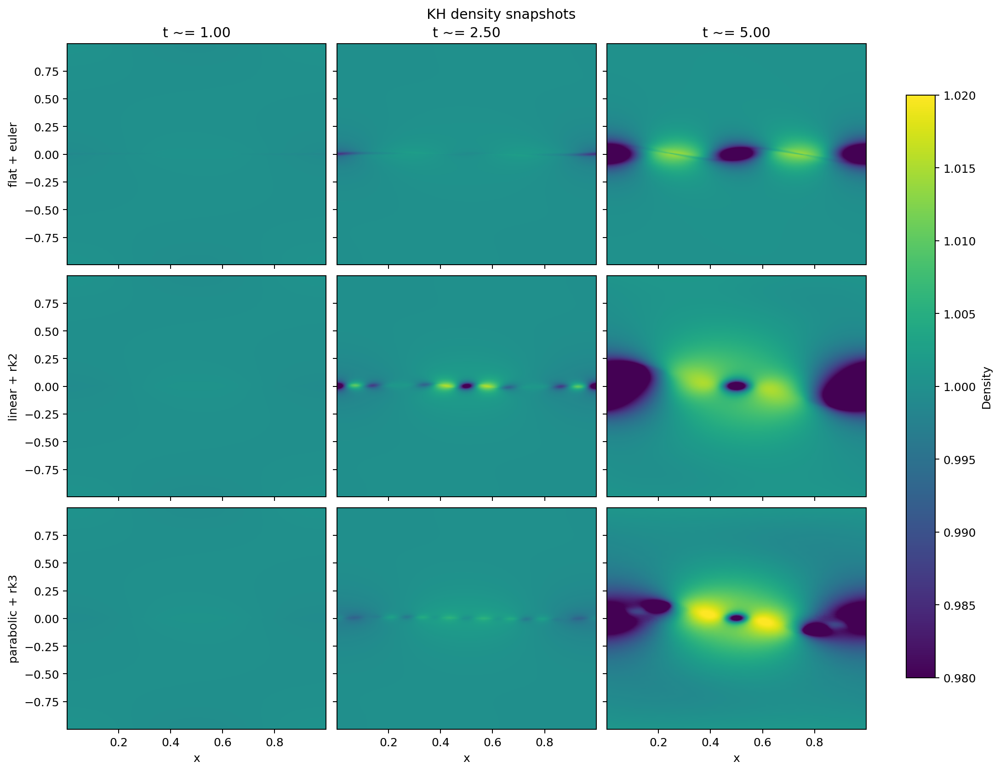
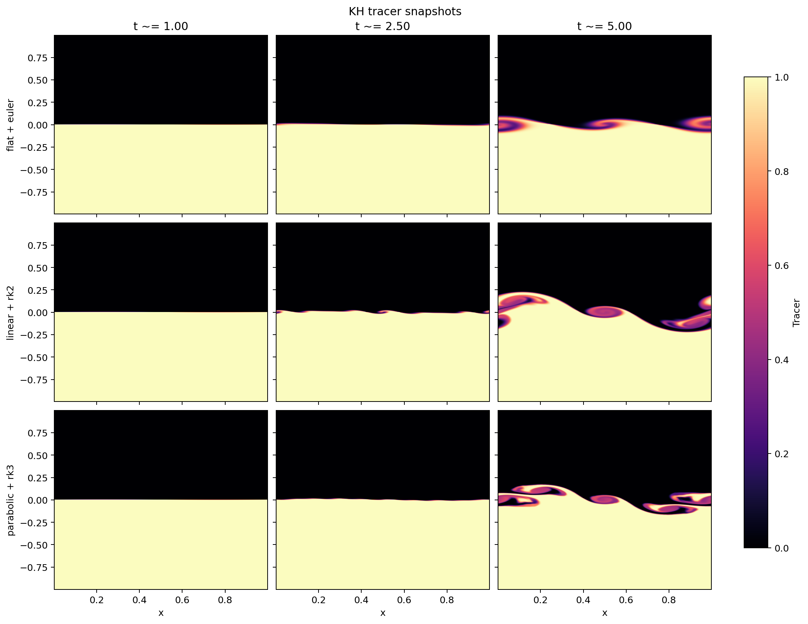
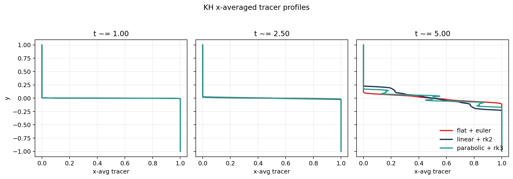

# Context

This onboarding step extends the instability-resolution study from
Rayleigh-Taylor growth to Kelvin-Helmholtz (KH) shear instability.

The supervisors requested a Roe-solver comparison in which only the
reconstruction and time-stepping pair changes:

- `flat + euler`
- `linear + rk2`
- `parabolic + rk3`

Unlike the RT case, this local PLUTO checkout did not ship a directly matching
plain-hydrodynamic KH example, so a custom 2D HD KH problem was constructed
from the same basic idea as the shipped RMHD setup: a tanh shear layer with a
small transverse perturbation and a passive tracer to visualize mixing.

# Goal

The aims of this step were:

- to build a custom HD KH benchmark compatible with the requested scheme matrix
- to compare the three methods with Roe fixed throughout
- to use tracer snapshots and tracer-profile metrics as the main mixing
  diagnostics
- to see whether the same ordering found for RT also appears in a shear-driven
  instability

# Workflow Summary

The following workflow was executed:

1. Created a dedicated remote workspace at
   `/home/bwbrook/work/pluto-onboarding/kh_instability` on `deep-server`.
2. Implemented a custom 2D HD KH `init.c` with:
   - uniform `rho = 1`
   - uniform `p = 1`
   - shear profile `vx = -v0 tanh(y / a)`
   - compact sinusoidal `vy` perturbation
   - one passive tracer
3. Built three Roe-based variants:
   - `flat + euler`
   - `linear + rk2`
   - `parabolic + rk3`
4. Ran the three cases through a named `tmux` workflow on `deep-server`.
5. Generated density snapshots, tracer snapshots, and x-averaged tracer
   profiles.
6. Computed simple growth and mixing metrics from the outputs.
7. Synced the figures and tables back to WSL and copied the report assets into
   the `xray_cavities` repo.

# Setup

The computational setup was:

- execution host: `deep-server`
- control/orchestration host: local WSL
- long-running remote work: inside `tmux`
- Python analysis environment:
  `uv run --project /home/bwbrook/papers/xray_cavities ...`

The shared KH runtime configuration was:

- 2D Cartesian domain
- `x in [0, 1]`
- `y in [-1, 1]`
- grid: `256 x 512`
- final time: `t = 5`
- output cadence: double-precision dumps every `0.5` time units
- boundary conditions:
  - periodic in `x`
  - outflow in `y`
- Riemann solver: `roe`

The custom KH problem used:

- shear speed `v0 = 0.25`
- shear width `a = 0.01`
- perturbation envelope width `b = 0.1`
- perturbation amplitude `0.01 * v0`

The main remote scripts were:

- `run_kh_matrix.sh`
- `analyze_kh.py`
- `run_all.sh`

The requested comparison times were `t = 1`, `2.5`, and `5.0`. The actual
snapshots used were the nearest available dump times, approximately `0.999`,
`2.500`, and `5.000`.

# Results

## Density Snapshots

The density field is a weak diagnostic here because the problem was initialized
with constant density. Even so, it still shows that the higher-order schemes
support much stronger nonlinear KH structure than `flat + euler` by late time.

## Tracer Snapshots

The tracer field is much more informative.

- `flat + euler` remains the most diffusive baseline, with the weakest roll-up
  and the smoothest interface.
- `linear + rk2` produces the strongest large-scale KH growth by `t = 5`.
- `parabolic + rk3` preserves crisp tracer structure and secondary detail, but
  in this setup it does not produce the broadest mixed layer.

So the KH result is slightly more nuanced than RT. The higher-order schemes are
both clearly less diffusive than `flat + euler`, but `linear + rk2` and
`parabolic + rk3` are not ordered by every metric in the same way.

## X-Averaged Tracer Profiles

The tracer-profile metrics were:

| Scheme | `t ~= 1.0` thickness | `t ~= 2.5` thickness | `t = 5.0` thickness |
|---|---:|---:|---:|
| `flat + euler` | 0.00390625 | 0.01953125 | 0.16015625 |
| `linear + rk2` | 0.01171875 | 0.03515625 | 0.43359375 |
| `parabolic + rk3` | 0.01171875 | 0.02734375 | 0.32421875 |

The velocity-growth metrics at `t = 5` were:

| Scheme | `mean(vy^2)` | `max |vy|` | Mixing-layer thickness |
|---|---:|---:|---:|
| `flat + euler` | 5.459243e-04 | 1.266987e-01 | 0.16015625 |
| `linear + rk2` | 4.654272e-03 | 3.469646e-01 | 0.43359375 |
| `parabolic + rk3` | 2.330995e-03 | 3.375096e-01 | 0.32421875 |

At `t = 5`, relative to `flat + euler`:

- `linear + rk2` had about `8.5x` larger `mean(vy^2)`
- `parabolic + rk3` had about `4.3x` larger `mean(vy^2)`
- `linear + rk2` produced the thickest tracer-defined mixing layer
- `parabolic + rk3` still retained sharper-looking tracer structure than
  `flat + euler`

# Interpretation

The KH comparison gives a slightly more complicated answer than the RT study,
but it is still very informative.

The main conclusions are:

1. `flat + euler` is again the most diffusive option and clearly suppresses KH
   growth.
2. Both higher-order schemes permit much stronger instability development than
   `flat + euler`.
3. In this specific KH setup, `linear + rk2` produced the strongest growth
   proxies and the broadest tracer-defined mixing layer by `t = 5`.
4. `parabolic + rk3` still preserved visually crisp tracer structure and strong
   roll-up, but it did not dominate every quantitative metric.

So the qualitative ranking for KH is not as simple as “higher order always wins
by every measure.” A better summary is:

- `flat + euler` is clearly worst for resolving KH in this test
- `linear + rk2` and `parabolic + rk3` are both strong improvements
- the preferred scheme depends a little on whether we value broader nonlinear
  mixing or crisper interface detail more strongly

# Issues Encountered

Two minor workflow issues came up.

First, the analysis script needed the same nearest-output-time fix as the RT
study, because PLUTO dump times do not land exactly on round-number targets.

Second, the passive tracer variable appeared in `pyPLUTO` as `tr1` rather than
`trc`, so the analysis script had to be made tolerant to the tracer attribute
name actually present in the output object.

Neither issue affected the runs themselves; both were analysis-layer fixes.

# Next Step

A sensible follow-up would be to consolidate the RT and KH findings into a
short comparative note for the supervisors, highlighting:

- where the scheme ordering is consistent across both instabilities
- where KH shows a more metric-dependent ordering than RT
- what scheme would be a reasonable default for later AGN-jet experiments
