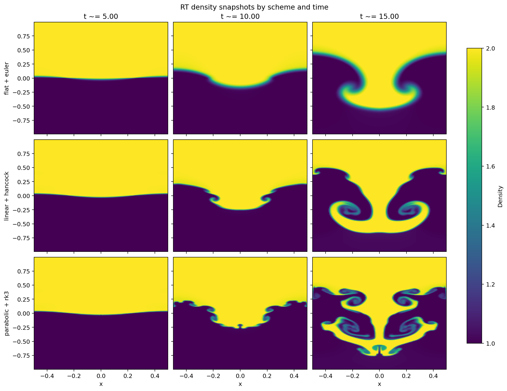
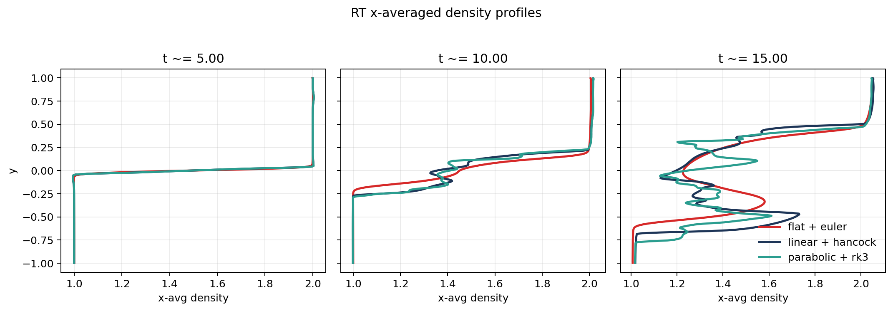

# Context

This onboarding step moves from one-dimensional shock-capturing tests to a
flow where the numerical method has to resolve a genuinely growing instability.
The supervisors requested a Rayleigh-Taylor (RT) comparison using the same Roe
Riemann solver throughout, while varying only the reconstruction and
time-stepping pair:

- `flat + euler`
- `linear + hancock`
- `parabolic + rk3`

That is a good next test because RT growth depends on how well the scheme
preserves sharp interfaces without adding too much numerical diffusion. It is
therefore a more demanding and visually intuitive benchmark than the Sod shock
tube.

# Goal

The aims of this step were:

- to build a three-scheme RT matrix while keeping the Roe solver fixed
- to use the built-in PLUTO hydro RT problem as the physical baseline
- to compare how quickly the three schemes develop secondary structure and
  interface roll-up
- to summarize the differences with both plots and simple profile-derived
  metrics

# Workflow Summary

The following workflow was executed:

1. Created a dedicated remote workspace at
   `/home/bwbrook/work/pluto-onboarding/rt_instability` on `deep-server`.
2. Reused PLUTO's shipped RT hydro setup from
   `pluto/Test_Problems/MHD/Rayleigh_Taylor`, but restricted it to the HD case.
3. Built three variants with a common runtime setup and Roe solver:
   - `flat + euler`
   - `linear + hancock`
   - `parabolic + rk3`
4. Ran the three cases in a named `tmux` workflow on `deep-server`.
5. Generated density snapshots and x-averaged density-profile comparisons.
6. Computed simple interface metrics from the x-averaged density profiles.
7. Synced the figures and tables back to WSL and copied the report assets into
   the `xray_cavities` repo.

# Setup

The computational setup was:

- execution host: `deep-server`
- control/orchestration host: local WSL
- long-running remote work: inside `tmux`
- Python analysis environment:
  `uv run --project /home/bwbrook/papers/xray_cavities ...`

The shared RT runtime configuration was:

- 2D Cartesian domain
- `x in [-0.5, 0.5]`
- `y in [-1, 1]`
- grid: `128 x 256`
- final time: `t = 15`
- output cadence: double-precision dumps every `5` time units
- runtime parameters:
  - `ETA = 2.0`
  - `GRAV = -0.1`
  - `CHI = 0.0`
- Riemann solver: `roe`

The main remote scripts were:

- `run_rt_matrix.sh`
- `analyze_rt.py`
- `run_all.sh`

The analysis compared the requested times `t = 5`, `10`, and `15`. Because
PLUTO writes outputs at the nearest available dump time, the actual snapshots
used were approximately `4.997`, `9.997`, and `15.000`.

# Results

## Density Snapshots

The qualitative trend is clear.

- `flat + euler` is the most diffusive of the three.
- `linear + hancock` develops noticeably sharper roll-up and secondary
  structure by `t ~= 10` and `t = 15`.
- `parabolic + rk3` preserves the richest small-scale structure and the most
  corrugated interface by late time.

By `t = 15`, the ranking by visual sharpness is:

1. `parabolic + rk3`
2. `linear + hancock`
3. `flat + euler`

## X-Averaged Density Profiles

The profile comparison compresses the 2D morphology into a simple vertical
measure of how far the mixed layer has spread.

The profile-derived metrics were:

| Scheme | `t ~= 5.0` thickness | `t ~= 10.0` thickness | `t = 15.0` thickness |
|---|---:|---:|---:|
| `flat + euler` | 0.0703125 | 0.3281250 | 1.0078125 |
| `linear + hancock` | 0.0703125 | 0.4609375 | 1.1718750 |
| `parabolic + rk3` | 0.0703125 | 0.4765625 | 1.2187500 |

Late-time interface extents at `t = 15` were:

| Scheme | Bubble height | Spike depth | Mixed-layer thickness |
|---|---:|---:|---:|
| `flat + euler` | -0.56640625 | 0.44140625 | 1.0078125 |
| `linear + hancock` | -0.67578125 | 0.49609375 | 1.1718750 |
| `parabolic + rk3` | -0.76171875 | 0.45703125 | 1.2187500 |

A useful summary is that by `t = 15`:

- `linear + hancock` produced a mixed layer about `16%` thicker than
  `flat + euler`
- `parabolic + rk3` produced a mixed layer about `21%` thicker than
  `flat + euler`
- `parabolic + rk3` also slightly exceeded `linear + hancock` in mixed-layer
  thickness

# Interpretation

This RT comparison behaved as expected for an order-of-accuracy test.

The main conclusions are:

1. `flat + euler` is the most diffusive baseline in this set.
2. `linear + hancock` is a substantial improvement, both visually and in the
   profile-derived spreading metrics.
3. `parabolic + rk3` resolves the most small-scale RT structure and yields the
   broadest mixed layer by late time.
4. The difference between `linear + hancock` and `parabolic + rk3` is real but
   modest compared with the jump from `flat + euler` to either of the higher-
   order schemes.

So, for the supervisor's question of how reconstruction/time-stepping affects
RT resolution with Roe fixed, the answer is straightforward: higher-order
reconstruction and time integration preserve noticeably more instability
structure and allow stronger interface development.

# Issues Encountered

There was one workflow issue rather than a scientific one.

The first analysis pass assumed PLUTO would write outputs at exactly `t = 5`,
`10`, and `15`. In practice, the dump times were slightly offset, such as
`4.997323` and `9.997590`, which caused a lookup failure in the analysis
script. This was fixed by changing the script to select the nearest available
output time within a small tolerance.

That same fix was also applied to the KH analysis script pre-emptively.

# Next Step

The natural follow-up is the matching Kelvin-Helmholtz scheme comparison:

- `flat + euler`
- `linear + rk2`
- `parabolic + rk3`

That will test whether the same ordering seen here for RT also appears in a
shear-driven instability with tracer-defined mixing.
