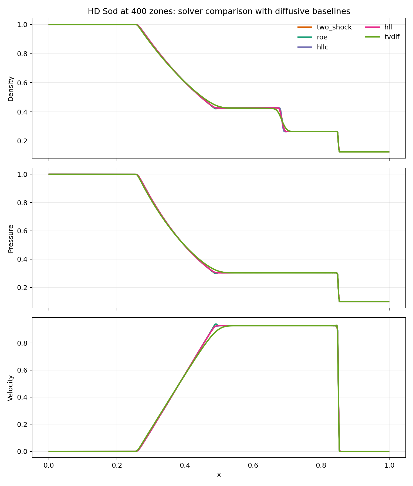
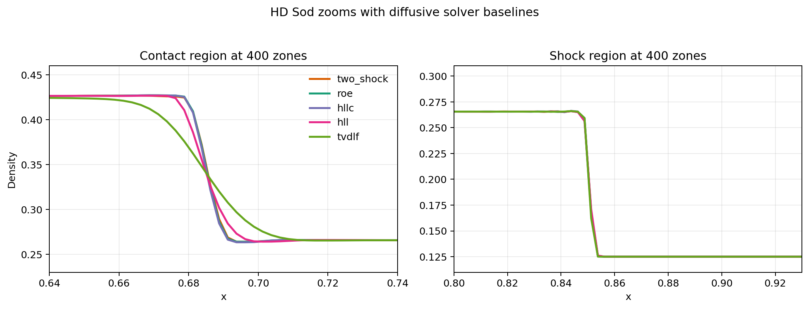
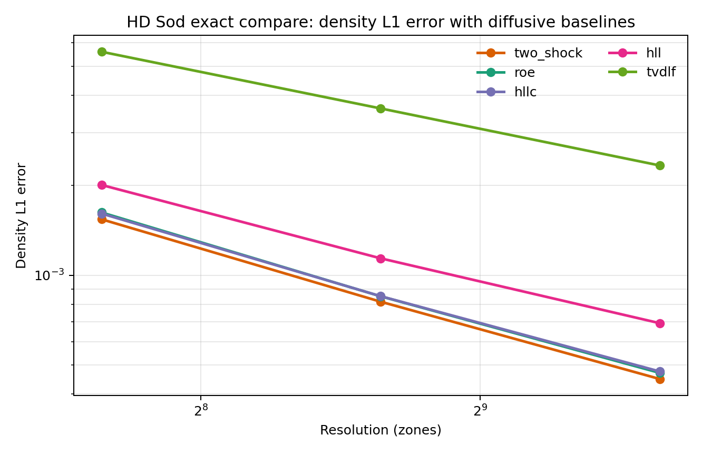

# Context

This report extends the first Sod shock tube benchmark by adding deliberately
more diffusive numerical solvers to the comparison set.

The earlier baseline showed that `two_shock`, `roe`, and `hllc` were all fairly
close in accuracy, with resolution making a bigger difference than the choice
among those three solvers. That was useful, but it did not yet give a very
strong visual feel for what a genuinely diffusive solver does to shock-capturing
quality.

This follow-up therefore asks a sharper question: what changes when the same Sod
problem is run with `hll` and `tvdlf`, using the same reconstruction and
time-stepping setup as before?

# Goal

The aims of this step were:

- to extend the solver set from three to five methods:
  `two_shock`, `roe`, `hllc`, `hll`, and `tvdlf`
- to determine whether the more diffusive solvers produce a visibly clearer
  contrast in the Sod solution
- to quantify that contrast with the exact Sod solution at `t = 0.2`
- to identify which flow features are most sensitive to numerical diffusion
  under this setup

# Workflow Summary

The following workflow was executed:

1. Created a separate remote workspace at
   `/home/bwbrook/work/pluto-onboarding/sod_diffusive` on `deep-server`.
2. Rebuilt the plain PLUTO HD Sod executable using the same configuration as the
   baseline run:
   - configuration `#04`
   - `PARABOLIC` reconstruction
   - `CHARACTERISTIC_TRACING`
3. Ran a 15-case matrix in a named `tmux` session:
   - solvers: `two_shock`, `roe`, `hllc`, `hll`, `tvdlf`
   - resolutions: `200`, `400`, `800`
4. Generated solver-comparison and zoom plots from the tabulated PLUTO output.
5. Computed exact-solution error metrics for all cases.
6. Synced plots and summaries back to WSL and copied the report assets into the
   `xray_cavities` repo.

# Setup

The computational setup was:

- execution host: `deep-server`
- control/orchestration host: local WSL
- long-running remote work: inside `tmux`
- Python analysis environment:
  `uv run --project /home/bwbrook/papers/xray_cavities ...`

The key remote scripts were:

- `run_sod_matrix.sh`
- `plot_sod_diffusive.py`
- `compute_sod_exact_errors.py`

The exact-solution compare used the standard Sod initial states:

- left: `rho = 1`, `u = 0`, `p = 1`
- right: `rho = 0.125`, `u = 0`, `p = 0.1`
- adiabatic index: `gamma = 1.4`

The exact star-region solution was:

- `p* = 0.30313018`
- `u* = 0.92745262`

# Results

## Solver Comparison at 400 Zones

At full-domain scale, the five solvers still look reasonably similar. The
biggest differences appear near the contact discontinuity rather than in the
gross structure of the wave pattern.

## Zoomed Comparison Near the Contact and Shock

The zoomed comparison is much more revealing:

- `two_shock`, `roe`, and `hllc` remain tightly grouped
- `hll` is visibly more smeared through the contact region
- `tvdlf` is much more smeared again, with a broad, rounded transition
- the shock position itself is comparatively less sensitive than the contact
  region

## Exact-Solution Error Trends

Density `L1` error by solver and resolution:

| Solver | `N=200` | `N=400` | `N=800` |
|---|---:|---:|---:|
| `two_shock` | 1.538719e-03 | 8.153583e-04 | 4.494629e-04 |
| `roe` | 1.621981e-03 | 8.499784e-04 | 4.711214e-04 |
| `hllc` | 1.608164e-03 | 8.507725e-04 | 4.763272e-04 |
| `hll` | 2.004344e-03 | 1.138795e-03 | 6.908966e-04 |
| `tvdlf` | 5.592546e-03 | 3.613556e-03 | 2.328683e-03 |

Some useful ratios relative to `two_shock`:

- at `N = 400`, `hll` had `1.40x` the density `L1` error of `two_shock`
- at `N = 400`, `tvdlf` had `4.43x` the density `L1` error of `two_shock`
- at `N = 800`, `hll` had `1.54x` the density `L1` error of `two_shock`
- at `N = 800`, `tvdlf` had `5.18x` the density `L1` error of `two_shock`

Best overall case:

- `two_shock_800`
- density `L1`: `4.494629e-04`
- pressure `L1`: `2.656432e-04`
- velocity `L1`: `8.766371e-04`

# Interpretation

This comparison answers the methodological question much more clearly than the
three-solver baseline did.

The main conclusions are:

1. `two_shock` remained the best performer at every tested resolution.
2. `roe` and `hllc` were still extremely close to `two_shock`.
3. `hll` was clearly more diffusive than the first three solvers, both visually
   and quantitatively.
4. `tvdlf` was much more diffusive again, and therefore provides a very useful
   “low-accuracy baseline” for learning what numerical smearing looks like in
   practice.
5. The contact discontinuity was the feature most strongly affected by solver
   diffusivity in this setup.

So the pedagogical value of this second comparison is high:

- the first solver set showed that several good solvers can behave similarly
- the expanded set now shows what happens when one chooses a substantially more
  diffusive method

That makes the numerical trade-off much easier to see.

# Issues Encountered

No major blocker occurred in this run.

Minor notes:

- the PLUTO build still emits warnings from legacy random-number functions such
  as `srand48`, but the executable built and ran successfully
- for this report, the analysis used the tabulated PLUTO outputs directly, so no
  special `pyPLUTO` compatibility shim was needed

Operationally, the `tmux` plus remote-script pattern worked exactly as intended.

# Next Step

The next natural extension is to hold the solver fixed and vary the
reconstruction/time-stepping side of the method, for example by comparing lower-
order versus higher-order reconstruction choices. That would separate “which
Riemann solver?” from “how aggressively is the solution reconstructed between
cells?” in the onboarding sequence.
