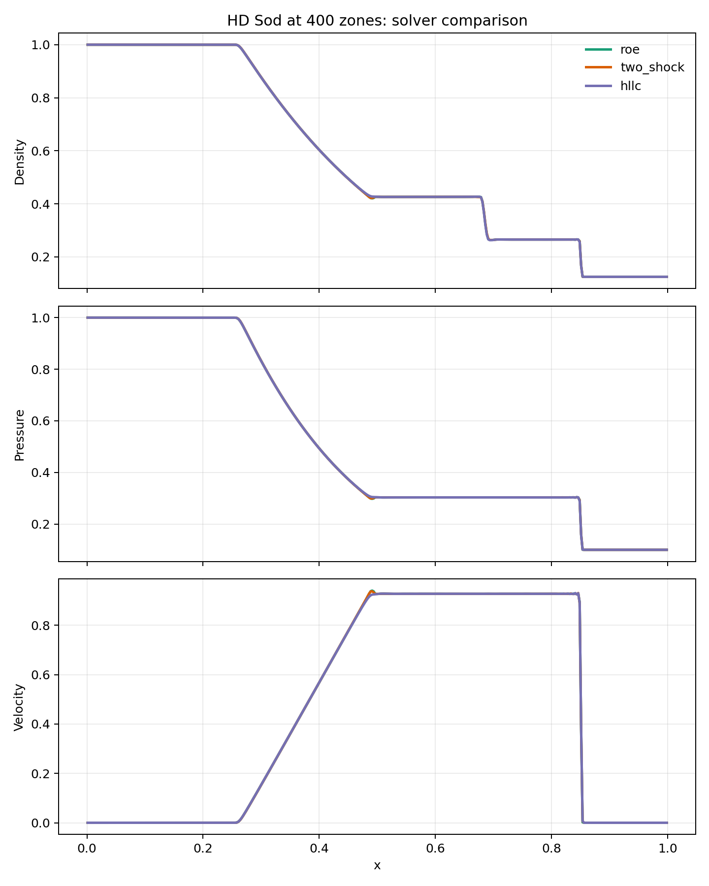
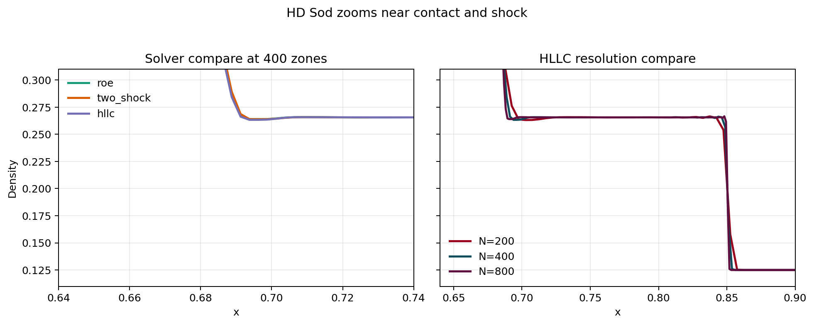
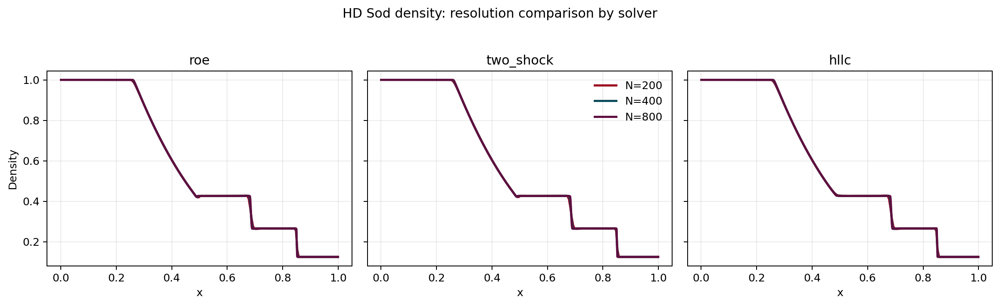
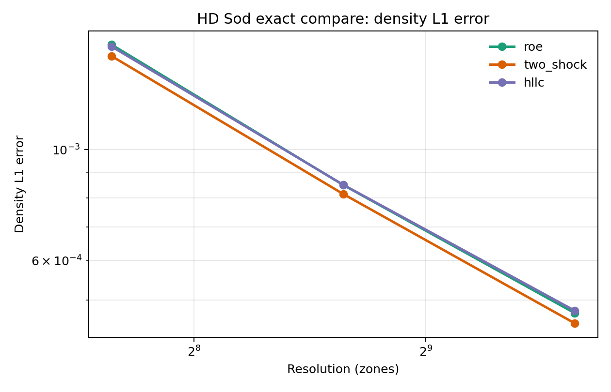

# Context

This is the first substantive onboarding exercise for the UTAS AGN workflow.

The task was to start with the classical Sod shock tube in PLUTO, then vary:

- numerical solver
- spatial resolution

and compare the resulting shock-capturing performance.

The work was run primarily on `deep-server`, with WSL used as the control plane.

# Why This Matters

For a beginning student, the Sod problem is a good first benchmark because it is:

- simple to set up
- rich enough to expose solver behavior
- paired with a known exact solution
- widely used in the CFD and astrophysical-fluid literature

It therefore gives an immediate feel for:

- how PLUTO problems are built and executed
- what solver choice actually changes
- how quickly accuracy improves with resolution

# Workflow Summary

The following steps were completed:

1. Identified the plain HD Sod problem under `pluto/Test_Problems/HD/Sod`.
2. Built a reusable executable on `deep-server` from configuration `#04`
   (`PARABOLIC` reconstruction plus `CHARACTERISTIC_TRACING`).
3. Ran a 9-case matrix:
   - solvers: `roe`, `two_shock`, `hllc`
   - resolutions: `200`, `400`, `800`
4. Generated comparison plots.
5. Computed exact-solution error metrics using the analytic Sod solution at
   `t = 0.2`.

# Numerical Setup

The left and right states were the standard Sod initial conditions:

- left: `rho = 1`, `u = 0`, `p = 1`
- right: `rho = 0.125`, `u = 0`, `p = 0.1`
- adiabatic index: `gamma = 1.4`

The exact star-region solution used in the error pass was:

- `p* = 0.30313018`
- `u* = 0.92745262`

# Visual Comparisons

## Solver Comparison at 400 Zones

At full-domain scale, all three solvers are visually quite close.

## Zoom Near the Contact and Shock

The zoomed view is more informative. It shows that `two_shock` is marginally
sharper through the contact/shock region, while `roe` and `hllc` are very close
behind.

## Resolution Comparison

The biggest visible gain comes from raising resolution from `200` to `400`
zones. The jump from `400` to `800` still improves the solution, but less
dramatically in visual terms.

# Exact-Solution Error Summary

The density `L1` error trends are shown below.

The corresponding numerical values are:

| Case | rho L1 | rho Linf | prs L1 | prs Linf | vx1 L1 | vx1 Linf |
|---|---:|---:|---:|---:|---:|---:|
| `hllc_200` | 1.608164e-03 | 6.159163e-02 | 1.059751e-03 | 4.406260e-02 | 2.985726e-03 | 3.178641e-01 |
| `hllc_400` | 8.507725e-04 | 5.816783e-02 | 5.498269e-04 | 5.690620e-02 | 1.625351e-03 | 3.834564e-01 |
| `hllc_800` | 4.763272e-04 | 6.696089e-02 | 3.021611e-04 | 8.452270e-02 | 9.619618e-04 | 5.186466e-01 |
| `roe_200` | 1.621981e-03 | 5.756403e-02 | 1.082248e-03 | 4.765010e-02 | 2.909741e-03 | 3.126280e-01 |
| `roe_400` | 8.499784e-04 | 5.853039e-02 | 5.446927e-04 | 5.920550e-02 | 1.558493e-03 | 3.751995e-01 |
| `roe_800` | 4.711214e-04 | 6.894739e-02 | 3.003596e-04 | 8.715250e-02 | 9.575541e-04 | 5.131607e-01 |
| `two_shock_200` | 1.538719e-03 | 5.648433e-02 | 9.750904e-04 | 4.706730e-02 | 2.723517e-03 | 3.099277e-01 |
| `two_shock_400` | 8.153583e-04 | 6.143639e-02 | 4.914761e-04 | 5.961660e-02 | 1.489547e-03 | 3.791442e-01 |
| `two_shock_800` | 4.494629e-04 | 7.150489e-02 | 2.656432e-04 | 8.747650e-02 | 8.766371e-04 | 5.113539e-01 |

# Interpretation

The main findings are straightforward and useful:

1. `two_shock` gave the lowest density `L1` error at all three tested
   resolutions.
2. `roe` and `hllc` were very close to one another and only modestly worse than
   `two_shock`.
3. Resolution had a bigger impact than solver choice within this solver set.
4. The `Linf` errors did not improve as cleanly as the `L1` errors, which is
   expected for discontinuous problems because the maximum norm is dominated by
   localized shock/contact structure.

In short:

- if one had to choose among these three tested solvers for this exercise,
  `two_shock` was the best performer
- but the strongest improvement came from increasing resolution rather than from
  changing solver

# Operational Notes

This exercise also validated the assisted workflow itself:

- WSL worked well as the planning and orchestration layer
- `deep-server` handled the build/run/analysis work cleanly
- reusable scripts plus `tmux` were a better pattern than long ad hoc SSH
  command chains

That is now the preferred operating mode for subsequent onboarding tasks.

# Next Step

The next natural extension would be to add a deliberately more diffusive solver
such as `hll` or `tvdlf` so that the contrast in shock capturing is more
pronounced than it is among `roe`, `two_shock`, and `hllc`.
