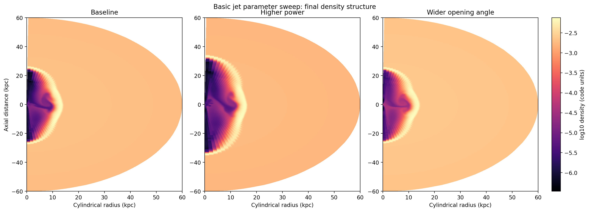
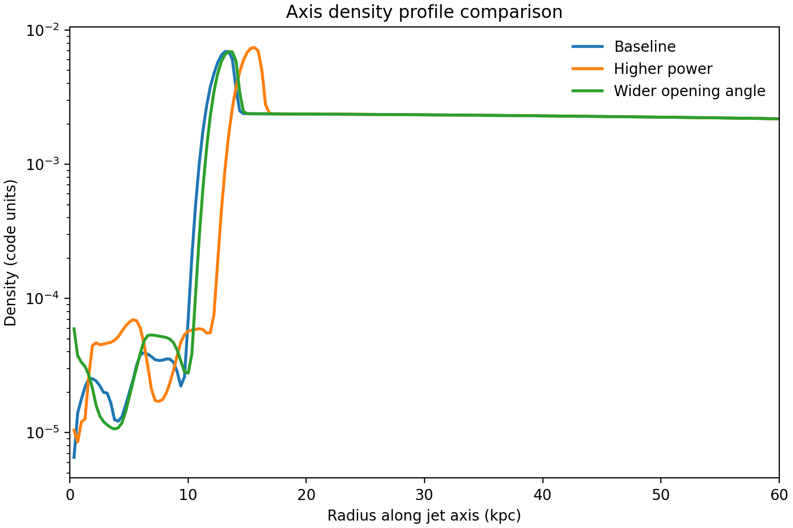

# Context

After getting a first basic `jet-setup` case to compile and run, the next useful
question was whether that same lightweight 2D spherical setup was sensitive to
simple physical parameter changes in a way that made intuitive sense.

This was not intended to be a full science study. It was a deliberately small
extension of the stage-3 onboarding run to test whether the setup is usable for
rapid physical experimentation as well as for compilation and smoke testing.

# Goal

The goal was to compare three closely related cases on the same grid and with
the same compile-time configuration:

- baseline
- higher jet power
- wider jet opening angle

The specific question was whether these runtime-only parameter changes produced
clear and interpretable differences in the final cavity/channel morphology.

# Workflow Summary

The workflow was:

1. reuse the same 2D spherical King-environment jet configuration from the
   basic jet run
2. compile the binary once
3. run three separate `pluto.ini` cases that differed only in runtime jet
   parameters
4. compare the final density maps, axis density profiles, and a small metrics
   table

An initial short-domain pass used the same compact `30 kpc` radial box as the
basic jet smoke test. That version was good enough to show qualitative
morphology changes, but the simplest front-position proxy saturated against the
outer boundary. Before checkpointing this report, the sweep was rerun on a
longer radial domain so the head-position comparison would be cleaner.

The cases were:

- `baseline`: `JET_PWR = 1e45`, opening angle `15 deg`
- `higher_power`: `JET_PWR = 3e45`, opening angle `15 deg`
- `wider_angle`: `JET_PWR = 1e45`, opening angle `25 deg`

# Setup

All three runs used:

- `deep-server` as the execution machine
- the same compiled 2D spherical `RHD` binary
- a refined `192 x 64` grid on `r in [0.2, 60.0] kpc`
- the same `tstop = 613.202787576`
- the same solver choice: `hllc`

The versioned remote workflow scripts for this sweep live in:

- `/home/bwbrook/papers/xray_cavities/scripts/pluto_onboarding/jet_parameter_sweep/`

# Results

## Final Density Comparison

The three cases are visibly similar in broad structure, which is reassuring:
small runtime changes do not destroy the solution morphology. But there are also
clear physical differences.

- The `higher_power` case drives the clearest and farthest-advanced dense head
  region.
- The `wider_angle` case produces a broader low-density cavity close to the
  source.
- The baseline sits between those two behaviours and looks like the most
  collimated of the three at fixed power.

## Axis Density Profiles

The axis profiles reinforce that interpretation.

- `higher_power` pushes both the dense head peak and the strongest axis-profile
  gradient farther out than the other two cases.
- `wider_angle` broadly tracks the baseline in head position at this output
  time, but changes the inner-cavity structure and transverse spread more
  strongly than the head advance itself.

## Metrics Table

| Case | Min density | Max density | Head peak radius (kpc) | Head-gradient radius (kpc) | Axis min density |
| --- | ---: | ---: | ---: | ---: | ---: |
| Baseline | 1.45e-06 | 7.21e-03 | 13.44 | 10.01 | 6.53e-06 |
| Higher power | 1.88e-06 | 7.76e-03 | 15.62 | 12.50 | 8.51e-06 |
| Wider opening angle | 3.41e-07 | 7.56e-03 | 13.44 | 10.63 | 1.06e-05 |

Two interpretations are especially useful here.

First, the higher-power case reaches both the farthest head-peak radius and the
farthest steep-gradient radius in the final state, consistent with a stronger
and more advanced head / working-surface region.

Second, the wider-angle case reaches the lowest minimum density anywhere in the
final domain, consistent with a broader evacuated cavity.

The longer domain therefore did what we hoped it would do: it preserved the
qualitative morphology comparison while also giving a cleaner head-position
metric than the saturated short-box proxy.

# Interpretation

This small extension did what it needed to do.

It showed that the basic `jet-setup` case is already responsive to physically
meaningful runtime changes.

The practical reading is:

- increasing `JET_PWR` mainly strengthens and advances the jet head
- increasing opening angle mainly broadens the cavity and reduces collimation
  close to the source
- at this output time, `wider_angle` changes cavity geometry more strongly than
  it changes head advance
- a modestly longer radial domain is enough to turn this from a purely
  qualitative morphology check into a cleaner comparative diagnostic

That is a good outcome for onboarding, because it means the setup is not just
operationally runnable; it is already behaving qualitatively like a plausible
jet model.

# Issues Encountered

No new fundamental workflow breakages showed up beyond those already discovered
in the first basic jet run.

The only meaningful issue was methodological in the initial short-box pass:

- the first front-position proxy saturated against the `30 kpc` outer boundary

That limitation was resolved here by rerunning on a `60 kpc` radial domain and
using head-position diagnostics tied to the final axis-density structure rather
than the old saturated proxy.

# Next Step

The most natural next move is now simply to proceed to the next
supervisor-specified onboarding task.

If this jet sweep were ever revisited later, the best incremental extension
would be to compare the same head-position diagnostics at one or two earlier
common times, rather than making the box even larger.
