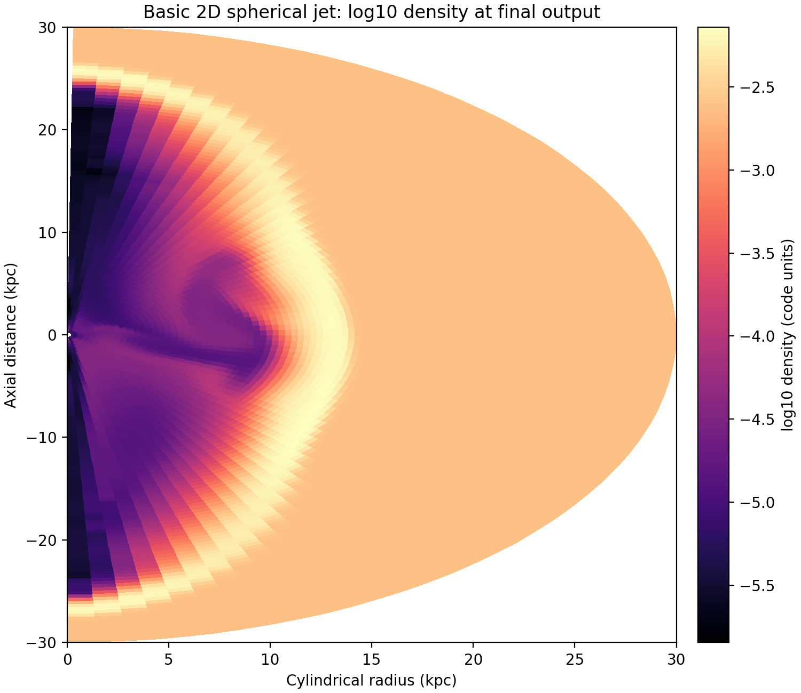
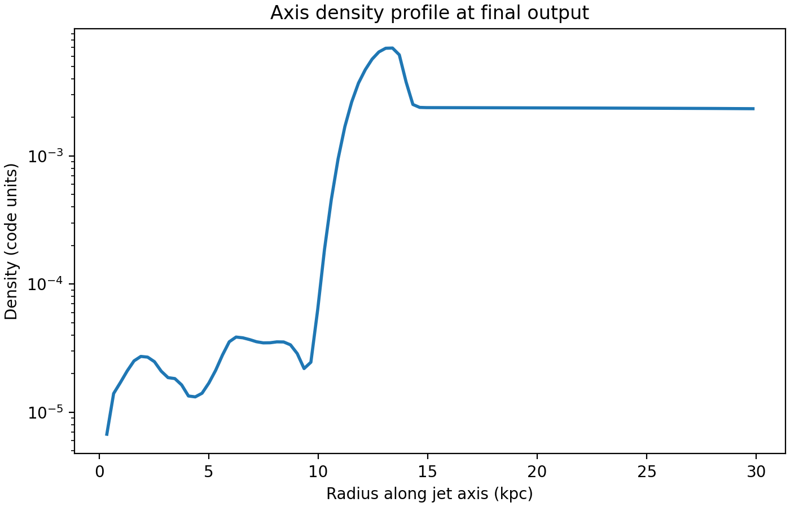

# Context

This onboarding step moved from plain-PLUTO test problems to the UTAS AGN
`jet-setup` workflow itself.

The brief from Stas and Patrick was:

- become familiar with `pluto.ini`, `init.c`, and the related setup files
- build the jet setup successfully
- run a basic jet simulation

That is an important transition point in the project. Up to now, the onboarding
work had focused on generic PLUTO numerics. This step tested whether the UTAS
AGN custom layer could be understood, configured, compiled, and run in a clean
and reproducible way.

# Goal

The concrete goals were:

- identify the role of the main jet-setup control files
- trace the intended `setup-problem -> build -> run` workflow
- adapt the default 3D relativistic jet setup into a lighter 2D spherical test
  case suitable for first-pass onboarding
- run the case on `deep-server`
- generate at least one interpretable diagnostic figure from the resulting jet
  output

# Workflow Summary

The actual workflow was:

1. inspect the current `jet-setup` source tree and wiki pages to map the roles
   of `pluto.ini`, `definitions.h`, `definitions_usr.h`, and `init.c`
2. create a versioned remote script bundle under
   `scripts/pluto_onboarding/jet_setup_basic/`
3. sync that bundle to `deep-server`
4. create a fresh remote workspace at
   `/home/bwbrook/work/pluto-onboarding/jet_setup_basic`
5. use `setup-problem` to copy the current `jet-setup/src` tree into a new
   problem directory
6. patch the copied setup into a lighter 2D spherical King-environment jet case
7. compile with PLUTO's `MakeProblem` interface inside the problem `src/`
8. run the simulation to completion on `deep-server`
9. post-process the final output into a density map, an axis profile, and a
   small metrics table

This stayed faithful to the agreed operating model:

- WSL as control plane
- `deep-server` as execution machine
- reusable remote scripts
- long run launched via `tmux`
- results synced back for reporting

# File Roles

The most useful mental model from this step is that the setup is split between
runtime control, compile-time control, and problem-specific C logic.

## `pluto.ini`

`pluto.ini` is the runtime control file. It defines:

- the grid and dimensional extent
- the CFL and final time
- the runtime Riemann solver choice
- boundary conditions
- output cadence and output format
- the jet and environment parameter values such as `JET_PWR`, `JET_SPD`,
  `JET_CHI`, `ENV_RHO_0`, and `ENV_TEMP`

For this first basic run, the case was reduced to:

- 2D spherical geometry
- `96 x 64` cells in radius and polar angle
- `tstop = 613.202787576`
- `Solver = hllc`
- a one-episode relativistic jet in a King atmosphere

## `definitions.h`

`definitions.h` controls compile-time PLUTO choices. For this onboarding case,
its most important settings were:

- `PHYSICS = RHD`
- `DIMENSIONS = 2`
- `GEOMETRY = SPHERICAL`
- `RECONSTRUCTION = LINEAR`
- `TIME_STEPPING = RK2`
- `PARTICLES = NO`

This is the file that determines the broad numerical and physical build
configuration before PLUTO is compiled.

## `definitions_usr.h`

`definitions_usr.h` holds problem-specific compile-time switches for the UTAS
AGN jet layer. For this basic run, the key choices were:

- `DENSITY_PROFILE = ENV_KING`
- `JET_INJECTION_ROTATED = NO`
- `PARTICLES_LP_RAISE = NO`

So this file acts as the bridge between the generic PLUTO build and the custom
jet/environment implementation.

## `init.c`

`init.c` is where the problem-specific C logic really lives.

Its main roles are:

- initialize the environment and jet normalizations once at startup
- load the King atmosphere properties
- load and print the jet injection properties
- populate the initial domain with density, pressure, and velocity values from
  the chosen environment model
- enforce the user-defined jet boundary condition during the run
- apply body-force terms such as gravity

The most important conceptual point is that `pluto.ini` provides the parameter
values, but `init.c` is where those values are turned into actual physical
initial conditions and injected jet behaviour on the grid.

# Setup

The run used:

- machine: `deep-server`
- working directory:
  `/home/bwbrook/work/pluto-onboarding/jet_setup_basic`
- code roots:
  - `/home/bwbrook/git/utas-agn/pluto`
  - `/home/bwbrook/git/utas-agn/jet-setup`
- Python analysis environment:
  `uv run --project /home/bwbrook/papers/xray_cavities ...`

The versioned workflow scripts for this step live in:

- `/home/bwbrook/papers/xray_cavities/scripts/pluto_onboarding/jet_setup_basic/`

The key outputs staged for this report are:

- final density map
- final axis density profile
- metrics CSV for the final output

# Results

## Final Density Structure

The jet clearly propagates through the spherical King atmosphere and develops a
low-density channel along the axis. For a first setup/compile/run exercise,
this is the important confirmation: the custom initialization and boundary
injection logic are working, not just the underlying PLUTO solver.

## Axis Density Profile

The axis profile shows a strongly evacuated jet path relative to the denser
ambient medium. That is consistent with the visual cavity/channel seen in the
2D density map.

## Final-Output Metrics

| Metric | Value |
| --- | ---: |
| Final output index | 4 |
| Radial cells | 96 |
| Angular cells | 64 |
| Minimum density (code units) | 1.43e-06 |
| Maximum density (code units) | 7.22e-03 |
| Jet-front proxy (kpc) | 29.84 |

The jet-front proxy is a simple derived diagnostic from the final axis profile.
It is not a formal science metric, but it is sufficient for this onboarding
step to show that the jet has advanced essentially to the outer radial extent
of the test domain.

# Interpretation

This stage can be counted as a successful first `jet-setup` familiarization.

The main practical conclusions are:

- the UTAS AGN jet setup is best understood as a layer on top of PLUTO with a
  clear separation between runtime control (`pluto.ini`), compile-time control
  (`definitions.h` and `definitions_usr.h`), and problem logic (`init.c`)
- the standard `setup-problem` workflow is the right conceptual entry point,
  because it creates a self-contained problem directory that can then be edited
  and compiled independently of the master source tree
- a lightweight 2D spherical relativistic jet case is a good first operational
  target because it runs quickly enough for onboarding while still exercising
  the genuine jet injection machinery
- the final run result is physically recognizable as a jet-driven low-density
  channel in a stratified atmosphere, so this is more than a pure smoke test

# Issues Encountered

Three useful implementation wrinkles showed up.

1. The default `create-build-script` path did not produce a usable makefile on
   this checkout when run non-interactively via `setup.py --auto-update`. The
   build was recovered by using PLUTO's underlying `MakeProblem` interface
   directly, which is also what the UTAS AGN test harness uses.
2. Setting `PARTICLES = NO` in `definitions.h` was not enough by itself,
   because `jet-setup/src/local_make` includes `Particles/makefile`
   unconditionally. For this basic no-particles run, that include needed to be
   removed in the copied problem directory.
3. The post-processing wrapper initially failed because `uv` was installed in
   `~/.local/bin` on `deep-server`, so the remote script needed an explicit PATH
   addition for non-interactive execution.

All three are useful onboarding findings because they expose where the custom
workflow is slightly more manual or fragile than the idealized wiki narrative.

# Next Step

The natural next move is to start using `jet-setup` more scientifically rather
than only operationally.

A sensible follow-up would be:

1. vary one or two physical jet parameters such as power or opening angle in
   this same 2D spherical setup
2. inspect how those changes alter the cavity/channel morphology
3. then move on to the next supervisor-recommended onboarding task from that
   stronger baseline
