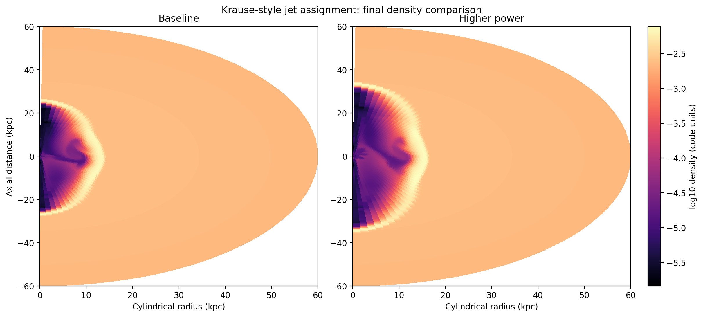
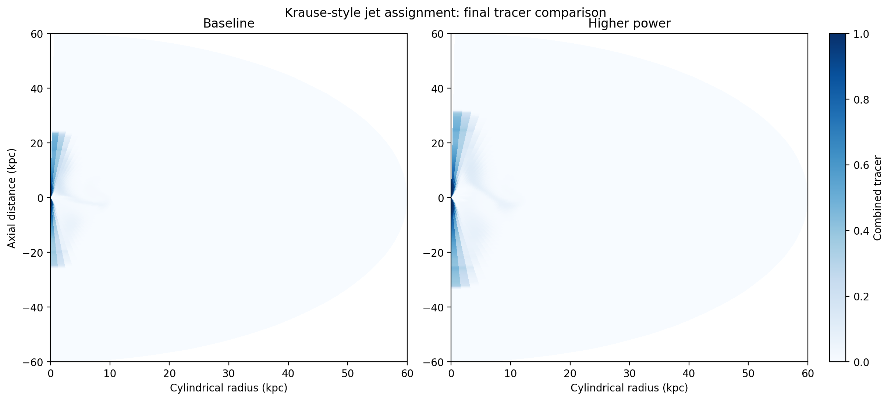
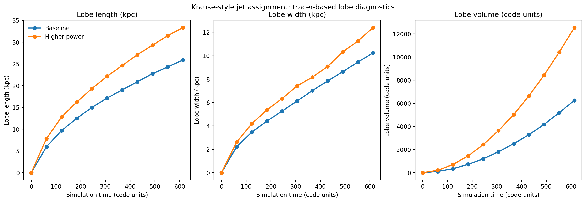

# Context

The final onboarding item from Stas and Patrick was deliberately terse:

- do Martin Krause's jets assignment
- redo the analysis with Python rather than `pyPLUTO`
- remake the relevant images

There was no explicit worksheet or companion note for this task in the local
UTAS AGN repositories. The most practical reading, supported by the structure
of `plutokore` and the older jet-analysis scripts in that codebase, was that
this step was meant to be a capstone:

- run a small, reproducible jet mini-suite
- analyze it in pure Python
- use jet tracers to extract simple lobe diagnostics
- remake the key figures without relying on `pyPLUTO`

That interpretation also fits the logic of the preceding onboarding stages.
Stage 3 showed that the UTAS AGN `jet-setup` could be compiled and run. This
stage asks whether the resulting jet outputs can now be handled in a more
research-ready Python workflow.

# Goal

The concrete goals were:

- reuse the validated stage-3 2D spherical jet setup as the base problem family
- run a fresh mini-suite with denser output sampling for time-series analysis
- analyze the results using `plutokore`, `numpy`, and `matplotlib`
- avoid `pyPLUTO` entirely in the new analysis lane
- remake a compact figure set and derive simple tracer-based lobe diagnostics
- document the result as the final PLUTO/jet onboarding capstone

# Workflow Summary

The workflow for this step was:

1. create a new versioned workflow bundle under
   `scripts/pluto_onboarding/krause_jets_assignment/`
2. patch `plutokore` for Python 3.12 compatibility so the pure-Python loader
   path works without the earlier `array.fromstring` issue
3. sync the new workflow bundle and `plutokore` compatibility fix to
   `deep-server`
4. create a fresh remote workspace at
   `/home/bwbrook/work/pluto-onboarding/krause_jets_assignment`
5. reuse the same lightweight 2D spherical `jet-setup` build style as stage 3
6. run two cases with identical geometry and compile-time settings but
   different jet power
7. write a new pure-Python post-processing script that loads all outputs,
   derives lobe diagnostics from the jet tracer, and regenerates the figures
8. stage the resulting artifacts back into `xray_cavities` for reporting

As in the earlier onboarding steps, the operating model stayed the same:

- WSL as control plane
- `deep-server` as execution machine
- reusable remote scripts
- long run inside `tmux`
- results synced back for local reporting and handover

# Setup

The mini-suite used:

- machine: `deep-server`
- workspace:
  `/home/bwbrook/work/pluto-onboarding/krause_jets_assignment`
- code roots:
  - `/home/bwbrook/git/utas-agn/pluto`
  - `/home/bwbrook/git/utas-agn/jet-setup`
  - `/home/bwbrook/git/utas-agn/plutokore`
- Python analysis environment:
  `uv run --project /home/bwbrook/papers/xray_cavities ...`

The compile-time and geometric setup followed the validated stage-3 jet lane:

- `RHD`
- `DIMENSIONS = 2`
- `GEOMETRY = SPHERICAL`
- `PARTICLES = NO`
- one fluid tracer retained for jet/lobe analysis
- `Solver = hllc`
- radial domain `0.2 .. 60.0 kpc`
- `192 x 64` grid
- `tstop = 613.202787576`

Two cases were run:

- `baseline`: `JET_PWR = 1e45`
- `higher_power`: `JET_PWR = 3e45`

Both used:

- opening angle `15 deg`
- the same King atmosphere
- denser `dbl` output sampling every `61.320278758` code-time units

The versioned workflow scripts for this step live in:

- `/home/bwbrook/papers/xray_cavities/scripts/pluto_onboarding/krause_jets_assignment/`

# Results

## Final Density Comparison

The final density maps show the same basic jet/cocoon morphology in both runs,
but the higher-power case clearly pushes the working surface farther outward and
inflates a larger low-density region around the axis. That is the same physical
direction we already saw in the simpler stage-3 jet sweep, but here it is being
read through a deliberately more analysis-focused workflow.

## Final Tracer Comparison

The tracer maps are more informative than the density maps for lobe geometry.
They isolate the jet-inflated region cleanly enough to support a simple
tracer-threshold mask, and the higher-power case shows a visibly larger lobe in
both axial extent and transverse spread by the final output.

## Lobe-Diagnostic Time Series

These diagnostics were all extracted from the tracer-defined lobe mask using a
default threshold of `tr1 > 0.005`:

- lobe length
- lobe width
- lobe volume

All three diagnostics grow monotonically with time, and the higher-power case
pulls ahead early rather than only at the last snapshot.

By the final output at `t = 613.2028`:

- lobe length is `25.89 kpc` for the baseline and `33.36 kpc` for the
  higher-power case
- lobe width is `10.24 kpc` for the baseline and `12.40 kpc` for the
  higher-power case
- lobe volume is `6.25e3` code units for the baseline and `1.25e4` code units
  for the higher-power case

So in this mini-suite the higher-power jet ends up:

- about `29%` longer
- about `21%` wider
- about `2.01x` larger in tracer-defined lobe volume

## Metrics Snapshot

| Case | Final output | Time (code units) | Lobe length (kpc) | Lobe width (kpc) | Lobe volume (code units) | Tracer threshold |
| --- | ---: | ---: | ---: | ---: | ---: | ---: |
| Baseline | 10 | 613.2028 | 25.89 | 10.24 | 6246.70 | 0.005 |
| Higher power | 10 | 613.2028 | 33.36 | 12.40 | 12548.22 | 0.005 |

# Interpretation

This stage was designed to close the onboarding loop, and it did so in two
important ways.

First, it showed that the UTAS AGN jet workflow is now usable beyond pure
simulation execution. We can run a jet mini-suite, extract tracer-defined lobe
properties, and rebuild figures in a scriptable Python analysis lane rather
than depending on `pyPLUTO`.

Second, it provides a plausible practical reading of the supervisors' brief. In
that reading, "Martin Krause's jets assignment" is not a hidden worksheet but a
small, reproducible jet-analysis exercise in the style of the older Krause-like
jet/lobe analysis already embedded in `plutokore`.

The main practical conclusion is therefore:

- stage 4 retires `pyPLUTO` from the jet-analysis path we would naturally use
  going forward

It also leaves us with a simple but real analysis template for later project
work: run a controlled jet suite, load outputs with `plutokore`, derive
tracer-based lobe properties, and regenerate publication-style figures directly
from Python.

# Issues Encountered

Two implementation wrinkles were useful rather than harmful.

1. The pure-Python analysis lane exposed a Python 3.12 compatibility issue in
   `plutokore`, where `array.fromstring` needed to be updated to
   `array.frombytes`.
2. The original assignment wording was under-specified, so the step had to be
   operationalized from the existing local codebase rather than from a literal
   worksheet.

Both are worth recording because they explain why this step was part execution,
part interpretation, and part workflow hardening.

# Next Step

This report completes the four requested onboarding stages.

The natural next move is no longer another PLUTO warm-up exercise. It is to
transition from onboarding into the actual project-specific research tasks,
using:

- `jet-setup` for simulations
- `plutokore` and the new pure-Python lane for analysis
- `deep-server` and `nectar-vm` as the established execution backbone
