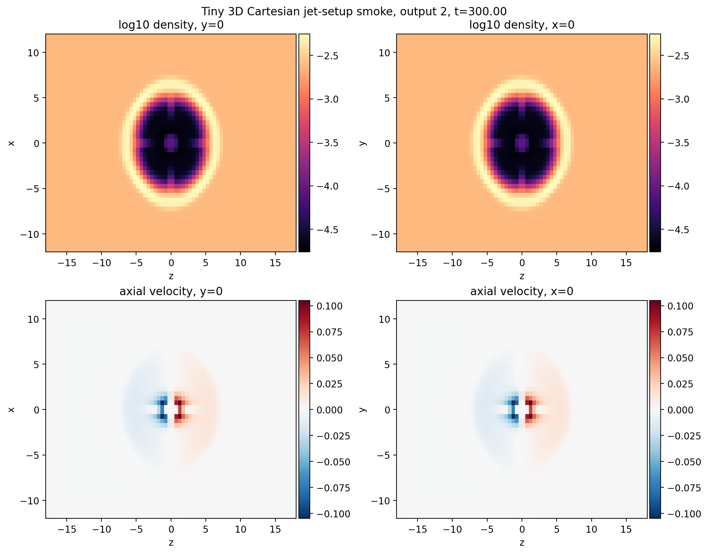

# Context

After completing the official 2D PLUTO jet assignment, the next bridge was to
repeat the spirit of the exercise in a full 3D Cartesian `jet-setup` case. This
was intentionally not a production simulation. It was a minimal check that a
resized `nectar-vm` can compile, run, retrieve, and analyze a 3D Cartesian
`jet-setup` problem before the workflow moves to `kunanyi`.

# Setup

The smoke run used:

- execution host: resized `nectar-vm`
- code: `jet-setup`
- physics: `HD`
- geometry: `CARTESIAN`
- dimensions: `3`
- particles: off
- environment: King profile
- grid: `48 x 48 x 72`
- domain: `x,y in [-12,12]`, `z in [-18,18]`
- final time: `300`
- output cadence: `150`

The versioned workflow scripts live in:

- `scripts/pluto_onboarding/jet_setup_tiny_3d_cart/`

# Result

Final smoke metrics:

| Metric | Value |
| --- | ---: |
| Final output | 2 |
| Final time | 300.0 |
| Grid shape | 48 x 48 x 72 |
| Density minimum | 1.734e-05 |
| Density maximum | 5.767e-03 |
| Maximum absolute axial velocity | 1.050e-01 |
| Cells with `|vx3| > 1e-3` | 10680 |
| Absolute z extent of axial-velocity mask | 7.25 |

# Interpretation

This passes the intended smoke gate:

- `jet-setup` can scaffold a 3D Cartesian problem on Nectar;
- a tiny 3D binary compiles cleanly;
- the run writes readable PLUTO `dbl` outputs;
- the local `plutokore` analysis path can read those outputs and make central
  slice diagnostics;
- the result shows a coherent central density/velocity response rather than a
  blank or corrupt volume.

The run is deliberately too coarse and short for science. It also does not yet
exercise particle/radio products or HDF5 output. Those remain separate smoke
gates before any serious 3D production job.

# Next Step

The next Nectar ladder rung should be a particle-enabled or HDF5-enabled smoke
case at similarly tiny scale. After those hooks are boringly green, the next
infrastructure move is `kunanyi`: SSH/jumpbox setup, module discovery, PLUTO
build, PBS short job, and artifact retrieval.
