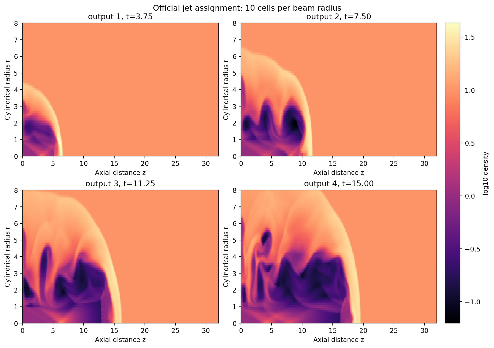
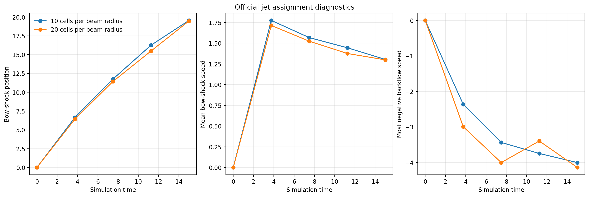

# Context

Patrick supplied the missing Martin Krause jet assignment after the earlier
onboarding capstone had already been interpreted and implemented from local
context. This report therefore supersedes the earlier "Krause-style" reading
for the specific assignment exercise, while preserving that earlier work as a
useful pure-Python jet-analysis precursor.

The official assignment asks for a 2D axisymmetric cylindrical jet in pressure
equilibrium with a uniform environment, with external Mach number `20`, at two
resolutions: `10` and `20` cells per beam radius.

# Goal

The practical goal was to run the official PLUTO example problem named by
Patrick:

- `Test_Problems/HD/Jet`

and produce the assignment-facing diagnostics:

- four logarithmic density snapshots for each resolution;
- bow shock, cocoon, Mach disc, contact surface, KH, RT, and backflow
  interpretation;
- bow-shock speed comparison between resolutions;
- a first Rankine-Hugoniot compression check.

# Setup

The workflow ran on resized `nectar-vm` rather than the MacBook.

Key settings:

- geometry: `CYLINDRICAL`
- dimensions: `2`
- solver: `hllc`
- equation of state: ideal gas, `gamma = 5/3`
- domain: `0 <= r <= 8`, `0 <= z <= 32`
- beam radius: `1`
- ambient-to-jet density ratio: `10`
- external Mach number: `20`
- pressure equilibrium between inlet and ambient gas
- output interval: `3.75`
- final time: `15.0`

The PLUTO runtime `MACH` parameter is the internal jet Mach number. For this
pressure-matched light jet, the script sets it to `20 / sqrt(10)` so that the
external Mach number is `20`.

The versioned workflow scripts live in:

- `scripts/pluto_onboarding/official_jet_assignment/`

# Results

## Density Snapshots

Both resolutions show the expected supersonic jet morphology:

- a low-density beam and cocoon;
- a bright compressed bow-shock shell;
- a terminal working surface / Mach-disc region near the jet head;
- a contact surface separating shocked jet material from shocked ambient gas;
- increasingly structured shear features along the cocoon boundary.

The `20` cells-per-radius case resolves sharper internal structure and more
filamentary contact-surface/KH morphology, but the large-scale head advance is
very similar to the `10` cells-per-radius case.

## Diagnostic Time Series

The bow-shock position was estimated as the furthest on-axis pressure
enhancement above `1.10` times the ambient pressure. This is a simple and
transparent assignment-level proxy, not a final publication measurement.

By `t = 15`:

| Resolution | Bow position | Mean bow speed | Bow-shell density ratio | Strong-shock limit | Most negative backflow |
| --- | ---: | ---: | ---: | ---: | ---: |
| 10 cells/R | 19.550 | 1.303 | 3.432 | 4.000 | -4.003 |
| 20 cells/R | 19.475 | 1.298 | 4.613 | 4.000 | -4.141 |

The bow-shock speed is therefore essentially unchanged by the resolution
increase at this smoke scale. The compression estimate is closer to the
strong-shock expectation in the higher-resolution run, though the simple
on-axis shell metric can overshoot locally because it samples a structured,
multidimensional shock rather than a clean planar discontinuity.

# Assignment Questions

a. Four sufficiently different logarithmic density snapshots are shown above
for both resolutions.

b. The bow shock is the leading bright compressed shell; the cocoon is the
low-density shocked jet material behind it; the Mach disc is the terminal shock
near the jet head; the contact surface is the interface between cocoon material
and shocked ambient gas.

c. KH structure appears along the sheared cocoon/contact boundary and becomes
much clearer in the `20` cells-per-radius run.

d. A characteristic shear velocity near the contact surface is about `9.5` to
`10.1` code-velocity units at the final snapshot. Using the incompressible
sheet estimate with wavelength `2 R_beam` gives a growth-rate scale of about
`8.6` to `9.1`. This is only a scale check because the simulated flow is
compressible, shocked, and spatially evolving.

e. RT-like structure is plausible where the decelerating/accelerating contact
surface places denser shocked ambient material against lighter cocoon material,
especially around the curved head and cocoon shell. It should not be read as a
pure textbook RT setup because the jet head is also shock- and shear-dominated.

f. The leading bow shock reaches `z ~= 19.5` by `t = 15`, giving a mean advance
speed of about `1.30` in code units. The speed declines from the earliest
snapshot because the cocoon/head structure expands and interacts with swept-up
ambient gas.

g. No material resolution dependence in bow-shock speed is visible at this
smoke scale: `1.303` versus `1.298`.

h. Backflow is visible inside the cocoon behind the working surface. The most
negative axial velocities are about `-4.0` to `-4.1`, strongest in the shocked
jet/cocoon rather than in the undisturbed ambient medium.

i. The high-resolution run has sharper shocks, clearer contact-surface
structure, and richer KH-like morphology. The strong-shock Rankine-Hugoniot
density-ratio expectation for `gamma = 5/3` is `4`; the simple measured
bow-shell ratios are `3.43` and `4.61`, which is credible for a first
assignment-level check but motivates a more careful shock-normal measurement if
this were promoted to science analysis.

# Next Step

The official 2D assignment is now reproducible on Nectar. The next useful
bridge is a tiny full-3D Cartesian `jet-setup` run that repeats the same
diagnostic logic at smoke scale before we return to the three-case science
suite.
