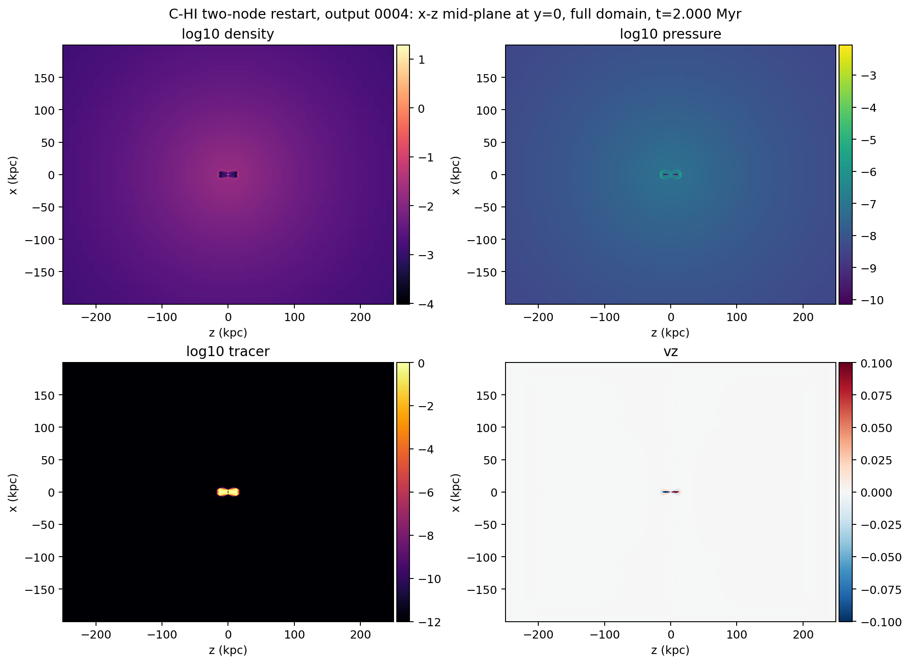
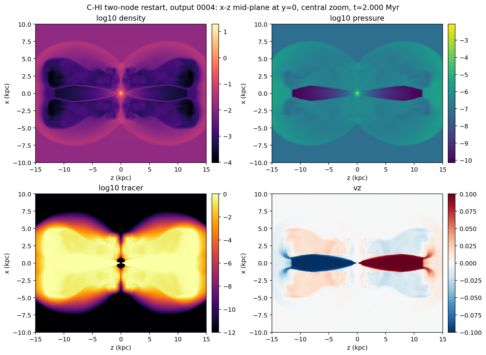
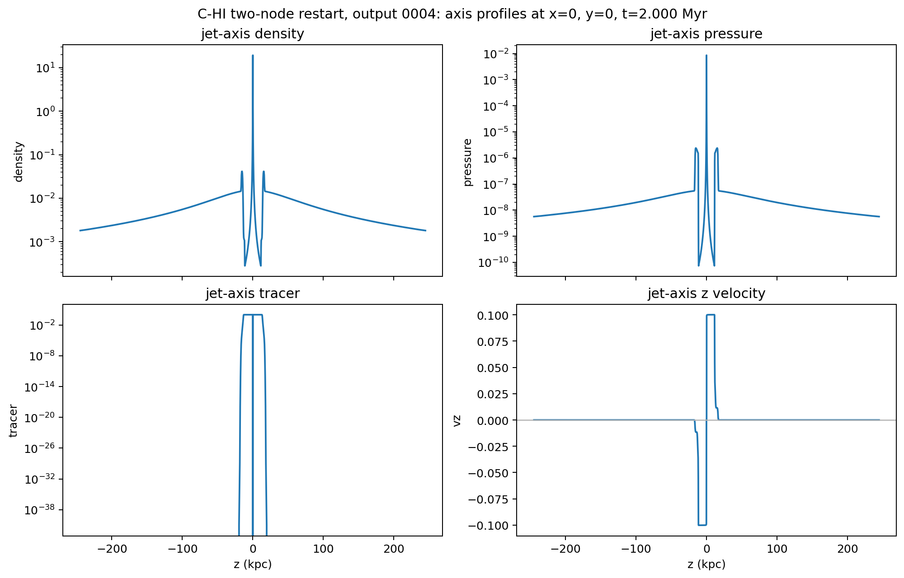

# C-HI Two-node Restart Rehearsal Quick-look

Date: 2026-05-09

## Summary

This report records the first production-template, multi-node restart
rehearsal for the particles-enabled `C-HI` Stewart-cluster run on `kunanyi`.

Run facts:

- source restart job: `690484.kunanyi-ohpc`
- job name: `c_hi_2node_env`
- scheduler result: `Exit_status = 0`
- resources: `select=2:ncpus=28:mpiprocs=28`
- nodes: `n038` and `n083`
- MPI ranks: `56`
- PBS walltime used: `01:45:08`
- PBS CPU time used: `45:43:18`
- PBS peak memory: `18587788kb`
- PBS virtual memory: `27291908kb`
- template restart mode: `RUN_KIND=h5_restart_2`
- PLUTO command: `-i pluto.ini -e environment.ini -maxtime 1.5 -h5restart 2`

The job restarted from `data.0002.dbl.h5` and advanced the run to a new
restart-capable output, `data.0003.dbl.h5`, at `2.1501 Myr`. The run wrote a
fresh `markers/DONE` file and no `FAILED` marker was present after completion.

This is still an early run-health diagnostic rather than a science result, but
it is an important gate: the current production template has now run the
particles-enabled `C-HI` case across two `kunanyi` nodes, with HDF5 restart and
HDF5 output intact.

## Launch Fixes Captured

Two intentionally small failed attempts preceded the successful job:

- `690481.kunanyi-ohpc` showed that OpenMPI did not infer the requested `56`
  PBS slots from the scheduler allocation.
- `690483.kunanyi-ohpc` showed that the second node did not inherit the HDF5
  runtime library path, failing on `libhdf5.so.310`.

The production template now writes an explicit OpenMPI hostfile from
`PBS_NODEFILE` and exports `PATH`, `LD_LIBRARY_PATH`, and HDF5-related
environment variables through `mpirun`. The successful `690484` hostfile was:

```text
n038.kunanyi slots=28
n083.kunanyi slots=28
```

This means the multi-node launch issue has been reduced to a documented template
fix, not a standing blocker.

## Output Catalogue

The current HDF5 catalogue now contains two regular science-cadence float
outputs, plus three walltime-forced double restart outputs.

| Output | Type | Time (Myr) | Step | Role |
| ---: | --- | ---: | ---: | --- |
| 0 | `dbl.h5` | 0.0000 | 0 | initial restart-capable output |
| 1 | `dbl.h5` | 0.4474 | 583 | first walltime-forced restart output |
| 2 | `dbl.h5` | 1.0102 | 1146 | second walltime-forced restart output |
| 3 | `dbl.h5` | 2.1501 | 2267 | two-node walltime-forced restart output |
| 0 | `flt.h5` | 0.0000 | 0 | initial float output |
| 1 | `flt.h5` | 0.4474 | 583 | first walltime-forced float output |
| 2 | `flt.h5` | 0.9990 | 1135 | nominal 1 Myr science-cadence output |
| 3 | `flt.h5` | 1.0102 | 1146 | second walltime-forced float output |
| 4 | `flt.h5` | 1.9996 | 2120 | nominal 2 Myr science-cadence output |
| 5 | `flt.h5` | 2.1501 | 2267 | two-node walltime-forced float output |

The corresponding CSV is stored at
`docs/science/assets/c_hi_2node_quicklook_2026-05-09/output_catalogue.csv`.

Particle outputs now extend through `particles.0218.dbl`.

## Quick-look Extraction

A one-core compute-node extraction job inspected the nominal 2 Myr float
output:

- quick-look extraction job: `690559.kunanyi-ohpc`
- inspected file:
  `/scratch/bwbrook/xray_cavities_runs/2026-05-08-c-hi-segment/C-HI/particles/problem/outputs/data.0004.flt.h5`
- timestep: `Timestep_4`
- PLUTO code time: `613.07384055587761`
- physical time: `1.9996 Myr`
- extraction result: `Exit_status = 0`

The compact evidence bundle was retrieved to:

```text
build/science/kunanyi_stage_2026-05-08/c_hi_2node_690484_quicklook_690559_compact_2026-05-09.tar.gz
```

SHA-256:

```text
e002e0df31f5f2749ce823f7ca5b897c4b6b4cb7b322be9e29e9fb8cf9b045bb
```

## Tracer Extent

At the default Level 2 truth threshold, `tracer > 5e-3`, the tracer-defined
region has grown smoothly from the previous early outputs:

| Snapshot | Time (Myr) | Default-threshold x/y extent | Default-threshold z extent |
| --- | ---: | --- | --- |
| first segment quick-look | 0.4474 | `+/-2.33 kpc` | `+/-6.22 kpc` |
| first restart quick-look | 0.9990 | `+/-3.84 kpc` | `+/-10.1 kpc` |
| two-node quick-look | 1.9996 | `+/-5.63 kpc` | `+/-16.5 kpc` |

Detailed 2 Myr thresholds:

| Threshold | Cells | x range (kpc) | y range (kpc) | z range (kpc) |
| --- | ---: | --- | --- | --- |
| `1e-3` | 6351456 | -5.82 to 5.82 | -5.82 to 5.82 | -16.5 to 16.5 |
| `5e-3` | 5908752 | -5.63 to 5.63 | -5.63 to 5.63 | -16.5 to 16.5 |
| `1e-2` | 5697720 | -5.53 to 5.53 | -5.53 to 5.53 | -16.1 to 16.1 |

## Figures

Full-domain mid-plane maps:



Central zoom:



Jet-axis profiles:



## Interpretation

The two-node rehearsal passes the intermediate `kunanyi` gate:

- HDF5 restart from `data.0002.dbl.h5` worked via `-h5restart 2`.
- OpenMPI launched across two PBS nodes using a generated hostfile.
- The HDF5 runtime environment propagated to the second node.
- PLUTO stopped through the requested `-maxtime 1.5` path.
- A new restart-capable `dbl.h5` output was written.
- The nominal 2 Myr `flt.h5` output was written and extracted successfully.
- Tracer, density, pressure, and `v_z` quick-looks remain symmetric and far
  from the outer grid boundaries.

The next compute rung should be a longer early-snapshot continuation, not yet a
full 48-hour production push. The near-term target is to reach the first `3-5`
regular science snapshots cleanly, then assemble the first aligned
truth/X-ray/radio smoke package around a declared snapshot and view.
