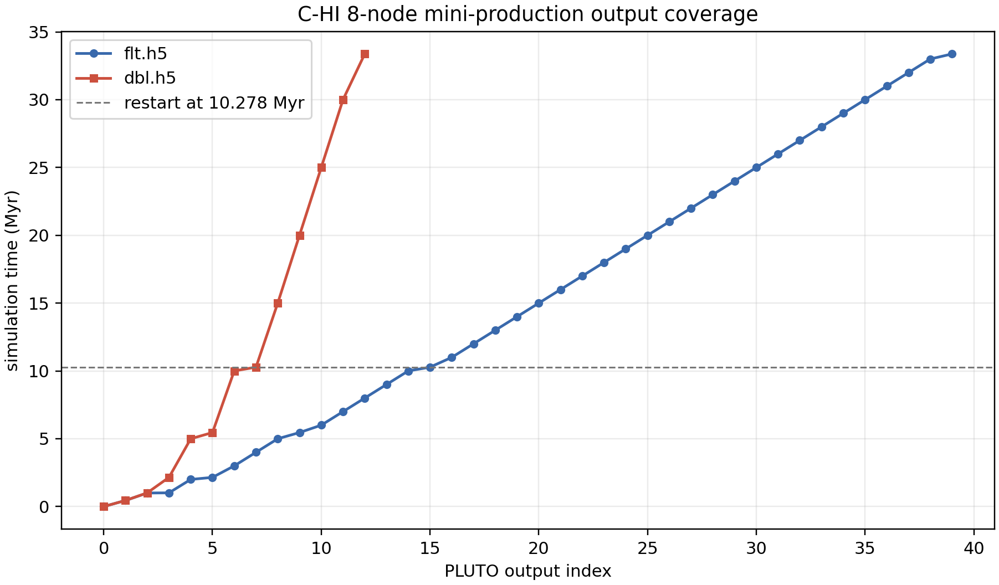

# C-HI 8-Node Mini-Production Update

Date: 2026-05-13

## Summary

The scheduler-fit `C-HI` mini-production continuation completed cleanly on
`kunanyi`. This was a reduced-grid particles-enabled run, not the final
full-grid production suite, but it is the first substantially larger
production-template continuation beyond the earlier 1-2 node rehearsals.

The run restarted from the previous walltime-stop HDF5 checkpoint at
`10.278362 Myr` and advanced to `33.374180 Myr`.

## Kunanyi Job

| Item | Value |
| --- | --- |
| PBS job | `691422.kunanyi-ohpc` |
| Job name | `c_hi_8mini` |
| Exit status | `0` |
| Request | `select=8:ncpus=28:mpiprocs=28` |
| MPI ranks | `224` |
| Walltime used | `14:45:00` |
| PLUTO guard | `-maxtime 14.5` |
| Restart mode | `-h5restart 7` |
| Start checkpoint | `data.0007.dbl.h5`, `10.278362 Myr` |
| Final output | `data.0039.flt.h5`, `33.374180 Myr` |
| Final restart checkpoint | `data.0012.dbl.h5`, `33.374180 Myr` |
| Output volume after run | `217G` |

The run used the production template staged as
`/u/bwbrook/codex_kunanyi/jet_setup_production_template_latest.pbs` and reused
the existing particles-enabled reduced-grid `C-HI` problem build.

## Output Coverage

The job added a long block of regular `flt.h5` outputs and a new set of
restart-capable `dbl.h5` checkpoints.

| Output type | New useful outputs | Time coverage |
| --- | --- | --- |
| `flt.h5` | `16-39` | `10.999144-33.374180 Myr` |
| `dbl.h5` | `8-12` | `14.999293-33.374180 Myr` |
| particles | through `particles.3343.dbl` | about `33.4 Myr` |

The walltime-to-simulation-time throughput for this segment was about
`1.57 Myr per wall-clock hour`, measured from `10.278362` to `33.374180 Myr`
over the `14.75 h` PBS walltime.

## Output Time Table

Selected regular outputs:

| Grid output | Time (`Myr`) | Step |
| ---: | ---: | ---: |
| `15` | `10.2784` | `10206` |
| `20` | `14.9993` | `14817` |
| `25` | `19.9997` | `19701` |
| `30` | `24.9992` | `24584` |
| `35` | `29.9996` | `29468` |
| `39` | `33.3742` | `32764` |

Selected restart checkpoints:

| Restart output | Time (`Myr`) | Step |
| ---: | ---: | ---: |
| `7` | `10.2784` | `10206` |
| `8` | `14.9993` | `14817` |
| `9` | `19.9997` | `19701` |
| `10` | `24.9992` | `24584` |
| `11` | `29.9996` | `29468` |
| `12` | `33.3742` | `32764` |

## Interpretation For The Meeting

This is a useful operational result:

- the production template restarted cleanly from HDF5
- the `8` node, `224` rank MPI layout ran to the `-maxtime` guard
- PLUTO wrote the expected final restart-capable HDF5 checkpoint before PBS
  termination
- output volume is now large enough (`217G`) that artifact discipline matters
- the run reached two-thirds of the current `50 Myr` first-target duration

The result does not replace a later full-grid/full-production allocation test.
It does show that the current C-HI setup, restart policy, and HDF5 output path
are now boring in exactly the way we wanted.

## Follow-Up Diagnostics

Two dependent diagnostic jobs have been submitted:

| PBS job | Name | Purpose |
| --- | --- | --- |
| `691762.kunanyi-ohpc` | `c_hi_ph5_33` | rebuild particle HDF5 through the new particle outputs |
| `691763.kunanyi-ohpc` | `c_hi_s33` | extract truth, cavity, XRAiSE, and radio scalar series |

The scalar series targets outputs `15`, `20`, `25`, `30`, `35`, and `39`,
covering `10.278-33.374 Myr`. Once those jobs complete, the next report should
extend the earlier through-10-Myr truth/X-ray/radio comparison to the new
mini-production segment.

## Local Artifacts

- compact run archive:
  `build/science/kunanyi_stage_2026-05-08/c_hi_8mini_691422_compact_2026-05-13.tar.gz`
- output-time CSV:
  `docs/science/assets/c_hi_8mini_2026-05-13/c_hi_8mini_output_times.csv`
- output-time figure:
  `docs/science/assets/c_hi_8mini_2026-05-13/c_hi_8mini_output_times.png`
