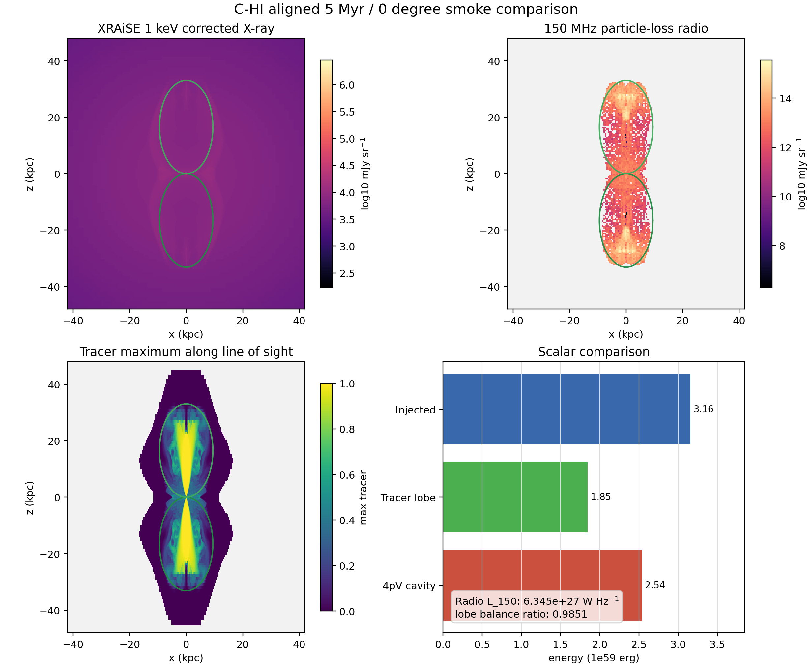
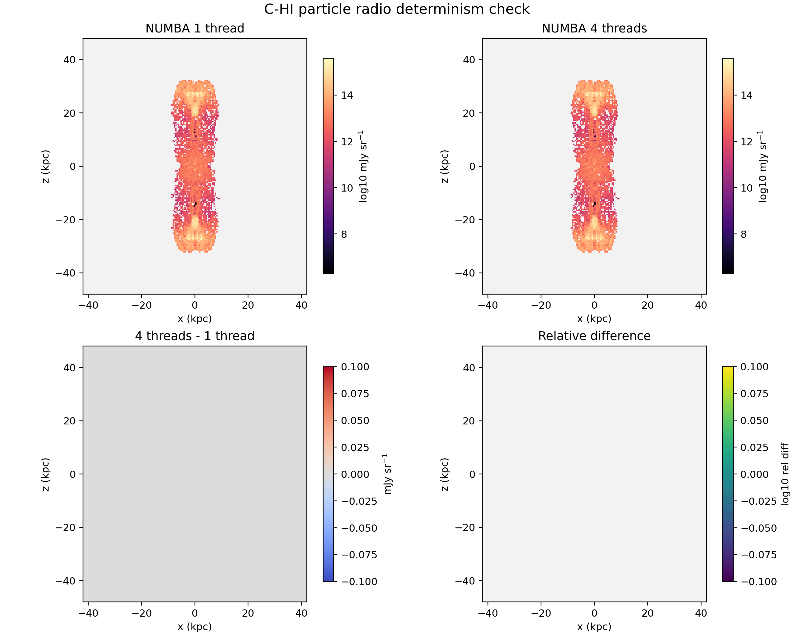

# C-HI 5 Myr Aligned Comparison And Determinism Gate

Date: 2026-05-10

## Summary

This report folds the aligned `C-HI` 5 Myr, `0 deg` smoke products onto one
page and records the deterministic particle-radio cross-check requested before
using the lane for longer snapshots.

The aligned target is:

- case: `C-HI`, high-power Stewart cluster control
- grid output: `data.0008.flt.h5`
- grid time: `4.9994 Myr`
- view: `0 deg`, projected along the simulation `y` axis
- truth threshold: `tracer > 5e-3`
- radio frequency: `150 MHz`
- X-ray energy: `1 keV`

## Aligned Products

The same target now has:

- Level 1 injected-energy truth
- Level 2 tracer-defined lobe truth
- ellipsoidal cavity-boundary and `pV` smoke
- XRAiSE-corrected 1 keV grid-thermal X-ray map
- particle-loss-aware 150 MHz radio/lobe map

The compact comparison assets are stored in:

```text
docs/science/assets/c_hi_aligned_comparison_2026-05-10/
```

## Scalar Comparison

| Quantity | Value |
| --- | ---: |
| grid time | `4.9994358508106655 Myr` |
| one-sided elapsed injected energy | `1.5777e59 erg` |
| bipolar elapsed injected energy | `3.1554e59 erg` |
| Level 2 tracer-lobe volume | `10791.775 kpc^3` |
| Level 2 tracer-lobe total energy | `1.8459e59 erg` |
| bipolar cavity `pV` | `6.3419e58 erg` |
| bipolar cavity `4pV` | `2.5367e59 erg` |
| mean cavity sound age | `13.4484 Myr` |
| XRAiSE-corrected 1 keV map max | `2.8783e6 mJy sr^-1` |
| XRAiSE-corrected 1 keV map sum | `1.0937e9 mJy sr^-1 pixels` |
| particle-loss 150 MHz map max | `3.6847e15 mJy sr^-1` |
| bipolar lossy 150 MHz luminosity proxy | `6.3450e27 W Hz^-1` |
| positive/negative radio lobe balance | `0.9851` |

The energy ordering is physically sensible for this early symmetric control:
the tracer-defined lobe energy is below the elapsed injected energy, while the
simple cavity `4pV` proxy sits between the Level 2 lobe energy and the total
bipolar injection.

## Comparison Figure



The green ellipses are the first cavity-boundary stub from the same
`tracer > 5e-3` target. The bottom-right panel puts the key truth and cavity
energy scales on the same axis, while the text box records the radio luminosity
and lobe-balance smoke.

## Determinism Check

The supplied `xraise.py` particle-loss path still emits a
`NumbaParallelSafetyWarning` inside `praise_aio(...)`. To test whether this
warning was producing thread-dependent results, the same particle-radio smoke
was rerun on `kunanyi` with:

- `NUMBA_NUM_THREADS=1`
- `NUMBA_NUM_THREADS=4`

The PBS job was:

- job id: `690644.kunanyi-ohpc`
- job name: `c_hi_rdet5`
- node: `n001`
- resources: `select=1:ncpus=4:mpiprocs=1`
- archive:
  `/u/bwbrook/codex_kunanyi/c_hi_particle_radio_determinism_2026-05-10.tar.gz`
- local archive:
  `build/science/kunanyi_stage_2026-05-08/c_hi_particle_radio_determinism_690644_2026-05-10.tar.gz`
- archive SHA256:
  `e04a16b996111a118998eac52fd3c10f90a602b0fc9a54a8d9df3e28b71802f0`

Result:

| Check | Result |
| --- | ---: |
| arrays allclose at `rtol = 1e-10` | `True` |
| exact output hashes match | `True` |
| maximum array relative difference | `0.0` |
| maximum scalar-metric relative difference | `0.0` |
| overall pass | `True` |

This does not prove the supplied Numba warning is harmless for every future
configuration, but it does show that the current 5 Myr, 150 MHz particle-radio
smoke is bitwise stable between one and four Numba threads.

## Determinism Figure



The lower panels are blank because the difference is exactly zero in the saved
products.

## Products

Aligned comparison products:

- `docs/science/assets/c_hi_aligned_comparison_2026-05-10/aligned_smoke_metrics.csv`
- `docs/science/assets/c_hi_aligned_comparison_2026-05-10/c_hi_aligned_comparison_maps.png`

Determinism products:

- `docs/science/assets/c_hi_particle_radio_determinism_2026-05-10/determinism_summary.csv`
- `docs/science/assets/c_hi_particle_radio_determinism_2026-05-10/determinism_summary.json`
- `docs/science/assets/c_hi_particle_radio_determinism_2026-05-10/determinism_array_diff.csv`
- `docs/science/assets/c_hi_particle_radio_determinism_2026-05-10/determinism_metric_diff.csv`
- `docs/science/assets/c_hi_particle_radio_determinism_2026-05-10/determinism_hashes.csv`
- `docs/science/assets/c_hi_particle_radio_determinism_2026-05-10/c_hi_particle_radio_determinism.png`

Reusable scripts:

- `scripts/science/build_aligned_smoke_comparison.py`
- `scripts/science/compare_particle_radio_determinism.py`
- `scripts/kunanyi/c_hi_particle_radio_determinism.pbs`

## Interpretation

This closes the first aligned-observable gate for the early `C-HI` control
snapshot. The project now has one declared 5 Myr target where truth, cavity,
X-ray, particle-loss, and radio products can be compared directly, and the
particle-radio lane is stable across the tested Numba thread counts.

The next science move should be to extend the same extraction/reporting path to
the next early snapshots, then decide whether the current `C-HI` run should be
continued toward the first `50 Myr` milestone or whether the grid/output
settings need adjustment before spending that larger compute block.
