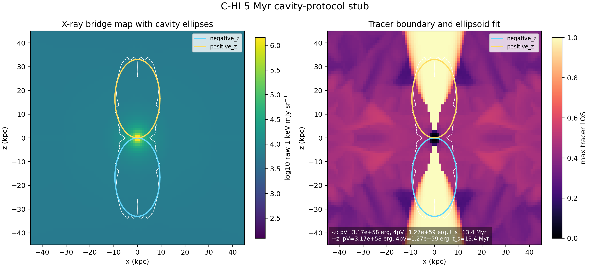

# C-HI 5 Myr Cavity-Protocol Stub

Date: 2026-05-10

## Summary

This report records the first explicit cavity-protocol smoke product for the
particles-enabled high-power cluster case, `C-HI`, using the same target as the
truth and observable smokes:

- grid output: `data.0008.flt.h5`
- grid timestep: `Timestep_8`
- physical time: `4.9994 Myr`
- view: `0 deg`, projected along the simulation `y` axis
- tracer threshold: `5e-3`

The extraction was run on a `kunanyi` compute node as PBS job
`690620.kunanyi-ohpc` and completed successfully. It is a cavity-protocol
stub, not the final science cavity measurement: it establishes a reproducible
ellipsoid-plus-ambient-shell path against the already aligned 5 Myr target.

## Method

The extractor fits one 3D tracer-defined ellipsoid per lobe. For each side of
the bipolar source, it uses all cells with `tracer > 5e-3` on that side of the
mid-plane to define the lobe centre and semi-axes. It then estimates the local
ambient medium from a same-side ellipsoidal shell outside the fitted lobe:

- shell ellipsoidal radius: `1.00` to `1.35`
- inner shell band: `1.00` to `1.15`
- outer shell band: `1.15` to `1.35`
- ambient tracer exclusion: `tracer <= 1e-3`

For each lobe the extractor reports:

- projected ellipsoid boundary for the `0 deg` view
- ellipsoid volume and tracer-extent volume
- local ambient pressure and density
- `pV` and `4pV`
- sound-crossing age
- buoyancy and refill age estimates

The buoyancy/refill ages use a provisional hydrostatic pressure-gradient proxy
for gravity from the inner and outer ambient-shell bands. These are useful only
as smoke-test values until the final cavity protocol uses the agreed
environment/gravity treatment.

## Kunanyi Job

- job id: `690620.kunanyi-ohpc`
- job name: `c_hi_cavity5`
- node: `n001`
- resources: `select=1:ncpus=1:mpiprocs=1`
- walltime requested: `00:30:00`
- extraction window: `2026-05-10T08:43:49Z` to `2026-05-10T08:44:25Z`
- extraction result: no stderr output, archive written successfully

Compact archive:

```text
remote: /u/bwbrook/codex_kunanyi/c_hi_cavity_stub_2026-05-10.tar.gz
local:  build/science/kunanyi_stage_2026-05-08/c_hi_cavity_stub_690620_compact_2026-05-10.tar.gz
sha256: 8166ab35bf27f7058bb5b44a387fd0f169edc8ccf2e4bbab920228bf3d78f769
```

## Scalar Smoke Metrics

| Metric | `-z` lobe | `+z` lobe |
| --- | ---: | ---: |
| lobe centre `z` | `-16.535 kpc` | `16.535 kpc` |
| semi-axis `x` | `9.465 kpc` | `9.465 kpc` |
| semi-axis `y` | `9.465 kpc` | `9.465 kpc` |
| semi-axis `z` | `16.510 kpc` | `16.510 kpc` |
| ellipsoid volume | `6194.84 kpc^3` | `6194.84 kpc^3` |
| tracer-extent volume | `5395.89 kpc^3` | `5395.89 kpc^3` |
| ambient pressure | `1.7422e-10 dyn cm^-2` | `1.7422e-10 dyn cm^-2` |
| ambient density | `2.0091e-26 g cm^-3` | `2.0091e-26 g cm^-3` |
| `pV` | `3.1709e58 erg` | `3.1709e58 erg` |
| `4pV` | `1.2684e59 erg` | `1.2684e59 erg` |
| sound speed | `1202.2 km s^-1` | `1202.2 km s^-1` |
| sound age | `13.45 Myr` | `13.45 Myr` |
| buoyancy age | `3.93 Myr` | `3.93 Myr` |
| refill age | `12.29 Myr` | `12.29 Myr` |

The near-identical values are expected for the current centred symmetric
`C-HI` control and are a useful sanity check on the measurement path.

## Figure



The white contour marks the line-of-sight maximum tracer boundary at
`tracer = 5e-3`. The coloured ellipses are the fitted projected cavity
boundaries derived from the 3D tracer extents.

## Products

The compact products are stored under
`docs/science/assets/c_hi_cavity_stub_2026-05-10/`:

- `cavity_stub_summary.csv`
- `cavity_stub_metadata.txt`
- `cavity_ellipse_boundary_0deg.tsv`
- `c_hi_cavity_stub_overlay.png`

The extractor and plotting helper are:

- `scripts/science/pluto_h5_cavity_stub_extract.c`
- `scripts/science/plot_cavity_stub.py`
- `scripts/kunanyi/c_hi_cavity_stub.pbs`

## Interpretation

This completes the first cavity-protocol smoke gate for the aligned 5 Myr
target:

- the same `C-HI` snapshot/view now has Level 1 truth, Level 2 tracer truth,
  bridge X-ray/radio observable products, and a first cavity measurement stub
- the fitted cavity geometry is symmetric and well inside the current domain
- the local ambient-shell estimator returns finite, symmetric pressure and
  density values
- `pV`, `4pV`, and simple age estimates can be produced reproducibly on a
  compute node without moving the full HDF5 file to the MacBook

The main remaining limitation is physics completeness, not mechanics. The
buoyancy/refill ages need replacement or calibration against the final agreed
environment/gravity treatment, and the bridge X-ray/radio products still need
the full GRAiLE/XRAiSE runtime rather than the compact C smoke path.
