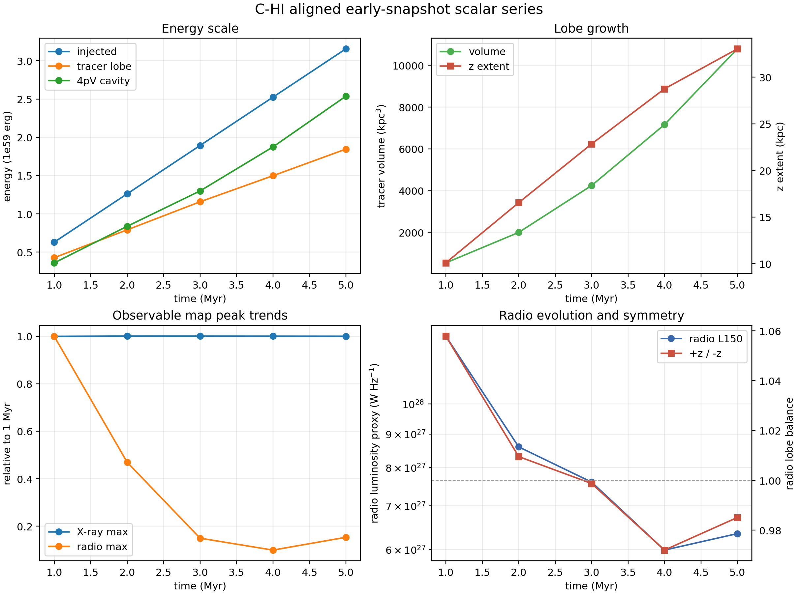

# C-HI Early Snapshot Series

Date: 2026-05-10

## Summary

This report extends the aligned `C-HI`, `0 deg` smoke lane from one snapshot to
the five regular early science outputs already available from the
particles-enabled `kunanyi` run:

| Grid output | Time (`Myr`) | Particle output |
| ---: | ---: | ---: |
| `2` | `0.9990` | `101` |
| `4` | `1.9996` | `202` |
| `6` | `2.9999` | `303` |
| `7` | `3.9991` | `403` |
| `8` | `4.9994` | `503` |

For each snapshot, the same compact lane was run:

- Level 1 injected-energy truth
- Level 2 tracer-defined lobe truth at `tracer > 5e-3`
- first-pass ellipsoidal cavity protocol
- XRAiSE-corrected `1 keV` grid-thermal X-ray scalar smoke
- particle-loss-aware `150 MHz` radio/lobe scalar smoke

The radio extraction used the per-snapshot Level 2 side volumes, not the
previous fixed 5 Myr lobe volumes.

## Kunanyi Job

- job id: `690646.kunanyi-ohpc`
- job name: `c_hi_eseries`
- node: `n001`
- resources: `select=1:ncpus=4:mpiprocs=1`
- compact archive:
  `/u/bwbrook/codex_kunanyi/c_hi_early_snapshot_series_2026-05-10.tar.gz`
- local archive:
  `build/science/kunanyi_stage_2026-05-08/c_hi_early_snapshot_series_690646_2026-05-10.tar.gz`
- archive SHA256:
  `503da7d4d2e80f1a2a76e5946aee59724ffe5055a71893119ef6786a06d8b68e`

The only stderr warning was the known `NumbaParallelSafetyWarning` from the
supplied particle-loss path. The 5 Myr target for this same lane has already
passed a `NUMBA_NUM_THREADS=1` versus `4` deterministic check.

## Main Trends

| Metric | 1 Myr | 5 Myr |
| --- | ---: | ---: |
| bipolar injected energy | `6.3052e58 erg` | `3.1554e59 erg` |
| Level 2 tracer-lobe energy | `4.2795e58 erg` | `1.8459e59 erg` |
| bipolar `4pV` cavity proxy | `3.5998e58 erg` | `2.5367e59 erg` |
| Level 2 tracer-lobe volume | `539.62 kpc^3` | `10791.77 kpc^3` |
| tracer z extent | `10.08 kpc` | `33.04 kpc` |
| XRAiSE-corrected X-ray peak | `2.8772e6 mJy sr^-1` | `2.8783e6 mJy sr^-1` |
| lossy 150 MHz luminosity proxy | `1.2695e28 W Hz^-1` | `6.3450e27 W Hz^-1` |
| radio lobe balance, `+z / -z` | `1.0579` | `0.9851` |

The early series is coherent:

- injected energy grows linearly, as expected for the still-active jet
- tracer volume grows by about `20x` from 1 to 5 Myr
- by 5 Myr, Level 2 tracer-lobe energy is about `0.585` of elapsed bipolar
  injection
- by 5 Myr, the bipolar `4pV` proxy is about `0.804` of elapsed bipolar
  injection
- radio lobe balance stays close to unity across the five snapshots, ranging
  from `0.9720` to `1.0579`
- the central X-ray peak is essentially flat across this early interval, while
  the particle-radio peak and luminosity evolve more strongly

## Figure



## Products

Compact products are stored under:

```text
docs/science/assets/c_hi_early_snapshot_series_2026-05-10/
```

Key files:

- `early_snapshot_series_metrics.csv`
- `c_hi_early_snapshot_series.png`
- `compact/snap_0002/`
- `compact/snap_0004/`
- `compact/snap_0006/`
- `compact/snap_0007/`
- `compact/snap_0008/`

Reusable scripts:

- `scripts/kunanyi/c_hi_early_snapshot_series.pbs`
- `scripts/science/build_early_snapshot_series.py`

## Interpretation

This closes the early-snapshot scalar-series gate. The first five regular
outputs show smooth lobe growth, stable symmetry, sensible energy ordering, and
no immediate evidence from the compact diagnostics that the `C-HI` setup should
be stopped before a longer continuation.

The next compute-facing move can therefore be a guarded continuation of `C-HI`
toward the first `50 Myr` milestone, using the already validated restart,
`-maxtime`, output-catalogue, and email-notification pattern. The practical
near-term target should be the next block of regular snapshots rather than a
blind multi-day push all the way to completion.
