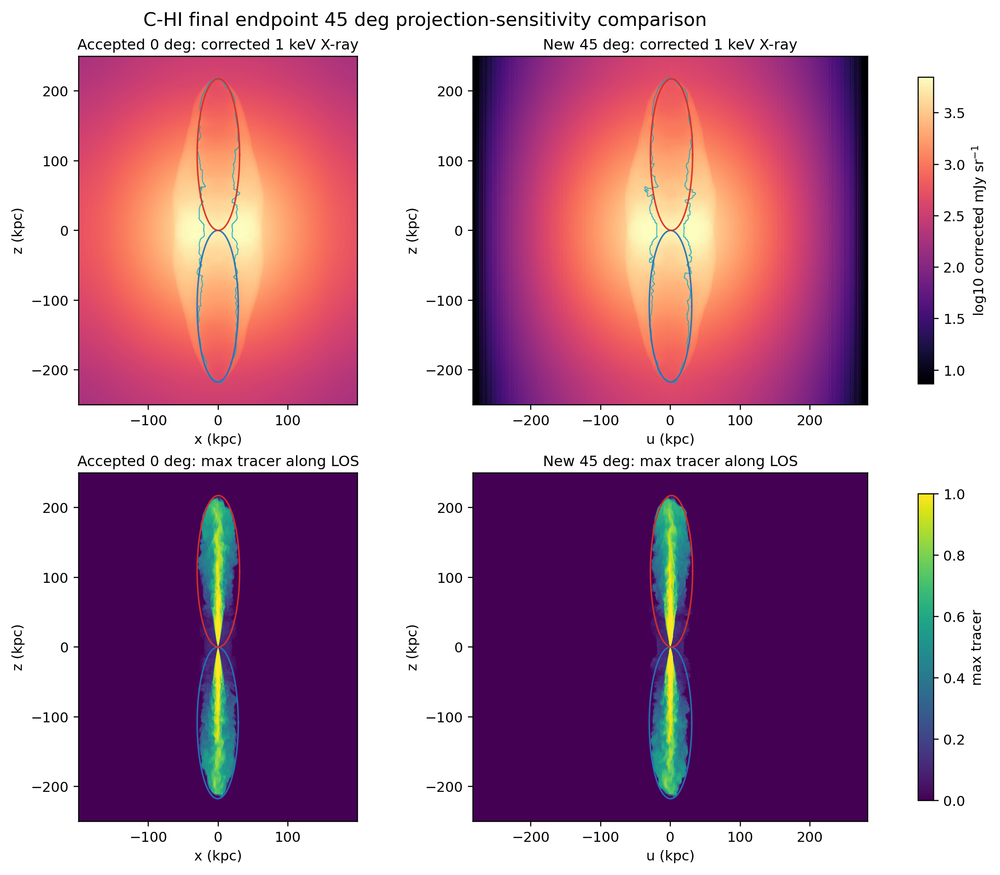

# C-HI Final 45-Degree Viewing-Angle Broadening

Date: 2026-06-23

## Summary

Goal 011 packages the first controlled post-processing-only broadening product
for the accepted final 50 Myr `C-HI` endpoint: one additional viewing angle,
`45 deg`, compared with the accepted final `0 deg` baseline.

Status: `complete_product`.

This is a projection-sensitivity probe, not a publication-ready observable
claim. It does not add `90 deg`, source-age sampling, `C-LO`, `G-LO`, new PLUTO
production, new radio observables, beam/instrument treatment, or new scientific
defaults.

## Remote Record

PBS completion evidence supplied by Barry:

| Job | Name | Exit | Walltime | Memory |
| --- | --- | ---: | ---: | ---: |
| `699815.kunanyi-ohpc` | `c_hi_xcav45` | `0` | `00:16:46` | `1260168kb` |

Remote stage:

```text
/u/bwbrook/codex_kunanyi/goal011_c_hi_final_45deg_viewing_angle
```

Remote analysis root:

```text
/scratch/bwbrook/xray_cavities_analysis/2026-06-23-c-hi-final-45deg-viewing-angle-broadening
```

Fetched archive:

```text
docs/science/assets/c_hi_final_45deg_viewing_angle_broadening_2026-06-23/remote_logs/final_45deg_viewing_angle_broadening_2026-06-23.tar.gz
sha256=fbf5102046b103e2777c8e29b85eee08dc5f5ff028196e5f6bcb73dc48f0ee20
```

Remote stdout records:

- `hdf5_preflight=passed`
- `xray_45deg_validation=passed`
- `cavity_validation=passed`
- `finished_utc=2026-06-23T08:06:05Z`

Remote stderr is zero bytes.

## Local Review Assets

Compact local review assets are under:

```text
docs/science/assets/c_hi_final_45deg_viewing_angle_broadening_2026-06-23/
```

Primary files:

| File | Purpose |
| --- | --- |
| `c_hi_final_45deg_viewing_angle_broadening.png` | reviewer-facing `0 deg` versus `45 deg` X-ray/tracer comparison |
| `viewing_angle_comparison.csv` | scalar X-ray comparison between accepted `0 deg` and new `45 deg` products |
| `projection_metrics.csv` | projected `45 deg` cavity boundary metrics from 3D ellipsoid rows |
| `cavity_energy_convention.csv` | `pV`, adopted `2.5pV`, and `4pV` cavity-energy convention table |
| `product_provenance.csv` | local and fetched-product checksums |
| `final_45deg_viewing_angle_metadata.json` | package status, remote paths, markers, and caveats |
| `cavity_stub/cavity_ellipse_boundary_45deg.tsv` | local 45-degree projected cavity overlay |

The fetched `cavity_stub/cavity_ellipse_boundary_0deg.tsv` is retained as
remote provenance but is not used as the 45-degree overlay. The 45-degree
overlay is projected locally from the 3D cavity summary rows into the `u-z`
sky plane.

## Figure



## X-ray Projection Comparison

| Metric | Accepted `0 deg` | New `45 deg` | `45/0` |
| --- | ---: | ---: | ---: |
| raw X-ray max (`mJy sr^-1`) | `1.435453943161817e6` | `1.598063123774619e5` | `0.11132806673369326` |
| corrected X-ray max (`mJy sr^-1`) | `2.874403714611562e6` | `3.298379248043104e5` | `0.11475003428628802` |
| raw X-ray pixel sum (`mJy sr^-1 pixels`) | `2.386267961414721e9` | `1.068842893446097e9` | `0.44791402756479354` |
| corrected X-ray pixel sum (`mJy sr^-1 pixels`) | `3.212610085481297e9` | `1.433987537616477e9` | `0.44636214774306926` |
| positive correction-ratio max | `2.451117643672624` | `2.283936965590594` | `0.9317941027785449` |

Pixel sums are diagnostic map sums, not luminosity integrals.

## Cavity Projection And Energy Convention

Projected 45-degree cavity display geometry:

| Side | `center_u` (`kpc`) | `center_z` (`kpc`) | `semi_u` (`kpc`) | `semi_z` (`kpc`) |
| --- | ---: | ---: | ---: | ---: |
| negative z | `0.2255530744909004` | `-108.73230285663158` | `30.44976137638979` | `108.70730285625905` |
| positive z | `1.6545618665652597` | `108.73230285663158` | `30.235010461740867` | `108.70730285625905` |

Cavity energy convention carried forward:

| Side | `pV` (`erg`) | adopted `2.5pV` (`erg`) | `4pV` (`erg`) |
| --- | ---: | ---: | ---: |
| negative z | `3.436843916631997e59` | `8.592109791579992e59` | `1.3747375666527988e60` |
| positive z | `3.4412100224950333e59` | `8.603025056237583e59` | `1.3764840089980133e60` |
| bipolar total | `6.87805393912703e59` | `1.7195134847817575e60` | `2.751221575650812e60` |

These are the same tracer-defined 3D cavity scalars used for the baseline
endpoint protocol; Goal 011 changes the viewing projection, not the cavity
definition.

## Method Boundaries

- Case: accepted final `C-HI` endpoint at 50 Myr.
- Baseline: accepted `0 deg` Goal 005 X-ray/cavity product.
- New target: one `45 deg` X-ray/tracer projection only.
- X-ray method: existing XRAiSE/GRAiLE grid path with supplied APEC and Gaunt
  correction tables.
- Cavity protocol: existing tracer-defined ellipsoid plus ambient-shell cavity
  stub. The 45-degree visual boundary is projected from the 3D ellipsoid rows.
- Energy convention: carry `pV`, adopted non-relativistic `2.5pV`, and
  literature-comparison `4pV`.

Preserved caveats:

- X-ray topology remains a connected-envelope/single-lobe caveat pending a
  later X-ray-based cavity-fit method.
- Sparse particle-binned radio remains a diagnostic, not a validated radio
  observable.
- Level 3 gravitational energy remains `blocked_missing_potential`.
- This product is not a final publication-ready observable product.

## Interpretation

Goal 011 completes the first controlled broadening step by changing one
post-processing axis: viewing angle. The `45 deg` product is finite,
reviewable, and packaged beside the accepted `0 deg` baseline with reproducible
local provenance.

Recommended next step: X-ray Cavities should review the Goal 011 product and,
if accepted, write the next goal as a similarly controlled single-axis
broadening step. The natural next candidate is `90 deg` for final `C-HI`, while
continuing to preserve topology, radio-observable, and Level 3 gravity caveats.
