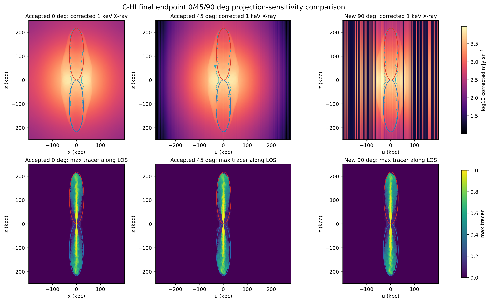

# C-HI Final 90-Degree Viewing-Angle Broadening

Date: 2026-06-23

## Summary

Goal 012 packages the final member of the controlled post-processing-only
viewing-angle trio for the accepted final 50 Myr `C-HI` endpoint: one new
`90 deg` product compared with the accepted final `0 deg` baseline and accepted
`45 deg` product.

Status: `complete_product`.

This is a projection-sensitivity probe, not a publication-ready observable
claim. It does not add source-age sampling, `C-LO`, `G-LO`, comparison-case
processing, new PLUTO production, new radio observables, beam/instrument
treatment, or new scientific defaults.

## Remote Record

PBS completion evidence from `qstat -x -f` and Barry's completion email:

| Job | Name | Exit | State | Walltime | CPU time | Memory |
| --- | --- | ---: | --- | ---: | ---: | ---: |
| `699822.kunanyi-ohpc` | `c_hi_xcav90` | `0` | `F` | `00:16:34` | `00:12:10` | `1288828kb` |

Remote stage:

```text
/u/bwbrook/codex_kunanyi/goal012_c_hi_final_90deg_viewing_angle
```

Remote analysis root:

```text
/scratch/bwbrook/xray_cavities_analysis/2026-06-23-c-hi-final-90deg-viewing-angle-broadening
```

Input endpoint:

```text
/scratch/bwbrook/xray_cavities_runs/2026-06-06-c-hi-fullgrid-agn-impi-r9-prod64/C-HI/particles/problem/outputs/data.0051.flt.h5
Timestep_51
```

Fetched archive:

```text
docs/science/assets/c_hi_final_90deg_viewing_angle_broadening_2026-06-23/remote_logs/final_90deg_viewing_angle_broadening_2026-06-23.tar.gz
sha256=0a27e7ad51d91a930ec5f1e853265093ec4bf59915bc4c172be8e7fba7150d6f
```

Remote stdout records:

- `hdf5_preflight=passed shape_nz_ny_nx=(1014, 960, 960) time_code=15330.069689399999`
- `xray_90deg_validation=passed`
- `cavity_validation=passed`
- `finished_utc=2026-06-23T13:31:40Z`

Remote stderr is zero bytes.

## Local Review Assets

Compact local review assets are under:

```text
docs/science/assets/c_hi_final_90deg_viewing_angle_broadening_2026-06-23/
```

Primary files:

| File | Purpose |
| --- | --- |
| `c_hi_final_90deg_viewing_angle_broadening.png` | reviewer-facing `0/45/90 deg` X-ray/tracer comparison |
| `viewing_angle_comparison.csv` | scalar X-ray comparison between accepted `0 deg` and new `90 deg` products |
| `viewing_angle_trio_comparison.csv` | scalar comparison spanning accepted `0 deg`, accepted `45 deg`, and new `90 deg` products |
| `projection_metrics.csv` | projected `90 deg` cavity boundary metrics from 3D ellipsoid rows |
| `cavity_energy_convention.csv` | `pV`, adopted `2.5pV`, and `4pV` cavity-energy convention table |
| `product_provenance.csv` | local and fetched-product checksums |
| `final_90deg_viewing_angle_metadata.json` | package status, remote paths, markers, and caveats |
| `cavity_stub/cavity_ellipse_boundary_90deg.tsv` | local 90-degree projected cavity overlay |

The fetched `cavity_stub/cavity_ellipse_boundary_0deg.tsv` is retained as
remote provenance only. The 90-degree overlay is projected locally from the 3D
cavity summary rows into the `u-z` sky plane.

## Figure



## X-ray Projection Comparison

Direct `90 deg` versus accepted `0 deg`:

| Metric | Accepted `0 deg` | New `90 deg` | `90/0` |
| --- | ---: | ---: | ---: |
| raw X-ray max (`mJy sr^-1`) | `1.435453943161817e6` | `2.22643695189851e5` | `0.1551033359520004` |
| corrected X-ray max (`mJy sr^-1`) | `2.874403714611562e6` | `4.614776271700215e5` | `0.16054725535740694` |
| raw X-ray pixel sum (`mJy sr^-1 pixels`) | `2.386267961414721e9` | `1.51157211595757e9` | `0.6334460925592869` |
| corrected X-ray pixel sum (`mJy sr^-1 pixels`) | `3.212610085481297e9` | `2.027964623971217e9` | `0.6312514030682306` |
| positive correction-ratio max | `2.451117643672624` | `2.324381436823162` | `0.9482945230406944` |

Combined trio highlights:

| Metric | `45/0` | `90/0` | `90/45` |
| --- | ---: | ---: | ---: |
| corrected X-ray max | `0.11475003428628802` | `0.16054725535740694` | `1.3991042038110435` |
| corrected X-ray pixel sum | `0.44636214774306926` | `0.6312514030682306` | `1.4142135623730925` |
| positive correction-ratio max | `0.9317941027785449` | `0.9482945230406944` | `1.017708225683063` |

Pixel sums are diagnostic map sums, not luminosity integrals.

## Cavity Projection And Energy Convention

Projected 90-degree cavity display geometry:

| Side | `center_u` (`kpc`) | `center_z` (`kpc`) | `semi_u` (`kpc`) | `semi_z` (`kpc`) |
| --- | ---: | ---: | ---: | ---: |
| negative z | `0.8589553833007812` | `-108.73230285663158` | `31.410423278808594` | `108.70730285625905` |
| positive z | `1.9228744506835938` | `108.73230285663158` | `30.054153442382812` | `108.70730285625905` |

Cavity energy convention carried forward:

| Side | `pV` (`erg`) | adopted `2.5pV` (`erg`) | `4pV` (`erg`) |
| --- | ---: | ---: | ---: |
| negative z | `3.436843916631997e59` | `8.592109791579992e59` | `1.3747375666527988e60` |
| positive z | `3.4412100224950333e59` | `8.603025056237583e59` | `1.3764840089980133e60` |
| bipolar total | `6.87805393912703e59` | `1.7195134847817575e60` | `2.751221575650812e60` |

These are the same tracer-defined 3D cavity scalars used for the baseline and
45-degree protocols; Goal 012 changes only the viewing projection.

## Method Boundaries

- Case: accepted final `C-HI` endpoint at 50 Myr.
- Baselines: accepted `0 deg` Goal 005 product and accepted `45 deg` Goal 011
  product.
- New target: one `90 deg` X-ray/tracer projection only.
- X-ray method: existing XRAiSE/GRAiLE grid path with supplied APEC and Gaunt
  correction tables.
- Cavity protocol: existing tracer-defined ellipsoid plus ambient-shell cavity
  stub. The 90-degree visual boundary is projected from the 3D ellipsoid rows.
- Energy convention: carry `pV`, adopted non-relativistic `2.5pV`, and
  literature-comparison `4pV`.

Preserved caveats:

- X-ray topology remains a connected-envelope/single-lobe caveat pending a
  later X-ray-based cavity-fit method.
- Sparse particle-binned radio remains a diagnostic, not a validated radio
  observable.
- Level 3 gravitational energy remains `blocked_missing_potential`.
- This product is not a final publication-ready observable product.

## Interpretation

Goal 012 completes the first final-endpoint `C-HI` viewing-angle trio while
holding run, endpoint, source age, case, physical defaults, and product
contracts fixed. The `90 deg` product is finite, reviewable, and packaged
beside the accepted `0 deg` and `45 deg` products with reproducible local
provenance.

Recommended next step: X-ray Cavities should review the Goal 012 product for
acceptance. If accepted, the next goal should be a decision gate for any
broadening beyond this viewing-angle trio, not automatic expansion into source
ages, comparison cases, or publication-ready observable claims.
