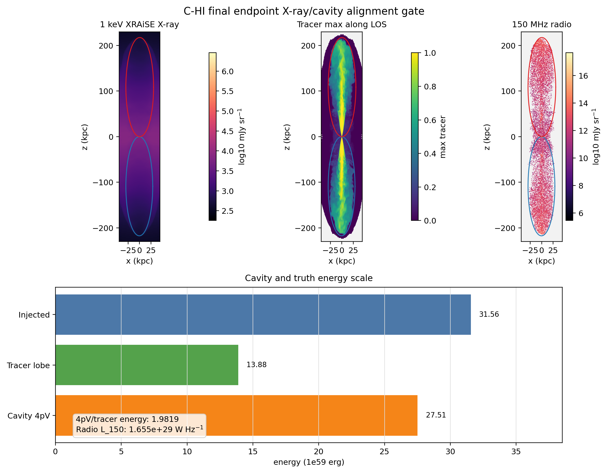

# C-HI Final Endpoint X-ray/Cavity Alignment Gate

Date: 2026-06-11

## Summary

This note records the Goal 005 final-endpoint alignment gate for the completed
50 Myr `C-HI` production run. It applies the existing `0 deg` XRAiSE/GRAiLE
grid X-ray path and the existing ellipsoid plus ambient-shell cavity protocol
to the final HDF5 endpoint, then compares the cavity quantities with accepted
Level 1/2 truth and the Goal 003 volume-coupled sparse radio scalars.

Headline result: the final endpoint alignment gate is `green`. The X-ray map is
finite and nonblank, the cavity protocol produced finite side-aware geometry,
ambient pressure/density, `pV`, `4pV`, and labelled age estimates, and the
cavity tracer volumes match the accepted Level 2 `tracer > 5e-3` side volumes
to numerical precision.

This is not a publication-ready observable. It does not add beam, detector,
exposure, source-age sampling, viewing-angle sampling, `C-LO`/`G-LO`, or the
Level 3 ambient-energy method.

## Remote Record

Remote stage:

```text
/u/bwbrook/codex_kunanyi/goal005_final_xray_cavity_alignment
```

Remote output root:

```text
/scratch/bwbrook/xray_cavities_analysis/2026-06-11-c-hi-final-endpoint-xray-cavity-alignment
```

Remote input:

```text
/scratch/bwbrook/xray_cavities_runs/2026-06-06-c-hi-fullgrid-agn-impi-r9-prod64/C-HI/particles/problem/outputs/data.0051.flt.h5
Timestep_51
```

PBS job:

| Job | Name | Request | Outcome |
| --- | --- | --- | --- |
| `697898.kunanyi-ohpc` | `c_hi_xcav51` | `select=1:ncpus=1:mpiprocs=1:mem=96gb`, `walltime=06:00:00` | extraction complete; wrapper exited `1` during post-cavity validation |

The job completed the heavy X-ray and cavity extraction. It exited nonzero
after the cavity products were written because the wrapper had purged
`Anaconda3` for the HDF5 compile/run step, then invoked `python` for validation;
on the compute node that resolved to an older interpreter that rejected an
f-string. The wrapper has been corrected to reload `Anaconda3/2024.02-1`
before post-cavity validation.

A lightweight remote finalizer was then run against the already-produced
outputs. It passed X-ray and cavity validation and wrote the archive:

```text
/u/bwbrook/codex_kunanyi/goal005_final_xray_cavity_alignment/final_endpoint_xray_cavity_alignment_2026-06-11.tar.gz
sha256=2d75e982a389ac0db6f9459c14d27ab3c5e749d045da18050f47df544f4c155e
```

## Local Review Assets

Compact local review assets are under:

```text
docs/science/assets/c_hi_final_endpoint_xray_cavity_alignment_2026-06-11/
```

Primary files:

| File | Size |
| --- | ---: |
| `final_xray_cavity_alignment_metrics.csv` | 1086 bytes |
| `final_xray_cavity_alignment_lobes.csv` | 1160 bytes |
| `final_xray_cavity_alignment_metadata.json` | 3380 bytes |
| `final_xray_cavity_alignment_summary.md` | 976 bytes |
| `c_hi_final_endpoint_xray_cavity_alignment.png` | 425789 bytes |
| `xraise_grid/xraise_grid_smoke_summary.csv` | 443 bytes |
| `xraise_grid/xraise_grid_smoke_metadata.json` | 1586 bytes |
| `xraise_grid/xray_1kev_xraise_corrected_mjy_sr.tsv` | 16548480 bytes |
| `xraise_grid/tracer_max_los.tsv` | 16548480 bytes |
| `cavity_stub/cavity_stub_summary.csv` | 1737 bytes |
| `cavity_stub/cavity_ellipse_boundary_0deg.tsv` | 36005 bytes |
| `remote_logs/c_hi_final_endpoint_xray_cavity_alignment.out` | 3390 bytes |
| `remote_logs/c_hi_final_endpoint_xray_cavity_alignment.err` | 157 bytes |

The full raw X-ray map and correction-ratio TSV diagnostics are preserved in
the remote archive. The local subset keeps the corrected map, tracer mask,
axes, scalar summaries, cavity summaries, logs, and review figure.

## Figure



The blue/red ellipses are the projected cavity boundaries from the same
`tracer > 5e-3`, `0 deg` target. The radio panel uses the accepted Goal 003
volume-coupled sparse PRAiSE-compatible bridge for continuity comparison.

## X-ray Metrics

| Metric | Value |
| --- | ---: |
| time | `50.00000000000777 Myr` |
| grid shape | `1014 x 960 x 960` |
| raw 1 keV max | `1.435453943161817e6 mJy sr^-1` |
| corrected 1 keV max | `2.874403714611562e6 mJy sr^-1` |
| raw 1 keV map sum | `2.386267961414721e9 mJy sr^-1 pixels` |
| corrected 1 keV map sum | `3.212610085481297e9 mJy sr^-1 pixels` |
| positive correction-ratio max | `2.451117643672624` |

The corrected map has `973440` finite positive cells.

## Cavity/Truth/Radio Alignment

| Side | Cavity volume / Level 2 volume | `4pV / Level 2 energy` | `4pV / injected-energy reference` | Radio `L_150` (`W Hz^-1`) |
| --- | ---: | ---: | ---: | ---: |
| negative z | `1.0000000000032894` | `1.9855699041313237` | `0.8712560946667675` | `5.20526129346918e28` |
| positive z | `1.0000000000021847` | `1.9783339067345296` | `0.8723629230347134` | `1.1343085864598182e29` |
| bipolar total | `1.0000000000056688` | `1.9819430042244381` | `0.8718095088507404` | `1.6548347158067362e29` |

Bipolar cavity scalar values:

| Metric | Value |
| --- | ---: |
| `pV` | `6.87805393912703e59 erg` |
| `4pV` | `2.751221575650812e60 erg` |
| mean sound age | `117.56594667731822 Myr` |
| mean buoyancy age | `38.97030509509733 Myr` |
| mean refill age | `95.97731955442052 Myr` |

The energy ordering is reviewable but not a final physical claim: the bipolar
`4pV` proxy is about `87.18%` of the accepted Level 1 bipolar injected energy
and about `1.98x` the accepted Level 2 tracer-lobe total energy.

## Method Boundaries

- View: `0 deg`, projected along simulation `y`.
- X-ray: `1 keV`, redshift `0.05`, supplied XRAiSE source plus supplied APEC
  and Gaunt correction tables.
- Cavity: one tracer-defined ellipsoid per lobe from the 3D
  `tracer > 5e-3` extents.
- Ambient shell: ellipsoidal radius `1.00` to `1.35`, same side, with
  `tracer <= 1e-3`.
- Age estimates: current sound, buoyancy, and refill proxies from the cavity
  stub, including the hydrostatic pressure-gradient proxy for buoyancy/refill.
- Radio comparator: accepted Goal 003 final volume-coupled sparse
  PRAiSE-compatible bridge.

No dense all-history particle cache was built, no new PLUTO simulation segment
was run, and no scientific defaults were changed.

## Interpretation

Goal 005 closes the immediate final `C-HI` endpoint X-ray/cavity alignment
gate. The existing 5 Myr mechanics can be applied to the completed 50 Myr
endpoint and produce a coherent side-aware comparison product.

The next gate should be a narrow review/decision step: Barry, Stas, and
Patrick should inspect whether the current ellipsoid/ambient-shell cavity
protocol and hydrostatic-proxy age estimates are acceptable for the next
production comparison step, or whether the Level 3 ambient-energy/cavity
method must be formalized before broadening to `C-LO`, `G-LO`, viewing angles,
or source-age sampling.
