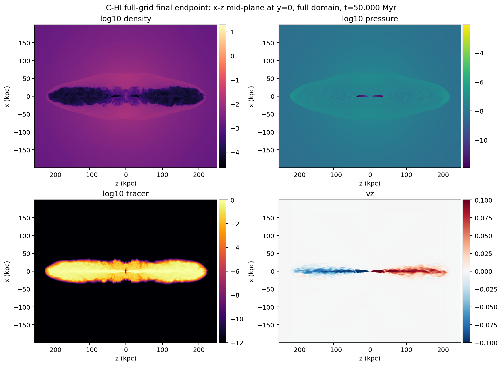
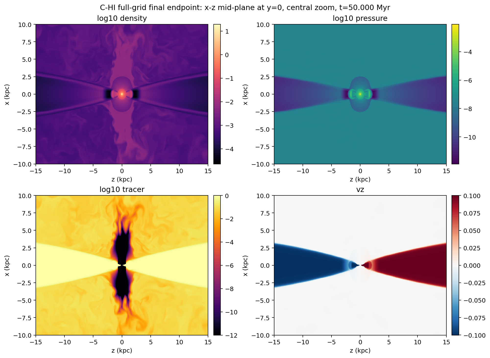
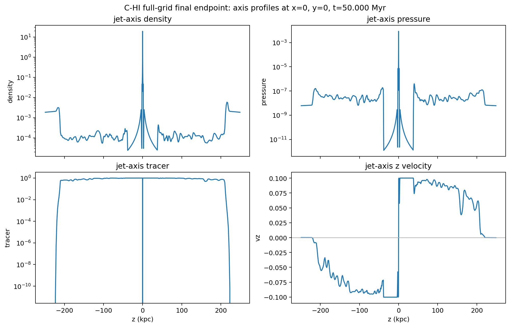

# C-HI Full-grid Final Endpoint Quick-look

Date: 2026-06-07

## Summary

This report records the first compact quick-look diagnostic for the completed
full-grid, particles-enabled `C-HI` production endpoint on `kunanyi`.

Run facts:

- source production job: `697298.kunanyi-ohpc`
- production job name: `c_hi_r9_p64`
- scheduler result: `Exit_status = 0`
- resources: `select=64:ncpus=28:mpiprocs=28`
- MPI ranks: `1792`
- PBS walltime used: `07:49:58`
- restart mode: `RUN_KIND=h5_restart_9`
- PLUTO command: `-i pluto.ini -e environment.ini -maxtime 47.5 -h5restart 9`
- final PLUTO step: `49253`
- final PLUTO code time: `15330.06968940`
- physical time: `50.0000 Myr`, using `306.601394` PLUTO code units per Myr
- output tree volume reported by PBS stdout: `475G`

The apparently short production walltime is benign: PLUTO reached the configured
`C-HI` endpoint at `tstop = 15330.06968940`, wrote the final HDF5 and particle
products, and exited normally.

## Endpoint Integrity

The production endpoint is:

```text
/scratch/bwbrook/xray_cavities_runs/2026-06-06-c-hi-fullgrid-agn-impi-r9-prod64/C-HI/particles
```

Focused product-integrity checks under the AGN Intel/IMPI HDF5 stack found:

- final double output: `data.0011.dbl.h5`, `67318639276` bytes
- final float output: `data.0051.flt.h5`, `44890581676` bytes
- final particle file: `particles.5000.dbl`, `23608389` bytes
- both final HDF5 files contain `/vars/{prs,rho,tr1,vx1,vx2,vx3}` with shape
  `{1014, 960, 960}`
- scalar reads from `rho`, `vx1`, and `tr1` succeeded in both final HDF5 files
- the final particle header reports `196732` particles, time
  `1.533006968940e+04`, and step `49253`

The detailed integrity record is in
`docs/exchange/logs/2026-06-07-c-hi-fullgrid-agn-impi-r9-prod64-integrity.md`.

## Quick-look Extraction

A one-core compute-node extraction job inspected the final float output:

- quick-look extraction job: `697386.kunanyi-ohpc`
- inspected file:
  `/scratch/bwbrook/xray_cavities_runs/2026-06-06-c-hi-fullgrid-agn-impi-r9-prod64/C-HI/particles/problem/outputs/data.0051.flt.h5`
- timestep: `Timestep_51`
- extraction result: `Exit_status = 0`
- walltime: `00:04:34`
- peak memory: `3771068kb`
- requested envelope: `select=1:ncpus=1:mpiprocs=1:mem=32gb`, `walltime=01:00:00`

The compact evidence bundle was retrieved to:

```text
build/science/kunanyi_stage_2026-06-07/c_hi_fullgrid_final_quicklook_697386_compact_2026-06-07.tar.gz
```

SHA-256:

```text
26f8ab57e4f8e3913bc629abb391f699c75b45296d474fe2c411736a0b71098c
```

Small extracted metadata and PBS logs are stored with the figures:

- `docs/science/assets/c_hi_fullgrid_final_quicklook_2026-06-07/metadata.txt`
- `docs/science/assets/c_hi_fullgrid_final_quicklook_2026-06-07/summary_metrics.csv`
- `docs/science/assets/c_hi_fullgrid_final_quicklook_2026-06-07/quicklook_pbs_stdout.txt`
- `docs/science/assets/c_hi_fullgrid_final_quicklook_2026-06-07/quicklook_pbs_stderr.txt`

## Tracer Extent

At the final endpoint, tracer-bearing material spans most of the jet-axis
domain but remains inside the apparent full-grid boundary in the quick-look
slice. The default Level 2 truth threshold remains `tracer > 5e-3`.

| Threshold | Cells | x range (kpc) | y range (kpc) | z range (kpc) |
| --- | ---: | --- | --- | --- |
| `1e-3` | 194674862 | -30.832 to 31.400 | -32.861 to 31.115 | -217.440 to 217.440 |
| `5e-3` | 185000464 | -29.998 to 30.832 | -32.269 to 30.551 | -217.440 to 217.440 |
| `1e-2` | 177856594 | -29.724 to 29.724 | -31.977 to 30.273 | -215.607 to 215.607 |

For comparison, the previous 5 Myr quick-look had a default-threshold extent
of about `x,y = +/-9.46 kpc` and `z = +/-33.0 kpc`.

## Figures

Full-domain mid-plane maps:



Central zoom:



Jet-axis profiles:



## Interpretation

This endpoint passes the immediate production-readiness gate:

- the 64-node AGN Intel/IMPI restart stack reached the configured 50 Myr stop
  cleanly
- final restart-capable, float, XMF, particle, and catalogue products are
  present and readable
- the compact extractor can read the final full-grid HDF5 product on a
  compute node without special handling beyond a modest memory request
- the mid-plane maps are nonblank and show the expected bilateral jet/cocoon
  structure
- the default-threshold tracer extent is large but not obviously boundary
  clipped in this quick-look

This remains a run-health and readiness diagnostic, not a cavity `pV`, X-ray,
radio, or lobe-energy measurement. The next science-facing step is to promote
this endpoint into the aligned truth, X-ray, radio, and cavity-analysis
workflow.
