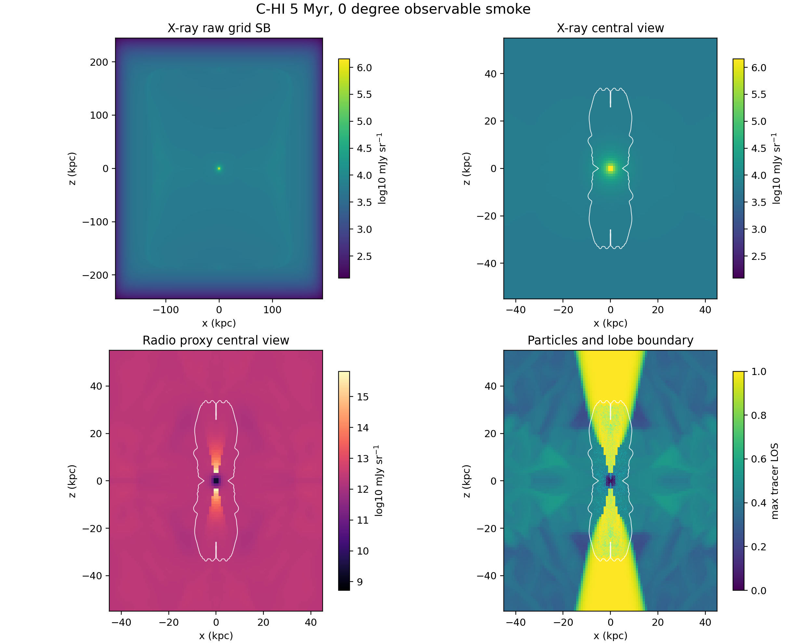

# C-HI 5 Myr Observable Smoke

Date: 2026-05-10

## Summary

This report records the first aligned observable smoke product for the
particles-enabled high-power cluster case, `C-HI`, using the same target as the
truth smoke:

- grid output: `data.0008.flt.h5`
- grid timestep: `Timestep_8`
- physical time: `4.9994 Myr`
- view: `0 deg`, projected along the simulation `y` axis
- particle output: `particles.0503.dbl`
- particle time: `4.9994 Myr`
- redshift used for this first smoke: `0.05`

The extraction was run on a `kunanyi` compute node as PBS job
`690612.kunanyi-ohpc` and completed successfully. It supersedes an initial
same-day trial, `690611.kunanyi-ohpc`, which used `particles.0500.dbl`; the
rerun corrected this to the exactly time-aligned particle file.

## What Was Tested

The supplied GRAiLE/XRAiSE bundle is present locally and contains the expected
notebook, APEC table, Gaunt-factor lookup table, driver script, and notes.
However, `kunanyi` currently has no Python analysis stack loaded by default:
`numpy`, `h5py`, `scipy`, `astropy`, `numba`, `matplotlib`, `yaml`, and
`hdf5plugin` were all absent from the baseline login environment.

For this first smoke, I therefore used a compact C extractor on the compute
node rather than trying to run the full Python driver on the login node. The
extractor:

- ports the supplied XRAiSE grid bremsstrahlung formula before the APEC/Gaunt
  correction stage
- ports the lossless `plutokore` pressure/tracer radio surface-brightness
  scaling for a first 150 MHz radio proxy
- reads the aligned PLUTO particle file and writes particle positions for the
  same 0 degree target
- writes compact 2D maps and scalar summaries for MacBook-side plotting

This is a traceable bridge smoke, not the final science observable pipeline.
The full GRAiLE/XRAiSE loss-kernel path still needs a portable Python runtime
on either `kunanyi` or a suitable analysis host.

## Kunanyi Job

- job id: `690612.kunanyi-ohpc`
- job name: `c_hi_obs5`
- node: `n001`
- resources: `select=1:ncpus=1:mpiprocs=1`
- walltime requested: `00:30:00`
- actual extraction window: `2026-05-10T08:03:53Z` to
  `2026-05-10T08:04:14Z`
- extraction result: no stderr output, archive written successfully

Compact archive:

```text
remote: /u/bwbrook/codex_kunanyi/c_hi_observable_smoke_2026-05-10.tar.gz
local:  build/science/kunanyi_stage_2026-05-08/c_hi_observable_smoke_690612_compact_2026-05-10.tar.gz
sha256: 477b576e9eacb662b9ed715e3737eecbe44f7b0121f66bcc19d9adc7ec78805e
```

## Scalar Smoke Metrics

| Metric | Value |
| --- | ---: |
| grid time | `4.9994348189788402 Myr` |
| particle time | `4.9994348189790641 Myr` |
| particles loaded | `16056` |
| tracer threshold | `5e-3` |
| raw 1 keV X-ray surface-brightness max | `1.4382e6 mJy sr^-1` |
| 150 MHz radio proxy max | `6.6204e15 mJy sr^-1` |
| 150 MHz radio luminosity proxy | `5.4149e26 W Hz^-1` |
| radio/tracer cells counted | `14296426` |

Particle extent at the aligned snapshot:

| Axis | Range |
| --- | --- |
| `x` | `-8.84` to `9.01 kpc` |
| `y` | `-8.81` to `8.70 kpc` |
| `z` | `-32.24` to `32.20 kpc` |

## Figure



The white contour marks the line-of-sight maximum tracer boundary at
`tracer = 5e-3`. The particle panel overlays the aligned particle positions on
the same projected lobe-boundary view.

## Products

The compact products are stored under
`docs/science/assets/c_hi_observable_smoke_2026-05-10/`:

- `observable_summary.csv`
- `particle_summary.csv`
- `particle_positions_0deg.tsv`
- `xray_1kev_raw_mjy_sr.tsv`
- `radio_150mhz_proxy_mjy_sr.tsv`
- `tracer_max_los.tsv`
- `x_kpc.tsv`
- `z_kpc.tsv`
- `c_hi_observable_smoke_maps.png`

The extractor and plotting helper are:

- `scripts/science/pluto_h5_observable_smoke_extract.c`
- `scripts/science/plot_observable_smoke.py`
- `scripts/kunanyi/c_hi_observable_smoke.pbs`

Two SCP helpers were also added for repeatable MacBook-control-plane transfer
through the Nectar bastion route:

- `scripts/kunanyi/copy_to_kunanyi.sh`
- `scripts/kunanyi/fetch_from_kunanyi.sh`

## Interpretation

This passes the first observable smoke gate:

- the same `5 Myr`, `0 deg` grid/particle target can be processed on
  `kunanyi`
- PLUTO HDF5 data can be reduced into compact projected X-ray/radio products
  without moving multi-GB HDF5 files to the MacBook
- the particle output loads and aligns exactly with the target snapshot
- the lobe boundary is visible and consistent with the previous tracer/truth
  diagnostics
- the radio proxy yields a finite first luminosity-scale product

## Remaining Work

The immediate next science/tooling step is to turn this bridge smoke into the
proper observable pipeline:

1. build a portable Python analysis environment for the supplied XRAiSE/GRAiLE
   scripts, preferably on a compute-safe host
2. replace the bridge X-ray map with the full XRAiSE path, including APEC/Gaunt
   corrections and particle-loss kernel mapping
3. replace the lossless radio proxy with the full particle-loss-aware radio
   product through the `plutokore`/GRAiLE lane
4. add the first cavity-protocol stub against this same snapshot/view:
   ellipsoidal boundary, local ambient pressure, `pV`, `4pV`, and simple age
   estimates
