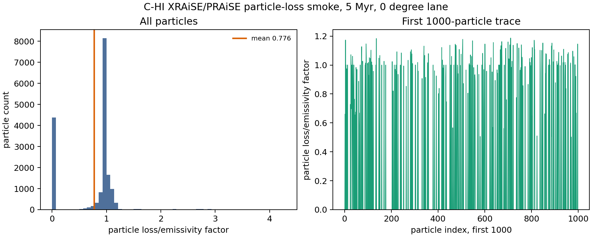

# C-HI 5 Myr Particle-Loss Smoke

Date: 2026-05-10

## Summary

This report records the first particle-loss-aware GRAiLE/XRAiSE smoke for the
particles-enabled high-power cluster case, `C-HI`, using the same aligned target
as the truth, bridge observable, XRAiSE grid, and cavity-protocol smokes:

- grid output: `data.0008.flt.h5`
- grid timestep: `Timestep_8`
- grid time: `4.9994 Myr`
- particle output selected by XRAiSE: `503`
- particle time: `4.9994 Myr`
- view protocol target: `0 deg`
- photon frequency: `2.417990504024e17 Hz`, equivalent to `1 keV`
- redshift: `0.05`

This is not yet the final radio/X-ray map product. It is the runtime gate that
proves Georgia's supplied particle-loss machinery can ingest our `C-HI`
particle history, run on a `kunanyi` compute node, and produce finite
particle-level PRAiSE emissivity values for the same 5 Myr target.

## What Was Added

Two small runtime steps were added.

First, the raw PLUTO particle files were converted into the preprocessed HDF5
layout expected by Georgia's driver:

- source particle history:
  `/scratch/bwbrook/xray_cavities_runs/2026-05-08-c-hi-segment/C-HI/particles/problem/outputs`
- processed particle file:
  `/scratch/bwbrook/xray_cavities_analysis/2026-05-10-c-hi-particles-hdf5/C-HI.particles.hdf5`
- file size: `129 MB`
- particle IDs represented: `17516`
- particle output times: `550`
- particle time span: `0.0` to `5.4550 Myr`
- fields carried through: `13`

Second, the particle-loss smoke used the processed HDF5 with supplied
`xraise.py` and a staged `plutokore` source checkout. The `kunanyi`
`Anaconda3/2024.02-1` module provides the heavy scientific stack. Three tiny
compatibility shims were staged for import compatibility only:
`contextlib2`, `hdf5plugin`, and `yt`.

## Kunanyi Jobs

Particle HDF5 preprocessing:

- job id: `690635.kunanyi-ohpc`
- job name: `c_hi_part_h5`
- node: `n001`
- resources: `select=1:ncpus=1:mpiprocs=1`
- extraction window: `2026-05-10T09:27:15Z` to `2026-05-10T09:28:15Z`
- result: processed particle HDF5 and compact summary archive written

Particle-loss smoke:

- job id: `690636.kunanyi-ohpc`
- job name: `c_hi_ploss5`
- node: `n001`
- resources: `select=1:ncpus=4:mpiprocs=1`
- extraction window: `2026-05-10T09:32:07Z` to `2026-05-10T09:32:35Z`
- result: full-loss particle emissivity array and compact summary archive
  written

Compact archives:

```text
particle HDF5 summary archive:
remote: /u/bwbrook/codex_kunanyi/c_hi_particle_hdf5_smoke_2026-05-10_summary.tar.gz
local:  build/science/kunanyi_stage_2026-05-08/c_hi_particle_hdf5_smoke_690635_summary_2026-05-10.tar.gz
sha256: 282820847ceb41071cc7199a22eec0ccd5438c91442183095ea09511e24352de

particle-loss archive:
remote: /u/bwbrook/codex_kunanyi/c_hi_xraise_particle_loss_smoke_2026-05-10.tar.gz
local:  build/science/kunanyi_stage_2026-05-08/c_hi_xraise_particle_loss_smoke_690636_2026-05-10.tar.gz
sha256: be405ff8884c24de2a0e61a2b8cb63c9602106f66bd5bfa47d942abda560c89d
```

The large processed `C-HI.particles.hdf5` is deliberately retained on
`kunanyi` scratch and is not copied into the repo.

## Scalar Smoke Metrics

| Metric | Value |
| --- | ---: |
| grid output | `8` |
| grid time | `4.9994358508106655 Myr` |
| particle output | `503` |
| particle time | `4.999435003568512 Myr` |
| particle emissivity shape | `17516 x 1 x 1` |
| finite values | `17516` |
| positive values | `13144` |
| NaN values | `0` |
| minimum | `0.0` |
| maximum | `4.2874063006224175` |
| mean | `0.7759846208637153` |
| positive minimum | `0.1851950760834578` |
| positive mean | `1.0340951475234963` |

The output filenames use `loss_factor` because this is a smoke-test lane for
the loss-aware component. The array extracted here is the `emis` return from
Georgia's `praise(...)` call, converted to SI emissivity units before saving.

## Figure



The left panel shows the full finite particle-level distribution. The right
panel shows the first 1000 particle entries as a quick visual check that zeros
and finite positive entries are both being carried through.

## Runtime Warning

The supplied `xraise.py` emitted a `NumbaParallelSafetyWarning` inside
`praise_aio(...)` about a variable written inside a parallel loop. The smoke
output is finite and reproducible enough for this gate, but before using this
path as a production observable pipeline we should run a deterministic
cross-check, for example by comparing `NUMBA_NUM_THREADS=1` and `4` on the same
snapshot.

## Products

The repo-scoped products are stored under:

- `docs/science/assets/c_hi_particle_hdf5_smoke_2026-05-10/`
- `docs/science/assets/c_hi_particle_loss_smoke_2026-05-10/`

Key files:

- `particle_hdf5_summary.csv`
- `particle_hdf5_field_summary.csv`
- `particle_hdf5_metadata.json`
- `particle_loss_smoke_summary.csv`
- `particle_loss_smoke_metadata.json`
- `particle_loss_factor.npy`
- `particle_loss_factor_first1000.tsv`
- `particle_loss_factor_diagnostics.png`

The reusable scripts are:

- `scripts/science/plutokore_particle_hdf5_smoke.py`
- `scripts/science/xraise_particle_loss_smoke.py`
- `scripts/kunanyi/c_hi_particle_hdf5_smoke.pbs`
- `scripts/kunanyi/c_hi_xraise_particle_loss_smoke.pbs`
- `scripts/kunanyi/python_compat/`

## Interpretation

This closes the particle-loss runtime gate for the 5 Myr `C-HI` target:

- `plutokore` can be staged on `kunanyi` without modifying the cluster Python
  installation
- the raw PLUTO particle sequence can be converted into Georgia's expected
  `*.particles.hdf5` layout
- the supplied XRAiSE/PRAiSE particle-loss code can load the processed particle
  history and produce finite full-loss particle emissivities at the aligned
  `5 Myr` snapshot
- the run remains small enough to use as a repeatable smoke test for future
  longer snapshots

The next observable step is to use these particle emissivities in a mapped or
raytraced radio/lobe product and compare it against the already aligned X-ray,
cavity, and truth products for the same snapshot/view.
