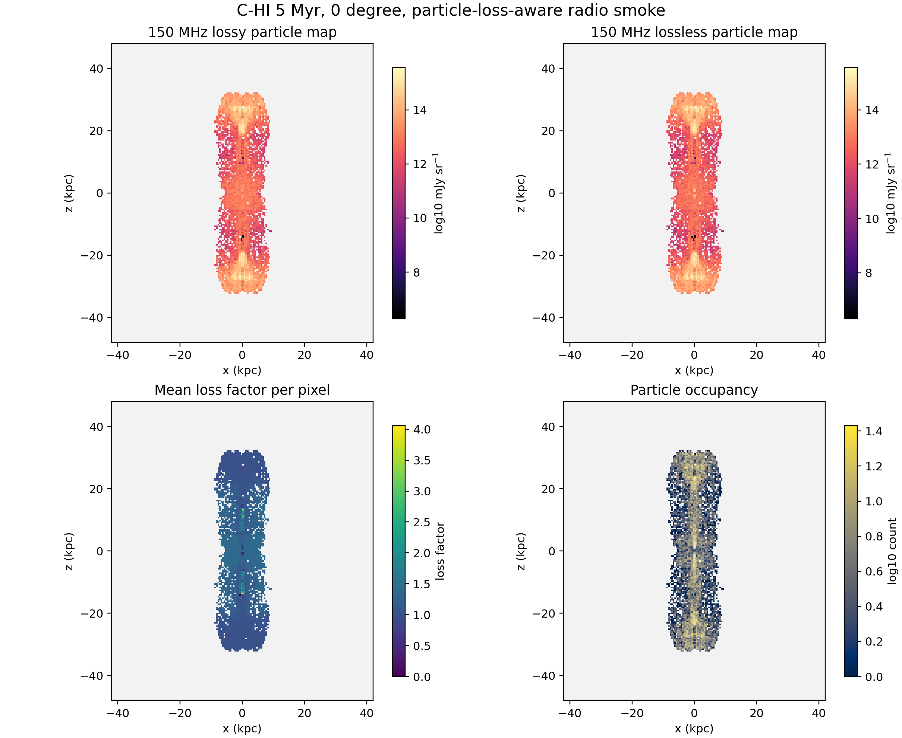

# C-HI 5 Myr Particle Radio Smoke

Date: 2026-05-10

## Summary

This report records the first particle-loss-aware radio/lobe smoke for the
particles-enabled high-power cluster case, `C-HI`, using the same aligned target
as the truth, XRAiSE grid, particle-loss, and cavity-protocol smokes:

- grid output: `data.0008.flt.h5`
- grid timestep: `Timestep_8`
- grid time: `4.9994 Myr`
- particle output selected by XRAiSE/PRAiSE: `503`
- particle time: `4.9994 Myr`
- view: `0 deg`, projected along the simulation `y` axis
- radio frequency: `150 MHz`
- redshift: `0.05`

The job recomputes the supplied `xraise.py`/`praise(...)` full-loss factor at
`150 MHz`, combines it with the lossless synchrotron emissivity expression in
Georgia's supplied XRAiSE code, and bins the result into an `x-z` particle
surface-brightness map. This is still a smoke product, not a final
beam-convolved observational radio map.

## Kunanyi Job

- job id: `690641.kunanyi-ohpc`
- job name: `c_hi_radio5`
- node: `n001`
- resources: `select=1:ncpus=4:mpiprocs=1`
- extraction window: `2026-05-10T09:50:03Z` to `2026-05-10T09:50:36Z`
- result: particle-loss-aware 150 MHz map, lobe summary, and compact archive
  written

Compact archive:

```text
remote: /u/bwbrook/codex_kunanyi/c_hi_particle_radio_smoke_2026-05-10.tar.gz
local:  build/science/kunanyi_stage_2026-05-08/c_hi_particle_radio_smoke_690641_2026-05-10.tar.gz
sha256: 57f6a572218a03ef040e3376be5652df75396400cd633ffb3c0fc87e264c274e
```

## Method

The smoke uses:

- staged `plutokore` and supplied `xraise.py` under
  `/u/bwbrook/codex_kunanyi/particle_loss_runtime`
- processed particle history:
  `/scratch/bwbrook/xray_cavities_analysis/2026-05-10-c-hi-particles-hdf5/C-HI.particles.hdf5`
- tracer threshold: `5e-3`
- map pixel size: `0.5 kpc`
- volume assignment: the Level 2 tracer-mask side volumes from the 5 Myr truth
  smoke are divided evenly across selected particles on each side
- Doppler term: the supplied-driver convention, `D^(2 + (s - 1)/2)`, using
  the `0 deg` line of sight

This volume assignment is a controlled proxy so the smoke can report a
luminosity scale. The final production radio pipeline should replace it with a
fully gridded loss-kernel/raytrace treatment.

## Scalar Smoke Metrics

| Metric | Value |
| --- | ---: |
| selected particles | `16054` |
| particles in frame | `16054` |
| map shape | `220 x 180` |
| lossy radio map max | `3.6847e15 mJy sr^-1` |
| lossy radio map sum | `2.1212e17 mJy sr^-1 pixels` |
| positive radio pixels | `3528` |
| loss factor mean | `1.1580` |
| loss factor max | `5.0732` |
| bipolar lossy luminosity proxy | `6.3450e27 W Hz^-1` |
| negative-z lobe luminosity proxy | `3.1963e27 W Hz^-1` |
| positive-z lobe luminosity proxy | `3.1487e27 W Hz^-1` |

The two lobes are closely balanced in this early symmetric control snapshot.

## Lobe Boundary Smoke

| Side | Particles | Volume (`kpc^3`) | X range (`kpc`) | Y range (`kpc`) | Z range (`kpc`) |
| --- | ---: | ---: | ---: | ---: | ---: |
| negative-z | `8027` | `5395.885` | `-8.839` to `9.015` | `-8.752` to `8.636` | `-32.244` to `-0.015` |
| positive-z | `8027` | `5395.890` | `-8.675` to `8.713` | `-8.815` to `8.705` | `0.001` to `32.203` |
| bipolar total | `16054` | `10791.775` | `-8.839` to `9.015` | `-8.815` to `8.705` | `-32.244` to `32.203` |

## Figure



The upper panels compare the full-loss 150 MHz particle map with the lossless
particle map on the same projection. The lower panels show the mean loss factor
and particle occupancy per pixel.

## Caveats

- The supplied `xraise.py` still emits a `NumbaParallelSafetyWarning` inside
  `praise_aio(...)`; this is the same warning recorded for the particle-loss
  smoke. A deterministic check comparing `NUMBA_NUM_THREADS=1` and `4` should
  be run before treating this as production.
- The luminosity is a proxy based on Level 2 tracer-mask side volumes divided
  across selected particles. It is useful for continuity and scale checks, but
  not yet a final science measurement.
- The map is particle-binned at `0.5 kpc` and is not yet beam-convolved or
  passed through the full grid loss-kernel workflow in Georgia's longer driver.

## Products

The compact products are stored under
`docs/science/assets/c_hi_particle_radio_smoke_2026-05-10/`:

- `particle_radio_smoke_summary.csv`
- `particle_radio_smoke_metadata.json`
- `particle_radio_lobe_summary.csv`
- `particle_radio_positions_0deg.tsv`
- `radio_150mhz_particle_loss_mjy_sr.tsv`
- `radio_150mhz_particle_lossless_mjy_sr.tsv`
- `radio_particle_count_map.tsv`
- `radio_particle_mean_loss_factor.tsv`
- `x_kpc.tsv`
- `z_kpc.tsv`
- `c_hi_particle_radio_smoke_maps.png`

The reusable scripts are:

- `scripts/science/xraise_particle_radio_smoke.py`
- `scripts/science/plot_particle_radio_smoke.py`
- `scripts/kunanyi/c_hi_particle_radio_smoke.pbs`

## Interpretation

This closes the first aligned radio/lobe smoke gate:

- the supplied particle-loss machinery can be rerun at a radio frequency
- the resulting particle-loss factors can be attached to particle synchrotron
  emissivities
- the same declared `C-HI`, 5 Myr, `0 deg` target now has aligned truth,
  cavity, XRAiSE grid-thermal, particle-loss, and radio/lobe smoke products

The next technical gate should be a deterministic particle-loss/radio
cross-check and then an aligned comparison summary that places the X-ray,
radio, truth, and cavity quantities on one page.
