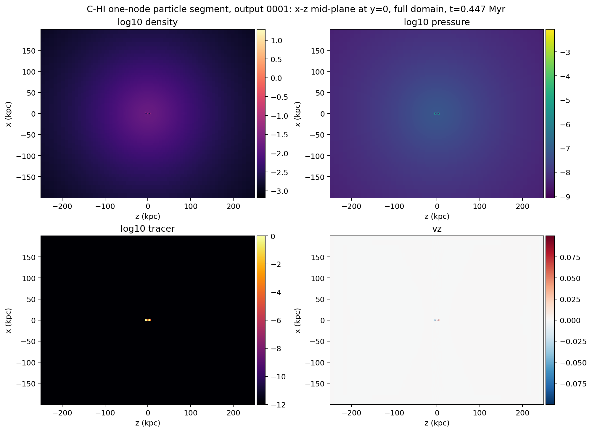
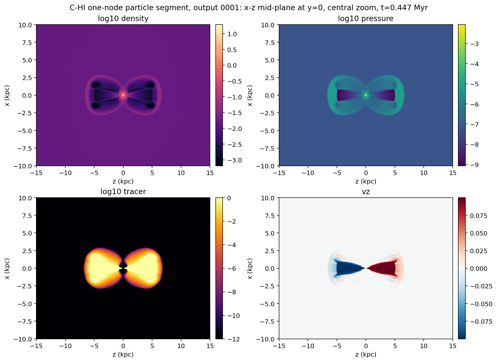
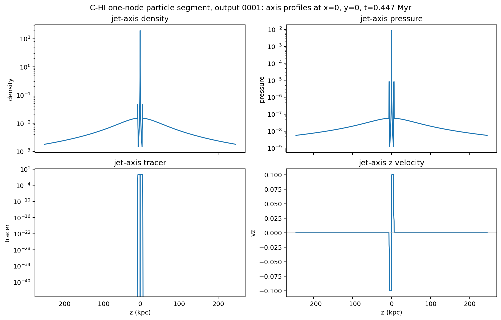

# C-HI One-Node Particle Segment Quick-look

Date: 2026-05-09

## Summary

This is the first quick-look diagnostic for the completed one-node,
particles-enabled `C-HI` segment on `kunanyi`.

Inputs:

- source run: `690426.kunanyi-ohpc`
- quick-look extraction job: `690451.kunanyi-ohpc`
- HDF5 file inspected:
  `/scratch/bwbrook/xray_cavities_runs/2026-05-08-c-hi-segment/C-HI/particles/problem/outputs/data.0001.flt.h5`
- timestep: `Timestep_1`
- PLUTO code time: `137.169223`
- physical time: `0.4474 Myr`, using `306.601394` PLUTO code units per Myr

This is an early run-health diagnostic, not a science measurement. The aim was
to confirm that the jet, tracer, HDF5, and post-processing path behave
sensibly before deciding whether to continue, restart, or promote to a larger
rehearsal.

## Extraction

Kunanyi's login-node Python does not currently expose `h5py`, `numpy`, or
`matplotlib`, so the heavy HDF5 read was done with a small serial HDF5 C
extractor on a compute node. That job wrote compact TSV slices and profiles
which were then plotted locally through the repo `uv` environment.

The reusable tooling added for this is:

- `scripts/science/pluto_h5_quicklook_extract.c`
- `scripts/science/plot_pluto_h5_quicklook.py`
- `scripts/kunanyi/c_hi_quicklook_extract.pbs`

## Tracer Extent

The default Level 2 truth threshold remains `tracer > 5e-3`. At this early time
the tracer-defined region is compact and symmetric:

| Threshold | Cells | x range (kpc) | y range (kpc) | z range (kpc) |
| --- | ---: | --- | --- | --- |
| `1e-3` | 790808 | -2.38 to 2.38 | -2.38 to 2.38 | -6.32 to 6.32 |
| `5e-3` | 670824 | -2.33 to 2.33 | -2.33 to 2.33 | -6.22 to 6.22 |
| `1e-2` | 619128 | -2.28 to 2.28 | -2.28 to 2.28 | -6.22 to 6.22 |

## Figures

Full-domain mid-plane maps:

Central zoom:

Jet-axis profiles:

## Interpretation

The quick-look products pass the immediate sanity gate:

- bipolar tracer lobes are present and symmetric
- the velocity field shows the expected oppositely directed bipolar flow
- density and pressure respond around the early lobes
- the tracer extent is far from the outer grid boundaries
- HDF5 extraction and local plotting are now reproducible without installing a
  private Python stack on `kunanyi`

The run is still only at `0.4474 Myr`, so it should not be judged for final
cavity morphology. The next useful simulation step is a longer restart segment
or an intermediate multi-node rehearsal once we decide whether to stay with the
one-node shakedown grid or move toward the final supervisor grid.
