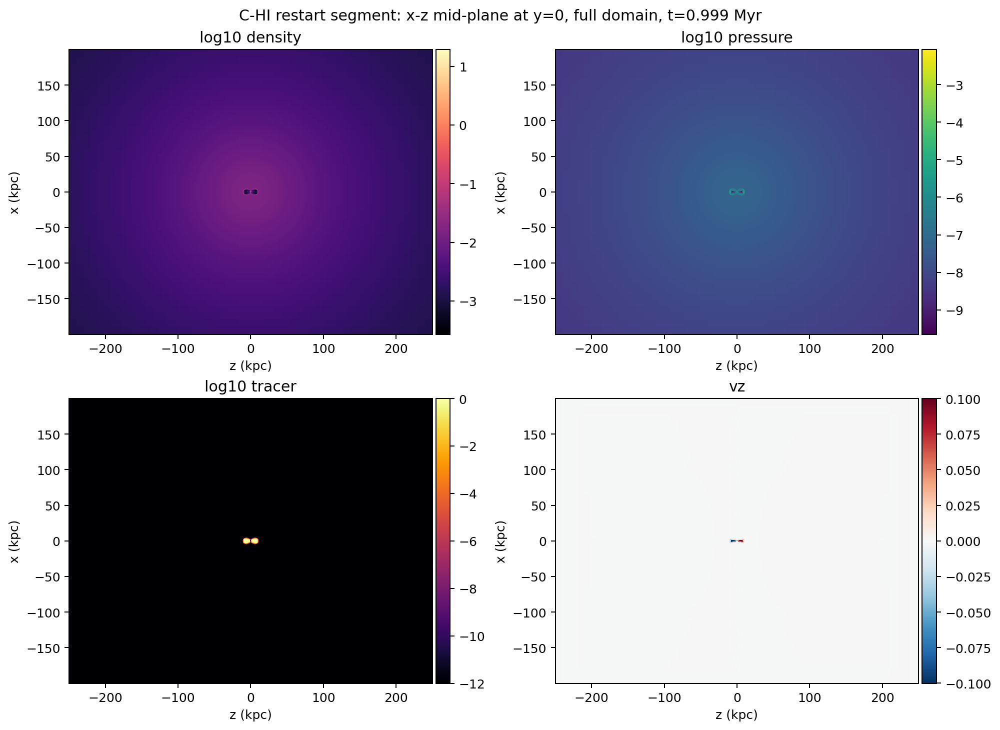
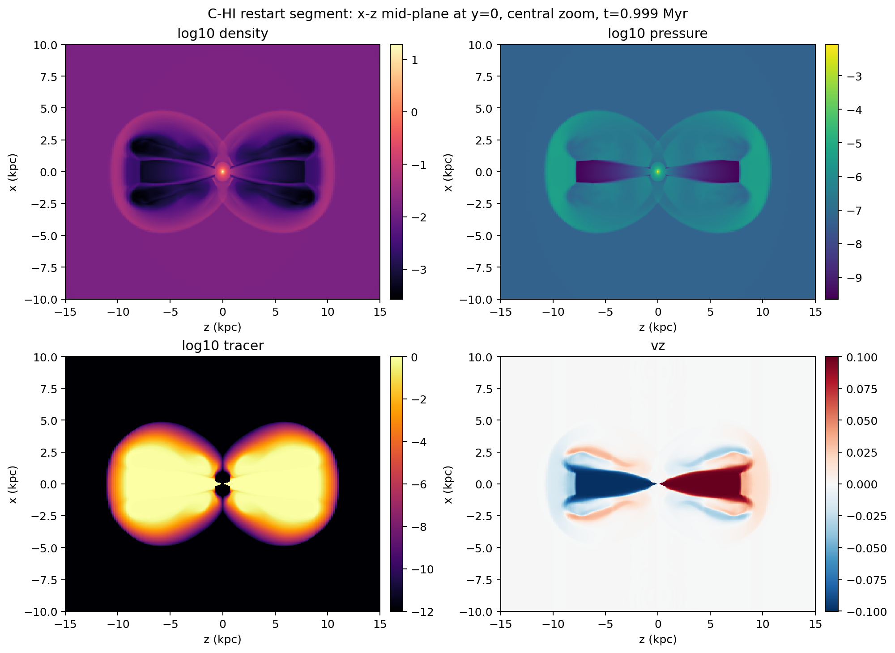
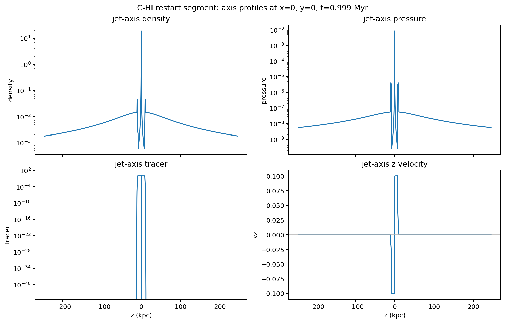

# C-HI Restart Segment Quick-look

Date: 2026-05-09

## Summary

This report records the first restart-continuation segment for the
particles-enabled `C-HI` one-node shakedown run on `kunanyi`.

Run facts:

- source restart job: `690452.kunanyi-ohpc`
- job name: `c_hi_restart`
- scheduler result: `Exit_status = 0`
- resources: `select=1:ncpus=28:mpiprocs=28`
- node: `n129`
- PBS walltime used: `01:40:09`
- PBS CPU time used: `44:14:47`
- PBS peak memory: `30588076kb`
- template restart mode: `RUN_KIND=h5_restart_1`
- PLUTO command: `-i pluto.ini -e environment.ini -maxtime 1.5 -h5restart 1`

The segment restarted from the previous `dbl.h5` output and advanced the
simulation from `0.4474 Myr` to a new restart-capable output at `1.0101 Myr`.
The run wrote a fresh `markers/DONE` file and no `FAILED` marker was observed.

This remains an early run-health diagnostic, not a science result. It is,
however, the first full confirmation that the static-grid HDF5 restart path is
working for the particles-enabled Stewart-cluster `C-HI` setup.

## Output Catalogue

The current HDF5 catalogue illustrates why output numbering cannot be treated
as a simple physical-time sequence once walltime-forced products are present.

| Output | Type | Time (Myr) | Step | Role |
| ---: | --- | ---: | ---: | --- |
| 0 | `dbl.h5` | 0.0000 | 0 | initial restart-capable output |
| 1 | `dbl.h5` | 0.4474 | 583 | first walltime-forced restart output |
| 2 | `dbl.h5` | 1.0101 | 1146 | second walltime-forced restart output |
| 0 | `flt.h5` | 0.0000 | 0 | initial float output |
| 1 | `flt.h5` | 0.4474 | 583 | first walltime-forced float output |
| 2 | `flt.h5` | 0.9990 | 1135 | nominal 1 Myr science-cadence output |
| 3 | `flt.h5` | 1.0101 | 1146 | second walltime-forced float output |

The corresponding CSV is stored at
`docs/science/assets/c_hi_restart_quicklook_2026-05-09/output_catalogue.csv`.

Particle outputs advanced from `particles.0045.dbl` after the first segment to
`particles.0103.dbl` after this restart segment.

## Quick-look Extraction

A one-core compute-node extraction job inspected the nominal 1 Myr float
output:

- quick-look extraction job: `690479.kunanyi-ohpc`
- inspected file:
  `/scratch/bwbrook/xray_cavities_runs/2026-05-08-c-hi-segment/C-HI/particles/problem/outputs/data.0002.flt.h5`
- timestep: `Timestep_2`
- PLUTO code time: `306.2961`
- physical time: `0.9990 Myr`
- extraction result: `Exit_status = 0`

The compact evidence bundle was retrieved to:

```text
build/science/kunanyi_stage_2026-05-08/c_hi_restart_690452_quicklook_690479_compact_2026-05-09.tar.gz
```

SHA-256:

```text
fe6c5259dcbe95d759d965d5b2e574e323af168dd127469a9c39d404e2cec2f2
```

## Tracer Extent

The default Level 2 truth threshold remains `tracer > 5e-3`. At about 1 Myr,
the tracer-defined region is still compact relative to the one-node shakedown
domain:

| Threshold | Cells | x range (kpc) | y range (kpc) | z range (kpc) |
| --- | ---: | --- | --- | --- |
| `1e-3` | 2572544 | -3.9 to 3.9 | -3.9 to 3.9 | -10.2 to 10.2 |
| `5e-3` | 2340392 | -3.84 to 3.84 | -3.84 to 3.84 | -10.1 to 10.1 |
| `1e-2` | 2236368 | -3.77 to 3.77 | -3.77 to 3.77 | -9.92 to 9.92 |

For comparison, the previous `0.4474 Myr` quick-look had a default-threshold
extent of about `x,y = +/-2.33 kpc` and `z = +/-6.22 kpc`.

## Figures

Full-domain mid-plane maps:



Central zoom:



Jet-axis profiles:



## Interpretation

This segment passes the immediate restart gate:

- the production PBS template detected `data.0001.dbl.h5` and launched PLUTO
  with `-h5restart 1`
- PLUTO stopped through the requested `-maxtime 1.5` path
- `data.0002.dbl.h5` was written as a new restart-capable output
- the nominal 1 Myr `flt.h5` output was written and extracted successfully
- particle output numbering continued through `particles.0103.dbl`
- tracer, density, pressure, and `v_z` quick-looks remain symmetric and far
  from the outer grid boundaries

The next useful compute rung is an intermediate multi-node rehearsal, not a
full 48-hour production run. That should test the same restartable `C-HI`
workflow with a multi-node PBS allocation before promoting to the supervisor
grid or a longer early-snapshot sequence.
