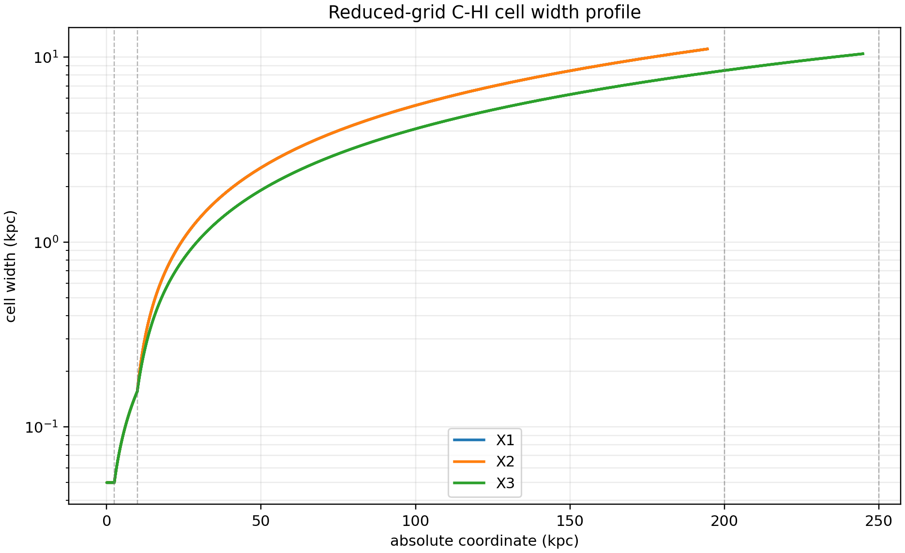

# C-HI Run Configuration Audit

Date: 2026-05-13

## Summary

This audit answers the configuration-review request from the third Barry-Stas-
Patrick meeting: expose the actual grid, output sizes, loaded modules, run
parameters, node/rank layout, and source/configuration provenance for the
current reduced-grid `C-HI` run before we move toward a full production launch.

The important conclusion is simple: job `691422.kunanyi-ohpc` is a successful
8-node reduced-grid continuation, not the final full-grid production
configuration. It is excellent as a restart/output/observable rehearsal, but it
should not be mistaken for the final grid that Stas and Patrick need to review
before an 80-node-style production run.

## Run Identity

| Item | Value |
| --- | --- |
| Source run | `691422.kunanyi-ohpc` (`c_hi_8mini`) |
| Case | `C-HI`, Stewart cluster environment |
| Variant | particles enabled |
| Restart mode | `-h5restart 7` from `data.0007.dbl.h5` |
| Run args | `-i pluto.ini -e environment.ini -maxtime 14.5 -h5restart 7` |
| Node/rank layout | `select=8:ncpus=28:mpiprocs=28`, `224` MPI ranks |
| Host nodes | `n063`, `n064`, `n072`, `n135`, `n169`, `n180`, `n212`, `n216` |
| Start time | `10.278362 Myr` |
| Final time | `33.374180 Myr` |
| Final restart checkpoint | `data.0012.dbl.h5` |

## Environment

The live run used the supervisor-confirmed radially averaged/tabulated Stewart
cluster environment:

| Item | Value |
| --- | --- |
| Environment kind | tabulated radial profile |
| Environment source | `env/extracted/environments/tabulated/tabulated_cosmo_002003.csv` |
| Runtime file | `tabulated_cosmo_002003.csv` |
| `environment.ini` external cube fields | deliberately unused for this tabulated run |
| Density profile define | `ENV_TABULATED` |

This follows Stas' instruction that science runs should use the radially
averaged environments rather than the full 3D profiles.

## Grid

The generated `grid.out` for this run is:

| Axis | Domain | Cells | Central `dx` | `dx` near `200 kpc` | Edge `dx` |
| --- | ---: | ---: | ---: | ---: | ---: |
| X1 | `-200..200 kpc` | `404` | `0.05 kpc` | `11.08 kpc` | `11.08 kpc` |
| X2 | `-200..200 kpc` | `404` | `0.05 kpc` | `11.08 kpc` | `11.08 kpc` |
| X3 | `-250..250 kpc` | `452` | `0.05 kpc` | `8.39 kpc` | `10.44 kpc` |



The run manifest names this grid `kunanyi_single_node_250` and describes it as
a reduced-grid shakedown: X1/X2 retain `+/-200 kpc`, X3 extends to `+/-250 kpc`,
and the central jet/inlet region keeps `0.05 kpc` resolution. The outer stretch
counts were deliberately reduced so the particle-enabled problem could be
built, restarted, and continued cheaply.

That means the present grid is not the candidate final production grid. The
candidate production grid remains `stewart_stretched_250`, with much larger
outer stretch counts and the X3 extension Patrick and Stas requested. That
full-grid render should be the next object of collaborator-agent review before
the first 48-hour production job.

## Jet And Output Parameters

| Parameter | Value |
| --- | ---: |
| `JET_PWR` | `1e45 erg/s` |
| `JET_SPD` | `0.1 c` |
| `JET_CHI` | `1.0` |
| `JET_OA_PRIMARY` / `JET_OA_SECONDARY` | `15 deg` / `15 deg` |
| `JET_INITIAL_RADIUS` | `0.1 kpc` |
| `JET_INJECTION_HEIGHT` | `0.75 kpc` |
| `JET_END_TIME` / `JET_ACTIVE_TIME` | `50 Myr` / `50 Myr` |
| `JET_RELATIVISTIC_DENSITY` | `NO` |
| `Nparticles` | `-1 16.0` |
| Particle injection frequency | `0.01 Myr` |

| Output | Cadence | Files after `691422` | Size |
| --- | ---: | ---: | ---: |
| `flt.h5` | `1 Myr` | `40` (`data.0000-0039.flt.h5`) | `3.55 GB` each; `141.90 GB` total |
| `dbl.h5` | `5 Myr` plus walltime stops | `13` (`data.0000-0012.dbl.h5`) | `5.32 GB` each; `69.13 GB` total |
| `particles.dbl` | `0.01 Myr` | `3344` (`particles.0000-3343.dbl`) | up to `12.83 MB`; `21.44 GB` total |

The output footprint after the 8-node job was about `217G` on scratch.

## Runtime Stack

The PBS job loaded `HDF5/1.14.0-gompi-2023a`, which pulled the expected
compiler/MPI stack:

| Component | Version/path |
| --- | --- |
| HDF5 | `HDF5/1.14.0-gompi-2023a` |
| HDF5 directory | `/share/apps/software/HDF5/1.14.0-gompi-2023a` |
| OpenMPI | `OpenMPI/4.1.5-GCC-12.3.0` |
| `mpicc` | `/share/apps/software/OpenMPI/4.1.5-GCC-12.3.0/bin/mpicc` |
| `mpirun` | `/share/apps/software/OpenMPI/4.1.5-GCC-12.3.0/bin/mpirun` |
| Compiler stack | `GCC/12.3.0`, `GCCcore/12.3.0` |
| MPI transport stack | `UCX/1.14.1`, `PMIx/4.2.4`, `UCC/1.2.0`, `libfabric/1.18.0` |

## Provenance

For job `691422`, the available source/configuration evidence is:

| Item | Evidence |
| --- | --- |
| `case_manifest.json` SHA-256 | `eaa7aa84c428aef13ae24d0dc5317589c17b160ee3426c5b81c7de3982ad9634` |
| `pluto.ini` SHA-256 | `b9c0a7313059c9f1b31ba4846c502ecb8597a274d3b612ad8bf3ccbde63d36ce` |
| `environment.ini` SHA-256 | `3b49690db1185c70742400925fb19f3f51abead2967f0e46a732b9734c86630b` |

The current `source_revisions.txt` did not record PLUTO or `jet-setup` commit
SHAs, only the scratch paths and config-file hashes. I have updated the
production PBS template so future jobs explicitly record git root, branch,
head SHA, status, missing-git state, and the PLUTO binary SHA-256. That fix
should be staged before the next production-template submission.

The follow-up particle-HDF5 rebuild for the through-33-Myr diagnostics
completed after being submitted with a temporary scheduler-fit `16gb` memory
request, but PBS reported roughly `43 GB` memory use. I have updated that
rerun wrapper to request `48gb` for future submissions.

## Gate Status

This audit supports three decisions:

- The reduced-grid lane is operationally healthy: restart, HDF5 output,
  particle output, email notification, and multi-node MPI all worked.
- It is not yet a full production science grid: the outer-cell widths in this
  reduced run are deliberately coarse and should not be used as the final
  configuration.
- The next production-facing gate should be a full-grid configuration render
  and review, followed by one bounded `kunanyi` production-template run only
  after Patrick/Stas or their repo agents confirm the final grid/config.

## Generated Artifacts

Supporting files are in:

```text
docs/science/assets/c_hi_run_configuration_audit_2026-05-13/
```

Key files:

- `run_config_summary.json`
- `grid_resolution_summary.csv`
- `output_file_size_summary.csv`
- `flt_output_times.csv`
- `dbl_output_times.csv`
- `c_hi_reduced_grid_cell_widths.png`
