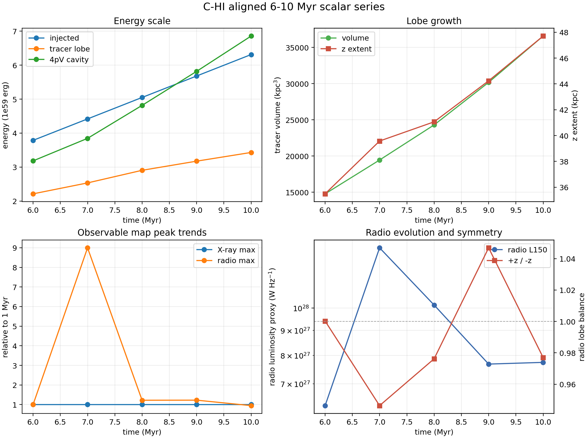
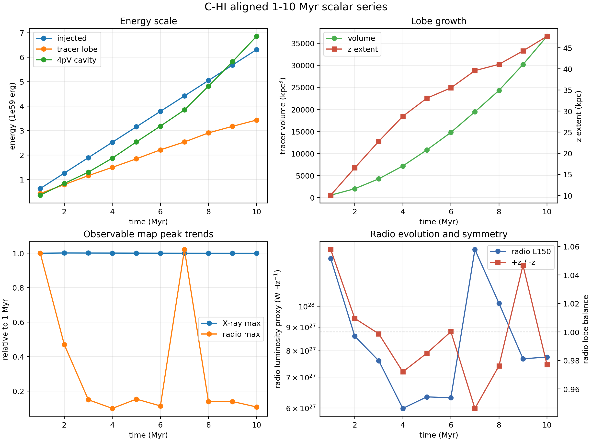

# C-HI Through-10 Myr Snapshot Series

Date: 2026-05-11

## Summary

The reduced-grid particles-enabled `C-HI` shakedown run has now reached the
nominal `10 Myr` regular-output block on `kunanyi`. This report extends the
aligned scalar diagnostic lane from the previous `1-5 Myr` series through the
new regular outputs:

| Grid output | Time (`Myr`) | Particle output |
| ---: | ---: | ---: |
| `10` | `5.9997` | `604` |
| `11` | `6.9990` | `704` |
| `12` | `7.9993` | `804` |
| `13` | `8.9996` | `904` |
| `14` | `9.9999` | `1004` |

The same compact lane was run for each snapshot:

- Level 1 injected-energy truth
- Level 2 tracer-defined lobe truth at `tracer > 5e-3`
- first-pass ellipsoidal cavity protocol
- XRAiSE-corrected `1 keV` grid-thermal X-ray scalar smoke
- particle-loss-aware `150 MHz` radio/lobe scalar smoke

The particle HDF5 cache was rebuilt first and now spans `0-10.278 Myr`, with
`1033` particle times and a full HDF5 size of `423 MB` on `kunanyi`.

## Kunanyi Jobs

Main continuation:

- job id: `690650.kunanyi-ohpc`
- job name: `c_hi_to10`
- resources: `select=2:ncpus=28:mpiprocs=28`
- exit status: `0`
- walltime: `06:44:13`
- output volume after run: `95G`
- final regular output: `data.0014.flt.h5`, `9.999876 Myr`
- final restart checkpoint: `data.0007.dbl.h5`, `10.278362 Myr`

Follow-up diagnostics:

- particle HDF5 job: `690680.kunanyi-ohpc`, `Exit_status=0`
- scalar-series job: `690681.kunanyi-ohpc`, `Exit_status=0`
- particle archive SHA256:
  `e674ebe6710910237558e8d3ea6f86716e3ad8b7e73a1b73d4588a555610a03c`
- scalar archive SHA256:
  `731c8e65e0818fa4eb934782a37289a9e9c31e7eb752a5563e9b5c1b51955943`

The only diagnostic stderr issue was the known `NumbaParallelSafetyWarning`
from the supplied particle-loss path. This same radio path has already passed a
`NUMBA_NUM_THREADS=1` versus `4` exact determinism check at the aligned `5 Myr`
target.

## Main Trends

| Metric | 5 Myr | 10 Myr | Change |
| --- | ---: | ---: | ---: |
| bipolar injected energy | `3.1554e59 erg` | `6.3114e59 erg` | `2.00x` |
| Level 2 tracer-lobe energy | `1.8459e59 erg` | `3.4309e59 erg` | `1.86x` |
| bipolar `4pV` cavity proxy | `2.5367e59 erg` | `6.8561e59 erg` | `2.70x` |
| Level 2 tracer-lobe volume | `1.0792e4 kpc^3` | `3.6574e4 kpc^3` | `3.39x` |
| tracer z extent | `33.04 kpc` | `47.71 kpc` | `1.44x` |
| XRAiSE-corrected X-ray peak | `2.8783e6 mJy sr^-1` | `2.8767e6 mJy sr^-1` | `1.00x` |
| lossy 150 MHz luminosity proxy | `6.3450e27 W Hz^-1` | `7.7444e27 W Hz^-1` | `1.22x` |
| selected particles | `16054` | `32065` | `2.00x` |

At `10 Myr`, the compact diagnostics give:

- Level 2 tracer-lobe energy is `0.544` of elapsed bipolar injection
- bipolar `4pV` is `1.086` of elapsed bipolar injection
- tracer-defined lobe extent is about `+/-47.7 kpc` in `z`
- fitted cavity centres sit at about `+/-23.87 kpc`
- mean sound age is about `21.69 Myr`
- radio lobe balance remains close to unity, with `+z / -z = 0.977`

Across the `6-10 Myr` block, radio lobe balance ranges from `0.946` to `1.047`.
The radio luminosity proxy is not monotonic, ranging from `6.32e27` to
`1.33e28 W Hz^-1`, while the central X-ray peak remains essentially flat.

## Figures





## Products

Compact products are stored under:

```text
docs/science/assets/c_hi_to10_snapshot_series_2026-05-11/
docs/science/assets/c_hi_to10_particle_hdf5_2026-05-11/
docs/science/assets/c_hi_to10_combined_series_2026-05-11/
```

Key files:

- `c_hi_to10_snapshot_series_metrics.csv`
- `c_hi_to10_snapshot_series.png`
- `c_hi_to10_combined_series_metrics.csv`
- `c_hi_to10_combined_series.png`
- `compact/snap_0010/`
- `compact/snap_0011/`
- `compact/snap_0012/`
- `compact/snap_0013/`
- `compact/snap_0014/`

Reusable scripts:

- `scripts/kunanyi/c_hi_to10_particle_hdf5.pbs`
- `scripts/kunanyi/c_hi_to10_snapshot_series.pbs`
- `scripts/science/build_early_snapshot_series.py`

## Interpretation

This closes the through-10-Myr diagnostic gate for the reduced-grid `C-HI`
shakedown. The lobe growth is smooth, the two sides remain well balanced, the
jet remains comfortably inside the `+/-250 kpc` axial domain, and the restart
catalogue is healthy.

The next compute-facing move can be another bounded continuation from
`data.0007.dbl.h5` toward the next regular snapshot block, or a short
production-scale allocation test if the goal is to transition from this
reduced-grid lane toward the full-grid `80 node` production pattern discussed
with Stas and Patrick.
