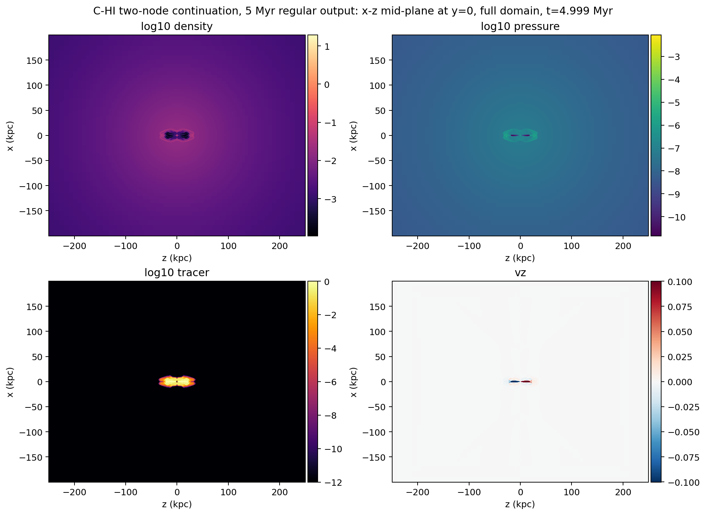
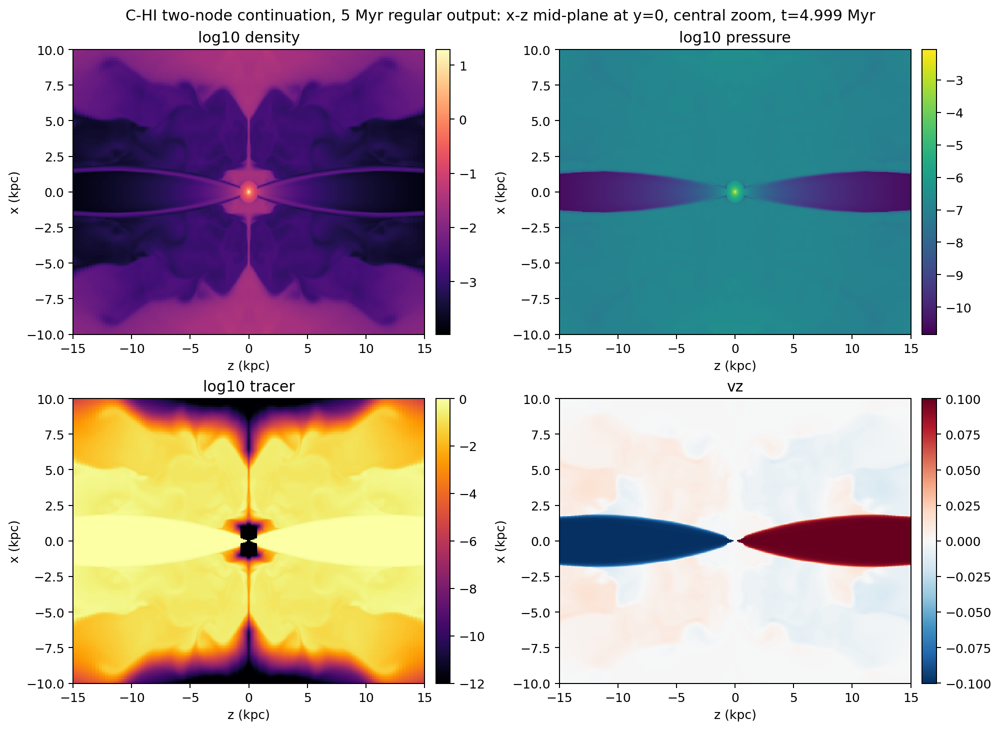
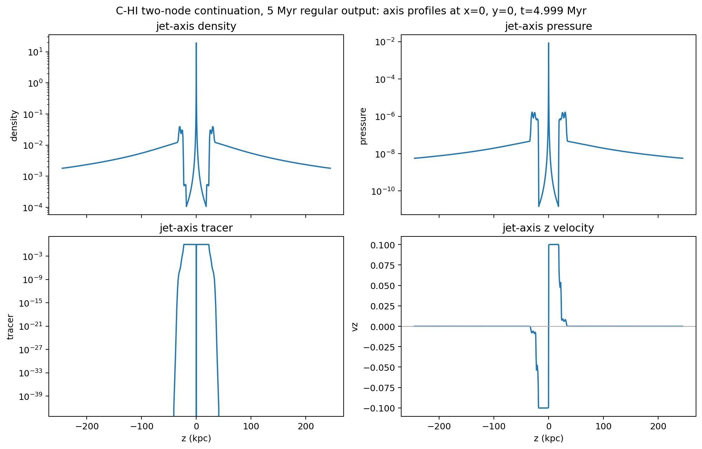

# C-HI Two-node Continuation To 5 Myr Quick-look

Date: 2026-05-10

## Summary

This report records the longer early-snapshot continuation of the
particles-enabled high-power cluster case, `C-HI`, on `kunanyi`.

Run facts:

- source continuation job: `690560.kunanyi-ohpc`
- job name: `c_hi_2node_to5`
- scheduler result: `Exit_status = 0`
- resources: `select=2:ncpus=28:mpiprocs=28`
- nodes: `n194` and `n029`
- MPI ranks: `56`
- PBS walltime used: `04:52:47`
- PBS CPU time used: `127:07:58`
- PBS peak memory: `18625004kb`
- PBS virtual memory: `27303048kb`
- template restart mode: `RUN_KIND=h5_restart_3`
- PLUTO command: `-i pluto.ini -e environment.ini -maxtime 4.5 -h5restart 3`
- output volume after completion: `64G`

The job restarted from `data.0003.dbl.h5`, completed cleanly, wrote a fresh
`markers/DONE` file, and left no `FAILED` marker. This continuation is the first
clean pass through the agreed early diagnostic snapshot window: nominal
science-cadence float outputs now exist at about `1`, `2`, `3`, `4`, and
`5 Myr`.

## Output Catalogue

The HDF5 catalogue now separates regular science-cadence outputs from
walltime-forced outputs. This matters because `-maxtime` writes useful restart
and float files at irregular physical times.

| Output | Type | Time (Myr) | Step | Role |
| ---: | --- | ---: | ---: | --- |
| 0 | `dbl.h5` | 0.0000 | 0 | initial restart-capable output |
| 1 | `dbl.h5` | 0.4474 | 583 | restart-capable double output |
| 2 | `dbl.h5` | 1.0102 | 1146 | restart-capable double output |
| 3 | `dbl.h5` | 2.1501 | 2267 | restart-capable double output |
| 4 | `dbl.h5` | 4.9994 | 5050 | nominal 5 Myr restart-capable output |
| 5 | `dbl.h5` | 5.4550 | 5495 | walltime-forced restart-capable output |
| 0 | `flt.h5` | 0.0000 | 0 | initial float output |
| 1 | `flt.h5` | 0.4474 | 583 | walltime-forced float output |
| 2 | `flt.h5` | 0.9990 | 1135 | nominal 1 Myr science-cadence output |
| 3 | `flt.h5` | 1.0102 | 1146 | walltime-forced float output |
| 4 | `flt.h5` | 1.9996 | 2120 | nominal 2 Myr science-cadence output |
| 5 | `flt.h5` | 2.1501 | 2267 | walltime-forced float output |
| 6 | `flt.h5` | 2.9999 | 3097 | nominal 3 Myr science-cadence output |
| 7 | `flt.h5` | 3.9991 | 4073 | nominal 4 Myr science-cadence output |
| 8 | `flt.h5` | 4.9994 | 5050 | nominal 5 Myr science-cadence output |
| 9 | `flt.h5` | 5.4550 | 5495 | walltime-forced float output |

The corresponding CSV is stored at
`docs/science/assets/c_hi_to5_quicklook_2026-05-10/output_catalogue.csv`.

Particle outputs now extend through `particles.0549.dbl`, consistent with the
`0.01 Myr` particle cadence.

## Quick-look Extraction

A one-core compute-node extraction job inspected the nominal 5 Myr float output:

- quick-look extraction job: `690583.kunanyi-ohpc`
- inspected file:
  `/scratch/bwbrook/xray_cavities_runs/2026-05-08-c-hi-segment/C-HI/particles/problem/outputs/data.0008.flt.h5`
- timestep: `Timestep_8`
- PLUTO code time: `1532.8336836509316`
- physical time: `4.9994 Myr`
- extraction result: `Exit_status = 0`

The compact evidence bundle was retrieved to:

```text
build/science/kunanyi_stage_2026-05-08/c_hi_to5_690560_quicklook_690583_compact_2026-05-10.tar.gz
```

SHA-256:

```text
56a4190ba1727070809f52233648b9e2097df9ab29859b85bf7b12460a9ebbc5
```

## First Truth Smoke

A second one-core compute-node extraction job inspected the same 5 Myr output
and wrote the first Level 1/Level 2 truth smoke products:

- truth extraction job: `690585.kunanyi-ohpc`
- inspected file: `data.0008.flt.h5`
- timestep: `Timestep_8`
- extraction result: `Exit_status = 0`
- peak memory: `3467276kb`
- walltime: `00:00:27`

Level 1 injected-energy accounting at `4.9994 Myr`:

| Quantity | Value |
| --- | ---: |
| one-sided injected energy elapsed | `1.5777e59 erg` |
| bipolar injected energy elapsed | `3.1554e59 erg` |
| one-sided configured 50 Myr active-time energy | `1.5779e60 erg` |
| bipolar configured 50 Myr active-time energy | `3.1558e60 erg` |

Level 2 tracer-mask lobe quantities, using the default `tracer > 5e-3` mask:

| Side | Volume (kpc^3) | Thermal energy (erg) | Kinetic energy (erg) | Total energy (erg) |
| --- | ---: | ---: | ---: | ---: |
| negative `z` | `5395.9` | `4.8321e58` | `4.3974e58` | `9.2295e58` |
| positive `z` | `5395.9` | `4.8321e58` | `4.3974e58` | `9.2295e58` |
| bipolar total | `10791.8` | `9.6642e58` | `8.7948e58` | `1.8459e59` |

Threshold sensitivity for the bipolar total:

| Threshold | Volume (kpc^3) | Total energy (erg) |
| --- | ---: | ---: |
| `1e-3` | `12251.9` | `2.0826e59` |
| `5e-3` | `10791.8` | `1.8459e59` |
| `1e-2` | `10099.6` | `1.7387e59` |

The truth CSVs are stored alongside the figures:

- `docs/science/assets/c_hi_to5_quicklook_2026-05-10/level1_injected_energy.csv`
- `docs/science/assets/c_hi_to5_quicklook_2026-05-10/level2_tracer_lobe_truth.csv`
- `docs/science/assets/c_hi_to5_quicklook_2026-05-10/truth_metadata.txt`

These are first-pass tracer-mask energetics, not cavity `pV` measurements. The
physical-unit conversion uses the current `jet-setup` default unit system:
`UNIT_LENGTH = 1 kpc`, `UNIT_VELOCITY = c`, and
`UNIT_DENSITY = 1.0023678e-24 g cm^-3`.

## Tracer Extent

At the default Level 2 truth threshold, `tracer > 5e-3`, the tracer-defined
region remains symmetric and safely inside the grid:

| Snapshot | Time (Myr) | Default-threshold x/y extent | Default-threshold z extent |
| --- | ---: | --- | --- |
| first segment quick-look | 0.4474 | `+/-2.33 kpc` | `+/-6.22 kpc` |
| first restart quick-look | 0.9990 | `+/-3.84 kpc` | `+/-10.1 kpc` |
| two-node quick-look | 1.9996 | `+/-5.63 kpc` | `+/-16.5 kpc` |
| 5 Myr continuation quick-look | 4.9994 | `+/-9.46 kpc` | `+/-33.0 kpc` |

Detailed 5 Myr thresholds:

| Threshold | Cells | x range (kpc) | y range (kpc) | z range (kpc) |
| --- | ---: | --- | --- | --- |
| `1e-3` | 15155496 | -9.61 to 9.61 | -9.61 to 9.61 | -33.0 to 33.0 |
| `5e-3` | 14296426 | -9.46 to 9.46 | -9.46 to 9.46 | -33.0 to 33.0 |
| `1e-2` | 13860569 | -9.32 to 9.32 | -9.32 to 9.32 | -33.0 to 33.0 |

## Figures

Full-domain mid-plane maps:



Central zoom:



Jet-axis profiles:



## Interpretation

The 5 Myr continuation passes the early diagnostic run gate:

- HDF5 restart from `data.0003.dbl.h5` worked via `-h5restart 3`.
- Two-node OpenMPI launch remains stable with the generated hostfile.
- HDF5 runtime propagation remains fixed.
- PLUTO stopped safely via Patrick's recommended `-maxtime` pattern.
- Nominal `flt.h5` outputs exist at `1`, `2`, `3`, `4`, and `5 Myr`.
- A fresh restart-capable `dbl.h5` output exists at the nominal 5 Myr point.
- Density, pressure, tracer, and `v_z` quick-looks remain symmetric.
- The jet/cocoon structure is still far from the outer `X3 = +/-250 kpc`
  boundary.
- Level 1 and first-pass Level 2 truth products now exist for the same 5 Myr
  snapshot.

This is now enough to move from the early-run infrastructure gate to the first
observable smoke gate. The next science-facing step is to declare the 5 Myr,
`0 deg` view as the first smoke target unless we decide that the observable
signal is still too compact, then produce the first GRAiLE/XRAiSE X-ray map and
particle-radio smoke product for the same snapshot.
