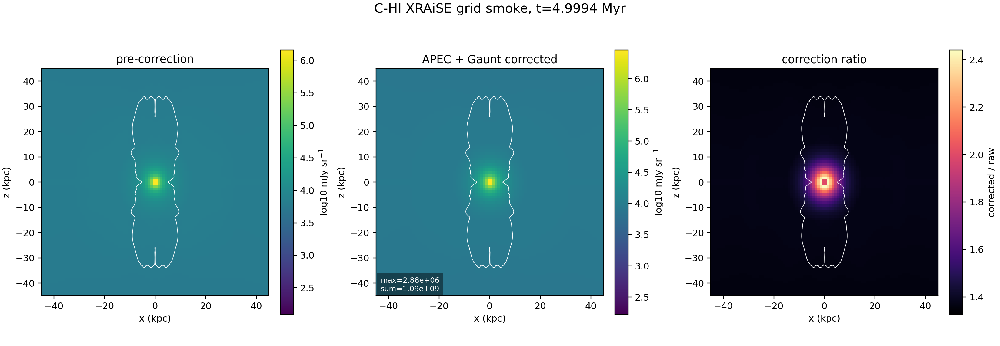

# C-HI 5 Myr XRAiSE Grid Smoke

Date: 2026-05-10

## Summary

This report records the first XRAiSE grid-thermal X-ray smoke product for the
particles-enabled high-power cluster case, `C-HI`, using the same target as the
truth, bridge observable, and cavity-protocol smokes:

- grid output: `data.0008.flt.h5`
- grid timestep: `Timestep_8`
- physical time: `4.9994 Myr`
- view: `0 deg`, projected along the simulation `y` axis
- photon energy: `1 keV`
- redshift: `0.05`

The extraction was run on a `kunanyi` compute node as PBS job
`690624.kunanyi-ohpc` and completed successfully. This is the first smoke that
uses the supplied XRAiSE Python source plus the supplied APEC and Gaunt
correction tables. It supersedes the earlier C bridge map for the grid-thermal
X-ray component, but it does not yet include the heavier particle-loss kernel.

## What Changed From The Bridge Smoke

The earlier observable bridge smoke ported Georgia's XRAiSE bremsstrahlung
expression before the APEC/Gaunt correction stage. This run uses:

- `xraise.py`, copied from Patrick's supplied `env/graile-all.zip`
- `apec_corrections.txt`, copied from `apec_corrections(1).txt`
- `gaunt_lut_2d.npz`
- a small streaming HDF5 adapter that scans `data.0008.flt.h5` in `y` chunks
  and projects along the line of sight

The run uses the TPAC `Anaconda3/2024.02-1` module. That module already
provides the Python stack needed for this grid-only XRAiSE step: `numpy`,
`h5py`, `scipy`, `astropy`, `numba`, `matplotlib`, `yaml`, `pandas`, and
`IPython`.

## Kunanyi Job

- job id: `690624.kunanyi-ohpc`
- job name: `c_hi_xrgrid5`
- node: `n001`
- resources: `select=1:ncpus=1:mpiprocs=1`
- walltime requested: `00:45:00`
- extraction window: `2026-05-10T09:03:17Z` to `2026-05-10T09:05:10Z`
- extraction result: no stderr output, archive written successfully

Compact archive:

```text
remote: /u/bwbrook/codex_kunanyi/c_hi_xraise_grid_smoke_2026-05-10.tar.gz
local:  build/science/kunanyi_stage_2026-05-08/c_hi_xraise_grid_smoke_690624_compact_2026-05-10.tar.gz
sha256: 85f36265a1563483a582bb904d69094fffce2811f45493f7c38bf53545c6ca23
```

## Scalar Smoke Metrics

| Metric | Value |
| --- | ---: |
| grid time | `4.99943481897884 Myr` |
| grid shape | `452 x 404 x 404` |
| raw pre-correction 1 keV max | `1.4382e6 mJy sr^-1` |
| XRAiSE-corrected 1 keV max | `2.8783e6 mJy sr^-1` |
| raw pre-correction map sum | `7.9961e8 mJy sr^-1 pixels` |
| XRAiSE-corrected map sum | `1.0937e9 mJy sr^-1 pixels` |
| correction-ratio range | `1.3273` to `2.4404` |

The raw pre-correction value matches the earlier C bridge smoke, which is a
useful cross-check that the Python XRAiSE path and the bridge extractor are
using the same base thermal expression before table corrections.

## Figure



The white contour marks the line-of-sight maximum tracer boundary at
`tracer = 5e-3`. The right panel shows the multiplicative correction ratio
from the supplied APEC and Gaunt tables.

## Products

The compact products are stored under
`docs/science/assets/c_hi_xraise_grid_smoke_2026-05-10/`:

- `xraise_grid_smoke_summary.csv`
- `xraise_grid_smoke_metadata.json`
- `xray_1kev_raw_mjy_sr.tsv`
- `xray_1kev_xraise_corrected_mjy_sr.tsv`
- `xray_1kev_correction_ratio.tsv`
- `tracer_max_los.tsv`
- `x_kpc.tsv`
- `z_kpc.tsv`
- `c_hi_xraise_grid_smoke_maps.png`

The reusable scripts are:

- `scripts/science/xraise_grid_smoke.py`
- `scripts/science/plot_xraise_grid_smoke.py`
- `scripts/kunanyi/c_hi_xraise_grid_smoke.pbs`

## Interpretation

This passes the XRAiSE grid-thermal smoke gate:

- the supplied XRAiSE source and correction tables can run on a `kunanyi`
  compute node using the site Anaconda module
- the same aligned `5 Myr`, `0 deg` target can now produce an
  APEC/Gaunt-corrected 1 keV X-ray map
- the pre-correction map reproduces the previous bridge value, anchoring the
  port against the earlier smoke
- the correction ratio is finite across the projected map and strongest near
  the bright central region

The remaining GRAiLE/XRAiSE upgrade is the particle-loss-aware component. The
current supplied driver expects a preprocessed `*.particles.hdf5` file and a
`plutokore` runtime; on `kunanyi`, those are still the next runtime gates.
