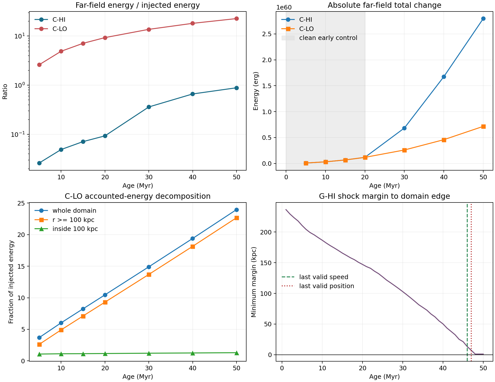

# Cluster background and shock-age validity diagnostic

## Purpose

Goal 063 resolves the two material interpretation gates exposed by the common
four-case fluid census. It tests whether the large normalized `C-LO` energy
terms are concentrated in the driven region or also appear in the distant
cluster atmosphere, and it defines the latest ages at which the existing
axial-shock measurements remain geometrically supported.

This is targeted analysis of existing outputs. It is not another PLUTO run and
does not change the accepted energy, potential, tracer, or shock methods.

## Locked background diagnostic

The remote calculation reads `C-HI` and `C-LO` snapshots
`0/5/10/15/20/30/40/50` and integrates full-fluid thermal, kinetic, and
centre-zero gravitational changes in spherical shells at
`0/50/100/150/200/inf kpc`. Shell sums must reproduce the accepted Goal 062
accounted-energy surface to relative error `<=1e-8` at every non-baseline age.

The prespecified far-field control is `r >= 100 kpc`. Both cluster fronts are
inside `100 kpc` through `20 Myr`, so those early rows are the cleanest test of
background evolution. Later rows remain useful for showing when the `C-HI`
disturbance propagates into the control region. Tracer volume and maximum are
recorded to expose contamination.

This paired design is informative but not equivalent to an unforced no-jet
control. A common far-field signal in both cases supports background evolution
as an explanation; it cannot uniquely identify its cause.

## Shock-age rule

Goal 062 already contains the needed axial profiles and shock rows, so this
part is local. A front position is domain-valid only when both sides are
detected, local pressure and density jumps are finite, and at least two full
axial cells remain beyond each detected front. A speed or kinematic Mach value
is valid only when all three snapshots in its local fit pass that rule.

On that rule, `G-HI` remains valid for front-position use through snapshot `47`
(`46.99915 Myr`) and for three-snapshot kinematics through snapshot `46`
(`45.99958 Myr`). Snapshot `48` places the negative-side front at the outermost
cell and invalidates its local jump stencil; the speed at snapshot `47` already
uses that boundary-limited point. `C-HI`, `C-LO`, and `G-LO` retain adequate
domain margin through snapshot `50`.

This is a technical validity classification, not a new post-hoc physical shock
strength threshold. Weak late features retain their reported jump metrics and
must be interpreted accordingly.

## Completion evidence

Remote preflight passed for both canonical `51`-snapshot chains, the `16`
selected HDF5 files, their required six variables and common
`1014x960x960` shape, the matched cluster-atmosphere hash, both Goal 062
reference tables, staged source hashes, wrapper syntax, and no-overwrite
targets.

PBS `787276.kunanyi-ohpc` (`cl_bgdiag`) completed with `Exit_status=0` in
`00:30:57`, using two CPUs and about `377 MB` reported memory. Both case
diagnostics validated, covering `16` snapshots and `80` shell rows. Remote
stderr is empty. `Stageout_status=1` is retained as a scheduler caveat, but the
requested stage-root archive and logs were present and retrieved directly.

The `11`-member archive has SHA-256
`5633df0a8be47b3142336c39ab2bb2dad8a7220ac1176a567430b828494d7a15`.
It contains only compact CSV/JSON/log products; no HDF5 or particle payload was
copied or modified.

## Result

The early far-field control is effectively identical between the two cluster
runs in absolute units. Across thermal, kinetic, gravitational, and total
terms at `5/10/15/20 Myr`, the maximum fractional `C-LO` versus `C-HI`
difference is `0.0002351` (`0.024%`). The agreement holds despite a `100`-fold
difference in jet power and zero far-field tracer. After `20 Myr`, the curves
separate as the `C-HI` shock propagates beyond `100 kpc`, which is the expected
failure mode of the early control region.

At the `C-LO` endpoint:

| Quantity | Fraction of injected energy |
| --- | ---: |
| Whole-domain accounted change | `23.9673` |
| Far field, `r >= 100 kpc` | `22.6765` |
| Inside `100 kpc` remainder | `1.2908` |

Thus `94.61%` of the whole-domain accounted change lies beyond `100 kpc`,
where `C-LO` tracer is zero and its shock remains inside `69 kpc`. The large
normalized value is dominated by common atmosphere evolution, not evidence
that the low-power jet couples almost `24` times its injected energy.

The inside-`100 kpc` remainder is only an upper bound on jet-affected energy:
it still includes any background evolution inside that radius. Without a
no-jet control it must not be promoted to a background-corrected coupling
efficiency.

## Decision

Decision label:
`C_LO_LARGE_NORMALIZED_BUDGET_BACKGROUND_DOMINATED_SHOCK_WINDOWS_LOCKED`.

The two Goal 062 gates are resolved for the next analysis tranche:

- do not interpret the uncorrected `C-LO` whole-domain normalized energy as a
  jet-coupling efficiency;
- use `G-HI` shock positions only through snapshot `47` and centred shock
  speed/Mach values only through snapshot `46`;
- retain endpoint `G-HI` values for non-shock observables when their own domain
  and method checks pass.

The next high-value goal is a common-age four-case observable-analysis
contract followed by selected-age X-ray/cavity and corrected-PRAiSE2
processing. It should directly test cavity-energy bias versus shock strength
and inferred versus known jet power rather than expanding the diagnostic
ledger.
