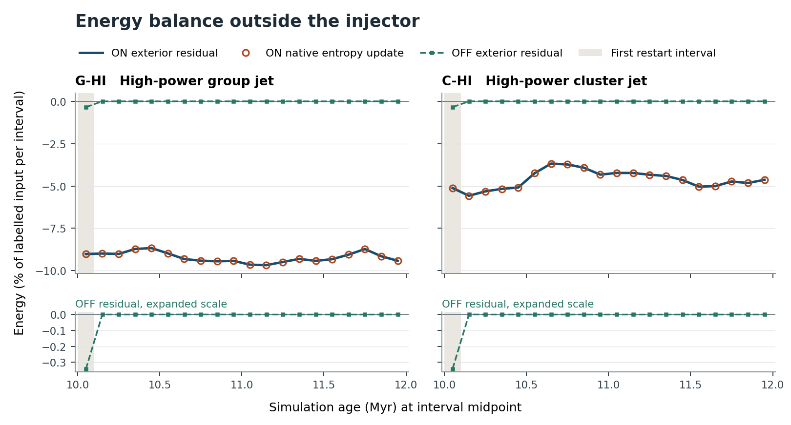

# How PLUTO's entropy switch changes the energy of a simulated jet

Switching entropy recovery off removed **99.81% of the measured exterior energy deficit in G-HI** and **99.63% in C-HI** under the registered calculation. Within each switch-on arm, the calculation from stored energy and flux matched the change recorded by the solver itself to within 0.000032 percentage points of labelled input. This identifies the numerical source of the deficit in both high-power simulations from 10 to 12 Myr. Its contribution at other ages and in the two low-power jets remains unmeasured. <!-- claims: BND-14 -->

| 10–12 Myr, primary calculation | G-HI (group) | C-HI (cluster) |
|---|---:|---:|
| Exterior residual, switch on (% of labelled input) | −9.21313 | −4.61482 |
| Native entropy change, switch on (%) | −9.21315 | −4.61478 |
| Exterior residual, switch off (%) | −0.01722 | −0.01707 |
| Deficit removed (%) | 99.81 | 99.63 |
| Net injector delivery / label, on → off | 1.15837 → 1.15145 | 1.16203 → 1.15513 |
| Whole-grid source / label, on → off | 1.06624 → 1.15128 | 1.11588 → 1.15496 |

G-HI passed the prospective switch-off criterion of a residual within ±1% of labelled input in each of the 20 short intervals. Claude's predicted switch-on deficit of 6–8% was too small. The measured G-HI deficit ranged from 8.67% to 9.68% per interval. The prediction of injector delivery near 1.15 times label held for both atmospheres and switch settings. [Primary window totals](assets/entropy_restart_result_2026-11-22/primary_windows.csv) · [All 80 primary intervals](assets/entropy_restart_result_2026-11-22/primary_intervals.csv)



The open circles give the solver's signed entropy updates and sit on the independently measured switch-on residuals. The lower panels enlarge the switch-off residuals. Each percentage uses that interval's labelled input.

## The paired experiment

We restarted the high-power group (G-HI) and cluster (C-HI) jets from their respective 10-Myr production checkpoints. In each atmosphere the two executables differed in the compile-time entropy switch. In smooth-flow cells the switch can recover pressure from advected entropy and write the corresponding gas energy back to the grid. We measured each gain and loss at the instant this happened. We also measured energy storage, injector delivery and transport across the six outer faces directly from the saved states. [Frozen predictions, controls and diagnostics](entropy_restart_protocol_2026-11-21.md)

Both switch-on controls reproduced their production state at 11 Myr. The saved time, hydro step and every value of all six fluid fields matched in all 934,502,400 cells, in both atmospheres. G-HI restored 39,764 particles and C-HI 40,452. The two gates passed before either switch-off run started. All four arms reached 12 Myr, saving 20 new fluid outputs at approximately 0.1-Myr intervals and a final double-precision checkpoint. The two arms in each case shared the same seed. There were 82 distinct float snapshots. [Execution and verification](../exchange/logs/2026-11-22-entropy-restart-results.md)

## Two independent energy accounts

For each arm we subtract the change in energy inside the maintained injector cells from the change over the grid, add signed outward transport across the domain boundary, then subtract signed delivery across the injector surface. A negative residual means energy disappeared from the freely evolved gas. Each storage and flux term includes thermal, kinetic and centre-referenced gravitational potential energy as applicable, with pressure work in the gas flux. The primary calculation uses piecewise-linear injector states with the saved-state solver flags, outer active cells and trapezoidal time weights. We sum energy in erg across the actual output intervals before dividing by their total labelled input. [Interval calculation](../../scripts/science/entropy_restart_budget.py)

The native solver counter separately measures the changes made during each accepted Runge–Kutta step. We accounted for every physical cell in each of its two stages and applied the native weights of one half and one. It includes 447,914 rows across the four runs. The two accounts share simulations and units. The counter uses no saved-state reconstruction of the injector or of boundary transport. [Native diagnostic](../../scripts/kunanyi/patch_entropy_restart.py) · [Stage reduction](../../scripts/science/reduce_entropy_restart_stages.py)

## How accurately can snapshots resolve the remaining balance?

Almost the entire switch-off residual comes from the first 0.1 Myr. It was −0.3432% of that interval's label in G-HI and −0.3417% in C-HI. Every later interval was within ±0.00048% of its own label in both runs. If only the 10, 11 and 12 Myr outputs are used, the apparent switch-off shortfalls grow to 0.177% and 0.176%. The first interval begins at the common production seed, and the injector rate has fallen by the next saved output. Using only that later rate for the first injector integral changes the full-window residuals to +0.00066% and +0.00063%. This measures sensitivity to how the switch transition is sampled. [Coarse sampling of the same runs](assets/entropy_restart_result_2026-11-22/annual_sampling_windows.csv) · [Independent endpoint calculation](assets/entropy_restart_result_2026-11-22/independent_verification.json)

G-HI's primary deficit from 0.75 to 0.85 kpc was 2.253% of label with the switch on. Another 6.960% lay farther out. C-HI lost 2.248% in the same shell and 2.366% beyond it. With the switch off, the shell and outer contributions were −0.054% and +0.036% in G-HI, and −0.053% and +0.036% in C-HI. Net delivery fell by about 0.69 percentage points of label in each atmosphere. The cone supplied most of this change. The stationary gas contributed a small outward flux in all four arms, about +0.14% with the switch on and +0.10% with it off. [Shell, cone and stationary balances](assets/entropy_restart_result_2026-11-22/primary_windows.csv)

The absolute residual depends on how the surfaces are reconstructed. With the configured injector rule, varying domain-face and time rules gives G-HI switch-off residuals of −0.089% to −0.00014%. For C-HI, extrapolating to the domain face gives −6.200% on and −1.602% off under trapezoidal integration. The on-to-off improvement is 4.598 percentage points with either domain-face choice. Forcing HLL on every injector face gives primary-boundary switch-off residuals of −1.73% and −1.71%. Forcing HLLC reproduces the configured-rule results. The first-order rows fail the historical tagged-mass closure test and are retained as diagnostics. These alternatives explain why the causal inference uses both the registered estimate and the direct within-arm energy counter. [All 96 method windows](assets/entropy_restart_result_2026-11-22/method_windows.csv) · [Matched on–off comparisons](assets/entropy_restart_result_2026-11-22/paired_windows.csv)

## Where the gains and losses occur

In G-HI, entropy recovery added 21.72% of labelled input and removed 30.93%. In C-HI it added 29.98% and removed 34.59%. These gross terms count the sign of the energy change in each cell visit. They can test Gemini's prediction that both signs matter. They cannot distinguish heating by numerical mixing from loss of kinetic energy within a single visit.

Gas with more than 50% jet material by mass had a net loss of 9.96% of labelled input in G-HI and 12.32% in C-HI. Gas with 0.5–50% jet material lost 0.11% in G-HI and gained 5.51% in C-HI. At radii of 25–50 kpc the net changes also had opposite signs, −3.14% in G-HI and +3.82% in C-HI. These classifications describe the gas when the solver changed its energy. The radial counter combines 0.75–5 kpc, so only the saved-state balance resolves the first 0.10 kpc outside the injector.

Both high-power jets also ran to completion with the switch off. The ordinary pressure floor then acted on 20,203 cell visits in G-HI and 1,158 in C-HI. It added 2.39 × 10⁻⁹ and 9.05 × 10⁻¹¹ of labelled input, respectively. Neither run used a density or gas-energy floor. These counts can include repeated visits to the same cell. [Stage tables and run receipts](assets/entropy_restart_result_2026-11-22/compact_inputs.zip)

## Reproduction

From the repository root, extract the compact receipts to a fresh directory and run the integration. The archive includes the snapshot-level stocks, the six signed outer-face rates, the cone and stationary injector rates, the stage reductions, the full-grid control results and file hashes.

```sh
unzip -q docs/science/assets/entropy_restart_result_2026-11-22/compact_inputs.zip -d /tmp/xray-entropy-inputs
.venv/bin/python scripts/science/entropy_restart_budget.py /tmp/xray-entropy-inputs /tmp/xray-entropy-tables
```

The independent verifier reads the raw stage ledgers, production archives and the compact measurements. It compares 10- and 11-Myr control stocks and rates with the historical production tables, and checks the four integrated primary budgets using endpoint stocks and time-weighted rates. Its receipt records the checks that used the retained native inputs. [Independent calculation](../../scripts/science/verify_entropy_restart_budget.py) · [Verification receipt](assets/entropy_restart_result_2026-11-22/independent_verification.json)
