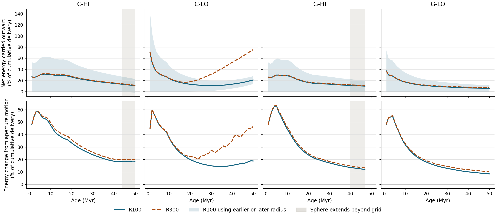

# Energy carried across the two velocity-defined spheres

By 50 Myr in the low-power cluster jet (C-LO), the reconstructed net outward gas-energy transport was equivalent to **75.6% of cumulative injector delivery through R300 and 21.1% through R100**. The layer between them received 54.5% of delivery on this estimate. Its energy rose by 27.4%. The changing set of cells inside the shell contributed −27.7 percentage points and the difference between the two energy residuals contributed +0.6. The thermal energy increase of the ambient gas in this shell alone was 20.0% of delivery. [Shell balance](assets/aperture_transport_2026-11-26/shell_balance.csv) · [Thermal, kinetic and gravitational contributions](four_case_energy_partition_2026-11-26.md)

The four PLUTO runs put bipolar jets of nominal power 2 × 10⁴⁵ (HI) or 2 × 10⁴³ erg/s (LO) into cluster (C) and group (G) atmospheres. The nozzle speed is 0.1c, the fluid has γ = 5/3, and the native stretched grid has 960 × 960 × 1,014 cells. We measured all retained production outputs, 0 through 50 Myr in C-HI, C-LO and G-LO and through 46.999150 Myr in G-HI. The calculation uses each pair's actual elapsed time. The denominator D is cumulative net **mechanical gas energy** delivered by the injector. Its reconstruction includes both cone sectors and signed exchange with the stationary nozzle surface. [Simulation settings, ages and regional stocks](four_case_energy_partition_2026-11-26.md) · [Injector history](production_injector_histories_2026-11-21.md)

## Comparison at 30 Myr

R100 and R300 enclose all cells out to the farthest cell moving at least 100 or 300 km/s, respectively. Both spheres fit fully on the computational grid at these ages. The table gives percentages of cumulative D, measured from time zero. Each pair is ordered **R100 / R300**. Outward transport includes thermal advection, pressure work, kinetic energy and transport in the fixed centre-zero gravitational potential. Moving ambient gas carries the enthalpy and potential energy it already had. D provides a common scale for that transport. The membership term measures the change from admitting or losing cells with energy different from their initial value.

| Case | Radius (kpc) | Energy stored above initial (% D) | Energy carried outward (% D) | Change from moving the surface (% D) |
| --- | ---: | ---: | ---: | ---: |
| C-HI | 145.93 / 145.91 | 93.26 / 93.26 | 19.27 / 20.06 | 23.87 / 25.87 |
| C-LO | 69.21 / 63.91 | 108.21 / 99.68 | 10.84 / 31.25 | 15.04 / 27.48 |
| G-HI | 149.86 / 149.83 | 93.22 / 93.22 | 13.56 / 14.47 | 17.39 / 18.59 |
| G-LO | 64.47 / 63.94 | 101.96 / 101.95 | 8.40 / 9.51 | 12.93 / 14.46 |

At 30 Myr the energy stored above initial inside C-LO’s R300 is 99.7% of delivery even though the outward transport was 31.3%. As the surface moved it enclosed an additional 27.5% of delivery in perturbed gas. Near equality of storage and input can therefore coexist with appreciable flow through the surface. In C-HI and G-HI the two radii nearly coincide by 30 Myr. Their cumulative transport can still differ because the curves followed different surfaces earlier. In C-LO the two surfaces have separated by 5.30 kpc at 30 Myr and by 8.08 kpc at 50 Myr. At each saved age, the signed shell stock equals net transport into the layer plus the change from moving both boundaries plus the difference of the two energy residuals. The last term is retained explicitly. [Selected ages, component fluxes and reconstruction alternatives](assets/aperture_transport_2026-11-26/selected_age_transport.csv)

The individual surface integrals depend strongly on which annual radius is held fixed. At R100, using each interval’s earlier and later radii gives 38.52% versus 0.025% through 30 Myr in C-HI, 19.97% versus 1.71% in C-LO, 27.12% versus 0.003% in G-HI and 16.71% versus 0.093% in G-LO. Each prescription integrates flux through a different sequence of surfaces. The primary value averages the two. The annual snapshots leave the path of the speed threshold between endpoints unknown. The figure’s blue shading spans those two R100 calculations.

In C-LO the difference between the two surface integrals is more stable than either integral alone. At 50 Myr, always using the earlier radius or always using the later radius gives 28.1% or 14.1% outward through R100 and 82.6% or 68.7% through R300. The difference is 54.50% or 54.59%. A trapezoid following the two endpoints gives 54.90%, and the donor-cell spatial reconstruction with symmetric time sampling gives 54.68%. At 30 Myr the corresponding differences span 19.8–21.5%, around the primary value of 20.4%. These tests all share the saved epochs and underlying fields. The range describes sensitivity to the tested rules. [Comparisons at every age](assets/aperture_transport_2026-11-26/shell_balance.csv)

| C-LO age | Net transport into shell | Change from moving boundaries | Difference in residuals | Measured shell energy increase |
| --- | ---: | ---: | ---: | ---: |
| 30 Myr | +20.4% | −12.4% | +0.6% | +8.5% |
| 50 Myr | +54.5% | −27.7% | +0.6% | +27.4% |

Each term is a percentage of the cumulative energy delivered by that age and is rounded separately. Positive net transport means that more energy flowed outward through the smaller surface than through the larger one. Both surfaces surround every lobe cell at these two ages. [Cocoon containment and shell components](four_case_energy_partition_2026-11-26.md)



## Last complete spheres and final outputs

Each pair gives R100 / R300. In the two high-power cases the last complete spheres precede the final available snapshots. Once a sphere extends beyond the grid, energy can cross both its internal surface and the patch of the computational box that completes the measured volume. The last column gives cumulative transport across that patch, with outward positive. The remaining surface contribution can be obtained by subtraction.

| Case | Age (Myr) | Geometry | Cumulative outward (% D) | Change from membership (% D) | Of the outward total, on box faces (% D) |
| --- | ---: | --- | ---: | ---: | ---: |
| C-HI | 43.000 | Complete | 13.76 / 14.46 | 18.26 / 19.83 | 0.00 / 0.00 |
| C-HI | 50.000 | Grid intersection | 10.82 / 11.56 | 18.71 / 20.19 | −0.54 / −0.51 |
| C-LO | 50.000 | Complete | 21.09 / 75.64 | 18.87 / 46.58 | 0.00 / 0.00 |
| G-HI | 39.000 | Complete | 11.39 / 12.39 | 13.97 / 15.15 | 0.00 / 0.00 |
| G-HI | 46.999 | Grid intersection | 10.03 / 11.00 | 12.12 / 13.30 | −0.02 / −0.02 |
| G-LO | 50.000 | Complete | 5.88 / 7.24 | 8.51 / 10.26 | 0.00 / 0.00 |

At 50 Myr the low-power group has a 0.71-kpc shell. Its reconstructed net energy import is 1.4% of delivery. The cluster at the same nominal power has an 8.08-kpc shell and net import equivalent to 54.5% of delivery. The two cases differ in atmosphere and jet evolution. [All geometries and signed balances](assets/aperture_transport_2026-11-26/tables/primary_balances.csv)

## Independent measurements of the same surfaces

At the C-LO output nearest 30 Myr, R300 is 63.91 kpc and R100 is 69.21 kpc. The smaller surface carries an outward power of $1.714\times10^{43}$ erg/s. The larger carries $2.175\times10^{42}$ erg/s. These are 75.4% and 9.6% of the simultaneous net injector gas power. The enthalpy flux, including pressure work, accounts for about 80% of each total. The remaining power is predominantly potential-energy transport in the adopted centre-zero convention. These rates are instantaneous. [Signed components](assets/aperture_transport_2026-11-26/instantaneous_rates.csv)

A second reader rehashed the native C-LO file and traced the ends of occupied rows and columns in each plane. It counted exactly the same 2,925,784 R100 faces and 2,772,944 R300 faces. All 14 mass and energy flux comparisons agree within $2\times10^{-16}$ of the sum of absolute face contributions. Both readers use the same snapshot, face interpolation, radii, units and potential. This checks the implementation of that estimate. [Native plane extraction](assets/aperture_transport_2026-11-26/independent_CLO30.json) · [Numerical comparison](assets/aperture_transport_2026-11-26/independent_flux_check.csv)

## What the time samples resolve

The initial 4,296-face aperture coincides with the maintained injector in all four cases, so its face estimate can be checked against the reconstruction that uses the production solver and its saved flags. At time zero the centred gas-power estimate spans 0.082–1.843 times labelled power across cases. The solver-specific estimate spans 1.135–1.211. The donor-cell estimate spans 1.215–1.220. Substituting the solver-specific rates at both ends of the fixed initial surface changes the 0–1 Myr integrated outward energy by +26.8%, −21.3%, +27.0% and +14.4% of **that interval’s** labelled input in C-HI, C-LO, G-HI and G-LO. Both spheres use the same initial surface, so that correction cancels in their difference. The published primary history uses the registered estimate throughout. [Shared-surface comparison](assets/aperture_transport_2026-11-26/startup_injector_comparison.csv)

The C-LO production control retained eleven native states from 9.999174 to 10.999231 Myr. Keeping the two production endpoint radii fixed separates the sampling of a face flux from any change in membership. The control reproduces all 56 production endpoint rates. Shortening the sample interval from one Myr to 0.1 Myr moves the outward energy from **2.854% to 2.951% of delivery at R100**, and from **3.081% to 3.220% at R300**. The fractions use the injector gas delivery sampled at the corresponding cadence. The change in that denominator is under 0.001%. Larger changes on the individual fixed surfaces partially cancel in the mean. This tests one C-LO interval at relatively small outward flux. [Fine-cadence comparison](assets/aperture_transport_2026-11-26/cadence_budget.csv) · [Endpoint checks and fixed-radius integrals](assets/aperture_transport_2026-11-26/cadence_comparison.json)

All 201 saved injector stencils show exactly constant maintained mass within each case. In the same 10–11 Myr control, the signed mass residual at R100 changes from −1.74 to −1.06 times the mass the labelled jet would inject in that Myr. At R300 it changes from −0.38 to −0.92. These values include the signed mass crossing the stationary injector surface. In that interval the total net injector mass actually flows inward, while the cones emit jet gas. Hence small changes in the energy integral with sampling cadence can coexist with a substantial mass imbalance. The discrepancy can include spatial flux reconstruction, unresolved time variation and errors in the reconstructed source. Attributing the discrepancy to an entropy update or a shock requires a separate measurement of that process. [Injector cell mass](assets/aperture_transport_2026-11-26/maintained_masses.csv) · [All mass balances](assets/aperture_transport_2026-11-26/mass_balances.csv.gz)

At 30 Myr the cumulative R100 / R300 mass residuals in units of cumulative nominal jet mass are −1.62 / −2.21 in C-HI, −1.59 / −3.63 in C-LO, +0.02 / +0.01 in G-HI, and −1.51 / −2.69 in G-LO. The aperture can transport far more ambient mass than the nozzle supplies. At C-LO/50 the two discrepancies are −2.53 and −4.81 nominal jet masses, or −3.1% and −1.5% on a scale formed by summing the magnitudes of the net aperture, cone and stationary-sector mass terms over the intervals. This scale still permits cancellation between inflow and outflow within each sector. [Signed mass residuals and both normalisations](assets/aperture_transport_2026-11-26/mass_balances.csv.gz)

## Limits on closing the energy accounts

Across the first ten Myr, the R100 cumulative energy residual lies **14.2–16.4 percentage points of delivery below** the reconstructed residual for the whole grid outside the injector. Across the next twenty Myr alone, the difference is −0.2 to +2.3 points. The analogous ranges for R300 are −17.8 to −14.3 points and −1.0 to +2.5 points. Thus much of the discrepancy seen at 30 Myr was accumulated in the first decade. Differences in which gas the two accounts cover, scatter across face and time rules, and the lack of solver fluxes at intermediate times limit physical attribution. A consistent shift of gravitational reference changes the signed energy residual by that constant times the measured mass residual. [Interval and cumulative energy accounts](assets/aperture_transport_2026-11-26/tables/primary_balances.csv) · [Registered balance definitions](four_case_aperture_transport_method_2026-11-26.md)

## Reproduce the tables

All 201 endpoint receipts matched their extraction hashes. Their native file identities matched the registered paths, sizes, inodes and timestamps. The C-LO/30 source file also passed a full SHA-256 rehash. The direct and sequential HDF5 readers produced identical measurements in all eight pilot snapshots.

A second calculation summed the four individual flux components over the two types of face at each of four samples per interval. It used the independently reviewed injector and whole-grid table. All 1,970 cumulative comparisons across the 394 sphere intervals agree to 6.7 × 10⁻¹⁶ of delivery. The calculations share native surface and stock measurements. Replaying from the unpacked endpoints and from the public archives gave 19 byte-identical tables and figures. [Component recalculation](../../scripts/science/check_aperture_transport_history.py) · [Replay checks and product digests](assets/aperture_transport_2026-11-26/replay_check.json)

Run from the repository root. The reducer expects a fresh output directory. The endpoint archives contain native snapshot identities, surface rates, geometry and the changing membership between neighbouring radii. The separate source archive supplies the injector and full-domain terms. The two high-power apertures extend outside the domain from outputs 44 in C-HI and 40 in G-HI. There the flux includes measured parts of the computational-box faces, and the stock and transport describe only the portion of the sphere on the grid. Both low-power series remain geometrically complete through 50 Myr. [Extraction receipt and archive hashes](assets/aperture_transport_2026-11-26/extraction_receipt.json) · [Table inventory and checks](assets/aperture_transport_2026-11-26/tables/verification.json)

```sh
assets=docs/science/assets/aperture_transport_2026-11-26
out=$(mktemp -d)
.venv/bin/python scripts/science/summarise_aperture_transport.py --endpoints "$assets" --output "$out/tables" --stage-sha256 6d891b93b5905a686d7f6c457cba881bab4e1df6a892cdcc7da39d56cdca3215
.venv/bin/python scripts/science/check_aperture_transport_references.py --endpoints "$assets" --output "$out"
.venv/bin/python scripts/science/check_aperture_mass_budget.py balances --tables "$out/tables" --out "$out/mass_balances.csv.gz"
.venv/bin/python scripts/science/plot_aperture_transport.py --tables "$out/tables" --output "$out"
.venv/bin/python scripts/science/check_aperture_transport_history.py --endpoints "$assets" --tables "$out/tables"
```
