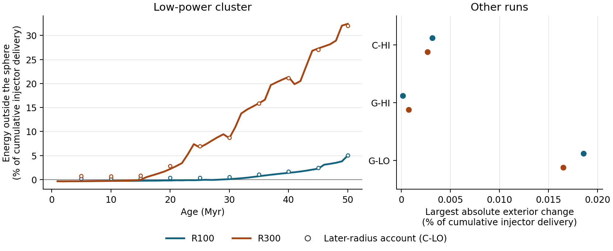

# Energy stored outside the velocity-defined spheres

At 50 Myr in the low-power cluster (C-LO), the gas between R300 and the fixed inset box holds an energy increase equal to **32.4% of cumulative injector delivery**. Beyond R100 the corresponding increase is **5.0%**. The difference puts **27.4% of delivery in the ambient shell between the spheres**. In the other three runs, the magnitude of the exterior energy change stays below **0.019% of delivery** at every saved age for which the sphere fits inside the inset box. [Measured exterior stocks](assets/aperture_transport_review_2026-11-27/exterior.csv)

R100 and R300 enclose all cell centres out to the farthest cell moving at least 100 and 300 km/s, respectively. The inset box contains whole cells at least 50 kpc inside each computational face. Exterior storage is the current-minus-initial energy in the box less the same change inside the sphere. The comparison uses each output’s measured net injector gas delivery, D. The four production runs have 201 native snapshots at approximately 1-Myr intervals, to 50 Myr in C-HI, C-LO and G-LO and 46.999 Myr in G-HI. [Simulation settings, ages, stock components and denominator](four_case_energy_partition_2026-11-26.md)

## Where the energy accumulates

| Case | Last eligible output, R100 / R300 (Myr) | Largest absolute exterior stock change, R100 / R300 (% D) |
| --- | ---: | ---: |
| C-HI | 30 / 31 | 0.00315 / 0.00264 |
| G-HI | 29 / 29 | 0.000148 / 0.000748 |
| G-LO | 50 / 50 | 0.01858 / 0.01650 |

Across these three runs, each exterior thermal, kinetic and gravitational change is at most 0.012% of delivery in magnitude. The kinetic contribution stays below 0.0009%. The small signed totals therefore also have small individual components. G-HI/30 is already outside the inset box, although its sphere still fits inside the computational grid. The measurement constrains energy present at the saved times between the sphere and the box. Energy could cross a surface and return between outputs or travel beyond the inset box. [Component and geometry checks](assets/aperture_transport_review_2026-11-27/exterior.csv)

In C-LO both spheres fit inside the box through 50 Myr. An additional estimate integrates the outward flux at the later radius of each interval and subtracts the energy perturbation already between the two endpoint radii at its start. The fixed-box stock subtraction uses no surface fluxes. Agreement is closest at late times when substantial energy has accumulated outside R300.

| C-LO age (Myr) | Stored beyond R300 (% D) | Later-radius estimate (% D) | Stored beyond R100 (% D) | Later-radius estimate (% D) |
| ---: | ---: | ---: | ---: | ---: |
| 10 | −0.29 | 0.64 | −0.29 | 0.19 |
| 20 | 2.19 | 2.79 | −0.20 | 0.34 |
| 30 | 8.62 | 8.69 | 0.09 | 0.54 |
| 40 | 21.36 | 21.16 | 1.39 | 1.69 |
| 50 | **32.42** | **32.00** | **5.02** | **5.07** |



## What the annual surface integrals measure

For an interval with earlier radius a and later radius b, the registered calculation averages a trapezoid on surface a and a trapezoid on surface b. Each uses both saved times at its chosen fixed radius. In C-HI, G-HI and G-LO neither radius shrinks between saved outputs. The earlier surface is then inside the later aperture. The first such surface is the injector itself. Energy crossing it can still be inside the aperture at the next output. The 26 November interpretation treated the mean as energy leaving these three apertures. We withdraw that interpretation and the corresponding 1.4% G-LO shell-import figure. The signed endpoint fluxes and the registered arithmetic are available for replay. [Registration](four_case_aperture_transport_method_2026-11-26.md) · [Earlier, later and averaged fixed-surface balances](assets/aperture_transport_review_2026-11-27/rules.csv)

This accounts for the apparent discrepancy in the first decade. At 10 Myr the mean-rule residual in the eight case/aperture combinations lies 14.2–17.8 percentage points of delivery below the whole-grid exterior residual. Closing the earlier-radius balances separately gives differences of −28.3 to −35.7 points. Closing the later-radius balances gives differences within 0.34 points. In C-LO, R300 decreases in the intervals ending at 32, 37 and 43 Myr. The calculation retains the signs of those changes. [Annual and cumulative balances](assets/aperture_transport_review_2026-11-27/rules.csv)

## The C-LO shell at 50 Myr

The two spheres have radii of 72.86 and 80.94 kpc. Both contain every on-grid cell with tracer above 0.001 at every saved C-LO age. The earlier- and later-radius prescriptions give different gross crossing estimates, **68.7–82.6% of D for R300 and 14.1–28.1% for R100**. Much of the discrepancy is common to the two surfaces. At 50 Myr their differences between rules are 13.9 and 14.0 percentage points, of which about 9.2 accumulated in the first ten Myr, while the two radii nearly coincided. The net into the shell is much more stable. [Shell balances by time rule](assets/aperture_transport_review_2026-11-27/shell.csv)

| 50-Myr balance (% D) | Earlier-radius rule | Later-radius rule | Registered mean |
| --- | ---: | ---: | ---: |
| R300 crossing minus R100 crossing | +54.50 | +54.59 | +54.54 |
| Change from moving the two boundaries | −27.76 | −27.65 | −27.71 |
| Difference between the two aperture residuals | +0.66 | +0.46 | +0.56 |
| Measured shell energy increase | **+27.40** | **+27.40** | **+27.40** |

The gas carried net energy into the shell equivalent to 26.17% of D in advected thermal energy, 17.45% in pressure work, 0.64% in kinetic energy and 10.29% in gravitational energy. The corresponding net transported mass is 1.70 × 10⁴² g, about 242 times the labelled jet mass. These quantities and tracer containment point to ambient gas carrying its enthalpy. The pressure-work to thermal-advection ratio is fixed at γ−1 for any ideal gas with this equation of state, so it cannot identify the gas that carried the energy. [Flux components and mass](assets/aperture_transport_review_2026-11-27/shell.csv)

The shell gains 8.59 × 10⁴¹ g in stored mass. Its thermal gain per gram of added mass is 1.57–1.60 times the flux-weighted specific thermal energy at its surfaces. That is consistent with the factor 5/3 for small adiabatic compression at fixed entropy. Determining a parcel’s heating history would require tracking its upstream thermodynamic state. Of the 27.4-point energy increase, thermal plus kinetic contributes 20.95 points and gravity 6.45, using the centre-zero potential. On the later-radius rule the energy residual is +14.38 points inside R300 and +14.84 inside R100, against +15.16 for the whole grid outside the injector. Most of that residual is already present inside R300. A direct measurement of the numerical source is available only in the 10–12 Myr restart experiment. [Shell components](assets/aperture_transport_review_2026-11-27/shell.csv) · [Whole-grid history and direct restart calibration](gemini_second_review_2026-11-23.md)

## Independent measurements of the same surfaces

At the C-LO output nearest 30 Myr, R300 is 63.91 kpc and R100 is 69.21 kpc. The smaller surface carries an outward power of $1.714\times10^{43}$ erg/s. The larger carries $2.175\times10^{42}$ erg/s. These are 75.4% and 9.6% of the simultaneous net injector gas power. The enthalpy flux, including pressure work, accounts for about 80% of each total. The remaining power is predominantly potential-energy transport in the adopted centre-zero convention. These instantaneous powers sample the two fixed surfaces at this output. [Signed components](assets/aperture_transport_2026-11-26/instantaneous_rates.csv)

A second reader rehashed the native C-LO file and traced the ends of occupied rows and columns in each plane. It counted exactly the same 2,925,784 R100 faces and 2,772,944 R300 faces. All 14 mass and energy flux comparisons agree within $2\times10^{-16}$ of the sum of absolute face contributions. Both readers use the same snapshot, face interpolation, radii, units and potential. This checks the implementation of that estimate. [Native plane extraction](assets/aperture_transport_2026-11-26/independent_CLO30.json) · [Numerical comparison](assets/aperture_transport_2026-11-26/independent_flux_check.csv)

## What the time samples resolve

The initial 4,296-face aperture coincides with the maintained injector in all four cases, so its face estimate can be checked against the reconstruction that uses the production solver and its saved flags. At time zero the centred gas-power estimate spans 0.082–1.843 times labelled power across cases. The solver-specific estimate spans 1.135–1.211. The donor-cell estimate spans 1.215–1.220. Substituting the solver-specific rates at both ends of the fixed initial surface changes the 0–1 Myr integrated outward energy by +26.8%, −21.3%, +27.0% and +14.4% of **that interval’s** labelled input in C-HI, C-LO, G-HI and G-LO. Both spheres use the same initial surface, so that correction cancels in their difference. The published primary history uses the registered estimate throughout. [Shared-surface comparison](assets/aperture_transport_2026-11-26/startup_injector_comparison.csv)

The C-LO production control retained eleven native states from 9.999174 to 10.999231 Myr. Keeping the two production endpoint radii fixed separates the sampling of a face flux from any change in membership. The control reproduces all 56 production endpoint rates. Shortening the sample interval from one Myr to 0.1 Myr moves the outward energy from **2.854% to 2.951% of delivery at R100**, and from **3.081% to 3.220% at R300**. The fractions use the injector gas delivery sampled at the corresponding cadence. The change in that denominator is under 0.001%. Larger changes on the individual fixed surfaces partially cancel in the mean. This tests temporal integration on fixed radii during one C-LO interval at relatively small flux. The test holds the surfaces fixed even between the 0.1-Myr snapshots, so it cannot locate the intervening moving boundary. [Fine-cadence comparison](assets/aperture_transport_2026-11-26/cadence_budget.csv) · [Endpoint checks and fixed-radius integrals](assets/aperture_transport_2026-11-26/cadence_comparison.json)

All 201 saved injector stencils show exactly constant maintained mass within each case. In the same 10–11 Myr control, the signed mass residual at R100 changes from −1.74 to −1.06 times the mass the labelled jet would inject in that Myr. At R300 it changes from −0.38 to −0.92. These values include the signed mass crossing the stationary injector surface. In that interval the total net injector mass actually flows inward, while the cones emit jet gas. Hence small changes in the energy integral with sampling cadence can coexist with a substantial mass imbalance. The discrepancy can include spatial flux reconstruction, unresolved time variation and errors in the reconstructed source. Attributing the discrepancy to an entropy update or a shock requires a separate measurement of that process. [Injector cell mass](assets/aperture_transport_2026-11-26/maintained_masses.csv) · [All mass balances](assets/aperture_transport_2026-11-26/mass_balances.csv.gz)

At 30 Myr the cumulative R100 / R300 mass residuals in units of cumulative nominal jet mass are −1.62 / −2.21 in C-HI, −1.59 / −3.63 in C-LO, +0.02 / +0.01 in G-HI, and −1.51 / −2.69 in G-LO. The aperture can transport far more ambient mass than the nozzle supplies. At C-LO/50 the two discrepancies are −2.53 and −4.81 nominal jet masses, or −3.1% and −1.5% on a scale formed by summing the magnitudes of the net aperture, cone and stationary-sector mass terms over the intervals. This scale still permits cancellation between inflow and outflow within each sector. [Signed mass residuals and both normalisations](assets/aperture_transport_2026-11-26/mass_balances.csv.gz)

## Reproduce the tables

Claude recomputed all 394 registered sphere balances from the original receipts and compared the two fixed-radius rules with exterior stocks. We replayed that review with the retained tracer projections and reproduced all five review files byte for byte. We also subtracted the separately integrated November 11 spherical components from the November 26 fixed-box components at all 319 eligible aperture-epochs. All 1,276 component comparisons agree with the review table on the scale of delivered energy. The figure script checks those inputs and regenerates the stock comparison. [Review code](../../scripts/science/check_aperture_transport_rules.py) · [Stock check and figure](../../scripts/science/plot_aperture_exterior_stocks.py)

All 201 endpoint receipts matched their extraction hashes. Their native file identities matched the registered paths, sizes, inodes and timestamps. The C-LO/30 source file also passed a full SHA-256 rehash. The direct and sequential HDF5 readers produced identical measurements in all eight pilot snapshots.

A second calculation summed the four individual flux components over the two types of face at each of four samples per interval. It used the independently reviewed injector and whole-grid table. All 1,970 cumulative comparisons across the 394 sphere intervals agree to 6.7 × 10⁻¹⁶ of delivery. The calculations share native surface and stock measurements. Replaying from the unpacked endpoints and from the public archives gave 19 byte-identical tables and figures. [Component recalculation](../../scripts/science/check_aperture_transport_history.py) · [Replay checks and product digests](assets/aperture_transport_2026-11-26/replay_check.json)

Run from the repository root. The reducer expects a fresh output directory. The endpoint archives contain native snapshot identities, surface rates, geometry and the changing membership between neighbouring radii. The separate source archive supplies the injector and full-domain terms. The two high-power apertures extend outside the domain from outputs 44 in C-HI and 40 in G-HI. There the flux includes measured parts of the computational-box faces, and the stock and transport describe only the portion of the sphere on the grid. Both low-power series remain geometrically complete through 50 Myr. [Extraction receipt and archive hashes](assets/aperture_transport_2026-11-26/extraction_receipt.json) · [Table inventory and checks](assets/aperture_transport_2026-11-26/tables/verification.json)

```sh
assets=docs/science/assets/aperture_transport_2026-11-26
out=$(mktemp -d)
.venv/bin/python scripts/science/summarise_aperture_transport.py --endpoints "$assets" --output "$out/tables" --stage-sha256 6d891b93b5905a686d7f6c457cba881bab4e1df6a892cdcc7da39d56cdca3215
.venv/bin/python scripts/science/check_aperture_transport_references.py --endpoints "$assets" --output "$out"
.venv/bin/python scripts/science/check_aperture_mass_budget.py balances --tables "$out/tables" --out "$out/mass_balances.csv.gz"
.venv/bin/python scripts/science/plot_aperture_transport.py --tables "$out/tables" --output "$out"
.venv/bin/python scripts/science/check_aperture_transport_history.py --endpoints "$assets" --tables "$out/tables"
.venv/bin/python scripts/science/plot_aperture_exterior_stocks.py --out "$out/exterior_stocks.png"
```
