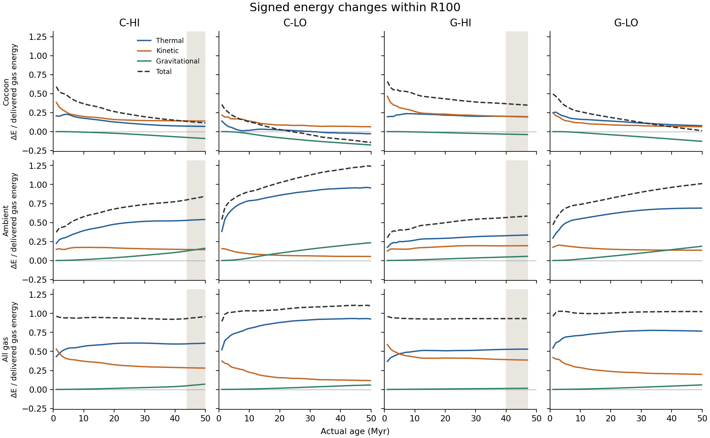
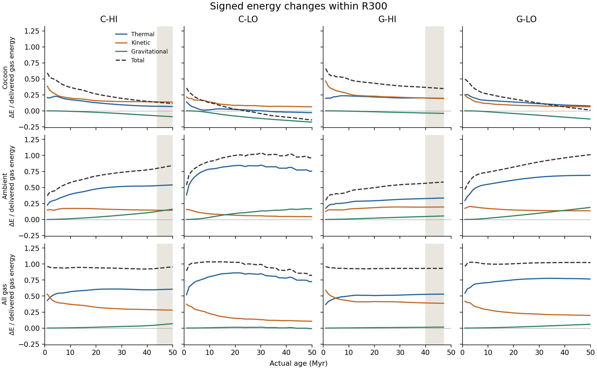

# Where the four jets store their energy

The cluster (C, Stewart atmosphere 002003) and group (G, 002031) each received a high-power (HI, nominal bipolar power 2 × 10⁴⁵ erg/s) and low-power jet (LO, 2 × 10⁴³ erg/s). PLUTO evolved a single fluid with γ = 5/3 on a stretched 960 × 960 × 1,014 Cartesian grid, with 0.05-kpc central cells and outer faces at ±200 kpc in x and y and ±250 kpc in z. The 0.75-kpc injector contains two 15° half-opening-angle cones at 0.1c. The production scheme uses linear reconstruction, HLLC with shock-triggered HLL fallback, two Runge–Kutta stages and selective entropy recovery. The fluid snapshots have single-precision fields at approximately 1-Myr intervals. There are 201 retained snapshots from 0 to 50.000000 Myr in C-HI, C-LO and G-LO, and 0 to 46.999150 Myr in G-HI. The integration uses the actual time of each output. [Production setup](four_case_scientific_synthesis_2026-08-26.md) · [Injector reconstruction](injector_faces_2026-11-19.md) · [Actual ages and source digests](assets/four_case_energy_partition_2026-11-26/snapshots.csv)

At 30 Myr, ambient gas accounts for the largest thermal energy increase in every R100 aperture. Its thermal energy rises by 31.4% of delivered energy in G-HI, 51.5% in C-HI, 66.1% in G-LO and 91.4% in C-LO. C-LO is also the case where the aperture matters most. At 50 Myr the ambient gas between R300 and R100 alone holds a signed increase equal to **27.4% of measured injector delivery**, including 20.0% in thermal energy. Both apertures contain every on-grid cocoon cell. [Two-aperture component histories](assets/four_case_energy_partition_2026-11-26/sphere_components.csv)

## What the fractions measure

Each aperture extends from the origin to the most distant native cell centre with three-dimensional speed ≥100 or ≥300 km/s in that snapshot. The budget uses **all** cell centres inside that radius, including slow gas. Each current cell with jet tracer `tr1 > 0.001` counts in full towards the cocoon. All remaining cells form the ambient region. For each region the initial energy comes from the same cells as the current energy. This makes the comparison a change at fixed positions within the current mask. Gas can enter or leave these positions and can change tracer class. [Spherical integrator](../../scripts/science/extract_spherical_energy_budget.py) · [Regional energy and mass integrator](../../scripts/science/extract_fixed_box_energy_budget.py)

The thermal, kinetic and gravitational changes sum, cell by cell, to the total change. Their densities are Δp/(γ−1), Δ(ρ|v|²)/2 and Φ₀Δρ. The potential Φ₀ comes from the initial atmosphere and is zero at the origin. Shifting its zero by a constant C changes the gravitational energy by CΔM. The tables therefore report the initial mass, final mass and signed mass change in every region. A negative cocoon change can accompany substantial current lobe pressure and enthalpy.

The common denominator D is the cumulative signed gas energy crossing the entire maintained injector surface into the evolving cells. It includes kinetic energy and enthalpy on axial and lateral cone faces and signed exchange with the stationary injector surface. The calculation reconstructs the configured PLUTO face fluxes at each saved time and integrates by the trapezoid rule. Potential transport is separate. The denominator counts exported mechanical gas energy once. The stock integrals include every selected cell, including the injector. Each table retains its measured signed sum. The nominal bipolar power times actual active age is also tabulated. The initialized nozzle already gives both apertures a radius of 0.74958 kpc and gives the cocoon a finite absolute enthalpy. At time zero D and all stock changes are zero, and the CSV leaves energy ratios blank. [Actual input convention](native_delivery_restatement_2026-11-21.md) · [All signed cone and stationary contributions](assets/four_case_energy_partition_2026-11-26/snapshots.csv)

## The 30-Myr comparison

All four R100 and R300 spheres fit inside the computational domain at these outputs. The first two energy columns give the signed stock change inside each sphere. The last two columns use current whole-cocoon pressure, integrated over its full tracer-selected volume. The primary enthalpy is 2.5∑pᵢVᵢ for the simulated fluid. The 4∑pᵢVᵢ column gives the conventional relativistic comparison.

| Case | Actual Myr | D (erg) | R100 / R300 (kpc) | ΔE(R100)/D | ΔE(R300)/D | 2.5pV/D | 4pV/D |
| --- | ---: | ---: | ---: | ---: | ---: | ---: | ---: |
| C-HI | 29.999994 | 2.1995 × 10⁶⁰ | 145.928 / 145.911 | 0.9326 | 0.9326 | 0.4714 | 0.7542 |
| C-LO | 29.999166 | 2.1093 × 10⁵⁸ | 69.211 / 63.910 | 1.0821 | 0.9968 | 0.8714 | 1.3943 |
| G-HI | 29.999367 | 2.1926 × 10⁶⁰ | 149.862 / 149.830 | 0.9322 | 0.9322 | 0.4043 | 0.6469 |
| G-LO | 29.999644 | 2.1734 × 10⁵⁸ | 64.469 / 63.938 | 1.0196 | 1.0195 | 0.6673 | 1.0677 |

Within R100, the kinetic increase in the high-power cases is larger than in the low-power case in the same atmosphere when expressed per unit of delivered energy. The cocoon in C-LO holds 7.4% of D in additional kinetic energy, yet its signed total is −4.2% of D. Its thermal change is small, and the change in centre-referenced gravitational energy contributes −11.9% of D. Roughly 2.02 × 10⁴² g less gas occupies the current cocoon cells than their initial atmosphere contained.

| Case | R100 region | Δthermal/D | Δkinetic/D | Δgravitational/D | Δtotal/D | Δmass (10⁴² g) |
| --- | --- | ---: | ---: | ---: | ---: | ---: |
| C-HI | Cocoon | +0.0943 | +0.1449 | −0.0436 | +0.1955 | −72.27 |
| C-HI | Ambient | +0.5150 | +0.1541 | +0.0680 | +0.7371 | +72.91 |
| C-LO | Cocoon | +0.0023 | +0.0743 | −0.1190 | −0.0424 | −2.02 |
| C-LO | Ambient | +0.9137 | +0.0609 | +0.1499 | +1.1245 | +1.99 |
| G-HI | Cocoon | +0.2013 | +0.2124 | −0.0246 | +0.3892 | −42.63 |
| G-HI | Ambient | +0.3140 | +0.1950 | +0.0339 | +0.5430 | +43.29 |
| G-LO | Cocoon | +0.1125 | +0.0774 | −0.0693 | +0.1205 | −2.98 |
| G-LO | Ambient | +0.6613 | +0.1398 | +0.0979 | +0.8991 | +2.99 |

The machine-readable table gives each component in erg and as a fraction of D for outputs near 10, 20, 30, 40 and 50 Myr where retained, plus the flagged G-HI endpoint. [Selected-age component table](assets/four_case_energy_partition_2026-11-26/selected_age_components.csv)

## Radius, outer gas and boundary contact

At 30 Myr the R100 and R300 totals differ by less than 0.0001 of D in three cases. In C-LO the 5.30-kpc layer between the two spheres contributes 0.0853 of D. By 50 Myr the layer extends from 72.86 to 80.94 kpc and contributes 0.2740 of D, divided into +0.1999 thermal, +0.0096 kinetic and +0.0645 gravitational. The 11 November review measured the same 50-Myr shell increase as 0.307653 of labelled input. The 27.4% value uses the measured gas delivery for that same case and age. [Earlier shell measurement](turn15_energy_emission_review_2026-11-11.md)

These are changes in the gas occupying the layer at that epoch. The interval budget also measures gas-energy transport through each surface and the effect of cells entering or leaving the shell. [Transport through R100 and R300](four_case_aperture_transport_2026-11-26.md)

| Case | Final actual Myr | ΔE(R100)/D | ΔE(R300)/D | Fixed inset box/D | Outside inset box/D | Whole grid/D |
| --- | ---: | ---: | ---: | ---: | ---: | ---: |
| C-HI | 50.000000 | 0.9576 | 0.9575 | 0.8606 | 0.2398 | 1.1005 |
| C-LO | 50.000000 | 1.0978 | 0.8238 | 1.1479 | 20.2064 | 21.3543 |
| G-HI | 46.999150 | 0.9325 | 0.9325 | 0.8067 | 0.1275 | 0.9342 |
| G-LO | 50.000000 | 1.0235 | 1.0234 | 1.0234 | 0.3467 | 1.3702 |

The fixed box uses complete cells at least 50 kpc inside all faces. Its actual bounds are ±149.724 kpc in x and y and ±198.936 kpc in z. C-LO illustrates why a whole-grid change is a poor measure of jet deposition. At 50 Myr the outer cells alone gain 20.21 times the energy delivered by the jet. The production face measurements show substantial boundary inflow in this atmosphere. [Fixed box and exterior components](assets/four_case_energy_partition_2026-11-26/box_components.csv) · [Measured domain-face balances](production_injector_histories_2026-11-21.md)

The high-power spheres first extend beyond the domain at output 44 in C-HI and 40 in G-HI. The shaded intervals in the figures show the **in-domain portion** of a truncated sphere. G-HI's tracer first touches a domain face at output 47 and its series ends there. Every aperture contains every tracer-selected cell still on the grid at that time. Both low-power spheres fit the domain throughout. The tables give separate geometric tests for the 40- and 50-kpc insets and the cocoon's minimum clearance from a face. Geometric containment alone cannot certify freedom from boundary disturbances.





## Reproduction

The public replay ties each index to the current and initial HDF5 digests, grid and environment digests recorded in the approved reductions. It checks all 4,824 spherical component values against the earlier spherical reduction, with a largest difference of 8.8 × 10⁻¹⁶ on the scale of the larger component or labelled input. The two reductions share the native fields and aperture definition. All 76 comparisons with the published 19-age enthalpy and storage table agree within 2.7 × 10⁻¹⁶. Regional sums, mass changes, the split between fixed box and exterior, and the independent integral of the snapshot injector rates against 197 archived intervals also pass. The extraction from the original reduction receipts and a replay from the public compact basis produced eight byte-identical files. The audit reuses the native integrations. [Numerical and source checks](assets/four_case_energy_partition_2026-11-26/verification.json) · [Original source review](assets/turn15_review_2026-11-11/verification_summary.json) · [Fixed-box production record](four_case_fixed_histories_2026-11-18.md)

Run from the repository root with a fresh output path. Adding `--fixed-root private_archive` rebuilds the public compact basis from the four original completion receipts and their 201 snapshot products.

```sh
.venv/bin/python scripts/science/four_case_energy_partition.py --out /tmp/four-case-energy-partition
.venv/bin/python -m pytest -q tests/test_four_case_energy_partition.py
```
