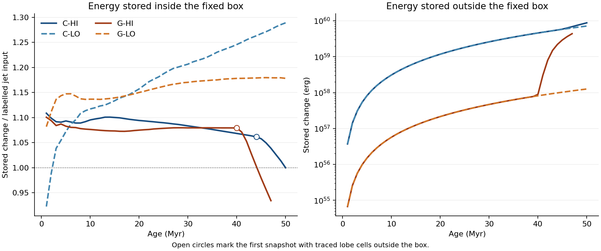

# Energy inside and outside the fixed box in all four simulations

G-LO job **879908** completed all 51 requested fixed-budget snapshots on
18 November, with exit 0 in 06:40:19. The four histories now cover 201
retained snapshots. PLUTO's cluster (C) and group (G) simulations each
use labelled bipolar jet powers of 2 × 10⁴⁵ (HI) and 2 × 10⁴³ (LO) erg/s.
The fixed box keeps full native cells at least 50 kpc from each domain face.
Its actual faces are ±149.724 kpc on x and y and ±198.936 kpc on z. The
exterior is the rest of the grid, counting edges and corners once.

Stored energy is the change from the initial snapshot in the same cells,
summing thermal, kinetic and gravitational contributions with the initial
potential zero at the centre. Each interior ratio below uses the labelled
power times elapsed active time at the actual saved age (capped at 50 Myr).
The G-HI series ends at retained index 47.

| Case | ~1 Myr | ~20 Myr | ~30 Myr | Final retained age and ratio | First traced lobe cells outside box |
| --- | ---: | ---: | ---: | --- | --- |
| C-HI | 1.10869 | 1.09413 | 1.08338 | 50 Myr, 0.99986 | Index 44 |
| C-LO | 0.92256 | 1.15707 | 1.20644 | 50 Myr, 1.28886 | Contained through 50 |
| G-HI | 1.10063 | 1.07488 | 1.07943 | ~47 Myr, 0.93425 | Index 40 |
| G-LO | 1.08183 | 1.14998 | 1.17023 | 50 Myr, 1.17814 | Contained through 50 |

At 50 Myr, G-LO's R100 sphere stores 1.17825 labelled-input units. At
all 50 nonzero ages R100 fits inside the fixed box and the absolute
difference between their stored changes is at most 0.000204 labelled-input
units. The box contains the traced lobe and all cells with speed ≥30 km/s
throughout. Cells with ≥1% thermodynamic change reach domain faces from
index 8. The close storage agreement concerns the **net** signed change
in the added region. Separate heating, cooling and energy transport can
cancel in this measure.
<!-- claims: NAT-11 -->



The exterior behaves very similarly across the two powers within each
atmosphere early on. At ~20 Myr the cluster exterior gained 1.17496 × 10⁵⁹
erg (HI) and 1.17505 × 10⁵⁹ erg (LO). The group values were 2.14754 × 10⁵⁷
and 2.14757 × 10⁵⁷ erg. The table gives 100 × |HI − LO| / |LO| using
unrounded energies. Individual output times of a pair differ by up to
0.00083 Myr at these selected indices.

| Matched index | Cluster exterior energy difference | Group exterior energy difference |
| --- | ---: | ---: |
| 20 | 0.00757% | 0.00162% |
| 30 | 0.00543% | 0.00178% |

The same resemblance appears separately in mass change and thermal-plus-kinetic
energy change. It is consistent with common background evolution within an
atmosphere. At later times the curves separate, conspicuously in G-HI as the
lobe extends beyond the inset box. The measured exterior change includes all
gas in those cells. Assigning it to a specific boundary or injector process
requires the transport and stability audits.
<!-- claims: NAT-11 -->

[All ages and coverage flags](assets/four_case_fixed_2026-11-18/histories.csv) ·
[Paired component measurements](assets/four_case_fixed_2026-11-18/exterior_pairs.csv)

## Verification and reproduction

The captured G-LO stage matched all 59 fresh remote file hashes. The 51
fixed-budget products and prior input receipts match the immutable request
and producer source at `8177795`. Independent compact checks passed
(19,382 arithmetic/coverage checks and 4,415 provenance checks). The
maximum difference from a previously measured G-LO spherical energy component
was 5.53 × 10⁻¹⁶ labelled-input units. The public comparison separately
verifies the four completion receipts and every snapshot product hash.
Independent native HDF5 reintegration and realised injector delivery remain
outside this verification.

A fresh restore of the 369-file private review archive reproduced the
audit reports, paired comparisons and the public history CSV. The archive
is at `/data/share/xray_cavities/turn18_glo_fixed_2026-11-18/fixed_histories_review_r1.tar.gz`
with SHA-256 `00044a1d4b24af1ba39dc34a1ff81bfaa8e2981a8cbeeebb0a50da005856a533`.
Verify the checksum, extract the regular files into a fresh project checkout
and run from its root with the matching producer sources and tests:

```sh
review=private_archive/turn18_glo_fixed_2026-11-18
high=private_archive/turn18_high_review_2026-11-18/stage/results
clo=private_archive/turn18_clo_review_2026-11-16/capture/stage/results
.venv/bin/python "$review/fixed_audit/audit_fixed_history.py" --stage "$review/stage/results"
.venv/bin/python "$review/provenance_audit/audit.py"
.venv/bin/python "$review/fixed_audit/compare_four_case_exteriors.py"
.venv/bin/python scripts/science/compare_fixed_histories.py --output /tmp/four-case-fixed \
  "$high/fixed_C-HI_full" "$clo/fixed_C-LO_full" \
  "$high/fixed_G-HI_full" "$review/stage/results/fixed_G-LO_full"
```
