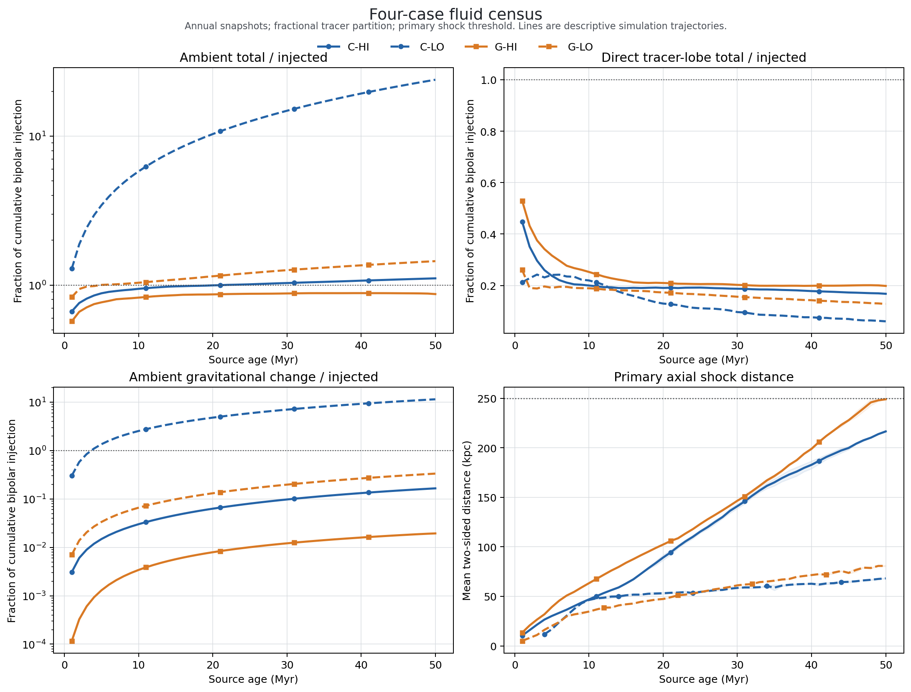

# Four-case fluid snapshot census

## Purpose

Goal 062 begins comparative analysis after completion of the matched raw
factorial. It applies the accepted cell-wise energy, centre-zero gravitational
potential, tracer partition, and axial-shock methods to every annual float
snapshot in `C-HI`, `C-LO`, `G-HI`, and `G-LO`.

This is the common factorial backbone, not the complete paper analysis. Radio
particle processing and projected X-ray cavity recovery remain separate so
that their heavier work can be targeted using the quality and topology gates
from this census.

## Locked contract

- Cases: `C-HI`, `C-LO`, `G-HI`, and `G-LO`.
- Ages: all float outputs `0..50`, using actual HDF5 times.
- One-sided powers: `1e45 erg s^-1` for `HI` and `1e43 erg s^-1` for `LO`.
- Environments: Stewart cluster `002_003` for `C`; Stewart group `002_031`
  for `G`.
- Primary material split: fractional `clip(tr1,0,1)`; thresholds `1e-3`,
  `5e-3`, and `1e-2` remain sensitivities.
- Gravity: fixed centre-zero potential from the matched tabulated gravity
  columns.
- Boundary energy flux remains unmeasured. The closure residual must not be
  relabelled as cocoon energy.
- Shock kinematics retain the accepted axial-tube, baseline-noise, contiguous
  disturbance, and local three-snapshot fit contract.

## Execution design

The four cases run concurrently as four single-threaded Python processes on
one Kunanyi node. Expected runtime is several hours, based on the accepted
six-snapshot G-LO job. The job requests `4` CPUs, `96 GB`, and `12` hours.
Input roots are read-only; the new analysis and archive surfaces are
no-overwrite.

The job must finish with four `51`-snapshot manifests, `204` total snapshot
records, finite energy terms, correct case powers, common environment hashes
within each environment pair, and preserved boundary/residual caveats.

## Completion evidence

Remote preflight passed for all four canonical chains with float counts
`51/51/51/51`. The two cluster environment tables matched SHA-256
`30cf7aa1ece95c1a0d0d9ea23d6baae2e16469f52c96a08b9a18a681527383aa`;
the two group tables matched SHA-256
`1bad5c1028439cc8f9e00f5614328c29e9a7e105519245511410e7c170a6de2a`.

PBS `786969.kunanyi-ohpc` (`four_fluid`) completed with `Exit_status=0` in
`04:18:49`, using `4` CPUs and approximately `27.1 GB` reported memory. All
four case processes exited `0`; the wrapper validated `204` snapshot records,
`612` energy rows, `306` shock rows, and `51` source rows per case. Remote
stderr is empty. `Stageout_status=1` is retained as a scheduler caveat, but the
requested archive and logs were present at their stage paths and retrieved
directly.

The immutable compact archive has `646` members and SHA-256
`b4dfb65a9231a53caec776f435ab819ce0b67c61fa9fd7f4aa866a5d7d83ece6`.
It contains the per-snapshot profiles without duplicating them into the normal
review surface. No HDF5 or particle payload was copied or changed.

## Factorial observations

The primary fractional tracer partition gives the following endpoint values,
all normalized by cumulative bipolar injected energy:

| Case | Ambient total | Ambient gravity | Direct tracer-lobe total | Closure residual | Maximum shock distance |
| --- | ---: | ---: | ---: | ---: | ---: |
| `C-HI` | `1.111` | `0.166` | `0.168` | `-0.278` | `217.44 kpc` |
| `C-LO` | `23.907` | `11.466` | `0.060` | `-22.967` | `68.47 kpc` |
| `G-HI` | `0.871` | `0.019` | `0.198` | `-0.069` | `248.95 kpc` |
| `G-LO` | `1.449` | `0.334` | `0.128` | `-0.577` | `81.44 kpc` |

The trajectories are technically complete and use the same calculation. They
are not all ready for naive scientific comparison:

- `C-LO` accumulates an ambient total change of nearly `24` times its injected
  energy, split mainly between thermal (`12.19`) and gravitational (`11.47`)
  terms, with an offsetting residual of `-22.97`. In absolute energy units,
  these terms are much less extreme because `C-LO` injection is `100` times
  weaker than `C-HI`, but they show that common atmosphere evolution or
  another background term can dominate a low-power normalized budget. This is
  an inference from the pattern, not yet a measured no-jet control correction.
- `G-HI` reaches `248.95 kpc` on a domain extending to about `250 kpc`; one
  side is already stationary at the edge in the final local speed fit. Its
  late shock kinematics are therefore domain-limited, even though earlier
  ages remain usable.
- High-power fronts travel much farther than low-power fronts in both
  environments. Direct tracer-lobe energy fractions decline with age in all
  cases, but the single deterministic simulation in each factorial cell does
  not support replicate-based uncertainty or population inference.

## Decision

Decision label:
`FOUR_CASE_FLUID_CENSUS_GREEN_C_LO_ENERGY_BASELINE_AND_G_HI_BOUNDARY_GATES_EXPOSED`.

Goal 062 establishes a complete common fluid census, but it also changes the
next scientific priority. Before broad radio or X-ray processing, the project
should diagnose the cluster low-power background term and lock valid age
windows, especially for late `G-HI` shock-dependent comparisons. This should
be a small targeted post-processing tranche using the existing raw outputs,
not another production simulation.

Radio power and observational cavity-recovery claims remain out of scope here.
The closure residual remains unattributed because boundary energy flux is
unmeasured; it is not promoted to cocoon energy.
