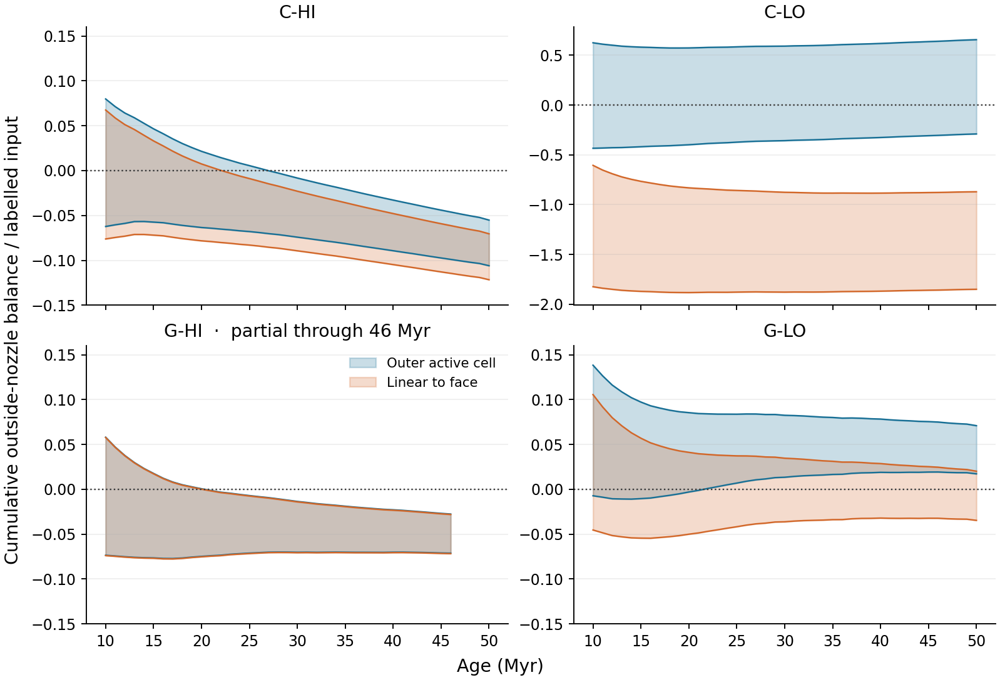

# Closing the eight-job energy accounting batch

All eight PBS jobs finished on 18 November or earlier. Seven returned exit 0.
The final job, **879909**, completed the G-LO flux analysis in **03:37:38**
and returned every index from 0 through 50. The original G-HI flux job
returned exit 1 at snapshot 47. Its recovered prefix includes intervals
through 46 Myr. This record describes the products of the original batch.

## What changes across the four cases

The four stretched-grid PLUTO runs cross cluster and group atmospheres
with labelled bipolar kinetic powers of 2 × 10⁴⁵ erg/s (HI) and
2 × 10⁴³ erg/s (LO). The flux accounting asks where energy was added to
the simulated gas. In each control volume the inferred source is the
change in thermal, kinetic and gravitational energy since the initial
snapshot plus the cumulative energy flux directed out through its faces.
Subtracting the nozzle-control balance from the whole-grid balance gives
the residual outside the nozzle. The initial gravitational potential is
fixed and zero at the centre. All values below are divided by labelled
kinetic power times actual elapsed active time.

| Case | Outside-nozzle balance at ~30 Myr | Last available flux index | Outside-nozzle balance there | Nozzle-control balance there |
| --- | ---: | ---: | ---: | ---: |
| C-HI | −0.08939 to −0.00827 | 50 | −0.12160 to −0.05515 | 1.11138 to 1.15313 |
| C-LO | −1.87890 to +0.59157 | 50 | −1.85036 to +0.65619 | 1.09221 to 1.12800 |
| G-HI | −0.07067 to −0.01355 | 46 (partial) | −0.07169 to −0.02759 | 1.10607 to 1.14950 |
| G-LO | −0.03622 to +0.08247 | 50 | −0.03464 to +0.07091 | 1.11527 to 1.15333 |

At the matched 30-Myr snapshot all 36 reconstructions give a negative
outside-nozzle balance in the two high-power runs. The negative sign
persists from index 27 in C-HI and 21 in G-HI through each available
endpoint. These dates precede the first traced lobe cells outside the inset
storage box (indices 44 and 40). Both signs occur at 30 Myr in the two
low-power runs. C-LO has the largest spread as its boundary inflow and
whole-grid energy change are both large compared with labelled input.
<!-- claims: BND-08 -->



From index 10 onward, each coloured band spans the three time-integration
rules and six nozzle-control choices for the specified domain-face
reconstruction. C-LO has its own vertical scale. The
[full table](assets/four_case_flux_2026-11-18/scenario_histories.csv)
includes all 196 available intervals and records the six nozzle choices
as minima/maxima for each domain-face and time-integration method.

## What the new G-LO history adds

At 50 Myr G-LO stores 1.57731 labelled-input units across the whole grid.
Under trapezoidal integration, the boundary term removes 0.39895 units
when the outer active cells supply the face state, or 0.45025 units with
linear extrapolation to the faces. That difference of 0.05130 is large
enough to change the inference outside the nozzle.

| G-LO at 50 Myr, trapezoidal integration | Whole-grid balance | Nozzle-control balance | Outside-nozzle balance |
| --- | ---: | ---: | ---: |
| Outer active cell | 1.17837 | 1.12667 to 1.14174 | +0.03662 to +0.05170 |
| Linear to face | 1.12706 | 1.12667 to 1.14174 | −0.01468 to +0.00040 |

Across all 36 choices the cumulative outside balance spans both signs at
49 of 50 ages. Only index 3 is uniformly positive. The final individual
interval, from 48.99969 to 50 Myr, is negative across the 36 choices
(−0.09970 to −0.01501 of the input **during that interval**). This last
increment is distinct from the accumulated balance since the start.

The [fixed-box measurement](four_case_fixed_histories_2026-11-18.md)
establishes a 17.8% storage excess over the label in G-LO. The present
flux measurement leaves its numerical origin unresolved. The inferred
nozzle-control source exceeds the labelled kinetic input at the available
endpoint in all four cases. It includes thermal and potential transport
and changing storage. Assessing the realised injection requires accounting
for nozzle overwrite and solver-step transport. The range across the
36 choices measures method sensitivity. It carries no statistical coverage
or guarantee on physical error.
<!-- claims: BND-08 -->

## Execution and verification

The terminal PBS records agree with the original serial chain. Seven
complete requests have output receipts. The eighth has the partial
[G-HI recovery](../exchange/logs/2026-11-18-accounting-chain-check.md).
Across cases there are 201 fixed snapshots, 200 flux snapshots (including
four initial states) and 196 measured flux intervals in the original batch.

For G-LO, 66 returned regular files match fresh hashes at source. The
completion lists 59 products. Independent checks cover the exact 51 inputs,
sources and product identities (7,306 checks), flux and storage arithmetic
(140,640 scalar checks and 15 hashes), and agreement with the separately
reduced fixed-budget whole grid (306 comparisons, largest energy difference
8.66 × 10⁻¹² labelled-input units). All 7,056 cross-case age and balance
entries checked against the individual audit tables agree within numerical
tolerance. Verification used compact outputs and bound native input receipts.
Independent HDF5 reintegration and historical solver-step instrumentation
were outside its scope.

The private archive contains the captured G-LO products, previous inputs
required for replay, all four reviewed source-balance tables and the
independent audits. The 281 regular members of
`/data/share/xray_cavities/turn18_glo_flux_2026-11-18/flux_histories_review_r1.tar.gz`
have archive SHA-256
`b96029bdef8daa2d62b0b61bb576734a754f35a55a9ee581f070d11ea01c8d11`.
A fresh restore reproduced the audit reports and public scenario table.
Verify that checksum, extract at the root of a fresh analysis checkout with
the producer sources/tests at `8177795`, and use the project environment:

```sh
review=private_archive/turn18_glo_flux_2026-11-18
high=private_archive/turn18_high_review_2026-11-18
lo=private_archive/turn18_clo_review_2026-11-16/capture/stage/results/flux_C-LO_full
source_table=source_accounting/outside_nozzle_source_balances.csv
.venv/bin/python "$review/flux_audit/audit_G_LO.py"
.venv/bin/python "$review/flux_audit/compare_fixed_whole_grid.py"
.venv/bin/python "$review/flux_audit/summarize_sign_history.py"
.venv/bin/python "$review/provenance_audit/audit.py"
.venv/bin/python scripts/science/compare_flux_histories.py --output /tmp/four-case-flux \
  "$lo/$source_table" "$high/stage/results/flux_C-HI_full/$source_table" \
  "$high/flux_audit/G-HI_partial/products/$source_table" \
  "$review/stage/results/flux_G-LO_full/$source_table"
```
