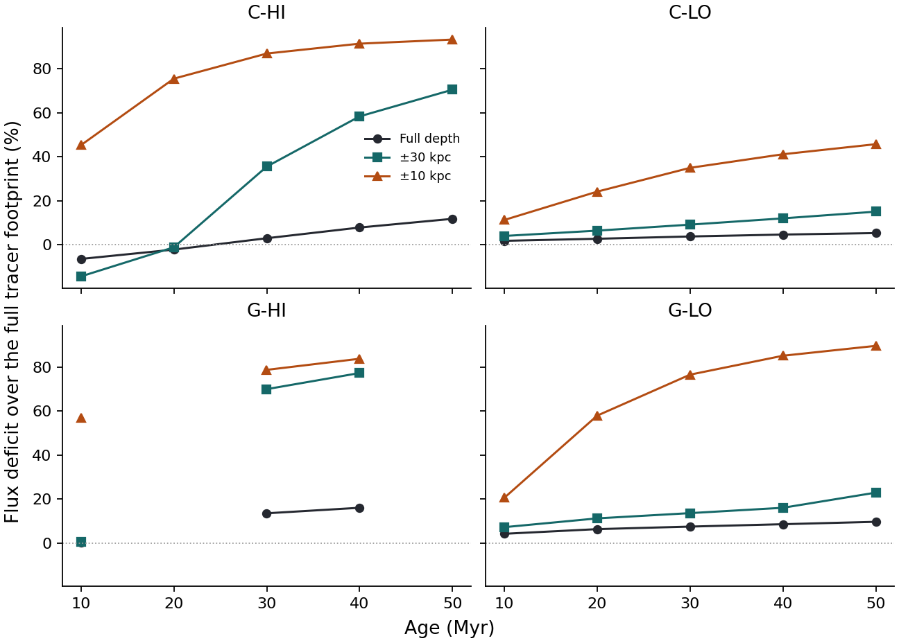

# How much of the X-ray cavity is hidden along the line of sight?

In all 18 side-on case-ages, more of the projected jet lobe dimmed when the emitting depth was reduced, first to ±30 kpc and then to ±10 kpc about the midplane. At full depth, a median 42.3% of the lobe area was more than 5% dimmer than before the jet turned on. That rose to 67.7% and 91.2% in the two slabs. These are direct comparisons with the initial atmosphere at the same depth. They use the same lobe footprint in all three images. Each case-age counts once and the previously examined G-HI/20 image is reported separately. [Case-age measurements](assets/four_case_midplane_slabs_2026-11-26/case_age_depth.csv) · [G-HI/20 pilot](ghi20_midplane_slab_results_2026-11-25.md)

| Median over the 18 case-ages | Full depth | ±30 kpc | ±10 kpc |
|---|---:|---:|---:|
| Lobe area more than 5% dimmer than at time zero | 42.3% | 67.7% | 91.2% |
| Flux lost over the whole lobe footprint relative to time zero | 5.0% | 12.8% | 66.7% |
| Lobe area covered by the registered 5% radial outline | 38.7% | 58.9% | 81.2% |
| Lobe area covered at the first tested cut that empties the initial image | 38.7% | 56.6% | 80.5% |
| Purity at that cut, among nonempty outlines (number of outlines) | 100% (16) | 91.8% (16) | 97.8% (18) |

## What fills the cavity in projection?

Light that the atmosphere **already emitted before the jet turned on** accounts for a median **94.7%** of the increase in integrated flux deficit from full depth to ±10 kpc. We measured this fraction for each case-age by holding the gas beyond ±10 kpc at its initial brightness. Initial light was the largest contribution in all 18 case-ages. Its share ranged from 73.0% in C-HI/10 to 100.7% in G-HI/40. [Signed dilution and brightness changes](assets/four_case_midplane_slabs_2026-11-26/case_age_depth.csv)

The gas outside the slab includes ambient gas and cells occupied by the evolved lobe. In **G-HI/40** the ambient gas beyond ±10 kpc was **55% brighter** than at time zero. That brightening contributed **+28.3 percentage points** to the full-to-slab increase in deficit. Dimming in the outer lobe cells contributed **−28.8 points**. Their sum was −0.47 points, which explains why the initial-light share slightly exceeded 100%. Ambient gas beyond ±10 kpc brightened at every case-age. Its increase was 16–55% across the eight high-power snapshots. [Component fluxes on the fixed footprint](assets/four_case_midplane_slab_review_2026-11-26/outer_gas.csv)

| Jet power | Initial outer light | Change in outer ambient gas | Change in outer lobe cells |
|---|---:|---:|---:|
| High (8 case-ages) | +37.7 to +80.8 | +11.8 to +28.3 | −28.8 to −1.3 |
| Low (10 case-ages) | +9.4 to +71.7 | +0.1 to +10.8 | −2.6 to 0 |

Entries are percentage-point contributions to the difference between the ±10 kpc and full-column flux deficits. The three terms add within each snapshot. The ranges give each term’s extrema across snapshots. Both epochs use the same cells, classified by their evolved tracer.

The flux deficit grew at both cuts in 17 of 18 case-ages. **C-HI at 10 Myr** illustrates why flux and area need separate measurements. More of the lobe area dimmed with each cut, yet its integrated flux was 6.5% **brighter** than the initial atmosphere at full depth and 14.4% brighter at ±30 kpc. Gas 10–30 kpc from the midplane was 49.6% brighter along these sightlines. Only at ±10 kpc was the total flux lower, by 45.2%. Short paths through jet gas also often appear bright in projection. The band with up to 5 kpc of tracer path was brighter in aggregate at full depth in 13 of 18 case-ages. The five C-LO outputs were the exceptions. [Per-case layer and tracer-path tables](assets/four_case_midplane_slabs_2026-11-26/tables.zip)



## What the undisturbed images say about the outlines

Two atmospheres at three depths give **six distinct controls**. At the registered 5% cut, **two fail**. The group initial image selects **27,028 kpc²** at ±30 kpc and **30,936 kpc²** at ±10 kpc, or 59.7% and 68.4% of the search aperture. The group full-depth control and all three cluster controls are empty. We evaluated both jet powers separately, giving twelve case-by-depth records. Within each atmosphere the initial brightness arrays differ in 716 pixels inside the central 0.75 kpc. Their outlines and first empty-control cuts agree at every depth. The two group failures therefore apply to 16 of the 54 evolved images. The first tested cuts that empty both initial sides are 7% at ±30 kpc and 8% at ±10 kpc. [Per-case control records](assets/four_case_midplane_slabs_2026-11-26/case_depth_controls.csv) · [Paired initial-image and mask checks](assets/four_case_midplane_slab_review_2026-11-26/controls.csv)

The control changes the interpretation of individual cavities. In G-HI/30 at ±30 kpc, the 5% radial outline covers 72.4% of the lobe and the initial outline alone covers 51.4%. Of the area the evolved outline correctly selects, 9,942 kpc² lies inside that initial outline and 4,948 kpc² outside it. All but 16 kpc² of the overlap physically dimmed by more than 5%, and the outline still covers 72.2% at the clean 7% cut. In the weaker **G-LO/10** lobe at the same depth, coverage falls from 24.3% to **zero** at 7%, although **59.5%** of the footprint physically dimmed. Here the failed initial outline lies entirely outside the small lobe. A clean control alone cannot establish that a detector finds a weak cavity. [Coverage splits, physical dimming and clean-cut sensitivities](assets/four_case_midplane_slabs_2026-11-26/case_age_depth.csv)

An empty initial control can also precede a low-purity outline. In three cluster slabs at the registered 5% cut, over half the selected area lies outside the tracer lobe. Comparing that exterior area directly with time zero shows how little of it physically dimmed. [Independent outline and brightness measurements](assets/four_case_midplane_slab_review_2026-11-26/outlines.csv)

| Cluster run and age | Slab | Purity | Selected area outside lobe (kpc²) | Of that area, dimmed >5% (kpc²) |
|---|---:|---:|---:|---:|
| C-HI, 20 Myr | ±30 kpc | 24.6% | 7,567 | 0 |
| C-HI, 30 Myr | ±30 kpc | 45.4% | 6,232 | 66 |
| C-LO, 50 Myr | ±10 kpc | 29.4% | 3,442 | 491 |

At the 7% cut that clears the group ±30 kpc control, four of eight case-ages have purity below 50% (G-HI/10 and G-LO at 30, 40 and 50 Myr). G-LO/10 is empty, so its purity is undefined. The four low-purity outlines each select 3,070–13,582 kpc² outside the lobe, of which at most 8 kpc² physically dimmed by more than 5%. Across these four outlines and the three cluster examples, the smoothed initial fit already exceeded the initial brightness on the falsely selected area by 2.8–6.7%. The evolved fit rose another 0.7–3.3%. Other exterior selections can trace real dimming. In C-HI/50 at ±10 kpc, 2,503 of the 2,525 kpc² selected outside the lobe dimmed by more than 5%. [False-area photometry and fitted backgrounds](assets/four_case_midplane_slab_review_2026-11-26/outlines.csv)

## Projected area and three-dimensional volume

The ±10 kpc slab intersects 93.4–100% of the projected lobe area but contains 26.4–100% of the tracer volume. G-HI/40 gives both lower limits. A cavity can look clear in a slab containing only a quarter of its volume. The 120-kpc detector aperture also excludes part of the full footprint in five high-power snapshots, reaching 43.1% in C-HI/50 and 34.8% in G-HI/40. The direct photometry includes that outer area. No tracer reaches a native grid face in these 18 outputs. Real sky images include the full emitting column. These simulations tell us how projection changes a cavity’s contrast in one viewing direction. [Full and slab targets, both lobes and both sides](assets/four_case_midplane_slabs_2026-11-26/case_age_targets.csv)

The three numbers in each area or flux entry give full depth, ±30 kpc and ±10 kpc, in that order. Negative flux deficits mean net brightening. The ages are the native output times.

| Case | Actual age (Myr) | Lobe area dimmed >5% (%) | Integrated flux deficit (%) | Lobe volume within ±10 kpc (%) |
|---|---:|---:|---:|---:|
| C-HI | 9.99989 | 21.6 / 30.3 / 79.7 | −6.5 / −14.4 / 45.2 | 88.7 |
| C-HI | 19.99911 | 30.4 / 38.4 / 87.1 | −2.2 / −1.2 / 75.5 | 68.9 |
| C-HI | 29.99999 | 36.6 / 56.6 / 93.1 | 3.0 / 35.5 / 86.9 | 62.3 |
| C-HI | 39.99985 | 35.9 / 69.5 / 95.5 | 7.8 / 58.3 / 91.4 | 55.8 |
| C-HI | 50.00000 | 36.6 / 78.8 / 96.3 | 11.8 / 70.5 / 93.2 | 49.0 |
| C-LO | 9.99917 | 0.0 / 33.4 / 73.7 | 1.8 / 4.0 / 11.2 | 100.0 |
| C-LO | 19.99989 | 0.4 / 69.4 / 91.6 | 2.7 / 6.4 / 24.1 | 100.0 |
| C-LO | 29.99917 | 28.0 / 79.1 / 97.0 | 3.7 / 9.1 / 34.9 | 100.0 |
| C-LO | 39.99915 | 44.6 / 83.9 / 97.5 | 4.6 / 12.0 / 41.1 | 100.0 |
| C-LO | 50.00000 | 53.9 / 84.9 / 97.0 | 5.3 / 15.0 / 45.7 | 99.7 |
| G-HI | 9.99926 | 46.4 / 52.3 / 84.3 | 0.3 / 0.6 / 56.7 | 68.9 |
| G-HI | 29.99937 | 51.1 / 80.7 / 85.7 | 13.5 / 69.9 / 78.7 | 30.3 |
| G-HI | 39.99912 | 42.7 / 80.1 / 85.8 | 16.0 / 77.2 / 83.7 | 26.4 |
| G-LO | 9.99974 | 41.8 / 59.5 / 72.8 | 4.2 / 7.2 / 20.5 | 100.0 |
| G-LO | 19.99978 | 58.9 / 69.5 / 86.3 | 6.3 / 11.2 / 57.9 | 100.0 |
| G-LO | 29.99964 | 58.0 / 66.0 / 90.9 | 7.4 / 13.6 / 76.5 | 97.7 |
| G-LO | 39.99999 | 56.3 / 63.2 / 93.3 | 8.5 / 16.0 / 85.1 | 91.0 |
| G-LO | 50.00000 | 54.0 / 61.5 / 95.0 | 9.6 / 22.9 / 89.6 | 83.7 |

## Verification against the earlier projections

The new full-depth initial brightness, evolved brightness and tracer path reproduce the archived rasters bit for bit for all 18 case-ages. All 18 full-depth radial masks reproduce their sealed hashes. The projected and native tracer volumes agree in all 162 depth-by-side comparisons, and 90 stored full-depth integrals also reproduce. A separate implementation using the released tracer footprints recovered all 1,458 flux, deficit and area quantities it checked, with a maximum scaled discrepancy below 10⁻¹⁵. [Identity and closure checks](assets/four_case_midplane_slabs_2026-11-26/identity_verification.json) · [Direct photometry](assets/four_case_midplane_slabs_2026-11-26/direct_photometry.json)

Every case-age has an archived perpendicular view of all emitting gas at both epochs. The 73,008 narrow-slab comparisons cover all 1,014 height rows per snapshot. The largest evolved row differences are 1.13 parts per million at ±30 kpc and 2.01 at ±10 kpc. Both initial maxima are below 0.062 parts per million. Widening each edge by one 0.42-kpc sky pixel increases the evolved integrated light by 1.07–1.60% and 3.90–4.50% of the exact-cut flux, respectively. The production tables express the same differences as fractions of the widened flux. The native projector applies one width per y cell at every x and z, which makes these row totals sensitive to a misplaced slab cut. Within-row brightness placement and the shared emissivity calculation still have one native implementation. The 18 perpendicular archives check whole-gas brightness. The pilot archive also checks lobe-cell brightness. [Production row checks](assets/four_case_midplane_slabs_2026-11-26/perpendicular_rows.csv) · [Independently weighted perpendicular rows](assets/four_case_midplane_slab_review_2026-11-26/side_view_rows.csv)

Claude reproduced 918 comparison values, including 648 that use a separately implemented radial detector. The other 270 check area and flux arithmetic on the retained rasters. Codex regenerated all six review files byte for byte and verified the component sums at both cuts from the production flux table. XR-08 is supported for the 18 side-on case-ages. [Review comparisons](assets/four_case_midplane_slab_review_2026-11-26/comparison.csv) · [Review receipt](assets/four_case_midplane_slab_review_2026-11-26/summary.json)

The first submission pointed to the protected prediction-stage tracer copies. Fourteen jobs stopped before projection and the remaining four obsolete jobs were cancelled. All 18 replacements used the released scoring copies after their hashes matched the original producer records. All 18 finished with exit status 0. The map panels, rasters and row-by-row evidence have two verified project copies. The review gallery is `private_archive/turn34_four_case_slabs/maps.html` and its portable bundle is `slab_map_panels.zip` beside it. [PBS accounting](assets/four_case_midplane_slabs_2026-11-26/pbs_accounting.json) · [Retained files receipt](assets/four_case_midplane_slabs_2026-11-26/mirror_receipt.json)

## What each measurement counts

The 18 case-ages are existing production snapshots of four jets viewed along the native y axis, with the jet axis z in the sky. The cluster (C) and group (G) atmospheres each host a high-power jet (HI, labelled bipolar kinetic power 2 × 10⁴⁵ erg s⁻¹) and a low-power jet (LO, 2 × 10⁴³ erg s⁻¹). Each output uses its matched time zero, a 0.1c injector, and the retained linear emissivity correction at 1 keV and redshift 0.05. Each native cell contributes its actual path length inside the slab. The comparison uses the 0° view already present in the full-depth DET-05 archive. The narrow-slab rules were registered after the G-HI/20 pilot and before producing these 18 slab comparisons. The pilot is tabulated separately. [Registered protocol](four_case_midplane_slab_protocol_2026-11-25.md) · [Case bindings and measured ages](assets/four_case_midplane_slabs_2026-11-26/registration.json)

For physical dimming, keep the full footprint of cells with current jet tracer >0.001 at all depths. In each sky cell compare the current and initial intensity at the same emitting depth. For the integrated deficit, sum the flux over that fixed footprint first, then divide the flux lost by its initial flux. A negative deficit means brightening. The layer tables separate the initial light of material added along a sightline from its subsequent change. The area that dims by more than 5% answers a different question and can remain small even when part of the lobe becomes very dark.

For the automated outline, fit the radial profile to each image at its own epoch and depth. Smooth on 10 kpc, search within 120 kpc, and keep pixels with a deficit greater than 5% in eight-connected components covering at least 25 kpc², evaluated separately on each jet side. Coverage divides selected lobe area by the full target area. Purity divides it by selected area and is undefined for an empty outline. The separate slab target counts only tracer actually inside the emitting slab. Source clipping, retained volume and area, the two individual lobes and their summed physical areas are given for every image. The first-clean threshold uses the initial image alone and must empty both control sides. [Area and sensitivity table](assets/four_case_midplane_slabs_2026-11-26/case_age_targets.csv) · [Control table](assets/four_case_midplane_slabs_2026-11-26/case_depth_controls.csv)

## Reproduction

The compact archive contains the 18 native completion records, the score and perpendicular receipts, and the per-case tables for areas, controls, fits, fluxes, layer and path bins, and native volume closure. Each row receipt also binds the detailed z-row data; those larger outputs and the per-case maps are retained with the source rasters. The public archive is sufficient to reproduce the cohort tables and summary figure. The project review archive contains a map gallery and the 19 sets of brightness maps, outlines, radial fits and initial controls, including the exposed pilot.

```sh
work=$(mktemp -d)
unzip -q docs/science/assets/four_case_midplane_slabs_2026-11-26/tables.zip -d "$work"
.venv/bin/python scripts/science/summarise_four_case_midplane_slabs.py \
  --manifest "$work/manifest.json" --out "$work/cohort"
```

For a native replay use the named case-age's contract, prior science and time-zero producer directories, and the released 0° tracer raster. The registration supplies the three contract and producer digests and the expected full-depth mask digest. The 90° check uses the original science map and its separately authenticated case-zero image. The commands below show the full chain for one case-age.

```sh
.venv/bin/python scripts/science/project_four_case_midplane_slabs.py \
  --contract "$CONTRACT" --contract-sha256 "$CONTRACT_SHA" \
  --previous "$SCIENCE_ARCHIVE" --previous-sha256 "$SCIENCE_PRODUCER_SHA" \
  --initial-previous-sha256 "$INITIAL_PRODUCER_SHA" --truth-dir "$RELEASED_TRACER" \
  --output "$WORK/native"
.venv/bin/python scripts/science/score_four_case_midplane_slabs.py \
  --projection-dir "$WORK/native" --completion-sha256 "$NATIVE_COMPLETION_SHA" \
  --full-mask-sha256 "$SEALED_MASK_SHA" --out "$WORK/scores"
.venv/bin/python scripts/science/check_four_case_slab_rows.py \
  --projection-dir "$WORK/native" \
  --archive-receipt "$SCIENCE_ARCHIVE/completion.json" --side-view "$SCIENCE_90" \
  --initial-receipt "$INITIAL_ARCHIVE/completion.json" --initial-side-view "$INITIAL_90" \
  --output-dir "$WORK/rows"
```

To check the physical photometry separately, run the direct area and flux sums on the original released tracer masks. Supply the four-case score and native directories and the original producer receipts.

```sh
.venv/bin/python scripts/science/check_four_case_slab_photometry.py \
  --native "$ALL_NATIVE" --scores "$ALL_SCORES" --released-tracer "$RELEASED_TRACER" \
  --producer-receipts "$ORIGINAL_PRODUCER_RECEIPTS" --out "$WORK/photometry.json"
```

Claude’s review script regenerates the component, control, outline, perpendicular and comparison tables from the retained images, and records their hashes in its summary.

```sh
uv run --no-project --python 3.12 --with scikit-image==0.26.0 python \
  scripts/science/check_four_case_midplane_slabs.py --archive private_archive/turn34_four_case_slabs
```
