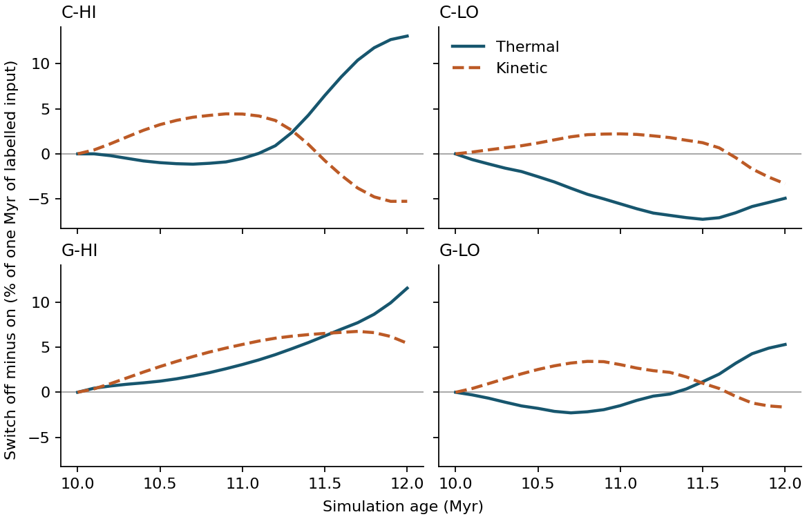

# What the production energy histories and a radio spectrum tell us

Gemini 4 Carbon (Google DeepMind) independently reviewed the project through `5395ca5`. Its reconstruction of the low-power lobe comparisons used the archived pressure integrals and injector rates. It reported agreement within $10^{-15}$ for all three tracer thresholds in each case. A fresh calculation by Codex (OpenAI, GPT-6) matches all twelve arm ratios within $8.9\times10^{-16}$ and checks the pressure-field hashes for the common seeds and endpoints. These checks share the native field extractions. They support the arithmetic in NAT-13 and its narrow interpretation as a contrast between these pairs at 12 Myr. [Independent calculation](../../scripts/science/review_entropy_redistribution.py) · [Paired lobe measurements](assets/entropy_redistribution_review_2026-11-23/lobe_contrasts.csv)

## The history beyond the paired restarts

The full production histories contain enough information to reconstruct the signed energy balance outside the injector. At 30 Myr the two high-power deficits are nearly identical when divided by delivered gas energy. In the low-power cluster the positive residual grows from 4.12% of labelled energy during the first ten Myr to 32.74% during the last ten. These are shares of the energy labelled over **each decade**. [Milestone and decade balances](assets/production_entropy_review_2026-11-23/milestone_and_decade_balances.csv)

| Case | Cumulative residual at 30 Myr (% of label) | Same residual (% of net gas delivery) | Last retained age | Cumulative residual then (% of label) |
| --- | ---: | ---: | ---: | ---: |
| C-HI | −7.82 | −6.73 | 50 Myr | −11.01 |
| C-LO | +9.74 | +8.74 | 50 Myr | +17.02 |
| G-HI | −7.86 | −6.78 | 47 Myr | −7.99 |
| G-LO | +2.26 | +1.97 | 50 Myr | +2.72 |

G-LO’s annual residual is negative in intervals ending at outputs 7–14, positive in those ending at 15–49, and negative again over 49–50 Myr. Its cumulative balance returns above zero at output 17. The final interval includes the known jet-speed dip between saved outputs. The direct negative entropy counter at 10–12 Myr and a positive late cumulative balance are compatible. C-HI’s 10–12 Myr deficit is relatively small, although its 9–10 Myr annual loss was smaller. [All 197 annual balances](assets/production_entropy_review_2026-11-23/annual_balances.csv)

**Which of these numbers measure the switch itself?** The instrumented restarts recorded its energy changes at accepted solver stages during 10–12 Myr in all four cases. The one-Myr sampling rule reconstructs the combined switch-on window within 0.019 percentage points of label in every case. The 197 production intervals reconstruct the exterior residual directly from the saved stocks and rates. Outside the instrumented window, assigning that entire residual to the switch assumes that the calibration and small competing terms persist. The annual switch-off balances miss the corresponding solver adjustments by up to 0.18 percentage points even in the calibrated window. In the two low-power switch-off arms, the finer two-Myr budget less the ordinary floor counter is −55.8 and −61.3 parts per million of label. Both arms contain jets. These signed net balances do not measure unperturbed, local hydrostatic drift on the production mesh. [Window and cadence comparison](assets/production_entropy_review_2026-11-23/restart_calibration.csv) · [Direct low-power counters](low_power_entropy_result_2026-11-23.md)

**What the two apertures add.** The fixed-box storage and whole-domain balances share the injector delivery. Their difference is the change in outer-shell energy plus the signed external face flux, with the small injector potential and maintained-cell terms accounted for. Shell sources can cancel transport across the unmeasured inset faces. In C-LO at 50 Myr, the speed-defined sphere stores 10.98% of label above delivered gas energy and the rest of the fixed box adds 5.63%. The whole exterior residual is +17.02%. The primary outer-face inflow alone is 22.68 times labelled energy. In G-HI at 47 Myr, storage in the box less delivery gives −22.39% and the full exterior gives −7.99%. The smaller differences before the lobes reach the inset surfaces support the signed accounting. Neither the close agreement nor its late breakdown identifies an acoustic flux or the source of the shell difference. [Signed balance equations, inputs and independent checks](assets/production_entropy_review_2026-11-23/README.md)

## Where the two-Myr energy difference appears

All four switch-on runs lose energy in cell visits with more than 50% jet material, from 9.96% to 15.92% of labelled input. C-LO loses 10.22% there and gains 13.68% across the two intermediate tracer bins (0.1–50%). The counter classifies cells by tracer fraction and radius when the update acts. It contains no decomposition into heat generated at density contacts, shear dissipation, or directed waves. Those processes can contribute with opposing signs in the same bin. The 0.75–5 kpc radial bin gives the net change over every tracer fraction there. [Stage-weighted signed bin totals](assets/entropy_redistribution_review_2026-11-23/switch_on_bins.csv) · [Instrumentation and idealised contact calculation](gemini_review_assessment_2026-11-21.md#what-to-read-from-the-entropy-experiment)

In C-LO at 12 Myr, turning the update off raises the mean pressure inside the primary lobe by 0.097%, reduces volume by 0.307% and reduces enthalpy by 0.210%. At the 1% tracer cut, volume increases 0.334% and enthalpy increases 0.362%. The primary lobe contains 23,558 fewer cells, of which the **net count difference** in the 0.1–0.5% tracer band is 12,072. Each mask selects cells anew. The 1% cut is also much broader than the 50% jet-rich counter bin. These data support opposing changes across tracer selections. They do not track individual parcels or the energy radiated by a contact. [Nested lobe cuts and cell counts](assets/entropy_redistribution_review_2026-11-23/lobe_contrasts.csv)

The proposed 80–87% acoustic loss fraction has a different measurable meaning. In units of one Myr of labelled input, the C-LO thermal difference (off minus on) is −0.04933 over the grid and −0.01048 in the primary lobe. Thus 79% of the **signed thermal difference** lies in the complementary cells. The 87% figure compares that same lobe thermal term with the whole-grid difference in **all forms of energy**, −0.08257. The kinetic component itself is −0.03321. None of those stocks measures pressure work through a surface. The production axial-front estimates at 12 Myr also differ between the two sides (kinematic Mach 1.73 and 0.55). They do not establish a single subsonic Mach number or pressure equilibration at the lobe edge. [Component differences](assets/entropy_redistribution_review_2026-11-23/paired_components.csv) · [C-LO axial-front diagnostics](assets/four_case_selected_age_native_shock_partition_2026-08-31/remote_analysis/C-LO/accepted_axial_shock_dynamics.csv)

In C-HI the three thermal values cited as a plateau divide the energy difference by the labelled input **since the shared seed**. Using one fixed Myr of labelled input instead gives **0.11786, 0.12694 and 0.13083** at 11.8, 11.9 and 12.0 Myr. The thermal difference grew another 11.0% over those last two intervals, more slowly in the last one. The kinetic difference moves from −0.04777 to −0.05273 to −0.05268 on the same scale. G-LO moves from a kinetic surplus and thermal deficit at 10.8 Myr to a kinetic deficit and thermal surplus at 12 Myr. C-LO finishes with deficits in both. A traversal time estimated from jet length and nozzle speed is physically plausible. Establishing a common transit wave would require spatial evidence tracing a disturbance from the nozzle to the termination region. The whole-grid time series alone cannot identify that route. [Four time series in ergs and with both normalisations](assets/entropy_redistribution_review_2026-11-23/paired_components.csv)

## What the radio weighting changes

In the previously exposed G-HI/20-Myr snapshot at the original 45° radio view, removing only the jet-tracer multiplier steepens the 1.4–15 GHz spectrum. Its spectral index changes from 0.621 to 0.645. Particles last shocked more than 10 Myr earlier supply 4.76% of the 15 GHz emission with the original weighting and 10.51% with unit weights. The weighted calculation reproduced all ten published luminosities from the two loss models. The continuous-injection fits put the break at 56.0 and 20.1 GHz, respectively. Both lie above the 15 GHz observing limit, so both yield an upper limit on spectral age. This verifies Gemini’s proposed direction of bias for one view and shows that weighting alone does not explain its censoring. The effect in the other censored views is open. [Radio comparison, input identities and spectra](radio_tracer_weight_check_2026-11-23.md)

## Compute decision and observer work

**Defer the 12–20 Myr continuations.** They would answer a real question about lobe enthalpy in these particular jets eight Myr farther on. The existing short pairs already establish a numerical, case-dependent response, and the production series quantify the exterior balance at the headline ages. One continuation per case would still share the switch-on evolution before 10 Myr and give no estimate of variation between realisations. There is no measured upper bound on a 30-Myr lobe correction from the whole-grid deficit. At 12 Myr the C-HI lobe thermal contrast is 2.19 times the total energy contrast because other components and regions compensate. The late ranking and the size of any correction remain open. The withdrawn X-ray recovery medians cannot be used to rank these uncertainties in dex. [Paired budgets and lobe response](entropy_restart_lobes_2026-11-23.md) · [Four retained restart sets](assets/low_power_entropy_result_2026-11-23/retained_high_checkpoints.json)

Stas’s first observer comparison is the native compressive front against the G-HI/20 X-ray arcs in the three development azimuths, with the front defined independently and Patrick’s review of the method. The 54-view X-ray cohort tests a separate, frozen question. Its prediction files must be sealed and their provenance and custody checked independently before truth is released for scoring. The radio comparison used the exposed development snapshot. The next collaboration review can therefore proceed with the held-out X-ray design intact. [Supervisor’s comparison request](../exchange/logs/2026-11-17-compressive-front-and-background-test-request.md) · [Frozen cohort and scoring protocol](background_refit_blind_protocol_2026-11-11.md)
