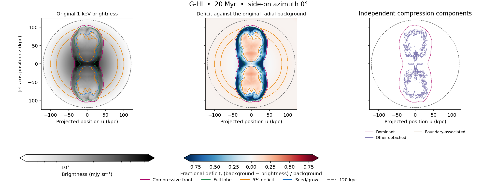

# The G-HI/20 compression front and the X-ray cavity outlines

**Simulation and observation.** The high-power jet in group atmosphere `002031` has bipolar labelled power $2\times10^{45}$ erg s⁻¹, speed $0.1c$, 15° half-opening angle and 0.75-kpc injection height. Its 960 × 960 × 1,014 Cartesian grid spans 400 × 400 × 500 kpc, with cell widths from 0.05 kpc at the centre to 1.69 kpc transversely and 2.10 kpc axially at the outer edges. The HLLC solver used CFL 0.33 and an initial step of $10^{-5}$ code units. Native single-precision fluid outputs were scheduled every 306.60139379 code units. The compared output is `Timestep_20`, code time 6131.909618, actual age **19.9996143 Myr**. The original 1-keV maps use redshift 0.05 and side-on azimuths 0°, 45° and 90° about the jet axis. [Frozen front definition](ghi20_compressive_front_contract_2026-11-23.md) · [Frozen observer comparison](compressive_front_observer_protocol_2026-11-23.md)

Patrick’s requested review covers the independent three-dimensional front definition, its projection and the interpretation of any apparent alignment. The lobe and observer metrics below use the previously exposed development maps. [Method review request](../exchange/logs/2026-11-23-ghi20-compressive-front-method-review.md)

## Do the lateral orange arcs follow the independent front?

The most conspicuous arcs, at 0°, sit **25–26 kpc outside** the edge of the dominant compressive layer at the median contour position in either hemisphere. Their median separations span 25.2–26.2 kpc across the four native definitions. The projected compression occupies only **0.60–0.65%** of the lateral orange area in that view. Across all six sides and views, **91.4–99.4%** of that area has no sightline intersecting either the dominant or other qualifying compression components. The selected layer reaches roughly 45 kpc from the jet axis and 105 kpc along it. All three independent sky projections recover its native volume of 103,965 kpc³. No qualifying component touches the boundary at the primary settings. [Area overlaps](assets/compressive_front_observer_2026-11-23/front_sightline_overlap.csv) · [Native definition, controls and limitations](assets/ghi20_compressive_front_native_2026-11-23/README.md)

| Side-on azimuth | Hemisphere | Signed median arc–front distance (kpc) | Median absolute distance (kpc) | Arc length within one native cell | Lateral orange area intersecting the front |
| --- | --- | ---: | ---: | ---: | ---: |
| 0° | Negative z | +26.12 | 26.12 | 11.69% | 0.60% |
| 0° | Positive z | +25.47 | 25.47 | 12.51% | 0.65% |
| 45° | Negative z | −0.45 | 4.43 | 0.57% | 8.18% |
| 45° | Positive z | −0.53 | 4.76 | 0.56% | 8.58% |
| 90° | Negative z | +0.83 | 2.50 | 2.04% | 8.14% |
| 90° | Positive z | +0.83 | 2.50 | 1.50% | 7.92% |

A small signed median at 45° or 90° conceals lengths on both sides of the front. In the 45° map more than half the arc perimeter lies over one native cell inward and about 46% lies over one cell outward. Within one projected sky pixel the apparent agreement rises to 30–31% there, reflecting the 0.59-kpc sky binning. All midpoints within one native resolution element are near the exterior-facing projected edge. None meets this criterion at a hole in the footprint. The broad orange arcs do not delineate this compressive surface in any of the three maps. Some edges meet locally; the overlap of the shell with a sightline through the lobe poses a separate emission question. [Complete signed contour distributions and sensitivities](assets/compressive_front_observer_2026-11-23/front_contour_separations.csv) · [Geometry comparison receipt](assets/compressive_front_observer_2026-11-23/geometry_comparison_receipt.json)



The overlays use the same brightness and deficit scales; the colour bars indicate values beyond their displayed limits. The dashed circle marks the 120-kpc search aperture. Distances use the complete rectangular pixel edges. The qualifying native width is the local effective cell length along the three-dimensional gradient of log pressure relative to the initial gas, averaged along the ray through the selected layer. An independent brute-force segment calculation reproduced all six signed medians. [45° overlay](assets/compressive_front_observer_2026-11-23/45deg_front_overlay.png) · [90° overlay](assets/compressive_front_observer_2026-11-23/90deg_front_overlay.png)

## How far the X-ray arcs extend beyond the lobes

The development image has a 5% brightness-deficit outline (orange) and a seed/grow outline (blue). The orange arcs include pixels outside the full projected lobe. At 0° the extralobe orange selection covers 3,611 and 3,618 kpc² in the negative and positive jet hemispheres. The blue selection includes 0.00 and 0.42 kpc² outside the lobe. The table measures exact distances from the exterior orange arc faces to the full projected lobe boundary, weighted by physical contour length. A positive sign means the face lies outside the lobe. [Per-side geometry](assets/compressive_front_observer_2026-11-23/original_geometry.csv) · [Signed distance distributions](assets/compressive_front_observer_2026-11-23/original_contour_to_lobe.csv)

| Side-on azimuth | Negative-z arc median (kpc) | Positive-z arc median (kpc) | Negative-z lateral profile (kpc) | Positive-z lateral profile (kpc) |
| --- | ---: | ---: | ---: | ---: |
| 0° | +36.56 | +34.74 | −71.52 | +71.52 |
| 45° | +14.37 | +14.44 | −1.88 | +0.03 |
| 90° | +13.95 | +14.52 | −2.28 | +0.03 |

The lateral profiles use the maximum total extralobe orange width at fixed z. The strongest cross-section under this rule is near the equatorial plane in the rotated views. The maximum integrated lobe-path profiles fall at −68.47 and +67.88 kpc in all three views. These cross-sections were selected using the exposed observer and tracer products before the new native front was available. [Profile locations](assets/compressive_front_observer_2026-11-23/profile_positions.csv)

## Source and control checks

The observer inputs match the three original binary map hashes and the retained native producer receipt. Across the three views the six original outlines, twelve current-image masks with fixed or refitted backgrounds, and twelve masks after replacement of the original speed-selected ambient gas all reproduced exactly. The earlier speed-selected calculation supplies a positive control for the replacement code. On this control the largest pixelwise discrepancy in the current brightness partition, divided by the sum of the absolute terms, was $1.6\times10^{-14}$. The original producer retained qualifications on per-cell emissivity extrapolation, native continuation provenance and the outer coverage of the rotated sky grids. Speed-selected gas, particularly in the control, has no independent shock classification. [Input hashes, qualifications and controls](assets/compressive_front_observer_2026-11-23/observer_inputs.json) · [Original emission audit](turn15_energy_emission_review_2026-11-11.md)

Restore the reviewed Turn 15 compact and map bundles into a common archive directory, preserving `compact_inputs/geometry` beside `results_emission`. Use the `G-HI_0020` subdirectory as `DEVELOPMENT_MAPS`. The `--native` directory holds the separately verified front projections for these three azimuths. A geometry-only receipt produces the overlay and distance tables; the completed emissivity receipt adds the three-way budgets, replacement comparisons and profiles. Omitting the two native arguments regenerates the development controls and lobe-distance table alone. [Input bundle hashes](assets/turn15_review_2026-11-11/README.md) · [Comparison code](../../scripts/science/compare_compressive_front.py)

```bash
.venv/bin/python scripts/science/compare_compressive_front.py \
  --inputs "$DEVELOPMENT_MAPS" --native "$NATIVE_FRONT" \
  --front-receipt "$NATIVE_FRONT/completion.json" --output "$NEW_RESULT_DIRECTORY"
```
