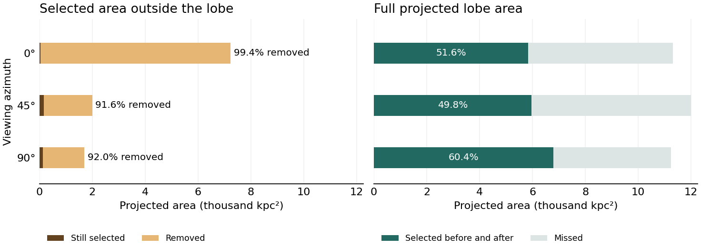

# How much false cavity area lies outside the G-HI compression front?

In G-HI at 20 Myr, restricting the original 5% X-ray deficit outline to the mapped compression front removed **99.4%, 91.6% and 92.0%** of its false area at **0°, 45° and 90°**, respectively, with the background held fixed. All six lobe sides then had 97.2–99.3% purity, but the outlines covered only 49.3–60.5% of each lobe. **None of the six met the DET-05 recovery criterion**, which requires at least 75% coverage, at least 95% purity and an outline clear of the aperture edge. [Full area scores](assets/ghi20_front_constraint_2026-11-25/area_scores.csv) · [DET-05 scoring rule](background_refit_blind_protocol_2026-11-11.md)

The original-outline removal shares were already determined on **24 November**. In each of the six hemispheres the lateral orange excess accounts for the entire falsely selected area. One minus its `dominant_area_fraction` in the published sightline-overlap table gives the share removed. The 25 November protocol preceded the explicit clipping scores. It specified how to handle open fronts and extended the comparison to other front definitions and previously fitted outlines. [24 November sightline table, commit `c6fc259`](assets/compressive_front_observer_2026-11-23/front_sightline_overlap.csv) · [Clipping protocol](ghi20_front_constraint_protocol_2026-11-25.md)

| Viewing azimuth | False area before (kpc²) | False area removed (kpc²) | Share removed | False area left (kpc²) | Real lobe area lost (kpc²) | Lobe area covered before and after |
|---|---:|---:|---:|---:|---:|---:|
| 0° | 7,229.4 | 7,184.2 | 99.4% | 45.2 | 0 | 51.6% |
| 45° | 1,993.9 | 1,826.8 | 91.6% | 167.1 | 0 | 49.8% |
| 90° | 1,702.7 | 1,566.1 | 92.0% | 136.7 | 0 | 60.4% |



Pooling these projections of the same gas gives **10,577 of 10,926 kpc²** of false area removed (96.8%). The 0° view supplies **67.9% of the removed area**. Pooled purity rose from 63.0% to 98.2%, with coverage at 53.8% before and after clipping. The two lobes give similar results within each view. Each removal percentage below uses that lobe’s originally selected false area as its denominator. [Per-side review](assets/ghi20_front_constraint_review_2026-11-25/sides.csv) · [Input and mask hashes](assets/ghi20_front_constraint_2026-11-25/receipt.json)

| View | Lobe | False area removed (kpc²) | Share removed | Correctly selected lobe area kept (kpc²) | Real area lost (kpc²) |
|---|---|---:|---:|---:|---:|
| 0° | Negative axis | 3,589.7 | 99.4% | 2,954.0 | 0 |
| 0° | Positive axis | 3,594.5 | 99.3% | 2,880.2 | 0 |
| 45° | Negative axis | 913.4 | 91.8% | 3,005.3 | 0 |
| 45° | Positive axis | 913.4 | 91.4% | 2,965.1 | 0 |
| 90° | Negative axis | 783.5 | 91.9% | 3,385.3 | 0 |
| 90° | Positive axis | 782.6 | 92.1% | 3,403.9 | 0 |

## Does the residual circular arc survive?

Patrick also flagged the smaller arc left after an earlier experiment replaced the front gas’s emissivity with its initial value and fitted a new background. We reproduced that outline, held its own background fixed, and applied the same cut. It removed **96.9%, 86.2% and 82.0%** of the remaining false area at 0°, 45° and 90°, respectively. That is 2,427 of 2,712 kpc² in total, again with zero real lobe area lost. The front therefore excludes most of both the broad original arc and its smaller residual in this snapshot. [Previous emissivity experiment and images](ghi20_compressive_front_comparison_2026-11-23.md) · [All comparison rows](assets/ghi20_front_constraint_2026-11-25/area_scores.csv)

The exact-edge reconstruction of the original radial image gave the same removal percentages to one decimal place. The original seed/grow rule selected only 9.56 kpc² of false area across the three views, all inside the front. In DET-06’s 100 km/s background fits these same three views had 0 kpc² of false area with a flat centre and 5.09 kpc² with the extrapolated slope. The front removed no pixels from either speed-based outline. This distinguishes the front’s benefit for the original orange arcs from the effect of changing how their background is fitted. [DET-06 background comparison](source_excluded_background_results_2026-11-25.md)

## What defines the boundary?

The cut uses exactly the footprint edged in magenta in the original overlays. All four definitions of the dominant compressive layer gave a single bounded, hole-free footprint in each view. Here a pixel lies inside the contour exactly when its sightline crosses the layer. The primary footprint enclosed 15,917, 16,395 and 15,929 kpc² at the three angles. Treating that entire area as cavity would give purities of only **71.1%, 73.2% and 70.6%**. Across the four definitions, the original outline lost 96.0–97.1% of its pooled false area. Patrick’s physical assessment of the native layer remains open. [Original overlays and native definition](ghi20_compressive_front_comparison_2026-11-23.md) · [Footprint areas](assets/ghi20_front_constraint_review_2026-11-25/bounds.csv)

**Zero lobe loss follows from the geometry.** The front encloses the entire tracer footprint, including every real lobe pixel missed by the X-ray detector. Any candidate clipped to the same front therefore keeps all its previously selected lobe area. Across the three views and four definitions the shortest distance from a tracer-pixel centre to the nearest exterior-pixel centre is **2.13 kpc**. Measuring instead between the actual cell edges that draw the tracer and front contours gives a minimum gap of **1.48 kpc for the primary front** and **1.07 kpc across all four definitions**. Both edge minima occur on the positive-axis lobe at 45°, the latter with the tight definition. [Pixel-centre margins](assets/ghi20_front_constraint_review_2026-11-25/bounds.csv) · [Physical contour gaps and closest coordinates](assets/ghi20_front_constraint_2026-11-25/tracer_front_clearance.csv)

## How accurately must an outer bound follow the front?

Claude moved the primary footprint inward and outward while holding the original cavity candidates fixed. The offsets use distances between sky-pixel centres on opposite sides of the footprint. The first three columns below give the fraction of false area removed, summing both lobes in each view. The final column gives the lowest purity among the six individual sides. [All tested offsets and per-lobe areas](assets/ghi20_front_constraint_review_2026-11-25/offsets.csv)

| Bound position | 0° | 45° | 90° | Lowest side purity |
|---|---:|---:|---:|---:|
| 2 kpc inward | 100.0% | 96.6% | 99.1% | 98.8% |
| At the mapped edge | 99.4% | 91.6% | 92.0% | 97.2% |
| 1 kpc outward | 97.9% | 86.2% | 84.6% | 95.5% |
| 2 kpc outward | 96.3% | 78.2% | 77.3% | 93.1% |
| 5 kpc outward | 91.4% | 58.8% | 55.0% | 87.8% |
| 20 kpc outward | 67.8% | 1.4% | 0.0% | 71.1% |

At 0° the broad exterior arcs are a median 25–26 kpc beyond the mapped front. The false area at 45° and 90° lies much closer to it. A uniform outward offset of 1 kpc kept all six sides above 95% purity. At 2 kpc, sides in both rotated views fell below 95%. Even at 5 kpc the cut removed more than half the false area in each view. Moving the bound 5 kpc inward excluded 1.1–1.5% of the full projected lobe area. These offsets bracket the sensitivity to a uniform placement error on this snapshot. Patrick’s proposed X-ray-only test must also allow an edge to vary around an individual lobe and a view to have no reliable edge. [Arc–front separations](ghi20_compressive_front_comparison_2026-11-23.md) · [Patrick’s observational test](../exchange/logs/2026-11-25-q032-front-constrained-cavity-handover.md)

## Reproduction

The public summary recomputes the bipolar and pooled results from the six hemisphere rows, verifies the two table hashes and can redraw the figure.

```sh
.venv/bin/python scripts/science/summarise_ghi20_front_constraint.py
.venv/bin/python scripts/science/summarise_ghi20_front_constraint.py \
  --figure docs/science/assets/ghi20_front_constraint_2026-11-25/front_clipping.png
```

With the archived G-HI/20 inputs, the measurement binds the two producer receipts to the same time, native files and exact sky grid. It replays the two original image-only outlines, the emissivity-replacement radial fit and the exact-image radial reference, and verifies both DET-06 candidates against their published mask digests.

```sh
.venv/bin/python scripts/science/measure_ghi20_front_constraint.py \
  --inputs "$GHI20_EMISSION" --native "$GHI20_FRONT" --out "$NEW_RESULTS"
```

A second Codex implementation traced the physical edges into a polygon, classified each row by boundary crossings and summed the widths of the occupied spans. It independently reconstructed the smaller refitted orange candidate. For the original and smaller orange candidates, all 24 clipped masks matched exactly across the three views and four fronts. All 15 area and fraction fields agreed on all 72 lobe and bipolar rows, within 1.82 × 10⁻¹² kpc² in area. The two implementations share the archived projections. The four other candidate comparisons were checked against their original inputs by the main analysis. [Independent review receipt](assets/ghi20_front_constraint_2026-11-25/independent_review.json) · [Independent implementation](../../scripts/science/review_ghi20_front_constraint.py)

```sh
uv run --no-project --python 3.12 --with scikit-image==0.26.0 python \
  scripts/science/review_ghi20_front_constraint.py \
  --maps "$GHI20_EMISSION" --front "$GHI20_FRONT" \
  --compare "$NEW_RESULTS/area_scores.csv" --output "$NEW_RESULTS/independent_review.json"
```

Claude (Anthropic, Fable 5.2) wrote a separate implementation using the same archived projections. It reproduced the original and refitted outlines, all 12 front footprints, all 24 clipped masks and all 72 lobe and bipolar area rows. Codex reran all 123 review checks and reproduced the four review files byte for byte. For the physical contour clearance Codex calculated the minimum distance between corners on the two exposed pixel boundaries and checked all 24 hemisphere distances by directly comparing the physical edge segments. On their shared rectilinear grid a closest pair of elementary edges always has a pair of endpoints at that distance. [Claude’s review](../../scripts/science/check_ghi20_front_bound.py) · [Contour clearance calculation](../../scripts/science/measure_ghi20_front_clearance.py)

```sh
uv run --no-project --python 3.12 --with scikit-image==0.26.0 python \
  scripts/science/check_ghi20_front_bound.py --exposed-dir "$GHI20_EMISSION" --front-dir "$GHI20_FRONT"
.venv/bin/python scripts/science/measure_ghi20_front_clearance.py \
  --exposed-dir "$GHI20_EMISSION" --front-dir "$GHI20_FRONT" \
  --output "$NEW_RESULTS/tracer_front_clearance.csv"
```
