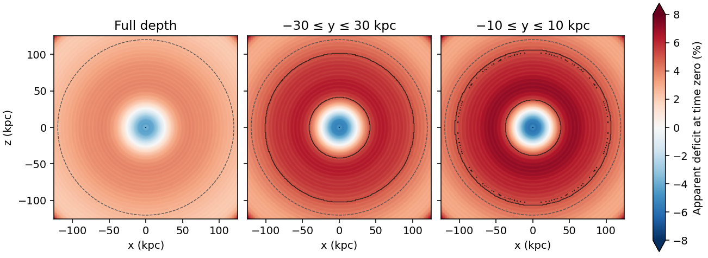

# How much does foreground gas hide the G-HI cavity at 20 Myr?

Removing foreground and background gas reveals more of the G-HI cavity at 19.9996143 Myr. At full depth, **55.8%** of the projected lobe is more than 5% dimmer at 1 keV than the same sightlines at time zero. That share rises to **73.2%** within ±30 kpc and **85.1%** within ±10 kpc. The ±30 kpc slab retains the entire projected tracer footprint and 98.8% of the lobe volume. [Matched brightness measurements](assets/ghi20_midplane_slab_review_2026-11-25/physical_reference.csv) · [Slab geometry](assets/ghi20_midplane_slabs_2026-11-25/areas.csv)

The original pilot fitted the time-zero images but omitted the detector run on them. **The registered 5% detector fails on both undisturbed slabs.** Its smoothed radial background produces large annular selections before the jet evolves. That explains much of the false exterior area in the 20-Myr outlines and changes how their purity can be interpreted. XR-07 is supported for this one side-on view after the independent detector, perpendicular-projection and source checks. [Control replay](assets/ghi20_midplane_slabs_2026-11-25/time_zero_controls.csv) · [Claude’s review](assets/ghi20_midplane_slab_review_2026-11-25/summary.json)

## What the undisturbed images show

| Emitting depth | Time-zero area selected at 5% (kpc²) | Share of search aperture | Lobe area physically dimmed >5% | Off-lobe area physically dimmed >5% (kpc²) |
|---|---:|---:|---:|---:|
| Full (±200 kpc) | 0 | 0% | 55.8% | 0.1 |
| ±30 kpc | 27,028 | 59.7% | 73.2% | 2.3 |
| ±10 kpc | 30,936 | 68.4% | 85.1% | 562.3 |

The first two columns of measurements apply the detector to the initial image against its own fitted background. The last two compare each 20-Myr pixel directly with its initial brightness, using the full tracer footprint and all off-lobe pixels inside 120 kpc. The physical area count has no component-size cut. The underlying table includes brightened area at the same threshold. [Areas dimmed and brightened](assets/ghi20_midplane_slab_review_2026-11-25/physical_reference.csv)



The solid black outlines enclose the time-zero selections. The dashed circle is the search boundary. Smoothing the steeper initial profiles gives peak apparent deficits of 4.0%, 6.4% and 7.1%, each expressed relative to the fitted background. At ±30 kpc, 7,478 of the 15,335 kpc² of evolved false area already lie in the control outline. At ±10 kpc the overlap is 7,934 of 14,417 kpc². The remaining false area in each slab lies between 100 and 120 kpc, where the initial fit already produces a mean apparent deficit of 4.6–4.8%. Changes in the fit or the gas brightness can then move pixels across 5%. [Background by radius](assets/ghi20_midplane_slab_review_2026-11-25/background_bias.csv) · [Control overlap](assets/ghi20_midplane_slabs_2026-11-25/time_zero_controls.csv)

Applied to the later lobe footprint, the initial outlines alone cover 0%, 65.3% and 69.6%. At 5%, the evolved outlines cover 51.6%, 67.1% and 79.7%. The failed slab controls cannot validate that coverage. Two checks support the depth trend in this pilot. First, all but 287, 25 and 15 kpc² of the evolved overlap dims by more than 5% against matched time zero. Second, Claude's **8% cut, chosen after inspecting the pilot**, empties all initial outlines and gives 46.8%, 66.5% and 79.4% evolved coverage, with 0, 0 and 120 kpc² of false area. [Coverage split](assets/ghi20_midplane_slab_review_2026-11-25/coverage_split.csv) · [Threshold checks](assets/ghi20_midplane_slab_review_2026-11-25/outlines.csv) · [Four-case protocol](four_case_midplane_slab_protocol_2026-11-25.md)

## Registered radial outlines at 20 Myr

These scores describe the detector at its registered 5% cut. The common target is the same 11,309.9 kpc² full-depth projected lobe at every depth. Coverage divides overlap by target area, and purity divides it by selected area. Each bipolar percentage uses the sum of the two sides’ physical areas. Both slab rows have failed initial controls.

| Emitting depth along y | Jet side | Selected (kpc²) | Overlap (kpc²) | Missed (kpc²) | False (kpc²) | Coverage | Purity |
|---|---|---:|---:|---:|---:|---:|---:|
| Full (±200 kpc) | −z | 6,565.1 | 2,953.9 | 2,716.5 | 3,611.2 | 52.1% | 45.0% |
| | +z | 6,498.4 | 2,880.2 | 2,759.3 | 3,618.2 | 51.1% | 44.3% |
| | **Both** | **13,063.5** | **5,834.1** | **5,475.8** | **7,229.4** | **51.6%** | **44.7%** |
| ±30 kpc | −z | 11,404.4 | 3,754.0 | 1,916.4 | 7,650.4 | 66.2% | 32.9% |
| | +z | 11,515.9 | 3,831.0 | 1,808.5 | 7,684.8 | 67.9% | 33.3% |
| | **Both** | **22,920.2** | **7,585.0** | **3,724.9** | **15,335.2** | **67.1%** | **33.1%** |
| ±10 kpc | −z | 11,690.9 | 4,502.5 | 1,167.9 | 7,188.4 | 79.4% | 38.5% |
| | +z | 11,745.3 | 4,516.5 | 1,123.1 | 7,228.8 | 80.1% | 38.5% |
| | **Both** | **23,436.2** | **9,018.9** | **2,291.0** | **14,417.2** | **79.7%** | **38.5%** |

The ±30 kpc outline recovers 32.0% of the area missed at full depth. It keeps every previously selected lobe pixel. At ±10 kpc it recovers 58.2% of the originally missed area and drops 0.11 kpc² of previously selected lobe. Both narrow-slab outlines remain inside the 120-kpc search aperture. All tracer sightlines lie inside it and the tracer reaches none of the six native grid faces. At ±10 kpc both sides exceed the DET-05 coverage criterion of 75%, and their purity remains well below its 95% requirement. [Areas and aperture checks](assets/ghi20_midplane_slabs_2026-11-25/areas.csv) · [DET-05 criteria](heldout_xray_results_2026-11-24.md)

### How much lobe remains in the slab?

The ±10 kpc slab still intersects 97.9% of the lobe’s projected area while keeping only 40.3% of its volume. The table scores its outline against the tracer cells actually inside each slab. The full and ±30 kpc footprint scores equal those for the common target above. The side-level scores for both target definitions are in the linked table.

| Depth | Lobe area retained | Lobe volume retained | Slab tracer area (kpc²) | Slab tracer volume (kpc³) | Coverage of slab lobe | Purity against slab lobe |
|---|---:|---:|---:|---:|---:|---:|
| Full | 100% | 100% | 11,309.9 | 461,605 | 51.6% | 44.7% |
| ±30 kpc | 100% | 98.8% | 11,309.9 | 456,059 | 67.1% | 33.1% |
| ±10 kpc | 97.9% | 40.3% | 11,069.7 | 186,024 | 80.9% | 38.2% |

At ±10 kpc the slab-matched coverage and purity are 80.2% and 38.2% on the negative-z side and 81.6% and 38.3% on the positive-z side. Each binary tracer cell contributes its physical volume inside the slab. A sky pixel belongs to the footprint if it intersects any such material. [All target and side combinations](assets/ghi20_midplane_slabs_2026-11-25/areas.csv)

## Where the brightness comes from

Over the fixed lobe footprint the area-integrated flux deficit is **8.7% at full depth, 44.6% at ±30 kpc and 73.2% at ±10 kpc**. Gas beyond 30 kpc supplied 48.4% of the initial light. Adding just that initial light to the evolved ±30 kpc image would bring the deficit down to 23.0%, a fall of **21.6 percentage points** from dilution. The outer gas also brightened by 29.5%, taking another **14.3 points** off the full-column deficit. At the three depths, ambient gas offsets 71.6%, 24.7% and 1.2% of the tracer cells’ own brightness decrease, using current tracer membership at both epochs. [Component fluxes](assets/ghi20_midplane_slabs_2026-11-25/filling.csv) · [Outer gas held at initial brightness](assets/ghi20_midplane_slab_review_2026-11-25/summary.json)

Grouping sightlines by the **length of tracer material along them** gives a physical comparison independent of the outline. The three shortest path bins cover 1,849 kpc² in total. For paths of (0, 5], (5, 10] and (10, 20] kpc, full-column flux is **36.3%, 25.4% and 16.1% brighter** than at time zero. These are flux changes for each bin as a whole. Gas 10–30 kpc from the midplane brightens by 107%, 91% and 65% in those bins. All three would remain brighter even if gas beyond 30 kpc had retained its initial brightness. [Tracer-path and layer table](assets/ghi20_midplane_slab_review_2026-11-25/layers.csv)

The detected and missed subsets are selected by the full-depth detector. In the 10–30 kpc layer the detected subset dims by 77.9% while the missed subset brightens by 45.9%. Beyond 30 kpc the gas actually brightens more on detected sightlines (37.0%) than on missed ones (19.7%). The layer’s association with the outline therefore depends on both depth and tracer path. A shock or wave identification would require additional evidence. [Detected and missed layer balances](assets/ghi20_midplane_slab_review_2026-11-25/layers.csv)

Within the detector’s selected exterior region, zero of 15,335 kpc² at ±30 kpc and 139.6 of 14,417 kpc² at ±10 kpc dims by more than 5% against time zero. This uses a smaller denominator than the all-exterior physical measurements in the first table. [Selected exterior fluxes](assets/ghi20_midplane_slabs_2026-11-25/independent_review.json)


**Maps.** The rows show current brightness, time-zero brightness, deficit against the current radial fit, and deficit against the matched time-zero image. Black is bright on a common logarithmic intensity scale (0.0175–525 mJy sr⁻¹). Red is dimmer on the common deficit scale (±199.4%). The end colours indicate saturation. Teal outlines the full tracer lobe, purple outlines the slab tracer, and orange marks the selected cavity. All quantitative measurements use the exact native sky-cell edges.


**Background fits.** Each of the 36 five-kpc annuli has direct support at both epochs and all three depths. The detector smooths each profile with a 10-kpc Gaussian width and holds the endpoint values inside the first bin centre and beyond the last. The large change in the inner profile at ±10 kpc occurs in sampled annuli. [Per-annulus measurements and angular support](assets/ghi20_midplane_slabs_2026-11-25/radial_profiles.csv)

## Verification

PBS job 884129 completed in 33 min 32 s with exit status 0. All five full-depth fields matched their archived rasters bit for bit. The projected tracer path times sky area agrees with the native volume sum on both sides at every depth. Each ±30 kpc boundary takes 0.139505 kpc of one cell. The ±10 kpc boundaries coincide with cell edges. [Native receipt](assets/ghi20_midplane_slabs_2026-11-25/native_completion.json) · [PBS accounting](assets/ghi20_midplane_slabs_2026-11-25/pbs_accounting.json)

The two detector implementations are the primary scorer and Claude’s DET-06 detector, which both subsequent review scripts use. They agree on the three evolved masks, all 18 area rows and the exterior brightness checks. After review the primary scorer reproduced all three time-zero masks bit for bit, the selected areas in all nine control rows, and all 12 bipolar areas dimmed or brightened on and off the lobe. Codex also replayed Claude’s 44 checks from the hash-verified projections, reproducing all six review files byte for byte. [Primary receipt](assets/ghi20_midplane_slabs_2026-11-25/score_receipt.json) · [Pilot replay](assets/ghi20_midplane_slabs_2026-11-25/independent_review.json) · [Review checks](assets/ghi20_midplane_slab_review_2026-11-25/run.json)

Three checks use earlier data. The archived perpendicular (90°) tracer path gives the lobe volume in each slab to within three parts in ten million. Spherical deprojection of the original full-depth initial image predicts the radial brightness of both undisturbed slabs within 0.25% at 20–120 kpc. Integrating the archived 90° brightness over the matching slab also reproduces the evolved whole-gas row totals in all 1,014 z rows to within 1.4 × 10⁻⁶ at ±30 kpc and 3.2 × 10⁻⁷ at ±10 kpc. For lobe-cell brightness the corresponding maxima are 1.6 × 10⁻⁵ and 6.9 × 10⁻⁶. This independently checks the slab cut and row sums. Both projections share the emissivity code, and the distribution of light within a row still has one native extraction. [Volume and radial deprojection](assets/ghi20_midplane_slab_review_2026-11-25/run.json) · [90° row totals and changed-cut sensitivity](assets/ghi20_midplane_slab_review_2026-11-25/side_view_rows.csv)

The code that produced the pilot and the other 18 projections uses the same intersection width for a given native y cell at every x and z. The perpendicular rows therefore check the depth weights throughout the projection. This was the basis for Claude’s 26 November adjudication of XR-07. [Native integration](../../scripts/science/project_ghi20_midplane_slabs.py) · [Review and adjudication, messages 3852–3853](../correspondence/thread-0029.md)

## Reproducing the measurement

The jet in group atmosphere 002031 has a total labelled power of 2 × 10⁴⁵ erg s⁻¹, speed 0.1c, 15° half-opening angle and 0.75-kpc injection height. The 960 × 960 × 1,014 native Cartesian grid spans 400 × 400 × 500 kpc. Output 20 is at 19.9996143 Myr. The 1-keV maps at redshift 0.05 use the archived XRAiSE linear extrapolation of the emissivity corrections. The receipt lists out-of-table and negative cell counts for each integration depth. [Simulation setup](ghi20_compressive_front_comparison_2026-11-23.md) · [Pilot protocol](ghi20_midplane_slab_protocol_2026-11-25.md)

The native worker reads the retained G-HI emission directory and its bound source files. It compares all five full-depth fields with the earlier 0° projection and checks projected tracer volume against a sum over native cells. To repeat the extraction, set `GHI20_PREVIOUS` to the archived `results_emission` directory and `SLAB_DIR` to a fresh output directory. To repeat the scoring from the retained rasters, use the verified `completion.json` and `projections.npz` in `SLAB_DIR` and the original 0° projection in `GHI20_REFERENCE`. The independent implementation uses the same rasters and a separate radial fit, component labeller and physical area sum.

```sh
.venv/bin/python scripts/science/project_ghi20_midplane_slabs.py \
  --previous "$GHI20_PREVIOUS" --output "$SLAB_DIR"
.venv/bin/python scripts/science/score_ghi20_midplane_slabs.py \
  --projection-dir "$SLAB_DIR" --reference "$GHI20_REFERENCE" --out "$NEW_SCORES"
uv run --no-project --python 3.12 --with scikit-image==0.26.0 python \
  scripts/science/review_ghi20_midplane_slabs.py --reference "$GHI20_REFERENCE" \
  --projection "$SLAB_DIR/projections.npz" --compare "$NEW_SCORES" \
  --output "$NEW_SCORES/independent_review.json"
```

To repeat Claude’s review, set `GHI20_SIDE_VIEW` to the archived `G-HI_0020_90deg.npz`. The command regenerates the review tables and summary. Running the script without arguments regenerates the summary from the public tables.

```sh
uv run --no-project --python 3.12 --with scikit-image==0.26.0 python \
  scripts/science/check_ghi20_midplane_slabs.py --projection "$SLAB_DIR/projections.npz" \
  --side-view "$GHI20_SIDE_VIEW"
```
