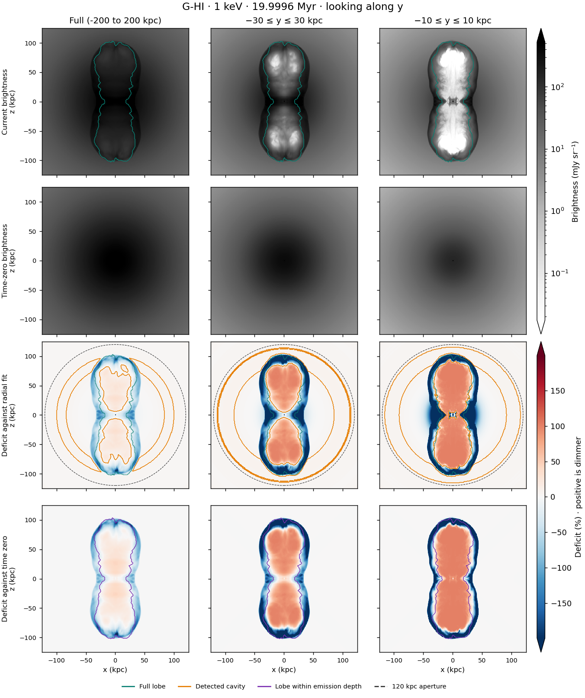
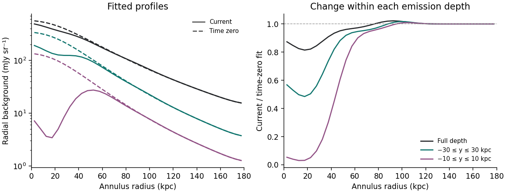

# How much does foreground gas hide the G-HI cavity at 20 Myr?

Removing gas in front of and behind the lobes makes their 1-keV X-ray depression much clearer. It also makes the radial detector select more gas outside them. Across both lobes, the ±30 kpc image keeps the entire projected tracer footprint and 98.8% of its volume. Coverage rises from 51.6% to 67.1%, while false area grows from 7,229 to 15,335 kpc². This is one side-on view of the exposed high-power group simulation at 19.9996143 Myr. [Matched area measurements](assets/ghi20_midplane_slabs_2026-11-25/areas.csv) · [Stas’s request](../exchange/logs/2026-11-25-midplane-slab-xray-cavity-request.md)

## What the outline recovers

The common target is the same 11,309.9 kpc² full-depth projected lobe at every depth. Overlap and missed area sum to the target area. Overlap and false area sum to the selected area. Coverage divides overlap by target area, and purity divides it by selected area. Each bipolar percentage uses the sum of the two sides’ physical areas.

| Emitting depth along y | Jet side | Selected (kpc²) | Overlap (kpc²) | Missed (kpc²) | False (kpc²) | Coverage | Purity |
|---|---|---:|---:|---:|---:|---:|---:|
| Full (±200 kpc) | −z | 6,565.1 | 2,953.9 | 2,716.5 | 3,611.2 | 52.1% | 45.0% |
| | +z | 6,498.4 | 2,880.2 | 2,759.3 | 3,618.2 | 51.1% | 44.3% |
| | **Both** | **13,063.5** | **5,834.1** | **5,475.8** | **7,229.4** | **51.6%** | **44.7%** |
| ±30 kpc | −z | 11,404.4 | 3,754.0 | 1,916.4 | 7,650.4 | 66.2% | 32.9% |
| | +z | 11,515.9 | 3,831.0 | 1,808.5 | 7,684.8 | 67.9% | 33.3% |
| | **Both** | **22,920.2** | **7,585.0** | **3,724.9** | **15,335.2** | **67.1%** | **33.1%** |
| ±10 kpc | −z | 11,690.9 | 4,502.5 | 1,167.9 | 7,188.4 | 79.4% | 38.5% |
| | +z | 11,745.3 | 4,516.5 | 1,123.1 | 7,228.8 | 80.1% | 38.5% |
| | **Both** | **23,436.2** | **9,018.9** | **2,291.0** | **14,417.2** | **79.7%** | **38.5%** |

The ±30 kpc outline recovers 32.0% of the area missed at full depth. It keeps every previously selected lobe pixel. At ±10 kpc it recovers 58.2% of the originally missed area and drops 0.11 kpc² of previously selected lobe. Both narrow-slab outlines remain inside the 120-kpc search aperture. All tracer sightlines lie inside it and the tracer reaches none of the six native grid faces. At ±10 kpc both sides exceed the DET-05 coverage criterion of 75%, and their purity remains well below its 95% requirement. [Areas and aperture checks](assets/ghi20_midplane_slabs_2026-11-25/areas.csv) · [DET-05 criteria](heldout_xray_results_2026-11-24.md)

### How much lobe remains in the slab?

The ±10 kpc slab still intersects 97.9% of the lobe’s projected area while keeping only 40.3% of its volume. The table scores its outline against the tracer cells actually inside each slab. The full and ±30 kpc footprint scores equal those for the common target above. The side-level scores for both target definitions are in the linked table.

| Depth | Lobe area retained | Lobe volume retained | Slab tracer area (kpc²) | Slab tracer volume (kpc³) | Coverage of slab lobe | Purity against slab lobe |
|---|---:|---:|---:|---:|---:|---:|
| Full | 100% | 100% | 11,309.9 | 461,605 | 51.6% | 44.7% |
| ±30 kpc | 100% | 98.8% | 11,309.9 | 456,059 | 67.1% | 33.1% |
| ±10 kpc | 97.9% | 40.3% | 11,069.7 | 186,024 | 80.9% | 38.2% |

At ±10 kpc the slab-matched coverage and purity are 80.2% and 38.2% on the negative-z side and 81.6% and 38.3% on the positive-z side. Each binary tracer cell contributes its physical volume inside the slab. A sky pixel belongs to the footprint if it intersects any such material. [All target and side combinations](assets/ghi20_midplane_slabs_2026-11-25/areas.csv)

## Where the brightness comes from

Summing flux over the same full-lobe footprint, the fractional brightness deficit against the matching initial atmosphere rises from **8.7% at full depth to 44.6% at ±30 kpc and 73.2% at ±10 kpc**. Gas beyond 30 kpc provided 48.4% of the initial flux on those sightlines and became 29.5% brighter. Classifying cells by their tracer at 20 Myr for both epochs, gas outside the tracer cells offsets 71.6%, 24.7% and 1.2% of the tracer cells’ own brightness decrease at the three depths. The full-depth deficit includes both the original foreground and background light and the subsequent brightening of that gas. [Emission by region](assets/ghi20_midplane_slabs_2026-11-25/filling.csv) · [Independent flux accounting](assets/ghi20_midplane_slabs_2026-11-25/independent_review.json)

The sightlines missed by the original outline show *where* the cavity is hidden. Over these same 5,475.8 kpc², gas at |y| ≤ 10 kpc dims by 46.4%, gas at 10 < |y| ≤ 30 kpc brightens by 45.9%, and gas beyond 30 kpc brightens by 19.7%, each relative to its own initial flux. These three regions supplied 23.1%, 29.7% and 47.2% of the initial light. Their weighted sum leaves the sightlines **12.2% brighter at full depth**. Even the ±30 kpc image is 5.5% brighter on those sightlines taken together. The depth cut locates the extra light without assigning it to a particular shock or wave. [Independent component sums](assets/ghi20_midplane_slabs_2026-11-25/independent_review.json)

The exterior areas in the outlines behave differently. As a follow-up to the area scores, we compared every selected pixel outside the full tracer footprint with its own time-zero brightness. At ±30 kpc **zero of 15,335 kpc²** dims by more than 5%. On that area the integrated brightness changes by less than 0.003% and the refitted background exceeds the initial flux by 6.47%. At ±10 kpc only 139.6 of 14,417 kpc² (0.97%) dims by more than 5%. There the area-integrated brightness falls 2.17% and the fitted background stands 4.29% above its initial flux reference. At full depth the corresponding dimmed exterior area is also zero. The detector’s 5% cut is relative to the refitted radial profile, which changes with depth. [Exterior brightness checks](assets/ghi20_midplane_slabs_2026-11-25/independent_review.json) · [Radial profiles](assets/ghi20_midplane_slabs_2026-11-25/radial_profiles.csv)



**Maps.** The rows show current brightness, time-zero brightness, deficit against the current radial fit, and deficit against the matched time-zero image. Black is bright on a common logarithmic intensity scale (0.0175–525 mJy sr⁻¹). Red is dimmer on the common deficit scale (±199.4%). The end colours indicate saturation. Teal outlines the full tracer lobe, purple outlines the slab tracer, and orange marks the selected cavity. All quantitative measurements use the exact native sky-cell edges.



**Background fits.** Each of the 36 five-kpc annuli has direct support at both epochs and all three depths. The detector smooths each profile with a 10-kpc Gaussian width and holds the endpoint values inside the first bin centre and beyond the last. The large change in the inner profile at ±10 kpc occurs in sampled annuli. [Per-annulus measurements and angular support](assets/ghi20_midplane_slabs_2026-11-25/radial_profiles.csv)

## Verification

PBS job 884129 completed in 33 min 32 s with exit status 0. All five full-depth fields matched their archived rasters bit for bit. The native cell-volume sums and the projected tracer path times sky area agree for both sides at every depth. The ±30 kpc boundaries each take 0.139505 kpc of a native cell. The ±10 kpc boundaries coincide with cell edges. Two scoring implementations using the same projections produced identical masks at all three depths. They reproduce all 18 physical area rows within 4 × 10⁻¹² kpc² and agree on the three exterior brightness checks. Independent review of the native extraction and extension to other cases and ages remain open. [Native receipt](assets/ghi20_midplane_slabs_2026-11-25/native_completion.json) · [PBS accounting](assets/ghi20_midplane_slabs_2026-11-25/pbs_accounting.json) · [Scoring receipt](assets/ghi20_midplane_slabs_2026-11-25/score_receipt.json) · [Independent replay](assets/ghi20_midplane_slabs_2026-11-25/independent_review.json)

## Reproducing the measurement

The jet in group atmosphere 002031 has a total labelled power of 2 × 10⁴⁵ erg s⁻¹, speed 0.1c, 15° half-opening angle and 0.75-kpc injection height. The 960 × 960 × 1,014 native Cartesian grid spans 400 × 400 × 500 kpc. Output 20 is at 19.9996143 Myr. The 1-keV maps at redshift 0.05 use the archived XRAiSE linear extrapolation of the emissivity corrections. The receipt lists out-of-table and negative cell counts for each integration depth. [Simulation setup](ghi20_compressive_front_comparison_2026-11-23.md) · [Pilot protocol](ghi20_midplane_slab_protocol_2026-11-25.md)

The native worker reads the retained G-HI emission directory and its bound source files. It compares all five full-depth fields with the earlier 0° projection and checks projected tracer volume against a sum over native cells. To repeat the extraction, set `GHI20_PREVIOUS` to the archived `results_emission` directory and `SLAB_DIR` to a fresh output directory. To repeat the scoring from the retained rasters, use the verified `completion.json` and `projections.npz` in `SLAB_DIR` and the original 0° projection in `GHI20_REFERENCE`. The independent implementation uses the same rasters and a separate radial fit, component labeller and physical area sum.

```sh
.venv/bin/python scripts/science/project_ghi20_midplane_slabs.py \
  --previous "$GHI20_PREVIOUS" --output "$SLAB_DIR"
.venv/bin/python scripts/science/score_ghi20_midplane_slabs.py \
  --projection-dir "$SLAB_DIR" --reference "$GHI20_REFERENCE" --out "$NEW_SCORES"
uv run --no-project --python 3.12 --with scikit-image==0.26.0 python \
  scripts/science/review_ghi20_midplane_slabs.py --reference "$GHI20_REFERENCE" \
  --projection "$SLAB_DIR/projections.npz" --compare "$NEW_SCORES" \
  --output "$NEW_SCORES/independent_review.json"
```
