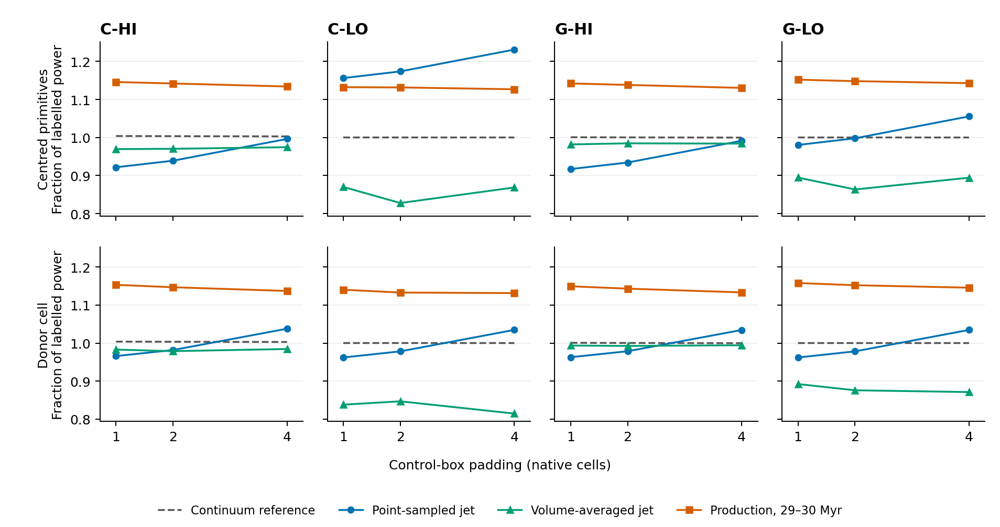

# Can the nozzle measurement create the apparent excess?

The G-HI production estimate is 13–15% above labelled power at 29–30 Myr. We ran the identical measurement on an artificial G-HI jet whose known energy flux differs from the label by at most 0.073% across the three control surfaces. Its largest reading was 3.45% above the label. The simple steady cone therefore fails to reproduce the production excess. The low-power cluster case shows why this result alone cannot establish the power actually delivered by the simulated jet.
<!-- claims: BND-08 BND-09 -->

| Case | Known flux through the three boxes | Synthetic, sampled at cell centres | Synthetic, conserved quantities averaged over cells | Production source, 29–30 Myr |
| --- | ---: | ---: | ---: | ---: |
| C-HI | 1.00300–1.00391 | 0.9218–1.0378 | 0.9695–0.9845 | 1.1342–1.1532 |
| C-LO | 1.00016–1.00020 | 0.9622–1.2312 | 0.8147–0.8701 | 1.1268–1.1404 |
| G-HI | 0.99980–1.00072 | 0.9171–1.0345 | 0.9819–0.9944 | 1.1305–1.1494 |
| G-LO | 1.00013–1.00017 | 0.9622–1.0555 | 0.8634–0.8947 | 1.1429–1.1580 |

All entries are multiples of labelled bipolar kinetic power, or of its integral over the interval. Each measured range spans the same three boxes and two face reconstructions. Production uses trapezoidal time integration of the outward flux plus the change in stored energy. The storage term contributes less than 0.000052 in absolute value in every row. The synthetic field has zero storage change. [Matched results by case, box and reconstruction](assets/nozzle_flux_calibration_2026-11-19/matched_nozzle_flux.csv)

**What the test excludes in each case.** Across both representations of the prescribed steady jet, even the largest synthetic reading falls below the smallest production reading in C-HI (1.038 versus 1.134), G-HI (1.034 versus 1.130) and G-LO (1.056 versus 1.143). Those geometries on the tested fields do not account for the observed excess. In C-LO all three centred point-sampled estimates exceed their matched production values, reaching 1.231. Geometry and the choice of cell representation can give an error of the required size there. Bias from the cocoon gas adjacent to the evolving production jet remains uncalibrated in every case. The [independent tagged-mass inventory](tracer_mass_budget_2026-11-19.md) measures how much marked material accumulated.
<!-- claims: BND-09 BND-10 -->



## The jet with known power

We recovered the exact cell centres and face coordinates from the four native output grids and reproduced the box bounds recorded by the original flux jobs. All four retained source configurations select a spherical injection region of radius 0.75 kpc. In that branch the cone apex is at the origin, as the startup records for both jets confirm. The control planes are at |z| = 0.80, 0.85 and 0.95 kpc, with jet diameters of 8.6, 9.1 and 10.2 native cells there. Each box encloses both jets.

We continued the prescribed 15° radial flow at 0.1c beyond the injection region, with density proportional to inverse radius squared, pressure proportional to density to the 5/3 power, and the tabulated atmosphere at rest elsewhere. The bipolar kinetic flux divided by the label is the ambient density at the source length scale divided by that at the inlet. It ranges from 0.99621 to 0.99999. Enthalpy adds 0.354–0.451% of the label in the high-power cases and 0.016–0.021% in the low-power cases. The gravitational term adds less than 0.000017% with potential zero at the centre. Mass and kinetic flux are conserved across the three boxes. Each has its own total reference because enthalpy and potential vary with radius. This is a prescribed field for measuring flux. An evolving hydrodynamic solution can have different structure at the same surface. [Independent continuum integrals](assets/nozzle_flux_calibration_2026-11-19/continuum_reference.csv)

The production reader operated unchanged on native-precision primitive fields. We supplied first the values at cell centres, then the same continuum field represented by cell-volume averages of mass, momentum and gas energy, converted back to primitives. Each representation uses the same analytic flux. An independent scalar calculation reproduced all 96 native point-sampled energy components to within 4.5 × 10⁻¹⁶ of the label. The two continuum calculations agreed within 1.2 × 10⁻¹³ in labelled units. Increasing the averaging quadrature from order 8 to 16 changed the totals by at most 1.4 × 10⁻⁸. [Cell-average convergence](assets/nozzle_flux_calibration_2026-11-19/conservative_averages.csv)

## Sixteen pairs of cells explain the C-LO result

At the widest C-LO box, 16 pairs of neighbouring cell centres straddle the jet edge across the two endcaps. Integrating over their actual face areas gives them **3.97%** of the jet's kinetic power. The centred primitive reconstruction assigns them **24.39%** of labelled power. It combines stationary ambient gas about 43 times denser than the neighbouring jet gas with half the jet speed before computing the kinetic flux. The donor-cell method instead selects the stationary inner cell at those 16 locations. The two methods return total fluxes of 1.2312 and 1.0347 there. With cell-volume averages the centred excess also disappears. At identical locations in C-HI, the ambient gas is only 0.43 times the jet density. [Cell-pair densities and reconstructed flux](assets/nozzle_flux_calibration_2026-11-19/mixed_density_contrast.csv) · [True kinetic flux by cell footprint](assets/nozzle_flux_calibration_2026-11-19/true_kinetic_footprints.csv)

Finer sampling of the same field at fixed physical surfaces reduces the largest absolute error across all four cases from 0.2310 at native spacing to 0.0345 at four times the resolution and 0.0266 at eight times. This checks the spatial measurement using the known field. The actual production flow can contain acceleration, mixing and pressure gradients absent from that field. The calibration supplies no transferable correction factor. [Resolution comparison](assets/nozzle_flux_calibration_2026-11-19/calibration_by_resolution.csv)

## What the production histories establish

In G-HI, reconstructed **kinetic transport alone** is 1.1262–1.1437 times labelled input over 29–30 Myr. Enthalpy adds 0.0042–0.0058. Across all six outer-face and time-integration choices, the cumulative whole-grid source at 30, 40 and 46 Myr is 1.0778–1.0796, consistent with the roughly 8% spherical storage excess. The outside balance subtracts the estimated nozzle source from that whole-grid source. Its negative sign cannot identify a physical loss outside the nozzle while the production nozzle flux is uncertain. A next check using existing snapshots would carry both transport and storage to larger, better-resolved surfaces around the injector. Solver-step fluxes and overwrite/source accounting would address delivery directly if attribution is needed.
<!-- claims: BND-05 BND-08 BND-09 -->

Two endpoint checks complete the comparison requested on the board.

- **G-HI, 46–47 Myr.** All 24 available outside-nozzle increments fall within the range of their *own* ten preceding intervals. Twelve use the 47-Myr domain-face flux and twelve use the 46-Myr value. The final net flux across all six domain faces is about 0.54% of labelled power. This establishes continuity in the measured balance at boundary contact. [Matched endpoint increments](assets/nozzle_flux_calibration_2026-11-19/ghi_same_scenarios.csv)
- **C-HI and G-LO, 49–50 Myr.** The whole-grid source drops from the preceding interval by 0.0586 and 0.0619 of labelled interval input respectively. The retained source wraps a 50-Myr cycle with zero quiet time. It prescribes a brief velocity dip at about 49.915–49.965 Myr on the output clock and full speed at the last dump. Both saved endpoints miss the dip. Its contribution to the measured drops remains unresolved, as does the historical binary-to-source linkage. [Matched final intervals](assets/nozzle_flux_calibration_2026-11-19/chi_glo_matched_intervals.csv)

## Reproduction

The project archive holds `turn19_nozzle_calibration_2026-11-19/nozzle_calibration_review_r1.tar.gz`, SHA-256 `e342f05bcc987b510ce085ce5a3036dd620e35b0b447a280896e7aa80e09493f`. Extract it under `private_archive/` in the checkout. From the repository root, supply a fresh destination for the replay.

```sh
.venv/bin/python private_archive/turn19_nozzle_calibration/replay.py private_archive/nozzle_calibration_replay
```

The replay verifies the bundle manifest and regenerates five numeric tables, including the matched production comparison, and the figure. The archive contains the input identities, independent reference and cell calculations, endpoint checks and their receipts.
