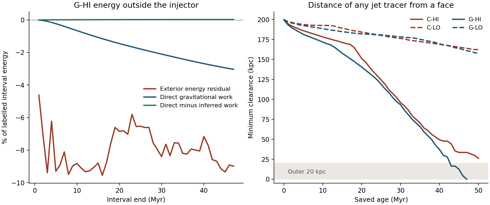

# What all four simulated jets delivered

The four jets supplied more mass and energy than their nominal power and speed imply. At every saved time after startup, the lateral faces of the cells forming the jet cones carried **78.4–81.9% of the excess marked-mass flux**. By 30 Myr the net injector gas energy exceeded label by **11.4–16.2%** across the four runs. At that age even the most dilute recorded jet gas was still at least **93 kpc** from a domain face. [Cone-face measurements at all 201 outputs](assets/production_injector_histories_2026-11-21/face_direction_history.csv) · [Four-case budgets](assets/production_injector_histories_2026-11-21/case_energy_budgets.csv)
<!-- claims: BND-10 BND-12 -->

## Four-case energy and mass budgets

Each row integrates from startup to the 30-Myr output. Gas energy includes pressure work. The cone and stationary-region columns are signed outward from the maintained cells. Each energy fraction uses the bipolar labelled power and the actual active duration. All fluxes use the production reconstruction and trapezoidal time weighting. The marked-mass column comes from the change in the whole-grid inventory using native cell volumes.

| Case | Cone gas energy / label | Stationary gas energy / label | Net injector gas energy / label | Marked mass gained / label | Whole-grid energy / label¹ |
| --- | ---: | ---: | ---: | ---: | ---: |
| C-HI | 1.1603 | +0.0014 | **1.1616** | 1.1553 | 1.0834 / 1.0685 |
| C-LO | 1.1580 | −0.0440 | **1.1140** | 1.1047 | 1.2114 / −0.2831 |
| G-HI | 1.1565 | +0.0014 | **1.1580** | 1.1515 | 1.0794 / 1.0789 |
| G-LO | 1.1594 | −0.0115 | **1.1479** | 1.1325 | 1.1705 / 1.1217 |

¹ The whole-grid energy source is the change in stored gas and potential energy plus energy crossing the six domain faces. The two values take the outermost cell state or extrapolate linearly to the boundary. Strong inflow makes this subtraction particularly sensitive in C-LO. Both estimates give a negative exterior balance in the high-power runs. The low-power exterior balances change sign with the boundary method. [Integrated sources, storage and exterior balances](assets/production_injector_histories_2026-11-21/case_energy_budgets.csv)

Over the entire available histories the net injector gas-energy ratios were **1.1618, 1.1228, 1.1581 and 1.1512** in table order. G-HI ends at 47 Myr and the others at 50 Myr. The stationary region supplied a small positive gas-energy flux at every high-power output and absorbed gas energy at every low-power output. C-LO absorbed 28.4% of labelled power at 1 Myr, when the net instantaneous injector power fell to 0.870 of label. The three 50-Myr endpoints miss the short velocity ramp between saved states. Trapezoidal fluxes overpredict the measured marked-mass gain in those final intervals by 3.52–3.59% of interval-labelled mass. [Primary case tables and sensitivity calculations](assets/production_injector_histories_2026-11-21/history_tables.zip)

## Which faces carry the excess

At the 197 post-startup outputs, cap gas carried 0.99972–1.00468 times the nominal kinetic energy per gram. The sides of the cones' grid cells carried 77.1–80.1% of the excess gas power as well as most of the excess marked mass. Of 33,096 cap-face measurements after startup, 33,029 had both characteristic speeds directed outward. All 67 exceptions occurred on lateral C-LO faces at 1, 2, 3, 7 or 50 Myr. Those faces still carried mass outward and accounted for at most 1.53% of outward cap energy at those epochs. At startup the solver switched to HLL on every cap face in every case. A hot exterior can influence individual faces, but the repeated mass excess persists when both characteristics point outward. [Directional fluxes](assets/production_injector_histories_2026-11-21/face_direction_history.csv) · [Exceptions by case and age](assets/production_injector_histories_2026-11-21/wave_exceptions.csv)
<!-- claims: BND-11 BND-12 -->

## Tracer at the boundary

Through 30 Myr the minimum distances from **any stored positive tracer** to a physical face were 95.80, 176.28, 93.15 and 178.23 kpc in table order. All 744 individual face samples and all four signed transport integrals over the sampled sequence were zero through 30 Myr. C-HI, C-LO and G-LO kept the outer 20 kpc entirely clear through 50 Myr. G-HI first entered that layer at 43 Myr and first reached a face, at negative z, at 47 Myr. At 46–47 Myr trapezoidal integration gives net loss of **0.04185% of the interval's labelled mass**, or **0.000890% of cumulative labelled mass**. Left and right endpoint rules give 0 and 0.08369% for the interval. Continuous transport between dumps remains unsampled. [Raw clearance and shell inventories](assets/production_injector_histories_2026-11-21/raw_tracer_summary.csv) · [All 1,206 individual face records](assets/production_injector_histories_2026-11-21/raw_tracer_faces.csv)
<!-- claims: BND-10 -->

## Can gravitational work explain G-HI's energy deficit?

The measured discrepancy is too small. At 29–30 Myr, direct gravitational work on the gas outside the injector was **−2.104%** of labelled energy. The change in potential energy and its transport through the same surfaces gave **−2.123%**. The difference was **+0.019 percentage points**, against an exterior energy balance of **−8.399%**. The ordinary work of lifting gas is already included in the gas-plus-potential energy budget. The relevant comparison for a gravity error is the difference between the two work estimates. [Matched gravity and exterior comparisons](assets/production_injector_histories_2026-11-21/gravity_scientific_check_summary.csv)

Through 47 Myr the primary G-HI injector delivered **1.1581 times label** and the whole-grid source was **1.0782 times label**. The resulting exterior deficit was **7.99% of labelled energy**. Over all 47 intervals and 1,120 valid combinations of injector reconstruction, boundary reconstruction and time weighting, every exterior residual was negative. The absolute difference between the two gravity estimates was at most **1.021% of the magnitude of the corresponding residual**. C-HI also had negative residuals throughout, with a maximum gravity discrepancy of 20.5% of the matched deficit. The original code applies gravity using its numerical mass fluxes at intermediate solver stages. The saved cell-centre velocities allow a direct work estimate, while attribution of the remaining discrepancy to a particular solver operation remains open. [All matched sphere comparisons](assets/production_injector_histories_2026-11-21/history_tables.zip) · [Independent gravity check](assets/production_injector_histories_2026-11-21/gravity_audit_receipt.json)
<!-- claims: BND-08 BND-13 -->



## Verification and reproduction

The analysis used 201 saved native states and 197 adjacent intervals. A separate implementation using the retained PLUTO C routines reproduced all **863,496 interface measurements**. The two implementations agreed on every wave and shock-switch classification. Repeating the C comparison on the original grid coordinates changed zero classifications. All four case histories, the repaired comparison and the independent local replays are archived. [C solver comparison](assets/production_injector_histories_2026-11-21/c_solver_receipt.json) · [Output hashes and PBS records](assets/production_injector_histories_2026-11-21/verification.json) · [Run and recovery record](../exchange/logs/2026-11-21-production-injector-histories.md)

The public replay verifies the table hashes and recomputes the cumulative energy, marked mass, boundary, lateral-face and gravity figures. Give it `--figure OUTPUT.png` to regenerate the figure with Matplotlib.

```sh
python3 docs/science/assets/production_injector_histories_2026-11-21/replay.py
```
