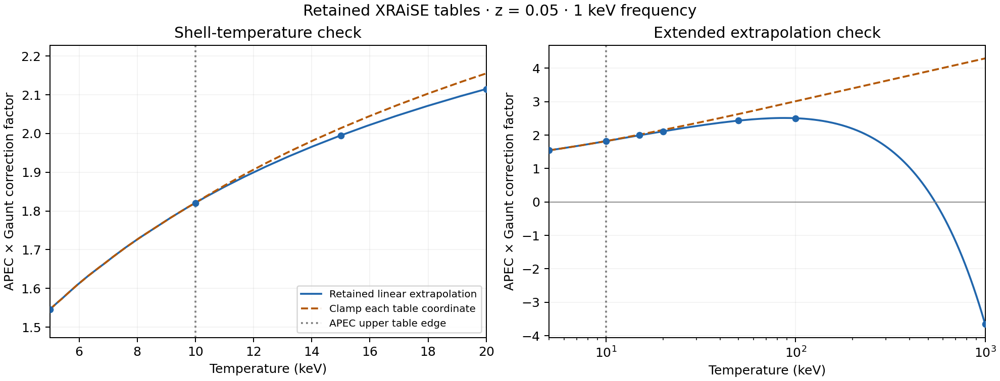

# Retained emissivity correction: pre-pilot extrapolation check

Claude requested this check in Correspondence discussion 29, message 2718.
The correction is positive and increasing over 5–20 keV, but turns over near
89 keV and crosses zero at 544.709884 keV. Include the separately labelled
clamp-to-table-edge arm in the C-HI/G-HI 40 Myr native pilot. Preserve linear
extrapolation as the retained-render reproduction arm. Neither convention is
validated high-temperature plasma physics by this comparison.

## Evidence

Both tables were downloaded from the authenticated Kunanyi portal runtime
directory and their SHA-256 values matched the frozen selected-age expectations
listed in `assets/q031_emissivity_extrapolation_2026-10-31/metadata.json`.
The calculation calls `xraise_grid_smoke.make_interpolators` directly, at
redshift 0.05 and frequency 2.417990504024e17 Hz, with the renderer's
8.617333262e-8 keV/K conversion. The figure and 10,122-point curve include
the interpolation knots and seven requested temperatures. No native fields
were read and no cluster job was submitted.

An independent review implemented axis bracketing and bilinear interpolation
without calling the renderer helper. It reproduced all 10,122 curve rows
(maximum absolute product difference 5.68e-12), verified table and source
hashes, and independently recovered the zero at 544.7098840528 keV from the
last APEC interval. The figure was visually checked.

| T (keV) | APEC | Gaunt | Retained product | Clamped product |
| ---: | ---: | ---: | ---: | ---: |
| 5 | 1.034685 | 1.494267 | 1.546096 | 1.546096 |
| 10 | 1.009592 | 1.803651 | 1.820953 | 1.820953 |
| 15 | 1.000152 | 1.994843 | 1.995146 | 2.013978 |
| 20 | 0.990711 | 2.134877 | 2.115046 | 2.155355 |
| 50 | 0.934068 | 2.605956 | 2.434140 | 2.630953 |
| 100 | 0.839662 | 2.985297 | 2.506641 | 3.013933 |
| 1000 | -0.859639 | 4.254646 | -3.657459 | 4.295458 |

The sampled maximum is 2.513457 at 88.5215 keV. The root comes from a bracketed
solve of the retained interpolator. The turnover and zero are extrapolation
artifacts beyond APEC's domain, not physical features established by the table.
Gaunt remains positive throughout this
range; the negative product arises from APEC's extrapolated decline. All Gaunt
coordinates and the redshift remain in range here. Clamping acts on each
table's coordinates independently: it caps APEC's temperature at 10 keV,
while Gaunt still uses the actual temperature. Capping both tables at the
APEC edge would be a different sensitivity.

At 20 keV the retained product is 1.87% below the clamped value. This is a
pointwise factor comparison, not a shell-integrated brightness error.
The fraction of C-HI shocked ambient above 10 keV remains unmeasured.
For a monatomic ideal-gas Mach 1.5 shock, the temperature multiplier is
1.49479; crossing 10 keV requires an upstream temperature above about
6.69 keV. Saying the atmosphere is at several keV alone does not establish
that much of its shell is outside the table.

The pilot must carry both current and case-specific initial emissivities
through identical masks and projections under both conventions. Report signed
and absolute brightness contributions outside the table and wherever the
retained emissivity is negative, including effects on the regional differences
and filling ratios. Retain raw negative values in the reproduction arm; do not
silently clip them or interpret them as physical negative radiation. A clamp
comparison measures convention sensitivity, not an uncertainty bound.

## Reproduction

Run `scripts/science/check_xraise_correction_extrapolation.py` with
`--apec-table`, `--gaunt-lut`, and a new `--output-dir`. The canonical remote
inputs are under `/u/bwbrook/codex_kunanyi/xraise_runtime/`; the local downloaded
paths are in the metadata. The script checks both hashes and refuses to
overwrite an existing output directory. Generated CSVs preserve full precision.
