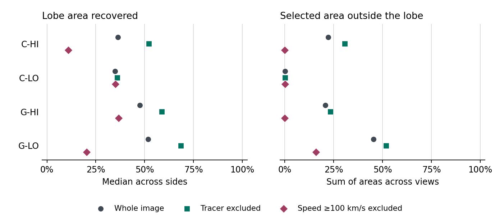

# Fitting the X-ray atmosphere outside the simulated lobes and moving gas

Excluding sightlines through gas moving at least 100 km/s from the background fit removed **about 96% of falsely selected exterior area under either central fit**. Across the 54 science views, median coverage of the projected lobe was **39.9%** when the measured inner brightness slope was extrapolated, **19.5%** when the innermost measured brightness was held constant, and **41.6%** with the original background. The slope fit recovered 168,639 kpc² of lobe area, close to the original 169,944 kpc². None of the fits passed on any of the 108 science sides. All 24 initial control sides stayed empty. [Independent reproduction](assets/source_excluded_review_2026-11-25/summary.json)

| Sightlines excluded from fit | Median lobe area recovered | Exterior area, summed over views (kpc²) | Purity, pooled by selected area | Median inferred / native volume | Empty science sides |
| --- | ---: | ---: | ---: | ---: | ---: |
| None, original DET-05 radial rule | 41.6% | 55,071 | 75.5% | 0.508 | 15 |
| Tracer-marked gas, constant centre | 52.5% | 90,457 | 69.3% | 1.298 | 9 |
| Gas moving ≥100 km/s, extrapolated inner slope | 39.9% | 2,453 | 98.6% | 0.390 | 10 |
| Gas moving ≥100 km/s, constant centre | 19.5% | 2,372 | 97.6% | 0.129 | 21 |

Each median includes empty science outlines. Purity is the fraction of all selected sky area that overlaps the lobe. A passing side needed at least 75% lobe coverage, 95% purity and no aperture contact. The tracer fit with the slope continuation reached 75.02% coverage on one side, with 39.6% purity. Eighteen sides had less than 75% of their target inside the aperture. The other 90 also failed. The separate exposed G-HI/20 example below is outside these totals. The figure shows the constant-centre fits. [Full numerical summary](assets/source_excluded_backgrounds_2026-11-25/summary.json)



The environment and jet power matter. G-LO accounts for 2,369 of the 2,372 kpc² of exterior left by the primary speed fit. In that run, excluding tracer raised median coverage from 51.8% to 68.5%, while over half of all selected area lay outside the lobe. The median inferred volume was then 3.11 times the native volume. Across the cohort only 28.9 of the tracer fit’s 90,457 exterior kpc² were more than 5% dimmer than those same pixels at time zero. A fitted deficit therefore often outlines sky whose brightness scarcely changed or increased.

## What changed in the fit

The comparison uses the same brightness, 5% deficit threshold, component filter and 120-kpc search aperture as the published radial rule. Each alternative changes which sightlines supply its radial background. The tracer fit drops every sightline that intersects jet-marked lobe gas. The speed fit drops every sightline that intersects gas moving at least 100 km/s, including fast ambient gas. A slow lobe sightline can still supply the speed fit. We also used speed thresholds of 30 and 300 km/s. Both exclusions require simulation fields. [Protocol fixed before examining the new fits](source_excluded_background_protocol_2026-11-25.md) · [Published DET-05 comparator](heldout_xray_results_2026-11-24.md)

A positive pixel contributes to its original 5-kpc annulus inside the 180-kpc fit aperture. Direct support requires eight retained pixels covering at least three of twelve angular sectors, capped at the pixel and sector counts originally available. The primary fit extends the innermost supported median inward at constant brightness. The sensitivity fit extrapolates the measured inner log-brightness slope. Both interpolate internal gaps and smooth the resulting profile with the original 10-kpc Gaussian. Each background is then applied to the full brightness image.

## The exposed G-HI view at 20 Myr

At 19.9996 Myr, the full-speed mask covered every tracer sightline at all three azimuths. It also excluded moving gas outside the lobe. With the constant inward continuation, the exterior arcs disappeared in all three views. The 5% deficit still missed more than half the lobe in each. Tracer exclusion alone reduced the false area at 0° and increased it at 45° and 90°. The table combines the two hemispheres before dividing. Each triplet gives the original, tracer-excluded and speed-excluded results in that order.

| Azimuth | Exterior area (kpc²) | Lobe area recovered | Purity | Inferred / native volume |
| --- | ---: | ---: | ---: | ---: |
| 0° | 7,229 / 4,178 / 0 | 51.6 / 68.9 / 48.1% | 44.7 / 65.1 / 100% | 3.98 / 2.08 / 0.45 |
| 45° | 1,992 / 3,464 / 0 | 49.8 / 55.9 / 38.2% | 75.0 / 65.9 / 100% | 1.02 / 1.54 / 0.29 |
| 90° | 1,701 / 3,317 / 0 | 60.4 / 68.6 / 47.9% | 80.0 / 69.9 / 100% | 1.09 / 1.74 / 0.44 |

The innermost directly supported annulus began at 15 kpc with the tracer exclusion and 30 kpc with the speed exclusion. Extending the measured inner slope instead raised speed-fit completeness to 58.5%, 48.3% and 58.4%, respectively. At 45° that continuation selected 5.1 kpc² outside the lobe. More than 99.98% of the retained speed-fit sky area at each azimuth intersects at least one outer-face cell with a pressure or density change of 1% or more since time zero. That is a line-of-sight incidence measure. It cannot apportion the brightness among boundary gas, the local atmosphere and the jet disturbance.

## Where the fit loses support

The 100 km/s exclusion retained 88.2% of the positive-brightness fitting area in the science images, yet left the centre without direct support in 39 of 54 views. The central gaps reached 60 kpc. Four more annuli required bracketed interpolation, all in G-LO at 50 Myr. Extending the measured log-brightness slope into the centre raised median science-side completeness from 19.5% to 39.9%. Exterior area stayed small at 2,453 kpc², and no side passed.

At the primary 100 km/s cut, the new outlines selected zero exterior area across both high-power runs. In C-HI the speed fit’s median lobe-area coverage fell to 10.9%, compared with the original 36.3%. Extending the measured slope inward raised it to 35.0%, with zero exterior area under either continuation. The innermost usable annulus began as far out as 60 kpc. In G-HI the corresponding primary median fell from 47.5% to 36.8%. In C-LO the original, tracer and speed fits had direct support in the innermost bin at every age and azimuth. Median completeness was 34.8%, 36.0% and 35.0%, respectively.

The velocity threshold matters too. At 300 km/s the primary continuation yielded 37.9% median completeness and 35,933 kpc² exterior. At 30 km/s the 0° and 90° views of each cluster run at 50 Myr had no usable fitting annulus. At 45° the central 140 kpc in C-HI and 80 kpc in C-LO had to be extrapolated. In C-HI the whole 120-kpc search aperture then lay inside the extrapolated part of the background. Of the 100 science sides with a defined 30 km/s fit, 40 had empty outlines and median completeness was 10.4%.

At 100 km/s, slow tracer sightlines contributed to the background in 13 C-LO views and three G-LO views. Summed across all 54 views, 0.033% of the projected tracer area escaped the speed mask. On 92.46% of the retained fitting area, at least one cell along the line of sight had changed pressure or density by at least 1% since the start. Rays intersecting a changed cell on a native box face alone accounted for 92.45% of retained area. The images do not locate which part of such a ray contributes a given fraction of its brightness. The comparison establishes how the inferred outline changes with the fit, while a claim about the true undisturbed background needs further physical evidence.

## Reproduction

The numerical tables are sufficient to reproduce the case summaries. The score table has one row per view, fitting exclusion, inward continuation and hemisphere, plus a bipolar row computed from physical sums. Initial controls have an empty target and zero target volume. Their physical nozzle still enters each fitting exclusion. A defined, empty science outline scores zero completeness and has undefined purity. A fit with insufficient support has a status and blank scores. Pooled purity divides all overlapping area by all selected area. [Side and bipolar scores](assets/source_excluded_backgrounds_2026-11-25/scores.csv.gz) · [Annular medians, sector counts, areas and profiles](assets/source_excluded_backgrounds_2026-11-25/radial_support.csv.gz) · [Coverage by view](assets/source_excluded_backgrounds_2026-11-25/coverage.csv.gz) · [Native and archived input identities](assets/source_excluded_backgrounds_2026-11-25/input_receipts.csv.gz)

```sh
.venv/bin/python scripts/science/summarise_source_excluded_backgrounds.py
```

Reviewers with the project holdings can regenerate the fits and figures from the original G-HI/20 emission directory, the two verified DET-05 archives and the compact native projections. Each per-view directory contains a comparison figure and the corresponding full-precision numerical record. The figure shows the whole brightness image, the two projected exclusions, the three deficit maps and outlines, measured radial support and alternative inward continuations.

The score column `captured_native_kpc3` integrates known tracer depth over selected sightlines. The separate `inferred_volume_kpc3` revolves the outline about the jet axis. Measuring what fraction of that inferred three-dimensional region contains jet gas would require intersecting it with the native volume.

```sh
.venv/bin/python scripts/science/measure_source_excluded_backgrounds.py \
  --exposed-dir "$GHI20_EMISSION" --prediction-tar "$PREDICTION_TAR" \
  --truth-tar "$SCORING_TAR" --native-root "$NATIVE_PROJECTIONS" \
  --out "$NEW_COMPARISON_DIR"
.venv/bin/python scripts/science/summarise_source_excluded_backgrounds.py \
  --collect "$NEW_COMPARISON_DIR" --assets "$NEW_TABLE_DIR"
```

Codex (OpenAI, GPT-6) performed the native projections, refits and scoring. The published DET-05 baseline was previously rescored by Claude (Anthropic, Fable 5.2). The comparison uses noiseless 1-keV images, one radial detector, three side-on azimuths and two hemispheres per simulated state. Azimuths and hemispheres share the same gas. Sums of area count each projection. This retrospective use of the 54 previously scored science views measures sensitivity to the background prescription. [Supervisor request](../exchange/logs/2026-11-24-source-excluded-backgrounds-and-energy-partition.md)

All 23 existing-output projection jobs exited successfully. The 57 evolved projected tracer depths matched the original depth maps at every pixel. All 69 unmasked outlines reproduced their archived references, and all 24 published fields agreed on all 132 registered radial side rows. A second Codex implementation reproduced ten primary excluded outlines pixel for pixel on five views, including all three exposed azimuths, C-HI/50 at 45° and G-LO/30 at 90°. It separately checked 360 annular measurements, both inward continuations, aperture contact, areas and volumes. The two implementations share the hash-bound original inputs, native projections and SciPy component labelling. Patrick’s physical review is pending. [Numerical verification](assets/source_excluded_backgrounds_2026-11-25/independent_check.json) · [Check implementation](../../scripts/science/check_source_excluded_comparison.py) · [Method review and private figure index](../exchange/logs/2026-11-25-source-excluded-background-method-review.md)
