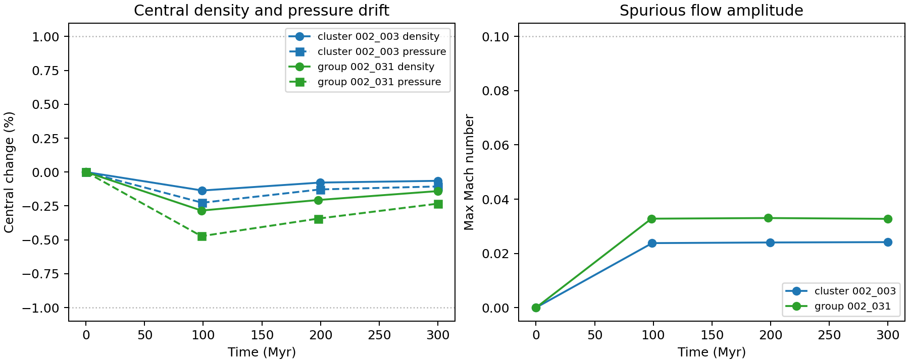
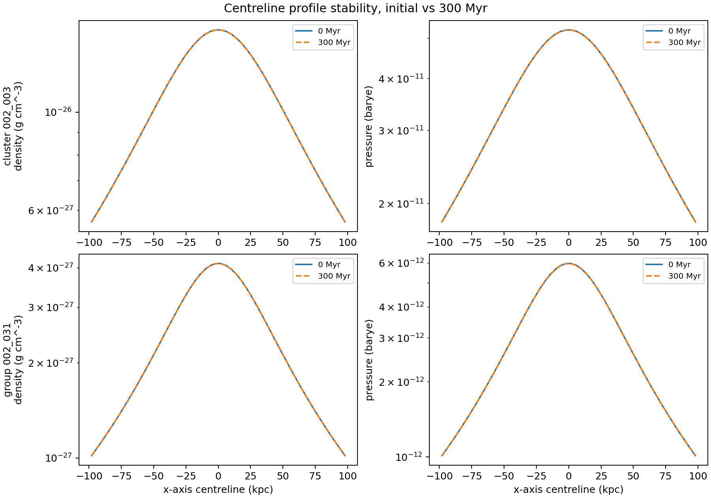

# Stewart Tabulated Environment Gate, 2026-05-05

## Summary

The confirmed Stewart radially averaged environments passed the first no-jet
Nectar stability gate on `2026-05-05`.

Stas' clarification is now treated as binding for science runs: use the
tabulated radius profiles, not the full 3D grid environments, because the full
3D profiles have too much spurious motion for reliable energetics.

## Inputs

The tested files were extracted from the ignored `env/environments.zip` archive
and staged to `nectar-vm`:

| Science role | Stewart environment | Extracted asset |
| --- | --- | --- |
| `C-HI`, `C-LO` | cluster `002_003` | `tabulated_cosmo_002003.csv` |
| `G-LO` | group `002_031` | `tabulated_cosmo_002031.csv` |

The local MacBook remained the control plane. The simulations ran on
`nectar-vm` after resizing to `c3.3xlarge`.

## Gate Setup

The tests were rendered with
`scripts/science/render_stewart_environment_gate_tests.py`, using the extracted
cluster and group CSVs, the current `jet-setup` environment verifier, and the
current `jet-setup` makefile and `definitions.h` templates.

Each rendered gate uses:

- HD, 3D Cartesian, vector body force
- no jet: `JET_END_TIME = 0`, `JET_ACTIVE_TIME = 0`
- no particles: rendered `definitions.h` sets `PARTICLES = NO`
- grid: `50 x 50 x 50`, uniform `[-100, 100] kpc` in each dimension
- run duration: `300 Myr`
- PLUTO code-time conversion: `1 Myr = 306.601393788`
- outputs near `0`, `100`, `200`, and `300 Myr`

## Results

| Environment | Max central density drift | Max central pressure drift | Max Mach | Max velocity | Gate |
| --- | ---: | ---: | ---: | ---: | --- |
| cluster `002_003` | `0.136%` | `0.226%` | `0.0242` | `10.6 km/s` | pass |
| group `002_031` | `0.284%` | `0.473%` | `0.0330` | `8.07 km/s` | pass |

The `jet-setup` verifier passed all outputs for both environments. These are
smoke-scale stability gates, not final production-resolution validation.

The plotted metrics are stored as `stewart_environment_gate_metrics.csv` in the
matching asset directory.

## Implementation Notes

Two small operational fixes came out of the gate:

- `scripts/science/render_stewart_environment_gate_tests.py` now renders a
  hydro-only `definitions.h` and a particle-free `local_make`, because the
  current `jet-setup` source template otherwise keeps `PARTICLES_LP` enabled.
- `scripts/science/render_three_case_configs.py` now writes `JET_END_TIME` and
  `JET_ACTIVE_TIME` in PLUTO code-time units. The old Stewart INIs confirmed
  that jet active/end times are code time, not Myr literals.

During the run, `nectar-vm` SSH was switched from fragile socket activation to
persistent `ssh.service`; this is recorded in `docs/nectar_vm_setup.md`.

## Next Gate

The environment asset blocker is now cleared. The next science gate is the
`C-HI` particle-free high-power cluster rehearsal using:

- cluster tabulated environment `002_003`
- `JET_PWR = 1e45 erg/s`
- `JET_SPD = 0.1`
- `JET_OA_PRIMARY = JET_OA_SECONDARY = 15 deg`
- physical duration `300 Myr`, rendered as `91980.41813640` PLUTO code-time
  units
- sparse `dbl` outputs at `100`, `200`, `300 Myr`, plus HDF5/checkpoint hooks

Only after this hydro rehearsal is green should the particle-enabled `C-HI`
repeat begin.
