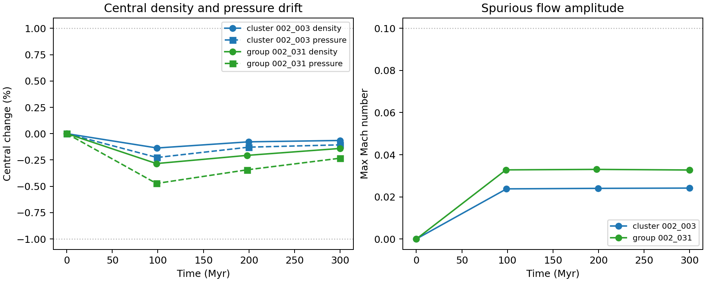
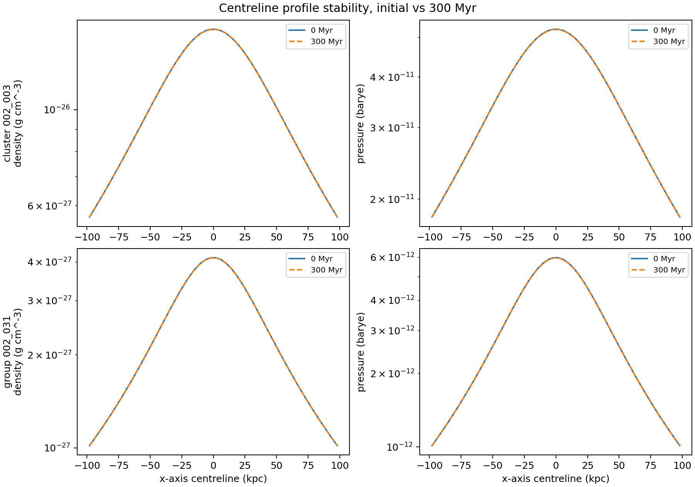

# Executive Summary

The main science asset blocker has been cleared. Patrick supplied the Stewart
environment archive and GRAiLE/XRAiSE bundle, and Stas clarified the key
science choice: production science runs should use the radially averaged
tabulated environments, not the full 3D grid environments, because the full 3D
profiles introduce too much spurious motion for reliable energetics.

We extracted the two selected tabulated Stewart environments, staged them to a
resized Nectar VM, and ran no-jet 3D Cartesian stability gates to `300 Myr`.
Both the cluster and group environments passed the existing `jet-setup`
stability verifier at smoke scale.

The project is now ready for the next science gate: a particle-free `C-HI`
high-power cluster rehearsal on resized Nectar, followed by a particle-enabled
repeat only after the hydrodynamic run is stable and diagnostically useful.

# What Is Now Confirmed

## Environment Selection

| Case role | Case ID | Stewart environment | Selected file |
| --- | --- | --- | --- |
| high-power cluster validation | `C-HI` | cluster `002_003` | `tabulated_cosmo_002003.csv` |
| low-power cluster science anchor | `C-LO` | cluster `002_003` | `tabulated_cosmo_002003.csv` |
| low-power group comparison | `G-LO` | group `002_031` | `tabulated_cosmo_002031.csv` |

The full 3D environment cubes remain useful reference assets, but are not the
default science inputs for the honours energetics path.

## Frozen Science Defaults

| Parameter | Current default |
| --- | --- |
| Physics | HD |
| Geometry | 3D Cartesian |
| Jet speed | `0.1 c` |
| Opening angle | `15 deg` |
| Duration | `300 Myr` |
| Snapshots | `100`, `200`, `300 Myr` |
| Views | `0`, `45`, `90 deg` |
| First validation case | `C-HI`, `JET_PWR = 1e45 erg/s` |
| Particle staging | off first, on second |

Important unit correction: the old Stewart INIs confirmed that PLUTO time
values are in code-time units. A `300 Myr` run is rendered as:

```text
tstop = 91980.41813640
JET_END_TIME = 91980.41813640
JET_ACTIVE_TIME = 91980.41813640
100 Myr output cadence = 30660.13937880
```

# Nectar Environment Gate

The MacBook remained the control plane. `nectar-vm` was resized to
`c3.3xlarge` for the gate tests, then parked back to `c3.xsmall` afterwards.

Each gate used:

- HD, 3D Cartesian, vector body force
- no jet: `JET_END_TIME = 0`, `JET_ACTIVE_TIME = 0`
- no particles: `PARTICLES = NO`
- uniform `50 x 50 x 50` grid over `[-100, 100] kpc`
- outputs near `0`, `100`, `200`, and `300 Myr`

## Results

| Environment | Runtime | Max central density drift | Max central pressure drift | Max Mach | Max velocity | Gate |
| --- | ---: | ---: | ---: | ---: | ---: | --- |
| cluster `002_003` | `39 s` | `0.136%` | `0.226%` | `0.0242` | `10.6 km/s` | pass |
| group `002_031` | `30 s` | `0.284%` | `0.473%` | `0.0330` | `8.07 km/s` | pass |

The result is not a final production-resolution validation, but it is a clean
smoke-scale gate: both tabulated environments load correctly, remain quiet over
the full `300 Myr` duration, and produce standard `grid.out`, `dbl.out`, and
`data.*.dbl` outputs that load through the current Python analysis environment.





# Technical Work Completed

## New and Updated Project Files

- `docs/science/stewart_environment_gate_2026-05-05.md`: detailed gate report.
- `docs/science/assets/stewart_environment_gate_2026-05-05/`: metrics and plots.
- `scripts/science/render_stewart_environment_gate_tests.py`: renders
  `jet-setup`-compatible no-jet stability tests from the Stewart tabulated
  environments.
- `scripts/science/plot_stewart_environment_gate.py`: regenerates the summary
  metrics and plots from gate outputs.
- `scripts/science/render_three_case_configs.py`: now renders jet active/end
  times in PLUTO code-time units.
- `docs/science/three_case_spec.md`: updated to record the tabulated
  environment decision, the green Nectar gate, and the code-time convention.

## Operational Fixes

The current `jet-setup` source template keeps `PARTICLES_LP` enabled in
`definitions.h`. For a true no-particle environment gate, the gate renderer now
emits a hydro-only `definitions.h` and a `local_make` that includes the UTAS
environment and jet user objects without including `Particles/makefile`.

Nectar SSH was also made more stable after intermittent port 22 connection
refusals by disabling socket activation and enabling persistent `ssh.service`.
After the gate, `nectar-vm` was parked back to `c3.xsmall` and verified by SSH
as `1` vCPU and about `1.9 GiB` RAM.

# Current Status

The infrastructure path is green:

- MacBook can orchestrate Nectar.
- Nectar can resize up for rehearsals and park down afterwards.
- `kunanyi` has already passed PBS, HDF5, PLUTO, `jet-setup`, email, and
  multi-node MPI smoke tests.

The science-input path is now green for the first rehearsal:

- Stewart tabulated cluster and group files are identified.
- Both selected files pass no-jet stability smoke tests.
- The GRAiLE/XRAiSE bundle is present locally, but still needs path and
  dependency porting before it is a repo-native X-ray pipeline.

# Immediate Forward Plan

## Gate 1: `C-HI` Hydrodynamic Rehearsal on Nectar

Run the first high-power cluster case with particles off:

- case: `C-HI`
- environment: cluster `002_003` tabulated profile
- jet power: `1e45 erg/s`
- jet speed: `0.1 c`
- opening angle: `15 deg`
- duration: `300 Myr`
- outputs: sparse `dbl` at `100`, `200`, `300 Myr`, plus HDF5/checkpoint hooks

Pass criteria:

- stable completion to `300 Myr`
- clear lobe/cavity morphology
- density, pressure, tracer, and log diagnostics produced
- no output, restart, or code-time surprises

## Gate 2: Particle-enabled `C-HI` Repeat

Repeat the same case with particles enabled only after Gate 1 is green.

Pass criteria:

- particle output files are produced and load
- `plutokore` radio functions can produce at least one smoke product
- radio/tracer/lobe products align at one declared snapshot and view

## Gate 3: First Observable/Truth Comparison

Build the first aligned comparison package for one `C-HI` snapshot/view:

- Level 1 truth: injected energy, with one-sided and bipolar conventions both
  reported until supervisors choose the convention.
- Level 2 truth: tracer-defined lobe volume and energy with tracer threshold
  `5e-3`, plus sensitivity checks at `1e-3` and `1e-2`.
- X-ray path: port GRAiLE/XRAiSE scripts rather than inventing a substitute.
- Cavity protocol: ellipsoidal cavity boundary, local ambient pressure, `pV`
  and `4pV`, and sound/buoyancy/refill age estimates.

## Gate 4: `kunanyi` Intermediate Rehearsal

Only after the Nectar `C-HI` hydro and particle gates are green should we move
to an intermediate `kunanyi` rehearsal using the production PBS template:

```text
select=N:ncpus=28:mpiprocs=28
rank count from PBS_NODEFILE
#PBS -M barry.brook@utas.edu.au
#PBS -m ae
```

The production launch order remains:

1. `C-HI`
2. `C-LO`
3. `G-LO`

# Supervisor Checkpoints

The useful discussion points for the 2026-05-06 meeting are:

1. Confirm that the tabulated Stewart files are now the agreed science inputs.
2. Confirm that `C-HI` remains the first rehearsal case.
3. Confirm whether `JET_PWR` should be treated as one-sided or total bipolar
   power in final comparison tables.
4. Confirm whether `JET_INITIAL_RADIUS` and `JET_INJECTION_HEIGHT` should stay
   near the historical Stewart values or be adjusted for the honours grids.
5. Confirm the preferred first snapshot/view for the aligned X-ray/radio/truth
   smoke comparison, if not `100 Myr` and `45 deg`.

# Bottom Line

We are no longer blocked on the Stewart environment files. The next meaningful
science task is a live `C-HI` hydrodynamic rehearsal on resized Nectar, with
the particle and observable/truth paths staged behind it.
