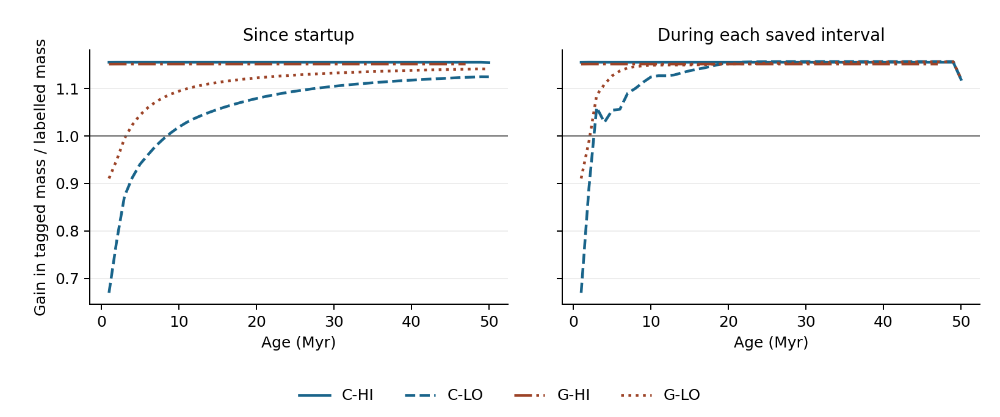

# How much jet-marked mass do the simulations retain?

By 30 Myr, G-HI had gained **4.8522 × 10⁴¹ g of jet-tagged gas** against **4.2134 × 10⁴¹ g** implied by the power and speed on its label, an excess of **15.2%**. The calculation sums mass in the grid without reconstructing the flow at the nozzle. C-HI gives 15.5%. Relative to the more precise continuum mass prescription, the two high-power cases both give 15.6%. The low-power cases accumulate less tagged mass early and approach the same rate later.

This changes the interpretation of the energy discrepancy. G-HI contains extra tagged mass independently of the small-surface energy estimate. A common error in that estimate cannot explain the mass observation. The energy carried by the extra mass across the discrete injector boundary remains unmeasured.
<!-- claims: BND-08 BND-09 BND-10 -->

| Case at 30 Myr | Gain in tagged mass (g) | Labelled mass (g) | Tagged gain / label | Bounds using native cell volumes | Net nozzle mass transported / label, all gas |
| --- | ---: | ---: | ---: | ---: | ---: |
| C-HI | 4.8683 × 10⁴¹ | 4.2135 × 10⁴¹ | 1.1554 | 1.1488–1.1700 | 1.528–1.545 |
| C-LO | 4.6546 × 10³⁹ | 4.2134 × 10³⁹ | 1.1047 | 1.0984–1.1187 | −4.776 to −4.572 |
| G-HI | 4.8522 × 10⁴¹ | 4.2134 × 10⁴¹ | 1.1516 | 1.1451–1.1662 | 1.536–1.555 |
| G-LO | 4.7721 × 10³⁹ | 4.2135 × 10³⁹ | 1.1326 | 1.1261–1.1469 | 0.966–0.996 |

All columns are cumulative from the saved initial state. The last column integrates the outward flux across each of the six original nozzle-control estimates with the trapezoidal rule. Negative values denote net inward transport. Each box exchanges untagged gas as well as material from the jet. The accompanying table gives transport, the change in mass stored inside the control volume, and their sum for all 18 choices of surface and time integration. [Tagged-mass histories](assets/tracer_mass_budget_2026-11-19/tagged_mass_history.csv) · [Nozzle mass in grams and labelled units](assets/tracer_mass_budget_2026-11-19/nozzle_mass_at_30_myr.csv)



Over 10–30 Myr the four cases gain 1.148–1.155 times their labelled interval masses. All four remain above 1.13 even at the conservative lower cell-volume bound for this interval. In the single 29–30 Myr interval the four census estimates span 1.152–1.157. The longer interval provides a stronger check because short-interval differences subtract two much larger inventories. [Interval masses and geometric bounds](assets/tracer_mass_budget_2026-11-19/tagged_mass_intervals.csv)

## What the tracer measures

We use the stored mass fraction in each cell, summing `ρ × tr1 × V` over the whole grid, then subtracting the same sum at startup. Initially 504 cells in the two moving caps are tagged in every case. The high-power labelled mass is `2 × bipolar kinetic power × elapsed time / speed²`, or 1.40450 × 10⁴¹ g per 10 Myr at 0.1c. The low-power rate is one hundredth of that. The continuum density prescription multiplies the labelled rates by 0.999462, 0.999994, 0.996214 and 0.999961 respectively. We use actual saved ages and integrate the prescribed velocity dip where it occurs. [Continuum source rates](assets/nozzle_flux_calibration_2026-11-19/continuum_reference.csv)

In ordinary finite-volume cells PLUTO advances the conserved quantity `ρ × tr1` with an upwind tracer fraction multiplying the numerical mass flux. The retained spherical injector sets density and pressure inside the entire sphere. It sets the tracer to one in the moving caps and to zero in the stationary part. Flagged injector cells have their conservative update suppressed. This maintains a reservoir that can supply tagged mass to its neighbours. The launch setting fixes the velocity of the cap primitives. It does not fix the kinetic energy per gram of the numerical flux across each interface. The source audit matched the problem files, build records and retained executable identities. The historical build did not record a complete source-tree hash.

The 201 accepted snapshots are 0–50 for C-HI, C-LO and G-LO and 0–47 for G-HI. At each epoch we matched the native input, timestep, size, geometry and age to the respective inventory. All 201 independent whole-grid tracer scans found raw extrema of zero and one with no values outside that interval. The fractional weights in the census therefore equal the raw stored tracer. Nineteen separate selected-age extractions reproduce the census masses.

The census inferred cell widths from neighbouring centres. The archived node coordinates give an exact-to-census volume ratio between 0.994328 and 1.012618 for every cell on the production mesh. Since every tagged mass is nonnegative, applying the lower factor at the later epoch and the upper factor at the earlier one gives a rigorous lower bound on the inventory change. Exchanging the factors gives its upper bound.

## Boundary exchange and the earlier 1.57 estimate

The density-weighted tracer inventory can change through the injector or through the outer boundary. Gas entering with zero tracer adds no tagged mass. The outflow boundary condition copies adjacent primitives, so some marked gas could cross the boundary if it reached the outer cells. At 30 Myr the nearest G-HI cell with `tr1 > 0.001` lies 100.96 kpc from a domain face. We used the gross gas flux on each outer active face to bound the tagged part at every saved age. A face untouched by that material gets a maximum tracer fraction of 0.001. A touched face gets the full maximum of one.

Through 30 Myr this permits at most **0.216%** of labelled mass to enter G-HI under any of the three saved-time integration rules. Even combining that allowance with the most adverse cell-volume bound leaves over **14.2%** excess tagged supply in this snapshot accounting. The analogous inflow allowances for C-HI, C-LO and G-LO are 4.34%, 434% and 21.6%. G-HI first reaches a domain face at index 47. These bounds constrain the sampled outer-active diagnostic. Flux between dumps and the exact historical solver-step tracer flux remain unmeasured. [Signed bounds by epoch and time rule](assets/tracer_mass_budget_2026-11-19/sampled_tracer_boundary_integral_bounds.csv)

The 2 November group HI-minus-LO estimate used the total grid mass. At 10 Myr the difference of 2.1763 × 10⁴¹ g comprises 1.6020 × 10⁴¹ g of tagged material and 0.5743 × 10⁴¹ g of complementary gas. The old 1.571 ratio used the whole-grid numerator and a profile-based denominator of 1.3850 × 10⁴¹ g. The tagged difference divided by the labelled HI-minus-LO mass at the two actual ages is **1.152**. The origin of the complementary gas difference remains open. [Paired decomposition at all common selected ages](assets/tracer_mass_budget_2026-11-19/paired_mass_decomposition.csv)

## What happens at the end of the cycle

The final tagged-mass gain per unit of labelled interval mass falls from 1.1554 to 1.1193 in C-HI, 1.1567 to 1.1199 in C-LO and 1.1562 to 1.1204 in G-LO. These are relative drops of **3.12%, 3.18% and 3.10%**. The prescribed velocity dip predicts a **3.18%** reduction in ideal mass supply during the last interval because mass flux scales linearly with velocity. The agreement is visible in the census even though both saved velocities miss the dip.

Ideal kinetic supply scales with velocity cubed. Its predicted shortfall of about 0.0417 labelled interval units is 71% of the measured whole-grid energy decline in C-HI, 67% in G-LO, and **142–180% in C-LO**. The shared mass response supports a change in loading at the end of the cycle. The different energy responses prevent a common causal attribution of the energy drop. [Three-case final energy comparison](three_case_final_interval_2026-11-19.md)
<!-- claims: BND-08 BND-10 -->

## Reproduction

The four-case fluid census, continuum references and final-interval clock are versioned in this repository. The review archive contains the remaining compact inputs and verification scripts. A fresh replay calculates the tagged mass from the original fractional census, joins the six nozzle surfaces under three time rules, and independently checks their sums from individual faces. It also reproduces the two historical HI-minus-LO components and the sampled tracer bounds.

The archive is `turn20_tracer_mass_2026-11-19/tracer_mass_review_r1.tar.gz`, SHA-256 `686ec883df99daa48278cfd280a32a9677d8afa92fc41993b65605d34eac0451`. Extract it under `private_archive/`. From the checkout root, run the replay with a fresh output directory.

```sh
.venv/bin/python private_archive/turn20_tracer_mass_review_r1/replay_review.py private_archive/tracer_mass_replay
```

A fresh restore reproduced all eight published numerical tables byte for byte. The independent face-by-face calculation checked 3,618 nozzle mass estimates. [Nozzle mass ranges at selected ages](assets/tracer_mass_budget_2026-11-19/selected_nozzle_mass_ranges.csv)
