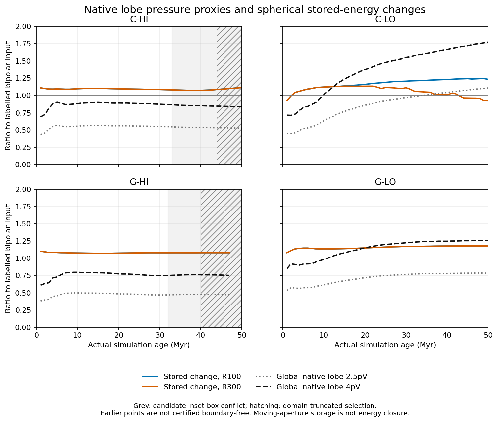
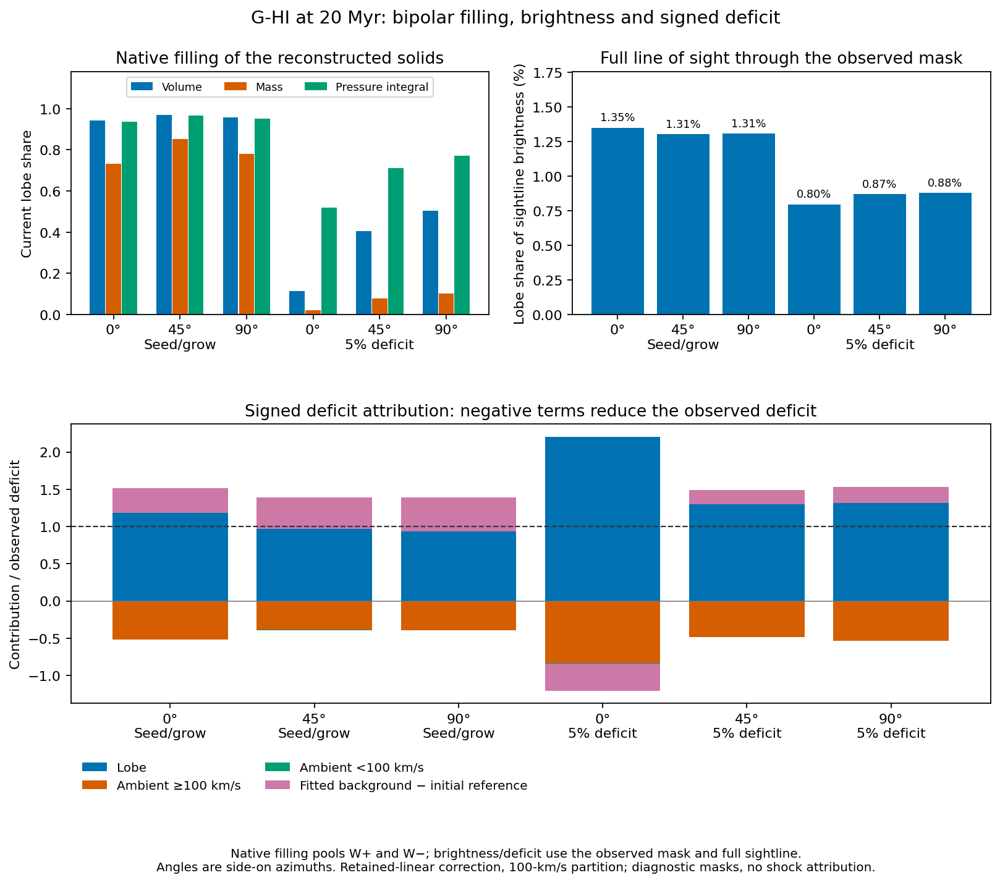

# Four-case energy budgets and G-HI emission/filling review

11 November 2026. Scope: the completed turn-15 outputs, verified saved
identities and independent compact-product arithmetic. These are diagnostic
measurements of four deterministic simulations and one G-HI emission snapshot.
The numerical review passes. The bounded scientific synthesis is recorded as
provisional in NAT-07/NAT-08/XR-03/XR-04 for collaboration adjudication;
observer methods and physical energy closure are not promoted.

The main result is that **knowing the true lobe volume does not turn pV into
a total stored-energy measurement**. The measured relation depends on case,
age and aperture. Separately, **a region can be nearly filled by tracer-defined
lobe cells while most of its projected X-ray brightness comes from other gas**.
The shape of an X-ray deficit therefore depends on ambient brightening and the
background estimate as well as the lobe.

## Verification and its limits

An independent provenance audit accounted for all 847 captured files, exact
committed sources, all 201 output/input/source/time/contract chains, all three
G-HI phase inventories, all compact emission inputs/products and all 24 saved
PNG/PDF renderings. It found no substitution, source drift or inventory failure.
The common native integration sources are byte-identical between the two
staged source commits; G-HI's separate stage adds its accepted lineage binding.

Independent energy reconstruction passed 21,427 scalar checks over 201
snapshots and 402 threshold rows. Maximum scaled residual was 1.96e-15.
The emission review passed 27,750 checks: pixel/component and covered-integral
identities, all attribution and observer rows, reconstruction geometry and
filling-ratio/pooling arithmetic. Twelve original weighted-histogram flags are
retained: their largest absolute area discrepancy is 2.33e-12 kpc2, only
2.06e-16 of selected area, within conservative floating-point forward bounds.
No producer threshold, mask or scientific gate changed.

These checks independently reproduce the arithmetic of the returned products,
not the native HDF5 integrations. Native energy/filling numerator integrals
remain source-bound measurements. The accepted large-restart hash and native
identities were checked through their saved lineage/receipts; native fields
were not rehashed or reintegrated locally. Historical source-to-executable
attestation, realised delivery, aperture transport and production-grid boundary
qualification retain their existing limits.

## True-volume energy comparison

At snapshot 20, actual ages span 19.99911--19.99989 Myr. Both speed apertures
contain every current lobe cell and are geometrically complete in the domain
and candidate inset box. Geometric containment is not a certification that
the production background is quiet. Each table entry below is divided by the
case's labelled bipolar power times its actual age. The component ledger uses
R100; the native pressure proxies use the whole current binary lobe.

| Case | Thermal change | Kinetic change | Gravitational change | Total change | Native 2.5pV | Native 4pV |
| --- | ---: | ---: | ---: | ---: | ---: | ---: |
| C-HI | 0.70117 | 0.37747 | 0.01551 | 1.09416 | 0.55868 | 0.89389 |
| C-LO | 0.97189 | 0.16955 | 0.01784 | 1.15929 | 0.86021 | 1.37634 |
| G-HI | 0.58900 | 0.47876 | 0.00712 | 1.07488 | 0.48375 | 0.77400 |
| G-LO | 0.86179 | 0.27114 | 0.01721 | 1.15014 | 0.71903 | 1.15044 |

The native 4pV proxy is 0.77--1.38 times labelled input at this age. At about
30 Myr, 4pV divided directly by R100 stored change is 0.809, 1.289, 0.694 and
1.047 for C-HI, C-LO, G-HI and G-LO. This comparison cancels the labelled-input
normalization and still differs across cases. All four snapshot-30 apertures
are geometrically complete and inside the candidate inset box. A universal
conversion from current pV to these defined stored-energy changes is therefore
not supported, even before adding X-ray volume-recovery error. Neither
quantity is a measured total of delivered jet energy. <!-- claims: NAT-07 -->

Current ambient cells contribute about 72%, 98%, 54% and 82% of R100's signed
storage change at 20 Myr. These are Eulerian current-region shares, not
Lagrangian deposition efficiencies. The group cases have larger kinetic and
smaller thermal terms than the corresponding cluster cases at 20 and 30 Myr;
there is one realisation per case. <!-- claims: NAT-07 -->

Grey marks conflict with the candidate inset box; hatching marks a
geometrically truncated sphere. G-HI stops at retained index 47. The unshaded
intervals are not certified boundary-free. Curves preserve the raw aperture
measurements and do not subtract a coarse boundary estimate.

### Aperture and sign counterexample

C-LO at 50 Myr has R100 = 80.936 kpc and R300 = 72.859 kpc, both complete and
unclipped. Total stored changes are 1.232527 and 0.924874 labelled-input units:
the intervening ambient shell contributes 0.307653, about 25% of R100's total.
Both apertures contain the entire current lobe. The current cocoon change is
-0.159984 input units, while global native 4pV is +1.771924 input units.
The cocoon terms are thermal -0.033002, kinetic +0.070987 and gravitational
-0.197969. These signs are consistent with the definitions. <!-- claims: NAT-08 -->

pV is an absolute current pressure integral. The ledger subtracts initial
energies in the cells currently labelled cocoon; its gravitational term uses
the specified centre-zero fixed potential. Their difference cannot simply be
called missing jet energy, and a negative cocoon change is not evidence of
negative injected energy or failed arithmetic.

Disturbed ambient gas lies outside the speed apertures, including in every
positive-age low-power snapshot. The compact outputs do not measure that
omitted energy or establish its cause. Late high-power apertures also exceed
the geometry limits: candidate-inset conflicts start at C-HI/33 and G-HI/32;
domain truncation starts at C-HI/44 and G-HI/40. Late inset clipping removes
some lobe material, so it is not an adopted physical correction. G-HI 48--50
remain excluded. <!-- claims: NAT-08 -->

## G-HI filling and projected emission

The emission snapshot is at 19.999614 Myr. All angles below are **side-on
azimuths**, not jet inclinations. Lobe membership is the full-cell binary
criterion tr1 > 1e-3; the shares are not microscopic pure-jet fractions.
Filling pools the numerators and denominators of separate W+ and W-
reconstructions, rather than taking their union or averaging fractions.
The emission tables and figure below use bipolar totals; individual-lobe and
separate W+/W- results remain in the reviewed products.

| Azimuth | Retained diagnostic outline | Lobe volume share | Lobe mass share | Lobe pressure-integral share | Recovered volume / native lobe volume |
| --- | --- | ---: | ---: | ---: | ---: |
| 0 deg | Seed/grow | 94.34% | 73.11% | 93.66% | 0.678 |
| 45 deg | Seed/grow | 97.03% | 85.37% | 96.62% | 0.493 |
| 90 deg | Seed/grow | 95.63% | 78.11% | 95.06% | 0.622 |
| 0 deg | 5% deficit | 11.32% | 2.20% | 51.78% | 3.981 |
| 45 deg | 5% deficit | 40.37% | 7.68% | 71.15% | 1.019 |
| 90 deg | 5% deficit | 50.47% | 10.17% | 77.09% | 1.089 |

Thus near-unity recovered volume at 45/90 degrees can hide a reconstructed
region that is only 40--50% lobe cells by volume. Seed/grow selects much more
lobe-dominated solids but still misses substantial projected lobe area.
Native filling, projected purity and recovered/global volume are different
metrics. The three azimuths are views of one simulation, not independent
replicates. <!-- claims: XR-03 -->

Only about 1.3% of full-line-of-sight brightness within the seed/grow masks
comes from lobe cells (about 0.8--0.9% within the 5% masks). Nevertheless the
lobe supplies most of the positive initial-minus-current deficit. At the
100-km/s partition, lobe deficit / observed deficit ranges 0.93--2.20 across
the retained masks. Moving ambient contributes -0.39 to -0.84: it brightens
and partly hides the lobe deficit. The fitted-background-minus-initial term is
also substantial, including a sign change between outlines at 0 degrees.
The signed terms sum to the observed deficit; the attribution ratio is not
bounded by one. <!-- claims: XR-03 XR-04 -->

The entire native box actually brightens by 3.50% in the same-cell emissivity
comparison. Local positive cavity deficits coexist with this global increase.
This is not a shock-energy measurement or an evolved no-jet counterfactual.

### Background and correction sensitivities

With retained-linear correction and the 100-km/s partition, replacing
moving-ambient emissivity with its initial same-cell value makes more lobe
sightlines detectable. Holding the original background fixed can
also greatly enlarge false selections: at 0 degrees seed/grow completeness
rises to 0.934 while purity falls to 0.421, and recovered volume reaches 5.37
times native lobe volume. Refitting the background instead gives projected
completeness 0.75--0.82 and purity approximately one across the two comparators
and three views. This remains a diagnostic experiment, still missing about
18--25% of projected lobe area; the new outlines have no newly integrated
native filling values. Neither comparator is promoted. <!-- claims: XR-04 -->

The conclusions survive 30/100/300-km/s partitions and both retained-linear
and coordinate-clamped correction policies. Between correction policies,
fixed-mask deficits change by at most 0.04161%, and recovered volumes by at
most 0.7196% across all observer rows. Changing the velocity cut produces at
most about 1.14% relative replacement-volume change. These sensitivities are
much smaller than the background/refit effect here. They quantify agreement
of two correction conventions, not proof that either is physically correct.
<!-- claims: XR-04 -->

The qualifications are item-specific. Around 14.68% of current cells are
outside the emissivity table, and 192,184 have negative retained-linear
emissivity. No nonfinite output is present. Within the diagnostic masks,
out-of-table absolute brightness from both epochs contributes at most 1.952%
of the observed-deficit scale, and retained-negative contribution at most
1.243e-7 of that scale. Uncovered whole-brightness fractions are at most
2.65e-6, with 30 tracer-mask pixels disagreeing at 90 degrees (0.0283% of
projected tracer area). Native reconstruction volume mismatch is below
0.020%, with no reconstruction truncation or C/A domain-face contact.
These quantify the retained holds without rewriting them as passes.

Almost 89% of the volume of tracer-negative gas with at least 1% density or
pressure change moves slower than 30 km/s. The below-cut external component
must not be called physically static, and moving ambient is not itself proof
of irreversible shocks or jet causation. <!-- claims: XR-04 -->

## What this changes

The first paper comparison can now show resolved thermal/kinetic/gravitational
storage and native-lobe pressure proxies without X-ray volume error. The
second layer must then treat recovered volume and background/brightness
selection explicitly; apparent volume agreement can be accidental. Clock and
age-to-power errors remain a separate later layer. The canonical article and
brief are not rewritten by this review, and the observer-method gate remains.

The highest-value next accounting measurement is realised nozzle delivery plus
transport, with production-boundary qualification still required before any
closure inference. For the observer side, adjudicate these bounded results
with the collaboration before selecting a new background or detector rule.
Do not retune the retained comparators to these tracer truths.

## Evidence and reproduction

Compact tables and figure receipts are in
`assets/turn15_review_2026-11-11/`. The raw captures, map NPZ files, independent
review scripts and detailed check traces are retained outside Git in the
project archive. See that asset directory's README for hashes and commands.

The integration and three independent checks used **Codex GPT-6.1 Sol**.
The provenance reviewer checked source/input/output identity; the energy
reviewer reconstructed compact scalar arithmetic; the emission reviewer
reconstructed pixel/table identities and histogram roundoff bounds. The parent
cross-checked key numbers against the independent tables and inspected the
rendered figures. Same-family independent checks are not cross-model review.
