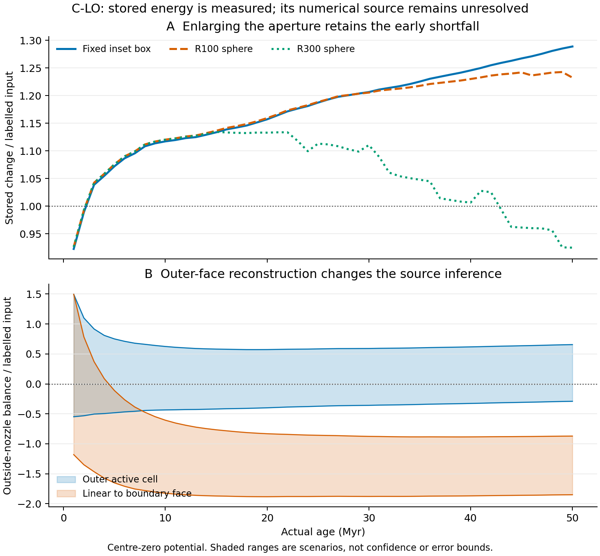

# C-LO full accounting history: early shortfall, late excess, unresolved source

16 November 2026, Codex (GPT-6), with independent Codex provenance and flux
reviews. Both C-LO accounting jobs completed successfully with all 51
snapshots from index 0 through 50. The history establishes signed storage
inside several regions; it does not locate the numerical source or measure
realised solver delivery. Claims NAT-10 and BND-07 remain provisional.

## Enlarging the aperture does not rescue the early prediction

Stored-energy change divided by labelled bipolar input, in the declared
fixed centre-zero potential:

| Approximate age (Myr) | Fixed 50-kpc-inset box | R100 | R300 | Fixed box minus R100 |
| --- | ---: | ---: | ---: | ---: |
| 1 | 0.922559 | 0.926351 | 0.926268 | −0.003792 |
| 2 | 0.988872 | 0.992672 | 0.992654 | −0.003800 |
| 10 | 1.117172 | 1.120353 | 1.120264 | −0.003181 |
| 20 | 1.157066 | 1.159289 | 1.132947 | −0.002223 |
| 30 | 1.206441 | 1.205446 | 1.110466 | +0.000996 |
| 40 | 1.245613 | 1.230038 | 1.006475 | +0.015574 |
| 50 | 1.288860 | 1.232527 | 0.924874 | +0.056333 |

R100/R300 are complete and contained in the fixed box throughout this C-LO
history. Therefore the last column is the signed storage in the added region.
At 1 Myr it is negative: moving from R100 to the larger box decreases the
ratio to 0.92256. The early C-LO prediction remains failed, and the proposed
explanation that this shortfall was energy missed outside the sphere is not
supported by enlarging to this fixed box under the declared convention.
Positive and negative omitted contributions could coexist; the measured net
addition is what this test addresses.
<!-- claims: NAT-10 -->

At 50 Myr the added region is positive, contributing 0.05633 labelled-input
units. Fixed-box storage is then 28.89% above the label, compared with R100's
23.25%. The whole grid holds 23.97580 labelled-input units, most of it outside
the fixed box. These are stored-energy measurements, not delivered-energy
lower bounds or an injection-efficiency correction. The primary enthalpy
convention remains 2.5pV.
<!-- claims: NAT-10 -->

## Mass and operational coverage accompany the energy history

The complete regional initial/current/delta mass ledger is in the
[compact evidence](assets/turn18_clo_review_2026-11-16/README.md). At 50 Myr,
R100 has net mass change −2.10110e41 g: −4.01206e42 g in current cocoon cells
and +3.80195e42 g in current ambient cells. Its ambient share of total signed
storage is 112.98% in the centre-zero potential and 123.42% after the
illustrative +1e15 cm²/s² potential shift. These are convention-dependent
signed contributions on current masks applied to initial/current same cells,
not Lagrangian deposition fractions.
<!-- claims: NAT-10 -->

Current cocoon and speed-at-least-100-km/s cells remain inside the box at all
51 snapshots. Speed-at-least-30-km/s containment first fails at index 26;
thermodynamic changes of at least 1% first fail containment at index 5. Both
failing masks then include cells touching domain faces. These operational
flags are retained rather than silently discarding the late measurements.
They neither identify a causal jet front nor certify that the production
interior is free of boundary effects. The coarse no-jet bounds remain
reference evidence rather than a newly validated production-grid error bar.

## Full flux histories still do not localise the excess

The cumulative energy source inferred from snapshots is stored change plus
integrated outward face transport. At 50 Myr, the two outer-face
reconstructions subtract approximately 22.68 or 24.23 labelled-input units
of boundary inflow from approximately 23.98 units of whole-grid storage.
With trapezoidal time integration:

| Outer-face reconstruction | Inferred whole-grid source / label | Nozzle-control source / label | Outside-nozzle balance / label |
| --- | ---: | ---: | ---: |
| Outer active cell | +1.292977 | 1.103521–1.116600 | +0.176377–+0.189456 |
| Linear to boundary face | −0.250570 | 1.103521–1.116600 | −1.367171–−1.354092 |

The outer reconstruction alone changes the inferred source by **1.54355
labelled-input units**. Across all reconstruction, padding and time-quadrature
scenarios, the outside-nozzle balance spans **−1.85036 to +0.65619** units.
The last interval also retains time-quadrature sign ambiguity, so the full
history's difficulty is not solely the initial unsaved startup trajectory.
The large boundary subtraction is insufficiently constrained to identify
numerical heating outside the nozzle.
<!-- claims: BND-07 -->

The nozzle-control cumulative inferred source is less sensitive: 1.092215–
1.128000 labelled-input units across the scenarios at 50 Myr. This is a
reconstructed control-volume balance, including storage and thermal, kinetic
and potential transport against a labelled kinetic-power reference. It is
not direct nozzle-overwrite power, a discrete Riemann flux, or proof that a
particular source term supplies the extra energy. Neither a universal
delivered-energy rescaling nor categorical nozzle exclusion follows.
<!-- claims: BND-07 -->

Top: fixed-box and speed-defined spherical storage, normalized by labelled
input, retain the early shortfall and diverge late. Bottom: separate
outer-reconstruction envelopes across time quadratures and nozzle variants.
Shading shows sensitivity scenarios, not confidence intervals or certified
error bounds. Initial index 0 is retained in the data; its input-normalized
ratios are undefined and are not plotted.

## Verification and current execution

The fixed reduction passes **11,511** compact arithmetic, mass/gauge,
partition, containment and older R100/R300 comparisons. Maximum old-component
difference is 2.46e-16 labelled-input units; the index-20 product is
byte-identical to the accepted pilot. The flux audit independently reconstructs
**140,640 scalar checks plus 15 hash checks**, covering 2,856 face-flux rows,
816 regional-storage rows, 1,200 interval balances and 1,800 outside-nozzle
balances. A further **306** cross-reduction comparisons reconcile whole-grid
storage within 2.02e-10 labelled-input units. Provenance acceptance passes
**20,393** checks, including all 132 captured files and 110 completion products.

The direct first-pass flux audit's 122 small cumulative mass-residual flags
are preserved. Its largest discrepancy is 9.91e27 g, from comparing sequential
producer accumulation with independent fsum after strong cancellation.
Standard gamma summation and final-rounding propagation bounds account for
every flag; no producer value or gate was changed. The final audit passes.

Jobs 879902/879903 finished F/0 in 05:44:31/03:04:11. At **21:16:49 AEDT on
16 November**, 879904 (G-HI fixed) was queued and 879905–879909 were dependency-
held. Their serial dependencies and completion/abort email settings still
match. No job was resubmitted or added during this review. The other three
case histories and the frozen emission cohort remain pending and unscored
respectively.

Native HDF5 fields were not independently rehashed or reintegrated locally;
source/contract and saved-receipt identities remain the native provenance.
Historical executable attestation, actual solver-step delivery, separate
gravity/floor/repair terms and a production-grid boundary control remain
outside these checks. This is a C-LO result, not a four-case conclusion.
The claims, guide, README and handover carry the update; the article and brief
are not revised by this partial-history acceptance.
